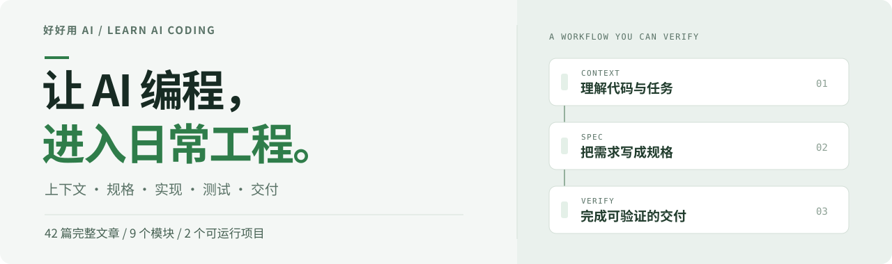

# 程序员 AI Coding 进阶实战

<p align="center">
  <a href="https://daviddingxu.github.io/learn-ai-coding/"></a>
</p>

<p align="center"><a href="https://daviddingxu.github.io/learn-ai-coding/"><strong>开始阅读 →</strong></a> &nbsp;·&nbsp; <a href="docs/course/README.md"><strong>完整目录</strong></a> &nbsp;·&nbsp; <a href="#动手实践"><strong>动手实践</strong></a></p>

<p align="center"> </p>

在真实代码库里，用 AI 完成需求、设计、实现、测试与交付。把一次次临场对话，变成有规格、有边界、有验证的开发流程。

## 适合谁学

适合已经具备编程、Git 和测试基础，希望用 Codex、Claude Code 等工具处理真实项目的开发者。课程从 Agent 的工作机制讲起，逐步进入上下文工程、规格驱动开发、调试、审查与交付；仓库包含完整正文、配图、源码、测试和实战过程记录。

## 学完能做什么

- 让 Agent 接手陌生代码库，给出有文件依据的代码地图与任务上下文。
- 把模糊需求写成规格、设计和小任务，用 OpenSpec 控制存量系统的行为变更。
- 用测试、调试证据和代码审查判断交付结果，再将有效做法沉淀为规则、Skill 与工具。

## 课程路线

| 模块 | 内容 | 学习重点 |
| --- | --- | --- |
| 00 | [导读与学习地图](docs/course/README.md#module-00) | 明确目标，选择第一条实践路线 |
| 01 | [AI Coding 底层心智](docs/course/README.md#module-01) | Agent 工作模型、任务选择与人的职责 |
| 02 | [程序员工具工作台](docs/course/README.md#module-02) | Codex、Claude Code、IDE 与 CLI 的组合使用 |
| 03 | [上下文工程与代码库理解](docs/course/README.md#module-03) | 代码地图、搜索、仓库规则与上下文清理 |
| 04 | [SDD 与 OpenSpec 实战](docs/course/README.md#module-04) | 需求、设计、任务拆分与变更管理 |
| 05 | [小步开发、测试与调试](docs/course/README.md#module-05) | 小 diff、TDD、排障与前后端验证 |
| 06 | [Skill、Superpowers 与工作流](docs/course/README.md#module-06) | 可复用流程、MCP、只读工具与多 Agent |
| 07 | [综合实战与资产沉淀](docs/course/README.md#module-07) | 从一次真实需求走到交付和复盘 |
| 08 | [个人工程资产](docs/course/README.md#module-08) | 维护自己的规则、案例与验证记录 |

第一次学习建议按顺序阅读；已经在项目中使用 AI 的读者，可以从上下文、OpenSpec 或测试调试模块进入。每篇正文均可跳转前后章节和对应实践。

## 动手实践

| 项目 | 你会做什么 | 包含内容 |
| --- | --- | --- |
| [个人效率助手](personal-productivity-app/README.md) | 实现逾期任务顺延、优先级与每日容量约束 | 交互页面、业务规则、OpenSpec 变更包与测试 |
| [AI Coding Workflow Kit](ai-coding-workflow-kit/README.md) | 生成代码地图、整理上下文、检查验证记录 | 仓库 CLI、只读工具、命令测试与过程记录 |

准备 Node.js 20 或更高版本，先运行个人效率助手：

```bash
git clone https://github.com/DavidDingXu/learn-ai-coding.git
cd learn-ai-coding/personal-productivity-app
npm test
npm run dev
```

打开 <http://127.0.0.1:4173>，调整每日容量，观察任务进入今日计划或顺延列表；再修改一条业务规则，对照规格和测试检查结果。macOS 与 Windows 使用相同命令。

## 交流与许可

欢迎通过 [Issue](https://github.com/DavidDingXu/learn-ai-coding/issues) 反馈文章或实践问题，提交改进前请阅读 [贡献指南](CONTRIBUTING.md)。

- 文章、图示与课程文档：[CC BY-NC-SA 4.0](https://creativecommons.org/licenses/by-nc-sa/4.0/)，署名、非商业使用、相同方式共享。
- 示例代码、脚本与网站代码：[PolyForm Noncommercial 1.0.0](LICENSE)。

商业使用需另行授权；具体范围与第三方内容说明见 [许可说明](LICENSING.md)。
