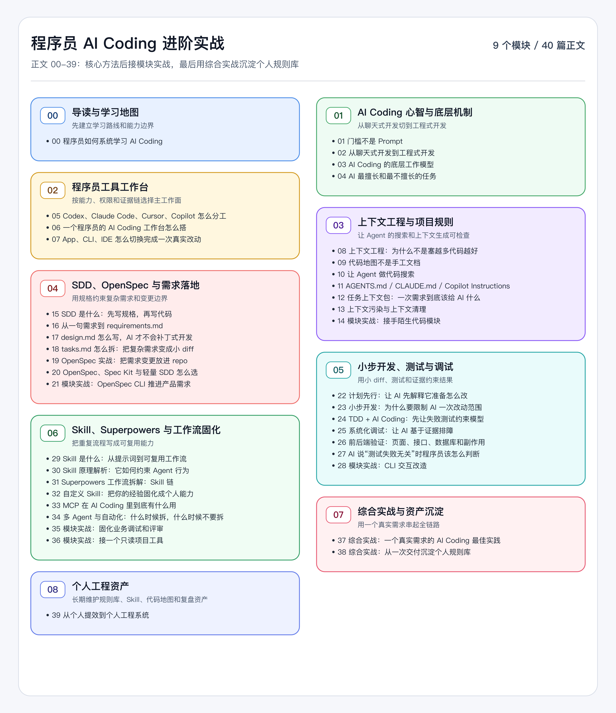

# 程序员 AI Coding 进阶实战

副标题：真实代码库里的 AI Coding 工作流

很多程序员已经开始用 AI 写代码，但真实项目很快会把问题暴露出来。

AI 能补一个函数，却不一定理解业务边界；能生成一组测试，却不一定测到关键路径；能解释一段报错，却可能忽略改前基线；能一次改很多文件，但谁来证明这些改动可审查、可回滚、可上线？

这里不讲 Prompt 技巧，也不做工具测评。问题收在一个地方：

> 如何把 AI 放进真实开发工作流，而不是停留在聊天窗口里。

## 为什么写这个专栏

AI Coding 的门槛看起来降得很低。装一个工具，打开仓库，描述需求，几分钟就能看到代码变化。

真正麻烦的是代码出来以后。

AI 读了哪些文件？有没有漏掉测试？它改的那一段是不是绕过了原来的业务规则？失败测试到底是历史问题，还是这次改动引入的回归？一个看起来“已经完成”的 diff，能不能交给同事 review，能不能回滚，能不能进 CI，能不能解释给未来的自己？

这些问题不是多背几个 Prompt 就能解决的。

程序员缺的不是更多工具名词，而是一套能放进日常开发的工作方法。它要能回答很细的问题：什么时候可以直接让 AI 改，什么时候必须先写规格；上下文给到什么程度刚好；怎么让一次改动小到可审查；测试失败时怎么分类；什么时候需要 Skill、OpenSpec、Superpowers、MCP 或多 Agent；哪些经验应该写回规则文件，哪些只该留在任务记录里。

这也是这个专栏要解决的问题：让 AI 参与真实开发时，所有关键判断都能落到需求、文件、diff、测试和验证证据上。

## 专栏讲什么

这是一套面向程序员的 AI Coding 进阶内容。

它不会从“什么是终端”“怎么安装 Node”开始讲。这里默认你已经会写代码，理解 Git、测试、接口、工程目录、命令行和代码审查。我们要处理的是更真实的问题：

- 一个陌生项目，AI 应该先读哪些文件？
- 一个复杂需求，能不能直接让 AI 开改？
- AI 生成了大 diff，怎么判断有没有越界？
- 测试失败时，怎么区分历史问题和本次回归？
- `AGENTS.md`、`CLAUDE.md`、Skill、OpenSpec、外部工具接入这些东西到底解决什么问题？
- 多 Agent、插件和自动化什么时候值得上，什么时候只会增加复杂度？

主线不会按工具清单展开，而是按一次可靠的 AI Coding 改动展开：

```text
任务判断 -> 工具选择 -> 上下文侦察 -> 规格或计划 -> 小步实现 -> 测试和验证 -> diff 审查 -> 经验沉淀
```

围绕这条主线，专栏会讲工具工作台、上下文工程、SDD 规格驱动开发、OpenSpec、测试与调试、代码审查、Skill/插件机制、多 Agent、外部工具接入和个人工程资产沉淀。结构上不是先讲一堆理论、最后再集中实战，而是每个核心方法后面接一个模块实战，最后再用一个端到端需求串起来。

业务主线会用个人效率助手这类产品需求展开。配套工程放在 [DavidDingXu/learn-ai-coding](https://github.com/DavidDingXu/learn-ai-coding)，里面拆成业务 module 和工具 module；过程材料会保留任务卡、上下文侦察、规格、计划、实现范围、验证记录、审查风险和复盘结论。命令输出会作为验证证据出现，但读者看到的是一次需求从进入仓库到交付复盘的完整过程。

整体路线如下。



这张图不是要求你把所有工具一次学完。它只是把 AI Coding 放回真实开发链路里：先判断任务风险，再决定上下文、规格、实现、验证和沉淀方式。每个模块都要落到一个真实动作，工具可以换，控制点不能丢。

## 适合谁看

适合已经有工程经验的程序员。

如果你经常维护老项目、改复杂需求、查线上问题、补测试、做代码审查，或者已经在用 AI 写代码但觉得结果不稳定，这类内容会更适合你。

更具体一点，适合这些情况：

- 你已经会写代码，但不满足于让 AI 只补全函数或生成样板代码。
- 你想把 AI 用到真实仓库里，而不是只做一次性 demo。
- 你关心 diff 是否可审查、测试是否可信、失败是否可复现、交付是否能解释。
- 你已经用过 Codex、Claude Code、Cursor、GitHub Copilot 等工具，但还没有形成稳定工作流。
- 你想理解 OpenSpec、Skill、MCP、多 Agent 这些东西什么时候有用，什么时候只是增加复杂度。

如果你刚开始学开发，也可以跟着看，但需要愿意一边补基础一边动手：至少准备一个真实仓库，熟悉 Git 的基本操作，能跑测试或本地服务，能看懂接口、数据库、工程目录和命令行输出。专栏不会从这些基础概念讲起，但会告诉你它们在 AI Coding 流程里为什么重要。

## 如何学习这个专栏

不要从工具名词开始学。先从任务判断开始。

第一步，先理解 AI Coding 的边界。什么任务可以让 AI 直接做，什么任务只能让它辅助分析，什么任务必须先写清规格和验证方式。这个判断不清楚，工具越多越容易乱。

第二步，搭好自己的工作面。CLI、IDE、App、浏览器、Git 都能参与 AI Coding，但它们不是按“谁更高级”来分工，而是按权限、反馈和证据来分工。能访问仓库、改文件、跑命令并留下证据的工作面可以承接主流程；IDE、浏览器、终端和 App 按审查、debug、用户路径和材料整理的缺口补位。

第三步，重点练上下文工程。真实项目里，AI 出错常常不是因为不会写代码，而是因为读错文件、漏掉规则、带着旧假设，或者把无关上下文混进来。代码地图、项目规则、任务上下文包和上下文清理，都是为了让 Agent 的判断可检查。

第四步，再进入规格驱动和复杂需求拆解。简单文案和小 bug 不需要上重流程；但跨模块、跨接口、有兼容规则的需求，需要把“要做什么、为什么这样做、分几步做、怎么验证”写成更硬的合同。

第五步，用测试、调试、审查和复盘收口。不要接受“已经修复”这种结论，要看 baseline、命令、输出、截图、接口响应、diff 和剩余风险。一次任务结束后，再决定哪些经验写进规则文件、Skill、脚本或检查清单。

如果你已经在真实项目里用 AI，可以边看边改自己的工作流。先从三个动作开始：让 AI 列出它实际读过的文件；让每次改动都有明确验证命令；让完成报告包含改了什么、怎么验证、还有什么风险。

## 常见问题

**这里只讲 Codex 吗？**

不是。Codex 适合说明贴近仓库、命令、diff 的 Agent 工作流，但它不是唯一答案。Claude Code、Cursor、GitHub Copilot、OpenSpec、Spec Kit、Superpowers、Skill、MCP 都会回到同一个判断：它解决什么工程问题，权限边界在哪里，验证证据怎么留下来。

**个人程序员需要学 OpenSpec、Superpowers、MCP 吗？**

不需要一上来都学。先掌握任务判断、上下文、计划、小 diff、测试和验证。OpenSpec 适合复杂需求，Superpowers 适合把流程固化成 Skill，MCP 适合受控接入外部资源。它们是工具箱，不是入门门槛。

**和团队 AI Coding 工程化有什么区别？**

重点不同。团队工程化会关注平台、权限、成本、指标和组织协同；这里关注个人开发者如何在自己的真实仓库里稳定交付。个人工作流会借鉴团队工程里的控制点，但不会把组织流程当成主线。

**如果项目没有测试，还能用这套方法吗？**

能，但不能假装已经验证。没有自动测试时，要写清手动验证路径、接口调用、日志检查或浏览器截图。后续再逐步把高风险路径补成自动化测试。

**这个专栏是否付费？**

免费。专栏正文、配套代码和可公开的过程材料都会开放出来，你可以直接按文章和仓库里的 module 跟做。

**会有配套工程和代码吗？**

会有，但代码不是为了凑 demo。配套代码仓库是 [DavidDingXu/learn-ai-coding](https://github.com/DavidDingXu/learn-ai-coding)。业务 module 会围绕个人效率助手里的今日计划、逾期顺延、容量限制这类产品需求展开；工具 module 会服务代码地图、上下文审计、任务上下文包、验证记录、只读工具边界、CLI 合同改造等能力。配套资料里会保留需求过程记录，方便你看到一个需求从进入仓库到验证、审查、沉淀规则的完整路径。你不一定要照搬这些 module，但应该能把背后的控制点迁移到自己的仓库里。

**为什么一直强调证据，会不会太重？**

证据不是长文档。一次小改动的证据可以只是 `git diff`、一个 focused test、一个接口响应或一张截图。真正重的是 AI 误改后清理大 diff、解释线上问题、回滚混乱改动。

AI Coding 的价值，不是让程序员少看代码，而是让程序员把更多时间放在判断、边界、验证和交付质量上。

如果 AI 参与的每一次改动都能回到需求、上下文、diff 和验证证据上，它才真正进入了你的工程工作流。

---

[课程首页](../../../README.md) · [完整目录](../README.md) · [程序员如何系统学习 AI Coding →](00-%E7%A8%8B%E5%BA%8F%E5%91%98%E5%A6%82%E4%BD%95%E7%B3%BB%E7%BB%9F%E5%AD%A6%E4%B9%A0-AI-Coding.md)

动手实践：[业务实践入口](../../../personal-productivity-app/README.md)
