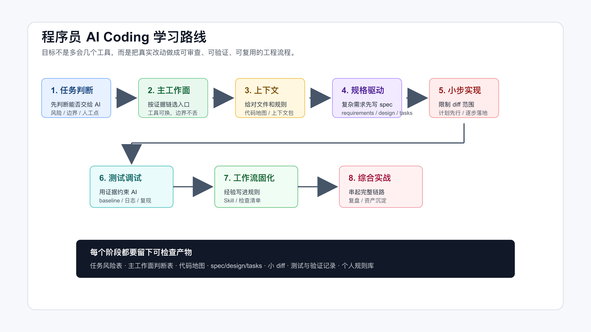

# 程序员如何系统学习 AI Coding

如果你已经会写代码，第一次认真把 AI 放进真实项目里，大概率会遇到一个反差。

它确实很快。

补一个函数、解释一段报错、生成一组测试、照着已有代码仿一个实现，很多时候几分钟就能看到结果。可一旦任务稍微真实一点，问题也会马上出现：它读了哪些文件？有没有漏掉关键入口？为什么改到不相关模块？测试失败到底是旧问题还是新回归？一段看起来能跑的代码，能不能进 review、进 CI、进生产？

这些问题不是多背几个 Prompt 就能解决的。

程序员学习 AI Coding，真正要学的不是“怎么把一句话说得更像魔法咒语”，而是怎么把 AI 放进自己的工程流程里。让它能帮你读代码、拆需求、写实现、跑验证、整理证据，同时又不能越过你设定的边界。

先从一个普通程序员每天都会遇到的问题开始：

```text
我手上有一个真实代码库，有一个真实需求。
我想让 AI 帮忙，但不能让它乱改。
我该怎么开始？
```

## 先把目标说清楚

系统学习 AI Coding，不是把所有工具都学一遍。

Codex、Claude Code、Cursor、GitHub Copilot、OpenSpec、Spec Kit、Superpowers、MCP、Skill、Plugin，这些名字会不断变化。工具值得学，但不能按工具名组织自己的能力。否则每出一个新入口，你都要重新焦虑一次。

更稳定的学习目标应该是这几个：

- 能判断一个任务适不适合交给 AI。
- 能让 AI 读对上下文，而不是凭感觉猜。
- 能把复杂需求拆成可审查的小 diff。
- 能用测试、页面、接口、日志和 diff 证明结果是真的。
- 能把反复有效的流程沉淀成规则、脚本或 Skill。

AI Coding 的核心不是“AI 会不会写代码”，而是“你能不能控制一次 AI 参与的工程改动”。

这套能力一旦建立起来，工具可以换，流程不会塌。

## 为什么不能只靠 Prompt

很多失败看起来像 Prompt 写得不好，实际不是。

比如你让 AI 改一个“今日计划自动纳入逾期任务”的需求。它可能很快写出函数，也可能顺手加页面、接数据库、做提醒、改排序规则。代码都像那么回事，但需求边界已经被它扩大了。

再比如你让 AI 修一个 CLI 交互问题。它修了输出文案，却没有注意 stdout、stderr、exit code 和 README 示例命令也是用户可见合同。测试可能绿了，真实用户路径仍然坏着。

还有更常见的：你让 AI 接手一个陌生模块，它说“我理解了项目结构”，但没有列出自己实际读过哪些文件；它总结得很顺，可入口、测试、生成目录、历史兼容逻辑都没核对。这个时候继续让它实现，风险已经埋下了。

所以 Prompt 只是入口。

真实项目里更重要的是这些东西：

```text
任务边界
上下文证据
实现计划
小步 diff
测试基线
验证结果
代码审查
规则沉淀
```

你可以把它们理解成程序员给 AI 装上的护栏。护栏越清楚，AI 越像一个可用的工程助手；护栏越模糊，AI 越容易变成一个很快的随机改代码机器。

## 这和工具教程有什么不同

很多 AI Coding 内容会从工具入口开始讲：

```text
这个按钮怎么用。
这个命令怎么跑。
这个模型怎么选。
这个 Prompt 怎么写。
```

这些东西当然有用，但它们不是程序员最容易卡住的地方。

真正卡住你的，往往是工具已经会用了，代码也生成了，但你不知道该不该接受它。

比如 Agent 给你改了 6 个文件。它说“我已经完成并通过测试”。你打开 diff，发现里面有一段你没要求的重构。它解释说这是为了提高可读性。这个时候你要判断的不是 Prompt 够不够好，而是：

```text
这段重构是否属于当前需求？
有没有改变外部行为？
测试能不能覆盖这个变化？
如果线上出问题，能不能单独回滚？
reviewer 能不能在一次审查里看懂？
```

这些判断靠工具教程解决不了。

再比如 AI 搜索项目后告诉你：“核心逻辑在 service 层，测试覆盖比较完整。”这句话听起来很专业，但如果它没有列出实际读取的路径，没有说明哪些测试覆盖哪些行为，没有说它排除了哪些 legacy、demo、generated 目录，你仍然只能相信它。

当工具已经能生成结果以后，真正要补的是判断结果是否可靠。很多关键动作看起来并不炫：

```text
先看 git status。
先让 AI 列出读过的文件。
先跑改前基线。
先限制 diff 范围。
先写清不做什么。
完成前重新跑验证。
review 先看行为风险。
```

这些动作不新，但它们决定 AI Coding 能不能进入真实项目。

## 可靠改动要经过哪些控制点

先把一次可靠改动拆开看。



这几个控制点不要求一次学完，但每次真实改动都绕不开。

第一步是任务判断。

不是所有需求都应该直接交给 AI 写代码。改文案、补测试、生成脚本、解释报错，和跨模块业务需求、数据修复、线上故障，风险完全不同。任务类型不同，授权边界就不同。

第二步是选择工作面。

IDE 补全、CLI Agent、App、浏览器、终端、Git 都能参与 AI Coding，但它们不是按“哪个更高级”分工。能读仓库、改文件、跑命令、留下验证证据的工作面，更适合承接主流程；浏览器适合验页面，Git 适合审 diff，App 更适合预览、长任务管理、异步审查和材料整理。

第三步是上下文工程。

AI 会读文件，但你不能只听它说“我看过了”。你要让它列出实际读取过的路径、判断哪些入口相关、哪些目录不能碰、哪些测试要跑、哪些结论还没有证据。

第四步是规格和计划。

简单任务可以轻量计划，复杂需求要写清需求、设计、任务和验证方式。重点不是文件名，而是把“意图”从聊天窗口搬进仓库，让人和 AI 都能复查。

第五步是小步实现。

AI 很容易一次改太多。真实项目里，更好的做法是让它按小任务推进，每一步都能解释改了哪些文件、为什么改、怎么验证。

第六步是测试和调试。

不要接受“已经修复”这种口头结论。要看改前能不能复现，改后跑了什么命令，失败怎么分类，用户可见行为有没有验证。

第七步是工作流固化。

如果你反复提醒 AI 同一件事，就应该把它写进 `AGENTS.md`、`CLAUDE.md`、Skill、脚本或检查清单。规则不是为了显得专业，而是为了少犯重复错误。

最后是综合实战。

所有方法都要回到真实需求里。否则学完上下文、spec、TDD、review、Skill，还是不知道一个需求从进入仓库到交付复盘应该怎么串起来。

## 先从一个真实仓库开始

如果你想跟着学，不需要先准备一个大项目。

一个你熟悉的小仓库就够了。它最好满足几个条件：

```text
能运行。
有基本测试或手动验证路径。
目录结构不是完全空白。
最近确实有一个小需求或小 bug。
你能判断 AI 的结果对不对。
```

不要一开始就拿线上高风险任务练。也不要只拿一次性 demo 练。demo 太顺，学不到边界；线上任务太重，容错空间太小。

比较合适的第一批任务是：

- 给 CLI 补一个用户可见错误提示。
- 给一个函数补边界测试。
- 让 AI 接手一个陌生模块但先不改代码。
- 修一个能稳定复现的小 bug。
- 给一个页面改轻量交互，然后用浏览器验证。

这些任务不大，但足够暴露真实问题：AI 是否读对文件，是否改到无关位置，是否知道怎么跑测试，是否会把完成说成一句空话。

## 第一次动手不要急着改代码

刚开始练 AI Coding，先做一个动作：让 AI 只读，不改。

给任务时直接这样写：

```text
先不要改代码。

请围绕这个需求做一次仓库侦察：
1. 列出你实际读取过的文件路径。
2. 判断这个需求可能影响哪些模块。
3. 标出哪些目录或文件不应该修改。
4. 找到可以验证结果的测试、命令或手动路径。
5. 给出一个小步实现计划。

如果证据不足，先列出缺口，不要猜。
```

这个动作看起来慢，但它会立刻暴露一个 Agent 是否可靠。

可靠的输出会具体到文件、命令和风险。不可靠的输出通常很顺滑：项目结构总结得很好，结论也像那么回事，但没有路径、没有测试、没有排除项，也没有停止条件。

第一次练习时，你只需要检查四件事：

```text
它读的文件是不是真相关？
它有没有漏掉明显入口？
它给的验证命令能不能跑？
它有没有把不该做的事列出来？
```

如果这四件事都说不清，先不要让它实现。

这一小步不会制造复杂 diff，却能训练一个关键习惯：AI 的结论必须能回到证据。

第一次练习的结果可以写得很短：

```text
任务：修复 CLI 未知命令时的错误提示。
AI 读取过：src/cli.js、test/cli.test.js、README.md、package.json。
相关行为：stdout、stderr、exit code、README 示例命令。
不改范围：不改命令名称，不改配置格式，不引入依赖。
验证方式：npm test；手动运行 node src/cli.js unknown。
下一步：先补失败测试，再改 CLI 分支。
```

这类记录不需要漂亮。它的价值是让你在改代码前就知道：当前任务的边界在哪里，验证在哪里，AI 有没有漏掉关键文件。

等这个动作熟了，再进入复杂需求就顺了。上下文工程不是抽象概念，它就是让这份记录更完整；规格驱动不是写文档，它就是把边界和验证写得更硬；测试和调试不是流程表演，它就是在结果出来后确认它没有骗你。

## 起手任务要小，但要有真实合同

第一次练习，不要选“帮我重构这个系统”。

选一个边界清楚、能验证、出错成本低的小任务。比如一个 CLI 工具现在遇到未知命令时只输出 `Unknown command`，用户不知道有哪些可用命令。你想把它改成：

```text
unknown command: publish

available commands:
- codemap
- context-pack
- verify-ledger
```

这个需求看起来很小，但它已经有真实工程合同：

```text
stdout 还是 stderr？
exit code 应该是 0 还是 1？
README 里的示例命令要不要同步？
现有测试有没有覆盖未知命令？
命令列表从哪里来，是否会和真实实现漂移？
```

直接让 AI “优化 CLI 提示”很容易跑偏。它可能顺手改命令注册方式，可能把错误输出写到 stdout，可能只改代码不改 README，也可能新增一个项目里没有用过的依赖。

更好的起手是这样：

```text
先不要改代码。

请先读取 CLI 入口、现有 CLI 测试、README 命令示例和 package.json。
列出当前 unknown command 的行为、已有测试覆盖、用户可见合同和最小修改范围。
如果需要修改，请先给出一个不超过两个文件的小步计划，并说明验证命令。
```

这段话没有复杂技巧，但顺序是对的：先找入口，再确认合同，再限制范围，最后才允许它计划修改。这样你拿到的不是一段“看起来更友好”的代码，而是一条可以审查的交付路径。

这种小任务练熟后，再去做更复杂的需求，心态会完全不同。你不会急着问“这个 Prompt 怎么写得更强”，而会先问：

```text
AI 需要读哪些文件？
哪些行为不能变？
改完怎么证明？
如果它要扩大范围，应该在哪里停下来？
```

这才是程序员学习 AI Coding 的起点。

## 看过程证据，不只看最终代码

很多人看 AI Coding 结果，只看最后生成了哪些代码。这样很容易错过真正有价值的部分。

更应该看这些材料：

```text
需求怎么被缩小。
哪些范围被拒绝。
AI 读了哪些上下文。
spec 或 plan 怎么写。
测试为什么这样设计。
最终跑了哪些验证。
review 看了哪些风险。
哪些经验写回了规则。
```

这些才是可迁移的部分。最终代码只是载体。

比如“今日计划”需求，表面上只是生成一个任务列表，真正要看的却是状态、日期、容量和排序怎么被限定住。

再比如 CLI 合同改造，表面上只是改错误提示，真正要看的却是 stdout、stderr、exit code 和 README 示例命令为什么都算用户可见行为。

只读项目工具也是一样。先证明权限边界，再考虑要不要包装成 MCP；先证明输出可复查，再考虑让 Agent 长期调用。

这些判断方式可以迁移到很多项目。

订单系统里，它可能变成“超时订单怎么关闭，但不能误关已支付订单”。工单系统里，它可能变成“SLA 快超时怎么升级，但不能把所有低优工单都推给同一个人”。内容系统里，它可能变成“审核任务怎么排优先级，但不能跳过人工复核”。

业务不同，控制点相似。

## 先改三个习惯

如果你已经在工作中用 AI 写代码，不需要先等工具体系全部学完。

第一，改起手式。

从现在开始，少用“帮我实现一下”。换成更可控的起手式：

```text
先不要改代码。
请先读相关文件，列出证据、影响面、不可修改范围和验证方式。
```

这一句话会立刻改变 Agent 的工作顺序。

第二，给自己的项目补最小规则。

不用一开始写很完整。先写 5 件事：

```text
项目怎么安装。
测试怎么跑。
哪些目录不能改。
什么算完成。
如果检查没跑，要怎么说明原因。
```

这些内容放进 `AGENTS.md`、`CLAUDE.md` 或项目已有的开发说明里。重点不是文件名，而是让 Agent 每次进项目时能读到稳定规则。

第三，选一个低风险需求练完整闭环。

完整闭环不是大项目。它只需要包含：

```text
改前边界。
小步实现。
验证命令。
diff 审查。
剩余风险。
```

第一次跑通这个闭环，比追十个新工具更有价值。

每次学一个新工具或新流程，都先问一句：它能不能改进下一次真实任务？如果不能，就先放一放。AI Coding 的学习顺序不应该由工具热度决定，而应该由你手上的任务风险决定。

## 常见问题

**已经会写代码，还需要系统学吗？**

需要学的不是编程基础，而是协作方式。你已经知道什么是好代码、好测试、好设计，现在要把这些判断转成 AI 能执行、你能检查的上下文、规则和验证动作。

**要不要一开始就学 OpenSpec、Superpowers、MCP？**

不用。先把任务判断、上下文侦察、小步实现、测试验证跑通。等你遇到复杂需求、反复调试、流程复用或外部资源接入，再引入这些工具。工具应该解决痛点，不应该制造负担。

**是不是每个任务都要走完整流程？**

不是。改一个文案、补一个简单测试，不需要上完整规格流程。真正要学的是判断：什么时候直接做，什么时候先计划，什么时候必须写 spec，什么时候只能让 AI 辅助分析。

**没有自动化测试，还能用 AI Coding 吗？**

可以，但不能假装已经验证。没有自动化测试时，要写清手动验证路径、页面截图、接口返回、日志检查或数据检查。后面再逐步把高风险路径补成自动化测试。

**只用一个工具能不能开始？**

可以。真正要掌握的是控制点：读上下文、定边界、拆小步、跑验证、看 diff。工具换了，控制点仍然成立。

**怎么判断 AI 的结果能不能接受？**

先看证据，不看口头总结。最少看四件事：diff 是否在计划范围内，相关测试或手动验证是否跑过，用户可见行为是否确认，剩余风险是否说清楚。

## 先做一个只读任务

系统学习 AI Coding 的第一步，不是换工具，也不是背模板。

先拿一个真实小任务，要求 AI 只读仓库、列证据、给计划，不要改代码。你会马上看到自己的项目缺什么：规则文件、测试命令、上下文边界、验证路径，还是任务本身没有说清楚。

这些缺口，就是后面要逐个补上的能力。

当 AI 参与的每一次改动都能回到需求、上下文、diff 和验证证据上，它才真正进入了你的工程工作流。

---

[课程首页](../../../README.md) · [完整目录](../README.md) · [← 程序员 AI Coding 进阶实战](00-%E4%B8%93%E6%A0%8F%E4%BB%8B%E7%BB%8D%EF%BD%9C%E7%A8%8B%E5%BA%8F%E5%91%98-AI-Coding-%E8%BF%9B%E9%98%B6%E5%AE%9E%E6%88%98.md) · [程序员用 AI Coding，真正的门槛不是 Prompt →](../01-AI-Coding-%E5%BA%95%E5%B1%82%E5%BF%83%E6%99%BA/01-%E7%A8%8B%E5%BA%8F%E5%91%98%E7%94%A8-AI-Coding-%E7%9C%9F%E6%AD%A3%E7%9A%84%E9%97%A8%E6%A7%9B%E4%B8%8D%E6%98%AF-Prompt.md)

动手实践：[业务样例与测试](../../../personal-productivity-app/README.md)
