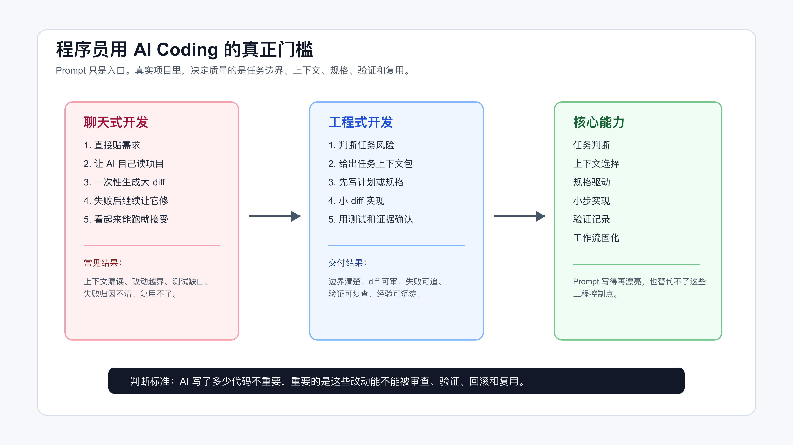

# 程序员用 AI Coding，真正的门槛不是 Prompt

很多程序员第一次认真用 AI 写代码，都会经历一个很短的兴奋期。

它能在几十秒里补完一个函数，能把一段报错解释得像模像样，能根据现有代码风格生成一组测试。你会觉得这东西确实能省时间。再过几天，另一个感受会冒出来：它也很容易把事情搞乱。

它会漏掉关键文件，会把测试失败归因成历史问题，会顺手重构无关代码，会把一个局部需求扩成一片大 diff。最麻烦的是，它经常讲得很有把握，让你以为它真的理解了项目。

所以程序员用 AI Coding，门槛不在于会不会写一句漂亮 prompt。

门槛在工程控制：任务能不能分级，上下文能不能给准，diff 能不能收住，验证证据能不能留下来。



这张图的左边，是很多人默认走的聊天式开发；中间，是更适合真实项目的工程式开发；右边，是需要逐步补齐的核心能力。

## Prompt 为什么不够

Prompt 有用，但它只是入口。

比如你可以这样写：

```text
请你作为资深后端工程师，帮我修复订单状态回退的问题。要求代码简洁、考虑边界、补充测试。
```

这句话看起来很完整。它有角色，有任务，有质量要求。问题是，对真实代码库来说，它缺了最关键的东西：

- 订单状态有哪些历史兼容逻辑？
- 哪些状态流转不能改变？
- 哪些文件是入口，哪些文件只是同名但无关？
- 当前失败能不能稳定复现？
- 修完以后跑哪个测试能证明问题解决？
- 如果测试失败，怎么判断是不是本次改动导致？

这些信息不在 prompt 里，AI 就只能猜。

程序员会觉得“这些我心里有数”。但 AI 不知道。它只看到你给它的上下文、它自己读到的文件、工具返回的结果，以及对代码模式的推断。

先记住一个事实：**你脑子里的项目经验，如果没有变成上下文、规则、测试或验证记录，就不能稳定约束 AI。**

## 会写代码的人，常常会低估流程

不懂代码的人用 AI，经常会被卡在基础问题上：环境起不来、报错看不懂、依赖装不上。

程序员的问题不一样。你知道怎么修，也知道 AI 生成的大概方向对不对，于是很容易跳过工程流程，直接让它开改。

这反而危险。

因为你会在脑子里自动补全很多缺失信息：这个接口不能改、这个 helper 要复用、这个测试环境要先起 Redis、这个字段历史上有兼容逻辑。你知道这些，但 AI 不知道。你越熟悉项目，越容易以为它也“应该知道”。

真实项目里，AI 写错代码通常不是最严重的问题。最严重的是它在错误上下文里写出了看起来很合理的代码。

比如：

```text
你让 AI 修复优惠券过期判断。
AI 找到 CouponService，补了一个日期判断。
测试也过了。

但真实入口在 CouponAvailableQueryService。
CouponService 只是老接口兼容层。
它改对了一个局部文件，却没有改到真实调用路径。
```

这类错误靠更长的 prompt 不一定能解决。它需要代码地图、调用链、测试入口和任务上下文包。

## 先区分两种 AI Coding

我建议先把 AI Coding 分成两类。

第一类是聊天式开发。

它的流程大概是：

```text
描述需求
让 AI 实现
看结果
继续让 AI 修
```

这种方式适合低风险任务。比如写一个脚本、补一个小函数、解释一段报错、生成一份临时 SQL。它快，成本低，不需要很重的流程。

第二类是工程式开发。

它的流程是：

```text
判断任务风险
选择工具工作面
准备上下文
写计划或规格
小步实现
运行验证
审查 diff
沉淀规则
```

这种方式适合真实项目里的需求开发、bug 修复、前后端联调、老项目改造和代码审查。

两者不是谁替代谁。关键是别拿聊天式开发去处理工程式任务。

如果一个任务满足下面任意两条，就应该按工程式开发处理：

- 需要改多个文件。
- 涉及业务状态、权限、金额、数据一致性。
- 需要兼容旧行为。
- 需要补测试或改测试。
- 失败后定位成本高。
- 改错后回滚成本高。
- 需要别人审查。

## 门槛一：任务判断

让 AI 开始写代码之前，先问一个问题：

> 这个任务到底能交给 AI 到什么程度？

不是所有任务都能直接授权。

可以按下面这张表判断：

| 任务 | AI 可以做 | 人必须控制 |
|---|---|---|
| 局部函数 | 生成实现、补边界测试 | 输入输出、异常语义 |
| 陌生模块理解 | 建代码地图、列调用链 | 判断它是否读到关键路径 |
| Bug 排查 | 分析日志、列假设、写复现脚本 | 确认根因和修复策略 |
| 跨模块需求 | 写计划、拆任务、生成小 diff | 架构边界和兼容策略 |
| 权限/金额/状态 | 辅助列风险和测试点 | 业务规则、上线决策 |
| 重构 | 拆小步、补回归测试 | 外部行为不变和回滚路径 |

这一步的价值很直接：它决定你应该给 AI 多少权限。

有些任务可以让 AI 直接改代码。有些任务只能让 AI 先读文件、列影响面。有些任务可以让 AI 写测试，但修复策略要人先定。有些线上风险任务，AI 只能做分析助手。

一个可靠的起手式是：

```text
先不要改代码。

请你先判断这个任务适不适合交给 AI 实现：
1. 这个任务属于局部改动、跨模块需求、bug 排查、重构，还是高风险业务改动？
2. 你需要先读取哪些文件？请列出路径。
3. 哪些行为不能改变？
4. 如果要实现，建议拆成几个小步骤？
5. 每一步用什么命令或测试证明完成？
```

这段话不会让 AI 变聪明，但会让它先暴露理解过程。

## 把任务判断落成授权级别

任务分级如果只停留在脑子里，对 Agent 没有约束力。真正要写给 Agent 的，是授权级别。

可以把一次任务分成四档：

| 授权级别 | 适用场景 | 给 AI 的权限 | 人要检查什么 |
|---|---|---|---|
| 只读分析 | 线上事故、需求不清、业务规则未确认 | 读文件、读日志、列事实和假设 | 是否把猜测写成事实 |
| 计划优先 | 跨模块需求、状态机、权限、金额 | 读仓库、列文件、写计划，不改代码 | 文件是否读对，计划是否越界 |
| 小步实现 | 局部 bug、已有测试、影响范围可控 | 按一个 task 修改，完成后停止 | diff 是否只服务这个 task |
| 自动执行 | 文档、样例、局部机械同步 | 直接改并验证 | 命令输出和残余风险 |

这个表的作用，是把“AI 能不能做”改成“AI 现在能做到哪一步”。

例如订单状态回退问题，第一轮通常不该让 AI 直接实现。更合适的授权是：

```text
你现在只做计划优先模式。

允许：
- 读取订单状态流转相关文件。
- 列出实际读取过的路径。
- 整理现有状态迁移和测试覆盖。
- 给出最小实现计划。

不允许：
- 修改代码。
- 修改测试。
- 推断业务规则。
- 新增依赖或重构状态机。

停止条件：
- 发现状态规则需要业务确认。
- 发现真实入口不止一个。
- 发现现有测试和代码语义冲突。
```

这段约束看起来比一句 prompt 硬，但它符合真实开发。程序员不会把一个没确认业务规则的状态机任务直接交给新人改；AI 也一样。

如果你不写授权级别，Agent 往往会默认自己可以继续往下做。它读到文件以后会改代码，测试失败后会继续修，修不动时会扩大范围。很多大 diff 就是这样长出来的。

授权失败通常不是一句话就能看出来。它会表现成几种信号：Agent 没有读到真实入口却开始实现；计划里出现你没有要求的重构；测试失败后它直接修改断言；为了让命令通过新增依赖或调整配置。看到这些信号，不要继续追问“再修一下”，要把任务退回到只读分析或计划优先模式。

## 门槛二：上下文选择

AI Coding 的质量，很大程度取决于上下文。

上下文不是把仓库全塞进去，也不是只贴一个需求描述。上下文要刚好覆盖当前任务。

一个最小任务上下文包可以包括：

```markdown
# Task Context

## Goal
- 要改变什么行为？
- 哪些行为不能改变？

## Files
- 入口：
- 核心实现：
- 测试：
- 配置：
- 历史兼容逻辑：

## Constraints
- 不新增依赖：
- 不改公开 API：
- 不改 generated 文件：
- 不做顺手重构：

## Done When
- 哪些测试通过：
- 哪个页面或接口验证：
- 哪个 bug 不再复现：
- diff 限制在哪些文件：
```

这个模板不复杂，但它能解决两个问题。

第一，它让 AI 知道边界。

第二，它逼你自己先想清楚任务。

如果你写不出 `Done When`，就说明你还没定义完成。如果你列不出核心文件，就说明现在让 AI 改代码还太早。

配套代码仓库 [DavidDingXu/learn-ai-coding](https://github.com/DavidDingXu/learn-ai-coding) 的工具 module 里有一个最小工具，可以直接生成任务上下文包：

```bash
cd learn-ai-coding/ai-coding-workflow-kit
node src/cli.js task-context \
  --title "修复订单状态回退问题" \
  --files "src/order.ts,test/order.test.ts" \
  --constraints "不改公开 API,不新增依赖" \
  --done "npm test,人工验证支付回调"
```

它不会替你理解业务，但能把一次 AI Coding 任务最容易漏掉的信息固定下来。

## 门槛三：小步实现

AI 很容易一次改很多。

它会觉得顺手整理命名、抽函数、改测试结构、删掉“重复逻辑”都是好事。对它来说，这些都是合理的代码改进。对真实项目来说，这些可能都是风险。

所以要限制 diff。

可以这样要求：

```text
这次只完成第一个小步骤。

限制：
- 只改计划中列出的文件。
- 不做顺手重构。
- 不新增依赖。
- 不改公开 API。
- 如果必须扩大范围，先停下来说明原因。

完成后输出：
- 改了哪些文件。
- 每个文件为什么改。
- 跑了什么验证。
- 还有什么风险没覆盖。
```

小步不是慢。小步是为了让审查、测试和回滚变便宜。

如果 AI 一次生成 800 行代码，你可能要花半小时才能判断它有没有越界。如果它一次只改 60 行，并且每个文件都有理由，审查就容易很多。

程序员要控制的不是一次生成多少代码，而是每次改动是否能被检查。

## 门槛四：验证证据

AI 说“已经修复”没有意义。

你要看证据。

一次改动至少要留下这些信息：

```markdown
## Baseline
- 改前怎么复现问题？

## Change Summary
- 改了什么？

## Verification Commands
```bash
npm test
```

## Evidence
- PASS 多少测试？
- 页面或接口怎么验证？

## Residual Risk
- 哪些路径还没覆盖？
```

配套工程的工具 module 里也放了一个验证记录检查器：

```bash
cd learn-ai-coding/ai-coding-workflow-kit
node src/cli.js verify-ledger --file examples/verification-ledger.pass.md
```

它会检查验证记录里有没有关键段落、命令块和通过信号。

这不是为了形式化写文档，而是为了防止一个常见问题：AI 把“我认为修好了”包装成“已经完成”。

如果没有 baseline，就不知道问题原来是否存在。
如果没有命令，就不知道验证怎么做。
如果没有通过信号，就不知道结果是否真实。
如果没有残留风险，就不知道还有哪些路径没覆盖。

## 门槛五：复用经验

如果你第二次提醒 AI 同一个规则，就应该考虑把它写下来。

比如：

- 这个项目用 `pnpm`，不要用 `npm`。
- 前端改动必须打开页面验证。
- 不要编辑 generated 文件。
- 不要新增生产依赖，除非先确认。
- 测试失败不能直接归因历史问题，必须先跑改前基线。

这些规则可以写进 `AGENTS.md`、`CLAUDE.md`、Copilot instructions、Skill、脚本或 checklist。

规则文件解决的是项目上下文。
Skill 解决的是重复流程。
脚本解决的是确定性动作。
MCP 解决的是必要外部资源接入。
多 Agent 解决的是可并行、可隔离的任务拆分。

它们不是互相替代的概念，而是一条递进线。

你先让 Agent 会做事，再约束它做对事；再把有效流程固化下来；再决定是否给它接外部资源；最后才考虑多 Agent。

## 能力自测：你现在卡在哪一层

可以用这张表给自己打分。

| 能力 | 低阶表现 | 专业表现 |
|---|---|---|
| 任务判断 | 看到需求就让 AI 改 | 先判断风险和授权范围 |
| 上下文选择 | 贴需求或塞大量文件 | 给代码地图和任务上下文包 |
| 计划拆解 | 接受 AI 一次性实现 | 要求先计划，再小步改 |
| 代码审查 | 看结果能不能跑 | 看 diff 是否越界 |
| 测试验证 | 接受“已修复” | 要求 baseline、命令、证据 |
| 调试 | 让 AI 连续猜 | 复现、假设、验证逐步推进 |
| 经验复用 | 每次重新解释 | 写进规则、Skill 或脚本 |

如果你只能优先补三项，我建议补：

- 任务判断。
- 上下文选择。
- 验证证据。

这三项决定下限。工具技巧、框架和多 Agent 都是后面的事。

## 这件事怎么落到日常开发

日常开发里，不需要每次都搞一套很重的流程。你可以先给自己定三个默认动作。

第一个默认动作：让 AI 先说明它读了什么。

很多 AI Coding 事故都和“以为它读了，其实没读”有关。让它输出实际读取过的文件路径，不是为了形式感，而是为了把理解范围暴露出来。它如果没读测试文件，就不要相信它对验证的判断；它如果没读调用入口，就不要相信它对影响面的判断。

第二个默认动作：让 AI 先给计划，不要直接改。

计划不是长篇方案。一个小需求可以只要 3 行计划：改哪个文件、为什么改、怎么验证。只要 AI 写不出这个计划，就说明它还没准备好进入实现。

第三个默认动作：把“完成”改成证据。

不要问“你修好了吗”。要问“你跑了什么命令，输出是什么，diff 是否只在计划范围内，还有哪些风险没覆盖”。这样问，AI 的回答才会从主观承诺变成可检查记录。

这三个动作不会让流程变复杂。它们只是把程序员本来就在脑子里做的判断，提前放到台面上。

如果你在团队里做 code review，也可以用同样的标准看 AI 生成的 PR：

- PR 描述里有没有任务边界？
- diff 是否出现无关重构？
- 测试是否覆盖真实风险？
- 失败路径有没有被解释清楚？
- 是否有“AI 觉得无关”但没有证据的测试失败？

一旦这样审查，你会发现 AI Coding 和普通开发并没有两套质量标准。AI 只是让代码生成速度变快了，但工程质量仍然要靠同一套东西：边界、测试、审查、验证和复盘。

个人使用 AI Coding 时，也可以按 PR 的标准要求自己。哪怕没有真正提交 PR，也要能回答：这次改动为什么必要，哪些文件被改，哪些验证跑过，哪些风险没有覆盖。只要这些问题答不上来，说明任务还没有进入可交付状态。

## 跟着做一次小练习

找一个你最近真的要改的小需求。不要让 AI 直接实现。

先让它做这件事：

```text
先不要改代码。

请你根据当前仓库，帮我完成一次实现前检查：
1. 列出你需要读取的文件路径。
2. 判断这个任务属于低风险、中风险还是高风险。
3. 写一个最多 4 步的小步计划。
4. 每一步说明如何验证。
5. 如果上下文不足，只提问题，不要猜。
```

然后你自己检查它的输出：

- 它列的文件是否真的是关键路径？
- 它有没有漏测试？
- 它有没有把高风险任务说成低风险？
- 它的验证方式是不是可执行命令？
- 它有没有准备一次改太多？

这一步练熟以后，再让 AI 写代码。

这一轮做完再进入实现，AI 的输出审查成本会低很多。原因不在某句 prompt，而在于任务已经被放进了明确的工程流程。

## 常见问题

### Prompt 还重要吗？

重要，但不要把它当全部。

Prompt 负责表达当前任务。项目规则、上下文包、测试、验证记录和 Skill，负责承载长期稳定的工程约束。真实项目里，这几类东西要一起用。

### 我是不是每个小需求都要写规格？

不用。

局部、低风险、可快速验证的任务，可以直接走轻量流程：任务说明、相关文件、小 diff、跑测试。跨模块、影响业务状态、回滚成本高的任务，再进入规格驱动。

### AI 写的大 diff 如果看起来很好，要不要接受？

先拆。

让 AI 解释每个文件为什么改，再把无关改动剥离出去。真正好的 AI Coding 结果，不只是代码能跑，还应该能被正常审查。

### 什么时候该写 Skill？

当一个流程重复出现，而且每次都要解释很多规则时。

比如调试流程、代码审查流程、完成前验证流程、前端截图验证流程。这类流程适合沉淀成 Skill。一次性的任务背景不适合写 Skill，放在任务上下文包里就够了。

### MCP 是不是也要早点学？

不需要。

先学会任务判断、上下文、验证和规则文件。等你遇到 AI 需要查文档、看 Issue、读只读数据、操作浏览器、访问代码索引时，再学 MCP 接入边界。MCP 的价值是安全接外部资源，不是自动让代码变好。

### 工程流程会不会限制 AI 的发挥？

会限制，而且应该限制。

真实项目需要的是可审查的输出，不是最大化生成内容。AI 一次改很多文件，看起来像效率高，但 reviewer 看不懂、测试说不清、回滚切不开，最后还是返工。

工程流程不是让 AI 少做事，而是让它在正确边界里做事。低风险任务可以放宽，高风险任务必须收紧。

## 先把底座搭起来

程序员用 AI Coding，起点不是把 prompt 写得更漂亮。

先把底座搭起来：判断任务风险，给对上下文，限制 diff，留下验证证据，把反复有效的经验沉淀下来。

这些动作做稳以后，AI 才会从会写代码的聊天窗口，变成可以被约束、检查和复用的开发工具。

## 可复查资料

- OpenAI Codex 最佳实践：<https://developers.openai.com/codex/learn/best-practices>
- OpenAI Codex `AGENTS.md` 指南：<https://developers.openai.com/codex/guides/agents-md>
- Anthropic Claude Code 最佳实践：<https://www.anthropic.com/engineering/claude-code-best-practices>
- GitHub Copilot coding agent 任务说明：<https://docs.github.com/en/copilot/tutorials/coding-agent/get-the-best-results>

---

[课程首页](../../../README.md) · [完整目录](../README.md) · [← 程序员如何系统学习 AI Coding](../00-%E5%AF%BC%E8%AF%BB%E4%B8%8E%E5%AD%A6%E4%B9%A0%E5%9C%B0%E5%9B%BE/00-%E7%A8%8B%E5%BA%8F%E5%91%98%E5%A6%82%E4%BD%95%E7%B3%BB%E7%BB%9F%E5%AD%A6%E4%B9%A0-AI-Coding.md) · [从聊天式开发到工程式开发 →](02-%E4%BB%8E%E8%81%8A%E5%A4%A9%E5%BC%8F%E5%BC%80%E5%8F%91%E5%88%B0%E5%B7%A5%E7%A8%8B%E5%BC%8F%E5%BC%80%E5%8F%91.md)

动手实践：[业务样例与测试](../../../personal-productivity-app/README.md)
