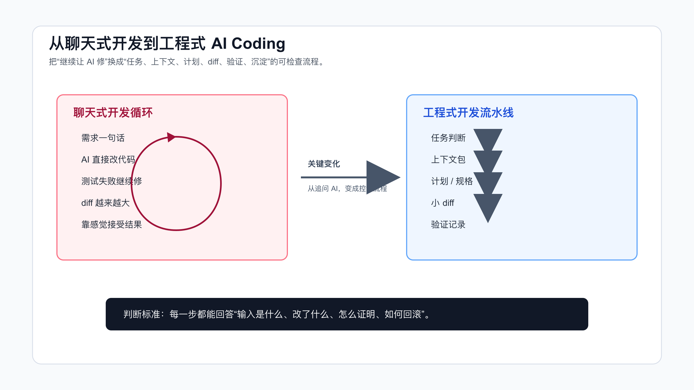

# 从聊天式开发到工程式开发

很多 AI Coding 失败，不是因为 AI 不会写代码，而是因为我们把真实项目当成聊天窗口来处理。

聊天窗口里，事情看起来很简单：描述需求，让 AI 改，测试失败再让它修。几轮下来，代码也许能跑，但 diff 变大了，修改范围说不清了，测试失败到底是不是本次引入也说不清了。

聊天式开发的典型问题就在这里：它把开发过程压成一段对话，却丢掉了真实工程里的控制点。

工程式 AI Coding 要做的事正好相反：不追求一次聊完，而是把任务拆成可检查的阶段。



## 聊天式开发为什么容易失控

先看一个常见流程：

```text
我：帮我修一下用户无法提交订单的问题。
AI：我已经修复了。
我：测试失败了。
AI：我会继续修复。
我：页面还是不对。
AI：我会调整前端逻辑。
```

这段对话的问题不是“AI 态度不好”。它的问题是从一开始就没有工程边界。

它没有问清楚订单提交失败的复现路径，没有确认前后端入口，没有区分接口失败、状态错误、权限拦截还是前端表单校验，也没有定义修完之后怎么证明完成。

于是 AI 会沿着它最容易看到的代码路径修改。它读到一个 submit 方法，就改 submit；读到一个错误提示，就改错误提示；读到一个测试失败，就让测试通过。每一步都像在解决问题，但整体可能越来越偏。

真实项目里，这种失控常见在五个地方：

- 上下文失控：AI 读了相似文件，却没读到真实入口。
- 范围失控：局部 bug 被改成跨模块重构。
- 验证失控：测试失败后没有改前基线，无法判断责任。
- 语义失控：AI 把业务规则理解成普通 if/else。
- 复用失控：这次踩过的坑，下次还要重新解释。

聊天式开发不是不能用。它适合低风险小事。问题是，很多人拿它处理真实需求。

## 工程式开发的核心变化

工程式 AI Coding 不是把流程变复杂，而是把隐含判断显式化。

程序员平时做需求，本来就会问这些问题：

- 这个需求影响哪些模块？
- 哪些行为不能改？
- 有没有历史兼容逻辑？
- 先改哪一小步最安全？
- 改完跑什么测试？
- 如果失败，怎么回滚？

只是以前这些判断在你脑子里。AI 加入以后，这些判断必须写出来。

一个工程式流程可以很轻：

```text
1. 任务判断：这个任务风险多高？
2. 上下文包：AI 应该先读哪些文件？
3. 计划：它准备改哪些文件，为什么？
4. 小 diff：一次只完成一个明确步骤。
5. 验证：跑命令、看输出、记录证据。
6. 沉淀：把反复出现的规则写回项目。
```

这六步不一定每次都写成长文。低风险任务可以很短，高风险任务要更完整。关键是顺序不能反。

## 第一步：先定义任务类型

不要一上来就让 AI 写代码。

先让它判断任务类型：

```text
先不要改代码。

请判断这个任务属于哪一类：
- 局部实现
- 陌生模块理解
- bug 排查
- 跨模块需求
- 重构
- 高风险业务改动

然后说明：
1. AI 可以负责哪些部分。
2. 哪些部分必须由人确认。
3. 实现前还缺哪些上下文。
```

这一步能过滤掉很多不该直接授权的任务。

比如“按钮样式不对”可能是低风险局部改动。“支付成功后订单状态偶尔回退”就不是。后者涉及状态流转、异步回调、幂等、历史数据和测试复现，必须先做上下文和验证设计。

工程式开发的第一条规则是：任务风险决定流程重量。

## 切换到工程式流程的几个硬信号

很多人不是不知道工程式流程有用，而是不知道什么时候该切。

可以记几个硬信号。只要出现其中两个，就不要继续聊天式开发。

第一个信号：AI 需要自己找入口。

如果你不能告诉它入口文件、测试文件、配置文件，只能说“你读一下项目”，那就说明任务还在侦察阶段。侦察阶段应该让 Agent 列事实和路径，不应该授权实现。

第二个信号：任务里有不能改变的行为。

比如旧接口响应、历史数据兼容、权限拦截、状态流转、字段语义。这些东西需要写进约束。只写“修一下”不够。

第三个信号：验证不是一条命令能覆盖。

前后端联动、异步任务、数据库状态、副作用、浏览器交互，都说明验证要分层。此时“跑了测试”只能覆盖一部分风险。

第四个信号：当前 diff 已经解释不清。

如果 AI 改了 8 个文件，但你只能说出其中 3 个为什么要改，就先停。让它分类 diff，再决定保留、拆分还是回滚。

第五个信号：测试失败开始被归因。

AI 说“这个失败和本次改动无关”时，不要直接接受。先让它给改前基线、失败命令、失败日志和影响面。没有这些证据，就不能继续在失败基础上叠补丁。

这些信号的共同点是：任务已经离开简单代码生成，进入工程责任区。

还有一个判断很实用：如果这次改动未来要被别人 review、要进 CI、要回滚、要写发布说明，就不要只按聊天式开发处理。真实交付天然需要证据链。

## 已经失控时怎么恢复

很多时候，你不是一开始就走工程式流程，而是聊了几轮之后才发现不对。

这时不要急着重开一个更长的 prompt。先把当前状态收住。

第一步，冻结修改。

```text
不要继续编辑文件。
请只分析当前状态。
```

第二步，整理 diff。

```text
列出当前已修改文件。
把每个文件分成三类：
- 直接服务原任务。
- 顺手重构或无关修改。
- 可能改变外部行为但未被授权。
```

第三步，回到事实。

```text
列出已确认事实、未验证假设、已排除假设。
标出当前失败命令和输出。
```

第四步，重新定义下一步。

```text
如果只保留最小修复，下一步应该改哪个文件？
需要先补哪条测试或复现证据？
哪些改动建议拆到独立任务？
```

这个恢复流程的目的不是让 AI 自己回滚。真实工作区可能有你的改动，也可能有已经确认过的改动。Agent 先分类，人再决定怎么处理。

一旦恢复流程跑完，就不要继续用原来的大对话推进。把清理结果整理成任务卡，再让 Agent 执行一个最小步骤。

## 第二步：让上下文可复查

聊天式开发里，最常见的一句话是：

```text
你先读一下这个项目。
```

这句话没什么约束力。

AI 读哪些文件、有没有漏关键路径、是否把同名但无关的文件当成入口，你都不知道。先让它列出实际读取路径，并解释为什么读。

可以这样问：

```text
请先建立任务上下文，不要改代码：
1. 列出你实际读取过的文件路径。
2. 标出入口文件、核心实现、测试文件、配置文件。
3. 说明哪些文件看起来相关但暂时不该改。
4. 如果缺少关键上下文，先提问。
```

代码地图可以单独沉淀。这里先记住一个原则：上下文必须可复查。

你不能只听 AI 说“我已经理解项目”。你要看它到底读了什么。

配套代码仓库 [DavidDingXu/learn-ai-coding](https://github.com/DavidDingXu/learn-ai-coding) 的工具 module 里有代码地图命令，可以帮你先做一层仓库扫描：

```bash
cd learn-ai-coding/ai-coding-workflow-kit
node src/cli.js codemap --root .
```

它不会替代人工判断，但能快速列出文档、配置和测试入口，避免 AI 一开始就漏掉基础文件。

## 第三步：把实现变成计划

聊天式开发里，AI 很容易直接进入实现。工程式开发里，实现之前要有计划。

计划不需要复杂。一个小需求可以只有这几行：

```markdown
## Plan

1. 修改 `src/order.ts` 的状态回退判断。
   - 原因：当前入口在这里。
   - 验证：新增失败测试。

2. 补充 `test/order.test.ts` 的已支付订单回退用例。
   - 原因：锁定业务边界。
   - 验证：`npm test`。
```

计划的作用不是让 AI 写方案文档，而是让你在代码生成前有机会发现问题。

如果计划里出现这些信号，就要暂停：

- 它准备改无关文件。
- 它没有提测试。
- 它想新增依赖。
- 它把重构混进 bug 修复。
- 它说“顺便优化”。
- 它跳过了你明确要求保留的旧行为。

计划阶段发现问题，成本很低。代码写完再发现，成本就高多了。

## 第四步：限制 diff

AI 一次改太多，是工程式开发最大的敌人之一。

可以给它一个固定约束：

```text
只执行计划的第 1 步。

要求：
- 不改计划外文件。
- 不做重构。
- 不新增依赖。
- 如果必须扩大范围，先停止并说明原因。
```

这条规则看起来简单，但非常有效。

它会逼 AI 把复杂任务拆小，也会降低审查成本。一个 50 行 diff 和一个 700 行 diff，审查难度不是线性差别。后者经常会让人放弃认真看。

工程式开发里，diff 必须服务任务，不服务 AI 的发挥。

## 第五步：验证不是一句话

“已修复”不是验证。

验证至少要包含三类信息：

```markdown
## 改前
- 问题如何复现？

## 改后
- 跑了什么命令？
- 输出是什么？

## 剩余风险
- 哪些路径没覆盖？
```

如果是前端改动，还要看页面。
如果是接口改动，还要看请求和响应。
如果是状态流转，还要看正向路径和禁止路径。
如果是权限逻辑，还要看允许和拒绝两类用例。

验证证据还要和风险匹配。改一行文案，截图或页面预览可能够了；改状态机，只看单元测试就不够，还要补禁止流转、重复回调和历史数据场景。AI 最容易漏掉的不是 happy path，而是那些过去靠程序员经验兜住的边界。

不要让 AI 用一句“测试通过”带过。让它贴命令、输出和影响范围。

配套工程的工具 module 里的验证记录检查器可以作为最小约束：

```bash
cd learn-ai-coding/ai-coding-workflow-kit
node src/cli.js verify-ledger --file examples/verification-ledger.pass.md
```

如果记录缺少关键段落、命令块或通过信号，它会直接指出缺口。

## 第六步：把经验写回规则

工程式开发最后一步是沉淀。

如果这次任务里你反复提醒 AI：

- 不要改 generated 文件。
- 不要新增依赖。
- 测试失败先跑 baseline。
- 前端改动必须截图。
- 只改计划内文件。

那这些内容就应该进入规则文件、检查清单或 Skill。

聊天式开发的问题是，每次都重新聊一遍。工程式开发的价值是，下一次不用从零开始。

规则沉淀可以很轻：

```markdown
## AI Coding Rules

- Keep diffs scoped to the requested task.
- Do not edit generated files.
- Run baseline before blaming existing failures.
- Ask before adding dependencies.
- For UI changes, verify in browser and keep screenshot evidence.
```

不用一次写很多。只写高频、稳定、会影响结果质量的规则。

## 失败路径：越修越乱是怎么发生的

很多人以为 AI Coding 失控是突然发生的。实际不是。它通常是一点点滑下去的。

第一步，需求没有边界。

你只说“修复订单状态回退”，没有说哪些状态允许回退、哪些状态禁止回退。AI 会从代码里猜业务规则。它看到 `status !== CANCELLED`，可能就会推断“非取消都可以改”。这类推断看起来合理，但业务上可能完全错。

第二步，上下文没有入口。

AI 读到了 `OrderService`，但真实入口在异步回调。它改了同步下单路径，测试也能补上，但线上问题依旧存在。这个时候如果继续说“还不对，再修”，AI 往往会沿着已经读过的错误路径继续挖。

第三步，测试被当成目标，而不是证据。

测试失败后，AI 可能会调整测试断言，让它匹配当前实现。它不是故意偷懒，而是它的优化目标经常会变成“让测试通过”。如果没有明确告诉它业务边界，测试本身也会被它改成错误现实的证明。

第四步，diff 扩散。

为了让新逻辑跑通，它开始改工具函数、类型定义、前端状态、测试 helper。每个修改都有解释，但合在一起已经超出原任务。人再去审这个 diff，会很难判断哪一行是真正必要的。

第五步，验证缺失。

AI 最后告诉你“问题已修复”。但没有改前复现，没有命令输出，没有页面截图，没有接口响应，没有残留风险说明。你只能靠感觉接受。

聊天式开发最危险的地方，不是每一步都错，而是每一步都缺少边界。

## 什么时候可以保持轻量

工程式开发不是要把所有小事都变复杂。

下面这些任务可以轻量处理：

- 改一段不会影响逻辑的文案。
- 补一个局部函数的边界判断。
- 解释一段日志或异常栈。
- 生成一个临时脚本。
- 给已有测试补一个简单 case。

轻量处理也不是完全无规则。至少要保留三个动作：

```text
1. 指定相关文件。
2. 限制改动范围。
3. 跑一个能证明结果的命令。
```

比如：

```text
只修改 `src/format-price.ts`。
补充人民币分转元的格式化边界。
不要改其它文件。
完成后运行 `npm test -- format-price`。
```

这已经足够，不需要写完整 spec。

真正需要工程式流程的是这些任务：

- 改状态流转。
- 改权限判断。
- 改金额、库存、优惠、账务逻辑。
- 改跨前后端接口。
- 改历史兼容逻辑。
- 做重构。
- 修复无法稳定复现的问题。
- 处理测试大量失败。

任务越接近业务不变量，越不能只靠聊天。

## 一套可以直接复用的转换清单

当你发现自己已经进入“继续让 AI 修”的循环，可以立刻停下来，用下面这套清单重启任务。

```markdown
# AI Coding Reset Checklist

## 1. 当前问题
- 现在失败的现象是什么？
- 是否有稳定复现路径？

## 2. 当前 diff
- AI 已经改了哪些文件？
- 哪些文件不在原计划内？
- 是否需要先回滚部分改动？

## 3. 真实入口
- 用户动作或系统事件从哪里进入？
- 后端入口、前端入口、异步任务入口分别是什么？

## 4. 业务边界
- 哪些行为必须保持不变？
- 哪些旧数据或旧接口需要兼容？

## 5. 下一步
- 只保留哪一个最小改动？
- 用哪个命令证明它有效？
```

这张清单可以把已经发散的对话重新拉回工程事实。

如果当前 diff 已经很乱，最好的动作通常不是继续修，而是让 AI 帮你分类：

```text
请不要继续修改。

请分析当前 diff：
1. 哪些改动直接服务原任务？
2. 哪些改动是顺手重构？
3. 哪些改动可能改变外部行为？
4. 哪些改动建议回滚？
5. 如果只保留最小修复，需要留下哪些文件？
```

让 AI 审自己的 diff，比让它在混乱 diff 上继续写代码更有价值。

## 怎么把工程式流程放进工具

工程式 AI Coding 不是只能靠人工记忆。你可以把关键动作放进工具和规则里。

第一层，写进项目规则。

比如：

```markdown
## AI Coding Rules

- Start with a short plan for any change touching more than one file.
- Keep the first diff focused on one behavior change.
- Do not change tests just to match the current implementation.
- Report baseline, command, output, and residual risk before saying done.
```

第二层，写成任务模板。

比如任务上下文包、debug worksheet、verification ledger。这些模板不需要绑定某个工具，Codex、Claude Code、Cursor 都能用。

第三层，写成 Skill 或脚本。

当流程开始重复出现，比如每次调试都要 baseline、假设、验证、ledger，就可以写成 Skill。确定性的检查动作，比如验证记录是否缺段落、代码地图是否能生成，可以写成脚本。

`ai-coding-workflow-kit` 就放在第三层。它不是业务系统，也不模拟一个假业务，而是服务 AI Coding 本身的真实工作流：代码地图、任务上下文、只读上下文包和验证记录。

这三层的边界要守住。

规则文件写长期约束，不能写一次需求。任务模板写本次目标，不能写项目百科。Skill 或脚本写可复用流程，不能包办业务判断。

比如“不要修改 generated 文件”可以放规则文件。

“这次只修 session 过期后首次提交失败”应该放任务上下文。

“调试时先记录 baseline、再列假设、再验证”可以放 Skill。

“用户登录失败时应该重试几次”不是工具规则，而是产品和系统设计决策，需要人确认。

把这些边界分清，工程式流程才不会变成文档堆叠。

## 读者迁移时要注意什么

把这套流程迁移到你的项目，不要照抄文件名。

前端项目重点看组件入口、状态管理、路由、接口封装、浏览器验证。
后端项目重点看 service 入口、持久化层、异步任务、事务边界、测试环境。
老项目重点看历史兼容逻辑、隐式配置、脚本命令、无法轻易跑通的测试。
多仓项目重点看 API 合同、版本依赖、发布顺序和回滚路径。

迁移时先做一件小事：找一个真实低风险需求，按工程式流程跑一遍。

不要一开始就挑战最复杂需求。你需要先验证流程能不能在你的项目里跑通：AI 能不能读到正确入口，测试命令能不能执行，规则文件有没有效果，验证记录能不能留下来。

流程跑通以后，再逐步提高任务复杂度。

## 一个完整对照

同样是“修复订单状态回退问题”，两种做法差别很明显。

聊天式写法：

```text
帮我修一下订单状态回退的问题，补一下测试。
```

工程式写法：

```text
先不要改代码。

目标：修复已支付订单被回退到 pending 的问题。

请先做实现前检查：
1. 读取订单状态流转入口、异步回调、相关测试。
2. 列出实际读取过的文件路径。
3. 判断哪些状态不能回退。
4. 给出最多 3 步计划。
5. 每一步说明验证命令。

限制：
- 不改公开 API。
- 不新增依赖。
- 不做顺手重构。
- 如果需要扩大范围，先停下来说明原因。
```

区别不在于第二段更长。区别在于第二段把控制点写清楚了。

AI 读什么、能改什么、不能改什么、怎么验证、什么时候停下来，这些都变成了明确约束。

## 常见问题

### 工程式开发会不会太慢？

对低风险小事，确实没必要重流程。改一个文案、补一个简单判断，可以轻量处理。

但对真实需求，工程式开发省的是返工时间。它让问题更早暴露在计划和上下文阶段，而不是等大 diff 出来以后再补救。

### 是不是所有需求都要写 spec？

不是。

规格驱动适合复杂需求、跨模块改动和高风险业务逻辑。普通小改动只需要任务上下文、计划和验证。流程重量要跟风险匹配。

### AI 已经能自动读仓库，还需要上下文包吗？

需要。

自动读仓库不等于读对文件。上下文包的价值是告诉 AI 优先级和边界，也让你能复查它有没有漏关键路径。

### 如果 AI 不按计划改怎么办？

不要继续让它补救大 diff。先要求它解释每个文件为什么改，然后把计划外改动剥离出来。必要时直接回滚到上一步，重新按小任务执行。

### 工程式 AI Coding 最先该练什么？

先练三件事：实现前检查、小步计划、验证记录。

这三件事不依赖特定工具，也不需要引入框架。练熟以后，再上 SDD、OpenSpec、Skill、MCP、多 Agent，才不会变成概念堆叠。

## 切换的标志

判断是否该切到工程式流程，不看需求描述有多长，而看它是否进入真实代码库、真实业务边界和真实交付责任。

低风险任务可以继续聊天式处理。改一段文案、补一个明显判断、解释一段错误日志，没有必要把流程拉满。

一旦改动需要被审查、回滚、发布或复盘，就要切到工程式流程：任务判断、上下文、计划、小 diff、验证、沉淀。

这一步切过去，AI Coding 才会回到开发本身，而不是停在连续追问里。

## 可复查资料

- OpenAI Codex 最佳实践：<https://developers.openai.com/codex/learn/best-practices>
- OpenAI Codex `AGENTS.md` 指南：<https://developers.openai.com/codex/guides/agents-md>
- Anthropic Claude Code 最佳实践：<https://www.anthropic.com/engineering/claude-code-best-practices>
- GitHub Copilot coding agent 任务说明：<https://docs.github.com/en/copilot/tutorials/coding-agent/get-the-best-results>

---

[课程首页](../../../README.md) · [完整目录](../README.md) · [← 程序员用 AI Coding，真正的门槛不是 Prompt](01-%E7%A8%8B%E5%BA%8F%E5%91%98%E7%94%A8-AI-Coding-%E7%9C%9F%E6%AD%A3%E7%9A%84%E9%97%A8%E6%A7%9B%E4%B8%8D%E6%98%AF-Prompt.md) · [AI Coding 的底层工作模型 →](03-AI-Coding-%E7%9A%84%E5%BA%95%E5%B1%82%E5%B7%A5%E4%BD%9C%E6%A8%A1%E5%9E%8B.md)

动手实践：[业务样例与测试](../../../personal-productivity-app/README.md)
