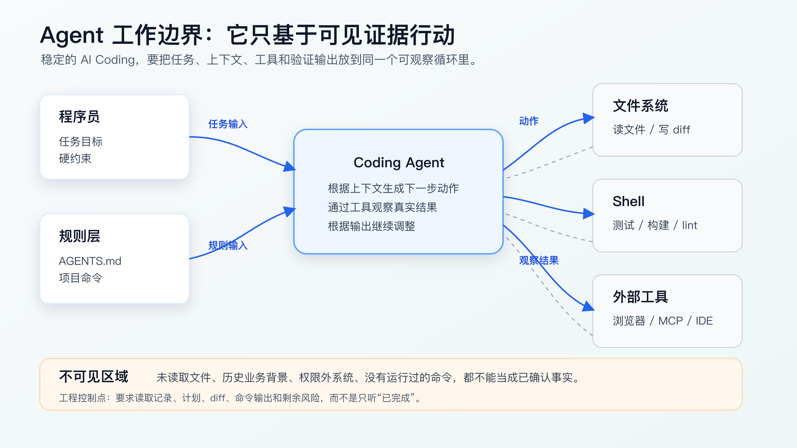
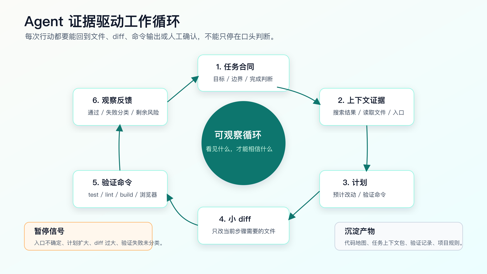

# AI Coding 的底层工作模型

很多程序员第一次认真用 AI Coding，都会高估一件事：以为 Agent 真的“理解了整个项目”。

它没有。

更准确的说法是：Agent 在一组指令、有限上下文和可用工具之间循环工作。它能读文件、改文件、执行命令、观察输出，再根据新的输出继续调整。它看起来像在理解项目，本质上是在不断把“可见证据”转成下一步行动。

这个差别会影响你的用法。

如果你把 AI 当成一个已经熟悉项目的同事，就会自然地给它一句模糊任务：“帮我修一下订单提交失败”。它会开始搜索、猜测、修改、运行测试，最后给你一句“已完成”。如果你把它看成一个基于上下文和工具反馈工作的开发 Agent，你就会先关心另外几个问题：

- 它实际读了哪些文件？
- 它有没有看到真实入口？
- 它的计划是否扩大了改动范围？
- 它跑的命令能证明什么，不能证明什么？
- 它遇到失败后，是基于证据收敛，还是在继续试错？

AI Coding 的稳定性，不来自更会写 prompt，而来自你能不能看懂这个工作循环，并把关键证据钉住。



## Agent 不是一个“会写代码的模型”

单独看模型，它只是根据输入生成输出。放到 AI Coding 场景里，事情变成了一个更复杂的系统：

- 有一层指令：系统规则、个人规则、项目规则、当前任务要求。
- 有一块上下文：用户粘贴的需求、Agent 读取的文件、搜索结果、历史对话。
- 有一组工具：文件读取、文件编辑、Shell、测试命令、浏览器、MCP 服务、IDE 能力。
- 有一个反馈通道：命令输出、测试失败、lint 报错、浏览器截图、Git diff。

真正参与开发的不是“模型”一个东西，而是模型加工具形成的工作循环。

OpenAI Codex 官方文档对 Codex CLI 的描述也很直接：它是在本机选定目录里读代码、改代码、运行代码的 coding agent。Codex 的最佳实践也强调几个方向：给对任务上下文、复杂任务先计划、把可复用规则放进 `AGENTS.md`、用配置和外部系统约束 Agent 行为。

这些建议背后的共同点不是“提示词更精致”，而是把 Agent 工作时依赖的输入、工具和反馈变得更可控。

程序员需要先接受一个事实：Agent 的代码能力很强，但它没有天然的项目记忆。它没有读过的文件，对它来说就是不存在；它没有跑过的命令，对它来说就不是证据；它没有被明确约束的边界，很容易被当前上下文里最显眼的线索带偏。

## 一个真实任务在 Agent 眼里是什么样

拿一个常见需求举例：

```text
用户在订单页点击提交后，偶尔会提示“状态异常”，但订单其实已经创建成功。
请修复这个问题。
```

人看到这句话，会自然联想到订单状态、接口幂等、前端重复提交、支付回调、后端事务、历史兼容逻辑。

Agent 不会自动拥有这些背景。它要先把任务转成一组可搜索线索：

```bash
rg -n "状态异常|submitOrder|createOrder|checkout|order status" src test
rg --files | rg "order|checkout|payment|test|spec"
git status --short
```

这些命令不是为了展示命令行技巧，而是为了回答三个基础问题：

1. 相关入口在哪里。
2. 有没有现成测试或规格文件。
3. 工作区是否已经有未提交改动。

如果这一步跳过，Agent 很可能只改到最先搜索出来的前端提示文案。它看到了“状态异常”，就修改错误提示；看到了 `submitOrder`，就加一个重试；看到了测试失败，就让测试通过。每一步都像在工作，但问题可能根本不在这里。

Agent 的行动路径高度依赖它先看到什么。

所以，程序员不能只问“它会不会写代码”，还要问“它是从哪里开始看的”。

## Agent 的工作循环

一个可控的 AI Coding 过程，通常会经过六个阶段。



第一步是任务合同。你给它的不只是需求描述，还包括不能改什么、完成后怎么证明、是否允许新增依赖、是否允许跨模块修改。

第二步是上下文获取。Agent 通过搜索和读文件建立当前任务视野。这里最重要的不是“读了很多文件”，而是读到了入口、调用链、测试、配置和约束。

第三步是计划。计划不是文档仪式，而是在写代码前暴露它的判断。它准备改哪些文件，为什么改这些文件，预计跑什么命令，都应该先说出来。

第四步是小范围编辑。真正的工作边界不是它口头说“我只改一点”，而是 Git diff。一次改动越大，审查成本越高，问题归因越难。

第五步是验证命令。测试、lint、类型检查、构建、浏览器验证、接口调用，都是把代码行为变成证据的手段。命令通过不等于业务完全正确，但命令没跑就更谈不上完成。

第六步是观察和复盘。Agent 要解释命令输出、失败原因、剩余风险，并决定是否继续。很多失控发生在这里：测试失败后没有分类，直接继续改，最后把原本的小问题改成大 diff。

这六步可以很轻，也可以很重。按钮文案这种低风险任务，可以两三步完成。涉及状态机、权限、金额、数据迁移的任务，就必须把每一步都写清楚。

## 指令层：Agent 首先会被什么约束

Agent 开始工作前，会先读到一组指令。不同工具的文件名和加载规则不完全一样，例如 Codex 使用 `AGENTS.md` 提供项目指导，Claude Code 常见的是 `CLAUDE.md`，GitHub Copilot 也有 repository instructions 和自定义指令能力。

这里不要把重点放在文件名上。重点是指令分层。

一份有效的项目规则，应该回答这些问题：

```markdown
# Project Instructions

## Commands

- Install: `npm install`
- Test: `npm test`
- Lint: `npm run lint`

## Work Rules

- Do not edit generated files under `dist/`.
- Do not add runtime dependencies without approval.
- Keep bug fixes scoped to the failing behavior.
- Before changing backend behavior, read the related tests first.

## Verification

- For behavior changes, run the focused test first.
- If broader shared code changed, run the full test suite.
- Report command output and remaining risk.
```

这类规则的价值不是“提醒 AI 要认真”。它会改变 Agent 的默认行动路径。

如果规则里写清楚 `dist/` 不能改，Agent 在发现构建产物报错时就不应该直接编辑构建产物。如果规则里写清楚新增依赖要先确认，它遇到一个解析问题时就不能顺手安装包。如果规则里写清楚共享代码改动要跑全量测试，它就不能只跑一个局部用例后宣布完成。

项目规则不需要长。长而空的规则反而容易污染上下文。好规则通常来自真实事故：AI 改错过哪里，就把能预防复发的规则写下来。

## 上下文层：搜索不是理解，读到关键路径才算开始

Agent 最容易犯的错之一，是把相似文件当成关键文件。

比如一个仓库里同时有：

```text
src/order/submit.ts
src/order/submit.legacy.ts
src/demo/order-submit.ts
test/order-submit.test.ts
docs/order-submit.md
```

如果任务是修线上订单提交，`demo` 和 `docs` 可能只是参考；`legacy` 可能只服务旧接口；真正入口可能在路由、service 或 controller 里。Agent 只读到一个文件并不能说明它找到了入口。

让 Agent 建立上下文时，可以直接要求它输出一份读取记录：

```text
先不要改代码。

请完成上下文侦察：
1. 列出你实际读取过的文件路径。
2. 标出入口文件、核心实现、测试文件和配置文件。
3. 说明哪些文件看起来相关但暂时不应该改。
4. 如果无法确认真实入口，停止并提问。
```

这个要求有两个作用。

第一，它迫使 Agent 暴露自己的证据。你能看到它是否只读了表层文件。

第二，它让你在实现前纠偏。实现前纠偏很便宜，写完代码再纠偏就会变成清理 diff。

配套代码仓库 [DavidDingXu/learn-ai-coding](https://github.com/DavidDingXu/learn-ai-coding) 的工具 module 里有一个轻量代码地图命令，可以在接手陌生仓库时先扫一遍结构：

```bash
cd learn-ai-coding/ai-coding-workflow-kit
node src/cli.js codemap --root .
```

它不会替代 `rg` 和人工判断，也不会解析完整 AST。它的价值是把文档、配置、测试入口先列出来，给 Agent 和人一个共同起点。

在真实项目里，我更建议把它当作“第一层索引”：先知道仓库有哪些明显入口，再让 Agent 针对具体任务搜索调用链。

## 计划层：先暴露判断，再允许实现

很多人不让 AI 写计划，是担心它浪费时间。这个担心有一半是对的：如果计划只是泛泛写“分析、实现、测试”，确实没价值。

有价值的计划应该短，但必须具体。

```markdown
## Plan

1. Read `src/order/submit.ts` and `test/order-submit.test.ts`.
   Reason: confirm current submit flow and existing behavior coverage.

2. Add or adjust one failing test for paid order status rollback.
   Reason: lock the bug before changing implementation.

3. Change only the status transition guard in `src/order/submit.ts`.
   Reason: keep the fix scoped to the observed failure.

4. Run `npm test -- order-submit`.
   Reason: verify the targeted behavior before wider checks.
```

看计划时，重点看五个信号：

- 它有没有把读文件和写代码分开。
- 它有没有说明为什么改这些文件。
- 它有没有提到测试或可观察验证。
- 它有没有混入“顺手重构”。
- 它有没有扩大到不相关模块。

如果计划里出现“优化整体结构”“统一抽象”“顺便清理旧逻辑”，就要停一下。不是这些事情永远不能做，而是它们不应该混在一个 bug fix 里。

AI Coding 最容易产生的问题，不是代码写不出来，而是它在一个任务里做了太多事。计划阶段就是防止这个问题的第一道门。

## 编辑层：真正的边界是 diff

Agent 说“我只做了小改动”没有意义。真正的边界看 diff。

每次实现后，至少要看两类信息：

```bash
git diff --stat
git diff
```

`git diff --stat` 看改动范围，`git diff` 看实际语义。很多问题只看测试是看不出来的。

例如，测试通过但 diff 里出现这些内容，就要谨慎：

- bug fix 顺手改了公共工具函数。
- 前端交互问题顺手改了后端接口。
- 为了让测试通过删除了断言。
- 修改了锁文件却没有说明新增依赖。
- 改动了格式化大文件，遮住真实逻辑变化。
- 把错误吞掉了，页面不报错但业务状态也没处理。

这里有一个很实用的交互方式：

```text
只执行计划第 2 步。

约束：
- 不改计划外文件。
- 不新增依赖。
- 不做重构。
- 如果必须扩大范围，先停止并说明原因。

完成后输出：
- 修改了哪些文件。
- 每个文件为什么必须改。
- 还没有跑的验证命令。
```

这段话的重点不是措辞，而是把 Agent 的自由度压到当前步骤里。

如果它真的发现必须扩大范围，例如测试入口依赖一个公共状态枚举，而枚举定义有缺陷，那也可以扩。但必须先停下来说明。这个停顿很关键，它让人重新判断风险。

## 验证层：命令输出是证据，不是结论

Agent 很喜欢说“测试通过”。程序员不能只看这句话。

你要看它跑了什么命令，在什么目录跑的，输出是什么，命令和本次改动的关系是什么。

验证报告要写到这个粒度：

```markdown
## Verification

- Command: `npm test -- order-submit`
- Directory: `learn-ai-coding/checkout-service`
- Result: passed, 8 tests
- Why this command matters: covers submit flow and paid-order rollback guard

## Not verified

- Real payment provider callback was not exercised locally.
- Existing integration test suite was not run because it requires staging credentials.
```

这里的“不确定”不是缺点，反而是专业表现。真实项目里很多东西无法在本地完全验证，例如第三方支付回调、生产数据分布、异步任务延迟、浏览器兼容性。Agent 如果把这些都说成“已完成”，风险更大。

配套工程的工具 module 里的验证记录校验命令，就是为了让完成报告不只停留在口头上：

```bash
cd learn-ai-coding/ai-coding-workflow-kit
node src/cli.js verify-ledger --file examples/verification-ledger.pass.md
```

这份记录至少要求有 baseline、change summary、verification commands、evidence 和 residual risk。它不能证明业务一定正确，但能防止最糟糕的情况：没有命令、没有证据、没有风险说明，却说完成了。

## 反馈层：测试失败以后，先分类再修改

测试失败是 AI Coding 里最容易失控的节点。

很多 Agent 会看到失败就继续改。改一次不行再改一次，最后测试可能绿了，但真实问题已经被绕过去。

失败后先分类。

| 失败类型 | 典型信号 | 应该怎么处理 |
|---|---|---|
| 改前就失败 | baseline 没跑，或同一命令在改前已失败 | 先记录基线，不把旧失败算成本次修复目标 |
| 本次引入失败 | 失败测试和 diff 直接相关 | 回到最小改动，优先修实现或测试预期 |
| 命令环境失败 | 缺依赖、缺服务、缺密钥、端口占用 | 不改业务代码，先处理环境或说明无法本地验证 |
| 规格冲突 | 测试期望和需求描述冲突 | 停下来让人确认业务规则 |
| 覆盖不足 | 命令通过，但关键路径没被覆盖 | 补验证路径，不要把通过当成完成 |

这张表在真实工作里很值钱。它能阻止 Agent 把环境问题改成业务代码，把历史失败算成自己修复，把规格冲突硬编码进实现。

你可以直接把它转成提示：

```text
测试失败后不要直接修改代码。

请先分类：
- 这是改前已存在失败，还是本次引入失败？
- 是实现问题、测试预期问题、环境问题，还是需求不清？
- 你需要查看哪些文件或输出才能确认？

分类完成前，不要继续编辑文件。
```

这种提示比“仔细一点”有效得多，因为它改变了 Agent 的下一步动作。

## 四种最常见的偏航原因

第一种是上下文缺口。

Agent 只读到 controller，没有读 service；只读到前端组件，没有读 API 契约；只读到新测试，没有读历史兼容用例。它会基于残缺上下文做出看似合理的修改。

解决办法不是一次性塞更多文件，而是让它解释每个文件和任务的关系。上下文要精，不是要多。

第二种是指令冲突。

用户说“尽快修好”，项目规则说“不能改公共接口”，历史对话里又出现“可以重构一下”。Agent 可能会选择当前最显眼的指令。处理这种情况，要把本次任务的硬约束写在任务开头，例如“这次只修 bug，不重构，不改接口”。

第三种是验证太弱。

只跑类型检查，不能证明业务路径正确；只跑单元测试，不能证明页面交互正确；只看页面不报错，不能证明接口状态正确。验证必须和风险匹配。

第四种是长任务积累错误结论。

一次对话太长后，Agent 可能会把早期猜测当成事实。尤其是排障任务，前几轮假设如果没被及时淘汰，会一直影响后续判断。遇到这种情况，最好让它重新整理证据：

```text
请停止修改，重新整理当前事实：
1. 已确认的事实有哪些？
2. 已排除的假设有哪些？
3. 仍未验证的假设有哪些？
4. 下一步最小验证动作是什么？
```

这个动作不是浪费时间。它是在清理错误上下文。

## 一套可以直接复用的交互协议

下面这套协议适合中等风险以上的任务。它不是固定格式，你可以按项目改短。

第一步，建立上下文：

```text
先不要改代码。

请围绕这个任务做上下文侦察：
- 用搜索找到可能相关的入口、实现、测试和配置。
- 列出实际读取过的文件。
- 标记你认为必须改和不应该改的文件。
- 如果真实入口不确定，先提问。
```

第二步，给计划：

```text
请给出最小实现计划。

要求：
- 每一步只对应一个可审查 diff。
- 说明预计修改文件和验证命令。
- 不允许新增依赖、重构或改接口，除非先说明必要性。
```

第三步，执行一小步：

```text
只执行计划的第一步。

完成后不要继续下一步，先输出：
- git diff --stat 的结果摘要。
- 修改文件和修改原因。
- 需要我确认的风险。
```

第四步，验证：

```text
运行和本次改动最相关的验证命令。

输出：
- 命令、目录、结果。
- 这个命令覆盖了什么。
- 没覆盖什么。
- 如果失败，先分类，不要直接继续改。
```

第五步，收口：

```text
请给出完成报告：
- 改了什么。
- 为什么这样改。
- 跑了哪些验证。
- 仍然存在什么风险。
- 哪些规则应该写回项目说明或工作流。
```

这套协议的核心是把 Agent 的每次行动都绑定到证据。它不要求每次都写长文，但要求每次都有可复查结果。

## 用配套工具把证据留在仓库里

很多 AI Coding 经验只停留在聊天记录里。下一次换任务、换工具、换对话，就要重新解释。

高频产物应该留在仓库里，下一次任务可以直接读取和复用。

配套工程的工具 module 目前提供四个小工具：

```bash
cd learn-ai-coding/ai-coding-workflow-kit

# 生成轻量代码地图
node src/cli.js codemap --root .

# 生成任务上下文包
node src/cli.js task-context \
  --title "修复订单状态回退问题" \
  --files "src/order.ts,test/order.test.ts"

# 生成只读上下文包
node src/cli.js context-pack \
  --title "检查 CLI 合同" \
  --files "src/cli.js,test/cli.test.js" \
  --done "npm test"

# 校验验证记录
node src/cli.js verify-ledger --file examples/verification-ledger.pass.md
```

这四个工具对应 Agent 工作循环里的四个证据点：

- `codemap` 让上下文起点可见。
- `task-context` 让任务目标、文件和约束可见。
- `context-pack` 把任务上下文、代码地图和验证交接组合成只读上下文包。
- `verify-ledger` 让完成证据和剩余风险可见。

它们不是平台，不是框架，也不需要进生产依赖。它们的价值是给真实项目提供可复制的工作形态：任务开始前先留下上下文，任务结束后留下验证证据。

## 什么时候可以放轻流程

不是所有任务都需要完整协议。

这些任务可以放轻：

- 改一处明显文案。
- 调整独立样式，不影响状态逻辑。
- 补一条文档说明。
- 改测试夹具里的拼写错误。
- 在已有模式下添加同类字段。

但只要出现下面任意一种信号，就不要直接让 Agent 实现：

- 涉及金额、权限、状态机、数据迁移。
- 涉及多个模块或多个仓库。
- 没有现成测试。
- 线上 bug 原因还不清楚。
- 需要判断历史兼容逻辑。
- Agent 提议新增依赖或重构。
- 测试失败需要解释。

流程轻重由风险决定。低风险任务追求速度，高风险任务追求可控。

## 常见问题

**Agent 已经会自己搜索文件，还需要我要求读取记录吗？**

需要。自动搜索只能说明它会找文件，不能说明它找对了。读取记录让你看到它的判断路径。很多错误在“它读了什么”这个层面就能发现。

**我能不能直接把整个仓库塞给 AI？**

一般不值得。上下文越多，噪音越多，旧约束和无关实现也会进入判断。先用搜索和代码地图找到候选路径，再按任务选择关键文件。

**命令都跑通过了，还要看 diff 吗？**

要。测试覆盖不了所有语义。AI 可能通过删除断言、吞异常、改无关逻辑让命令变绿。diff 是你判断工程边界的核心材料。

**Agent 说环境缺依赖，能让它直接安装吗？**

先看项目规则。生产项目里，安装依赖可能改变锁文件、运行时体积和安全面。让它说明缺什么、为什么缺、是否已有替代方案，再决定。

**什么时候需要开新对话？**

当对话里已经积累了很多被推翻的假设，或者任务从排障切到实现、从实现切到重构时，开新对话通常更干净。新对话要带上已确认事实、已排除假设和当前 diff，不要只带最终结论。

## 把这个模型迁移到自己的项目

你不需要一次搭完整体系。先从四件事做起。

第一，写一份短的项目规则文件。只放每次都要遵守的命令、目录、限制和完成判断，不放口号。

第二，给陌生模块生成一份代码地图。至少知道入口、测试、配置、生成文件和禁止修改目录。

第三，每个中等风险任务开始前，写一个任务上下文包。目标、相关文件、不能改的边界、预期验证命令，都放进去。

第四，任务结束后留下验证记录。哪怕只有三行，也要写清命令、结果和没覆盖的风险。

做完这四件事，Agent 就不再只是“会聊天写代码”的工具，而会进入一个可观察、可审查、可复用的工程流程。

接下来要处理任务授权问题：哪些任务可以让 Agent 主导，哪些任务只能让它辅助，哪些任务必须人先判断？这需要一张任务风险分级表。

## 可复查资料

- OpenAI Codex CLI 官方文档：<https://developers.openai.com/codex/cli>
- OpenAI Codex 最佳实践：<https://developers.openai.com/codex/learn/best-practices>
- OpenAI Codex `AGENTS.md` 指南：<https://developers.openai.com/codex/guides/agents-md>

---

[课程首页](../../../README.md) · [完整目录](../README.md) · [← 从聊天式开发到工程式开发](02-%E4%BB%8E%E8%81%8A%E5%A4%A9%E5%BC%8F%E5%BC%80%E5%8F%91%E5%88%B0%E5%B7%A5%E7%A8%8B%E5%BC%8F%E5%BC%80%E5%8F%91.md) · [AI 最擅长和最不擅长的开发任务 →](04-AI-%E6%9C%80%E6%93%85%E9%95%BF%E5%92%8C%E6%9C%80%E4%B8%8D%E6%93%85%E9%95%BF%E7%9A%84%E5%BC%80%E5%8F%91%E4%BB%BB%E5%8A%A1.md)

动手实践：[业务样例与测试](../../../personal-productivity-app/README.md)
