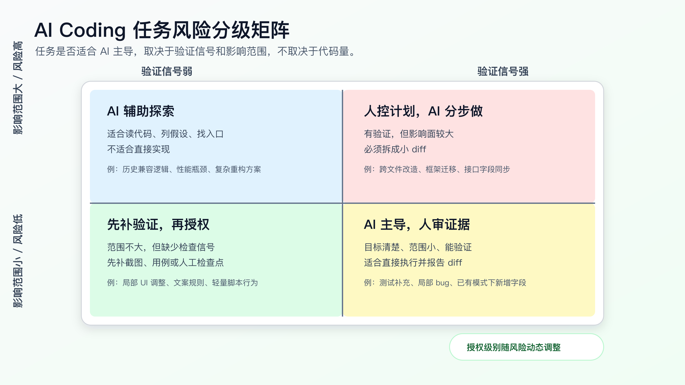
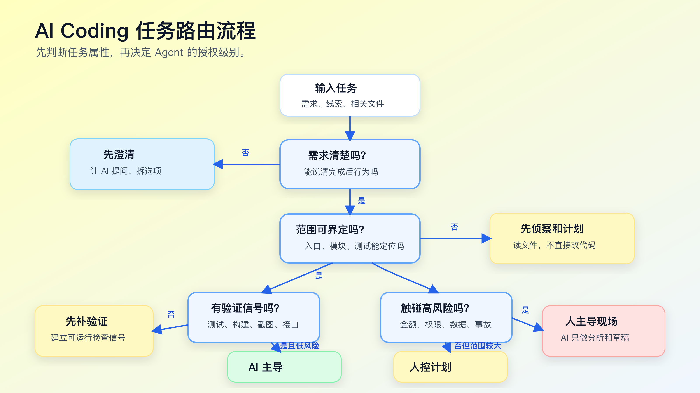

# AI 最擅长和最不擅长的开发任务

判断一个任务能不能交给 AI，不要先问“AI 会不会写这段代码”。

先问四个问题：这个任务的目标是否清楚，影响范围是否可控，验证信号是否明确，关键业务判断是否已经有人做过。

这四个问题，比模型名字、工具名字、prompt 技巧都更重要。

AI Coding 最容易被误用的地方，是把所有任务都按“简单/复杂”来分。很多任务代码量不大，但风险很高；很多任务看起来复杂，但只要边界清楚、测试充分，反而适合交给 Agent 执行。

比如：

- 给已有接口补一条参数校验，可能很适合 AI 主导。
- 修改“订单已支付后是否允许回退状态”，代码也许只有两行，但不该让 AI 自己拍板。
- 把一批老 API 从 `callback` 改成 `async/await`，代码量很大，但如果有测试、有规则、有范围，也可以让 AI 分批做。
- 线上鉴权异常正在影响用户登录，这时 AI 可以帮你读日志和列假设，但关键决策必须人先控住。

所以，程序员用 AI Coding，先要建立任务分级能力。



## 任务不是按“难不难”分，而是按“可控不可控”分

官方文档里其实有一致的方向。

OpenAI Codex 的最佳实践建议在任务里给清楚 goal、context、constraints、done when，复杂、模糊或难描述的任务先让 Codex plan 再实现。Anthropic 的 Claude Code 最佳实践强调给 Agent 一个可运行的检查信号，并把 explore、plan、code 分开。GitHub Copilot cloud agent 的文档也明确说，分配给 agent 的 issue 最好有清晰描述、完整完成条件和相关文件方向；复杂宽泛、敏感关键、需求模糊的任务更适合人自己处理。

这不是三家工具的偶然相似。它们都在提醒同一件事：Agent 更适合处理有边界、有上下文、有反馈的任务。

程序员可以把任务拆成四个维度来看：

| 维度 | 低风险信号 | 高风险信号 |
|---|---|---|
| 目标清晰度 | 一句话能说明改什么、完成后行为是什么 | 需求里有“优化一下”“体验更好”“兼容历史情况” |
| 影响范围 | 单文件、单模块、已有相同模式 | 跨模块、跨仓库、公共接口、数据结构变化 |
| 验证信号 | 有单测、类型检查、截图、接口用例或可复现步骤 | 只能靠肉眼判断，或者依赖线上数据和第三方系统 |
| 业务风险 | 文案、样式、局部工具、非核心路径 | 金额、权限、状态机、数据迁移、隐私、安全、线上事故 |

这四个维度比“前端/后端”“简单/复杂”更有用。

一个前端按钮改色，如果影响设计系统组件，也可能不小。一个后端逻辑修复，如果只改一个已有 guard，并且有失败用例锁住边界，反而可以让 AI 主导实现。

## 四种任务处理模式

我通常把 AI Coding 任务分成四类。

第一类：AI 主导，人做快速审查。

适合目标明确、影响范围小、验证信号强的任务。例如：

- 文档补充和结构调整。
- 明确的测试补充。
- 已有模式下新增字段。
- 局部 bug，有复现用例。
- UI 小改，有截图对比。
- 简单脚本修复，有输入输出样例。

这类任务可以直接给 Agent 执行，但仍然要看 diff 和命令输出。

第二类：AI 实现，人控制计划。

适合中等复杂度任务。需求已经清楚，但涉及多个文件或少量架构边界。例如：

- 给现有模块加一个新能力。
- 补充接口字段，并同步类型、测试和页面展示。
- 修复一个涉及前后端状态一致性的 bug。
- 小范围重构，但范围已经被锁定。

这类任务不要让 Agent 一上来写代码。先让它读文件、出计划、拆步骤。人确认计划后，再让它一步一步改。

第三类：人主导判断，AI 辅助执行。

适合业务判断重、上下文复杂、验证困难的任务。例如：

- 支付、结算、退款、优惠券叠加规则。
- 权限模型和数据隔离。
- 历史兼容逻辑。
- 性能瓶颈定位。
- 复杂重构方案。
- 数据迁移策略。

这类任务里，AI 的价值很大，但不是拍板。它可以帮你画调用链、读历史提交、整理测试缺口、生成候选方案、补机械改动。关键业务规则和方案取舍要人先定。

第四类：人控制现场，AI 只做辅助分析。

适合高风险、不可逆、时间敏感的任务。例如：

- 线上事故处置。
- 安全漏洞修复。
- 用户隐私和鉴权异常。
- 生产数据修复。
- 大规模依赖升级。
- 删除数据、改迁移、改权限策略。

这里不要把 Agent 放到驾驶位。你可以让它读日志、总结证据、列排查路径、写回滚脚本草稿，但执行和决策必须有人确认。

## 一个任务路由流程

把上面的分类落到日常工作里，可以用下面这张路由图。



这个流程看起来简单，但能挡掉很多事故。

第一问：需求是否清楚？

如果需求连“完成后什么行为应该改变”都说不清，不要直接实现。先让 AI 采访你，或者让它把需求改写成几个可确认的选项。模糊需求直接进实现，后面很容易变成“它改得很勤快，但不是我要的”。

第二问：影响范围是否能界定？

如果只涉及一个模块，而且你能指出入口、测试和约束，可以继续。如果 Agent 需要自己判断跨模块影响，就先让它做代码侦察和计划，不要授权改代码。

第三问：是否有可运行验证？

没有验证信号的任务，不代表不能做，但不能让 AI 自己宣布完成。至少要补一个命令、截图、接口调用、人工检查点或对比样例。验证信号越弱，人介入越多。

第四问：是否触碰高风险业务？

金额、权限、隐私、状态机、数据迁移、线上事故，不应该因为“代码看起来简单”就放给 AI 主导。这里的风险不在代码行数，而在错误后果。

## AI 真正擅长的任务

AI 擅长的不是“简单任务”，而是可描述、可搜索、可验证的任务。

第一类是模式迁移。

比如你已经有三个类似组件，现在要按同样模式加第四个；已经有两个接口用了同样鉴权方式，现在要给第三个接口补上；已有测试文件里有正常路径，现在要补一个边界路径。AI 在这种任务上表现通常不错，因为它可以从已有代码里提取模式。

提示可以这样写：

```text
请参考 `src/features/profile/EditProfileForm.tsx` 的实现方式，
在 `src/features/account/AccountSettingsForm.tsx` 增加同类校验。

要求：
- 只复用现有校验工具，不新增依赖。
- 补充对应测试。
- 跑相关测试命令。
```

这里的关键是“参考已有模式”，不是让它自由设计。

第二类是测试补充。

AI 很适合根据已有测试风格补测试，尤其是边界条件、异常路径、回归用例。前提是你要告诉它目标行为，而不是只说“提高覆盖率”。

```text
请补一个回归测试：
- 场景：订单已经 paid 时，不允许回退到 pending。
- 期望：返回业务错误，不修改订单状态。
- 参考测试文件：`test/order-status.test.ts`。

先只写失败测试，不改实现。
```

“先只写失败测试”很重要。它把 AI 从“写一堆能过的测试”拉回到“先锁住真实 bug”。

第三类是局部 bug 修复。

如果 bug 有复现步骤、有错误输出、有相关文件路径，AI 可以很快定位并修复。好的输入应该包含：

```text
现象：
- 用户在 session 过期后重新登录，第一次提交表单失败。

复现：
- 登录后等待 token 过期。
- 刷新页面。
- 提交表单。

已知线索：
- 错误日志：`401 refresh token missing`
- 相关目录：`src/auth/`
- 测试：`test/auth-refresh.test.ts`

要求：
- 先读相关文件并给出计划。
- 不改登录接口协议。
- 用失败测试锁定问题后再改实现。
```

这种任务很适合 AI，因为它有明确的症状和验证路径。

第四类是机械性同步。

例如类型定义、文档、测试夹具、配置样例需要跟随一个小变更同步。AI 做这种事比人更不容易漏文件，但前提是改动范围可枚举。

```text
字段 `displayName` 已加入 `UserProfile`。
请同步：
- TypeScript 类型
- API fixture
- 对应展示测试
- README 中的字段表

不要修改接口语义。
完成后输出 diff 摘要。
```

这类任务要避免一个坑：同步不是重构。如果 Agent 借机整理结构，要停。

## AI 不擅长独立负责的任务

第一类是目标模糊的任务。

“优化体验”“整理架构”“让代码更优雅”“修一下偶发问题”，这些话对人也不够，对 AI 更不够。Agent 会把模糊目标转成它能执行的局部动作，例如改命名、抽函数、加重试、吞异常。结果可能看起来更整洁，但不一定解决问题。

如果目标模糊，先让 AI 做需求澄清：

```text
先不要改代码。

请把这个需求拆成需要我确认的问题：
- 用户可观察行为是什么？
- 哪些行为不能改变？
- 完成后怎么证明？
- 哪些信息缺失会影响方案？
```

第二类是领域规则重的任务。

AI 可以读代码，但它不知道你们公司为什么当年留下一个奇怪的分支。很多业务规则不是从代码表面能推出来的。

例如优惠券叠加、风控拦截、支付状态回退、商家结算周期，代码里可能有历史兼容、临时政策、灰度逻辑、人工运营规则。AI 如果只按“更合理”的工程结构来改，可能会删掉业务上必须保留的脏逻辑。

这类任务要先把业务合同写清楚：

```markdown
## 业务规则

- paid 订单不能回退到 pending。
- refunding 状态可以进入 refunded，但不能进入 canceled。
- 历史订单缺少 `paymentProvider` 时，按 legacy provider 处理。
- 不改变旧接口返回码。

## 人工确认

- 退款状态流转由业务负责人确认。
- 历史订单兼容规则不能由 AI 推断。
```

第三类是大范围重构。

AI 很容易把重构做成“能跑但难审”的大 diff。大范围重构不是不能用 AI，而是不能让它一口气做完。要把任务拆成可验证的机械步骤：

```text
这次只做第一步：
- 把 `src/payment/legacy.ts` 中的类型定义移动到 `src/payment/types.ts`。
- 不改变运行逻辑。
- 跑现有测试。
- 输出 diff 摘要后停止。
```

重构任务里，AI 最适合做可机械验证的步骤；抽象边界和迁移顺序要人控制。

第四类是线上事故。

事故现场最怕“看起来合理的改动”。AI 可以帮你整理日志、列假设、写查询、生成回滚检查项，但不要让它直接改生产路径。事故里，优先级是止血、定位、回滚、记录，不是让代码更优雅。

可以这样用：

```text
请只做分析，不要写修复代码。

输入：
- 事故时间线
- 错误日志
- 最近 3 个相关提交

输出：
- 已确认事实
- 可能原因，按证据强弱排序
- 下一步最小验证动作
- 需要人工确认的风险
```

这种用法能提高排障效率，但不把控制权交出去。

## 用一张任务卡决定授权级别

给 Agent 开始任务前，可以先写一张很短的任务卡。

```markdown
# Task Risk Card

## Objective

修复用户 session 过期后第一次提交表单失败的问题。

## Scope

- 可能相关：`src/auth/`、`test/auth-refresh.test.ts`
- 不允许修改：登录接口协议、token 存储格式

## Risk

- 涉及登录状态，但不涉及权限模型变更。
- 不允许吞掉 401 错误。

## Evidence

- 复现日志：`401 refresh token missing`
- 预期验证：`npm test -- auth-refresh`

## Agent Mode

- 先读文件和出计划。
- 人确认计划后再改代码。
- 如果需要扩大范围，先停止。
```

配套代码仓库 [DavidDingXu/learn-ai-coding](https://github.com/DavidDingXu/learn-ai-coding) 的工具 module 里有一个命令可以生成任务上下文包。它不会替你做风险判断，但能把任务信息固定下来：

```bash
cd learn-ai-coding/ai-coding-workflow-kit
node src/cli.js task-context \
  --title "修复 session 过期后首次提交失败" \
  --files "src/auth/,test/auth-refresh.test.ts"
```

生成出来的上下文包，可以再手动补上 scope、risk、evidence 和 Agent mode。这里不要追求模板漂亮。真正有用的是把“能改什么、不能改什么、怎么证明”写清楚。

## 五个真实工作里的判断例子

例子一：补一个空状态页面。

需求是“列表为空时显示空状态文案和按钮”，已有同类页面，设计稿明确，有前端测试或截图验证。这个任务可以 AI 主导。你要给它参考组件、目标文件和截图验证要求。

```text
参考 `src/pages/order/EmptyState.tsx` 的模式，
给 `src/pages/invoice/ListPage.tsx` 增加空状态。

要求：
- 不改列表查询逻辑。
- 不新增组件库依赖。
- 跑相关前端测试，必要时提供截图对比。
```

例子二：修一个接口字段映射错误。

后端返回 `display_name`，前端类型写成 `displayName`，页面显示为空。相关文件明确，有 fixture 和测试。这个任务可以 AI 主导，或者 AI 实现、人快速审查。重点是别让它改接口协议。

```text
修复字段映射，不改变后端接口协议。
请先定位 mapping 层和测试，再给最小 diff。
```

例子三：订单状态偶发回退。

这类任务代码可能很少，但属于状态机和业务规则。不要让 AI 自己判断。先让它整理状态流转、历史测试、日志证据，再由人确认规则。

```text
先不要改代码。
请整理订单状态流转：
- 当前代码允许哪些状态迁移？
- 哪些测试覆盖了 paid/refunding/refunded？
- 日志里回退发生在哪个入口？
- 你认为需要业务确认的问题有哪些？
```

例子四：把一个模块迁移到新框架。

这是大范围任务。AI 可以参与，但必须拆成阶段。先迁移测试夹具，再迁移只读路径，再迁移写路径，最后清理旧代码。每一步都要有验证命令和回滚边界。

这类任务如果直接说“帮我迁移”，很容易得到一个难审的大 diff。

例子五：线上登录大面积失败。

这里 AI 只能辅助。让它读日志、比较最近提交、列假设、写临时查询都可以。但是否回滚、是否开关降级、是否改鉴权逻辑，必须由人控制。

```text
请基于下面日志只做排障分析，不改代码。
按证据强弱列出假设，并给每个假设的最小验证命令。
```

这五个例子背后的判断很一致：AI 的授权级别跟代码量无关，跟风险、上下文和验证有关。

## 一个简单评分法

如果任务很多，可以用 8 分法快速分级。每个维度 0-2 分：

| 维度 | 0 分 | 1 分 | 2 分 |
|---|---|---|---|
| 目标 | 模糊 | 大致清楚 | 行为明确 |
| 范围 | 跨系统 | 多文件但可界定 | 单模块或同类模式 |
| 验证 | 无法本地验证 | 部分可验证 | 有明确命令或截图 |
| 风险 | 关键业务/安全/数据 | 普通业务逻辑 | 文档、测试、局部展示 |

得分不是越高越好，而是用来决定授权：

| 分数 | 建议模式 |
|---:|---|
| 7-8 | AI 主导，人审 diff 和证据 |
| 5-6 | AI 实现，人先确认计划 |
| 3-4 | 人主导方案，AI 做侦察和局部执行 |
| 0-2 | 暂不授权实现，先澄清需求或人工处理 |

这个评分法不需要严格。它的价值是让你在任务开始前停 30 秒，避免把高风险任务当成普通代码生成。

## 任务分级后的提示写法

不同授权级别，对 Agent 的提示也不一样。

AI 主导型：

```text
请直接完成这个小改动：
- 目标：补充 invoice 列表空状态。
- 参考：`src/pages/order/EmptyState.tsx`
- 约束：不改查询逻辑，不新增依赖。
- 完成判断：相关测试通过，并输出 diff 摘要。
```

AI 实现、人控计划型：

```text
先不要改代码。
请读取相关文件并给出最小实现计划：
- 预计改哪些文件。
- 每个文件为什么要改。
- 需要跑哪些验证命令。
- 哪些风险需要我确认。
```

人主导、AI 辅助型：

```text
请只做分析和方案候选，不要编辑文件。
输出：
- 已确认事实。
- 缺失上下文。
- 方案 A/B 的影响范围。
- 每个方案的验证方式和风险。
```

高风险辅助型：

```text
请只基于提供的日志和提交记录做排障分析。
不要给出生产执行命令。
不要修改代码。
按证据强弱排序假设，并列出需要人工确认的点。
```

把提示写成这样，Agent 就不容易越权。不是因为它“更听话”，而是因为你明确了它当前的角色。

## 改完怎么确认不是误用 AI

任务完成后，至少看四个结果。

第一，看 diff 范围。

```bash
git diff --stat
git diff
```

如果任务是局部 bug，但 diff 涉及公共基础库、锁文件、多个无关模块，要回到计划重新判断。

第二，看验证命令。

```bash
npm test -- auth-refresh
npm run lint
```

命令要和任务风险匹配。文档改动不一定要跑全量测试，状态机改动只跑格式化肯定不够。

第三，看失败分类。

如果测试失败，先确认是改前已有、环境问题、本次引入，还是需求冲突。不要让 Agent 在没分类前继续改。

第四，看剩余风险。

完成报告里应该有“未覆盖什么”。比如：

```markdown
未覆盖：
- 没有连接真实支付网关。
- 没有跑浏览器兼容性测试。
- 没有验证历史订单数据。
```

这几行不是为了承认失败，而是让人知道下一步该看哪里。

## 常见误区

**误区一：AI 适合做简单活，不适合做难活。**

这个说法太粗。AI 适合做边界清楚、反馈明确的活。难任务如果能拆成小步，也可以让 AI 做很多；小任务如果涉及核心业务，也不能随便放手。

**误区二：测试多就可以放心交给 AI。**

测试多只是降低风险，不会自动消除风险。你还要看测试覆盖的是不是本次改动路径，Agent 有没有为了通过测试修改测试本身，是否存在未覆盖的外部系统。

**误区三：让 AI 自己判断风险就行。**

AI 可以帮你列风险，但不能替你承担责任。业务优先级、线上影响、数据后果、用户承诺，这些判断必须由人来定。

**误区四：复杂任务只要 prompt 写得长就能解决。**

长 prompt 可能只是把噪音变多。复杂任务需要的是规格、计划、小 diff 和验证，不是把所有背景塞进一段话。

**误区五：AI 不适合重构。**

AI 可以做重构，但重构必须被拆成机械步骤。先移动类型、再替换调用、再删除旧路径，每一步都能验证。让 AI 一次性“重构得更优雅”，风险很高。

## 可以先改的一件事

下次你准备把任务交给 AI 前，先写四行：

```markdown
目标：
范围：
验证：
风险：
```

如果这四行写不出来，就不要直接实现。先让 AI 帮你澄清。

如果这四行写得很清楚，就继续判断授权级别：AI 主导、AI 实现人控计划、人主导 AI 辅助，还是只让 AI 做分析。

AI Coding 的效率，不来自把更多任务扔给 AI，而来自把合适的任务以合适的授权级别交出去。

接下来进入工具工作台。工具很多，先解决一个问题：在不同任务分级下，应该用 App、CLI、IDE、补全、浏览器和 Git 形成怎样的工作面。

## 常见问题

### 任务评分一定要写成文档吗？

不用。

低风险任务可以在脑子里快速过一遍。只要涉及跨模块、状态、权限、金额、数据迁移、线上问题，就建议写成短任务卡。任务卡不需要漂亮，能说明目标、范围、验证和授权级别就够。

### AI 判断任务风险靠谱吗？

可以让 AI 辅助列风险，但不能让它最终拍板。

AI 能根据代码、测试和文档发现技术风险，却不一定知道业务承诺、上线窗口、历史兼容、用户影响和组织决策。风险判断可以让它先列证据，再由人确认。

### 小任务是不是都可以交给 AI 主导？

不一定。

任务小不等于风险低。两行金额计算、一次权限判断、一个状态迁移条件，都可能影响生产。判断授权级别时，看错误后果和验证信号，不看代码行数。

### 没有测试的任务是不是不能用 AI？

可以用，但要降低授权级别。

没有测试时，可以让 AI 先整理复现步骤、生成手工验证清单、写最小测试候选、查调用链。等验证路径建立起来，再让它实现。不能让它在没有证据的情况下自己宣布完成。

### 重构类任务怎么用 AI 才合适？

先把重构拆成机械步骤。

例如先移动类型，再替换引用，再删除旧入口，每一步都跑测试。不要让 AI 一次性“整理架构”。重构最怕行为改动混进结构调整里，拆小步是为了让 reviewer 能看懂每一轮变化。

## 可复查资料

- OpenAI Codex 最佳实践：<https://developers.openai.com/codex/learn/best-practices>
- Anthropic Claude Code 最佳实践：<https://www.anthropic.com/engineering/claude-code-best-practices>
- GitHub Copilot cloud agent 任务最佳实践：<https://docs.github.com/en/copilot/tutorials/cloud-agent/get-the-best-results>

---

[课程首页](../../../README.md) · [完整目录](../README.md) · [← AI Coding 的底层工作模型](03-AI-Coding-%E7%9A%84%E5%BA%95%E5%B1%82%E5%B7%A5%E4%BD%9C%E6%A8%A1%E5%9E%8B.md) · [Codex、Claude Code、Cursor、Copilot 怎么分工 →](../02-%E7%A8%8B%E5%BA%8F%E5%91%98%E5%B7%A5%E5%85%B7%E5%B7%A5%E4%BD%9C%E5%8F%B0/05-Codex-Claude-Code-Cursor-Copilot-%E6%80%8E%E4%B9%88%E5%88%86%E5%B7%A5.md)

动手实践：[业务样例与测试](../../../personal-productivity-app/README.md)
