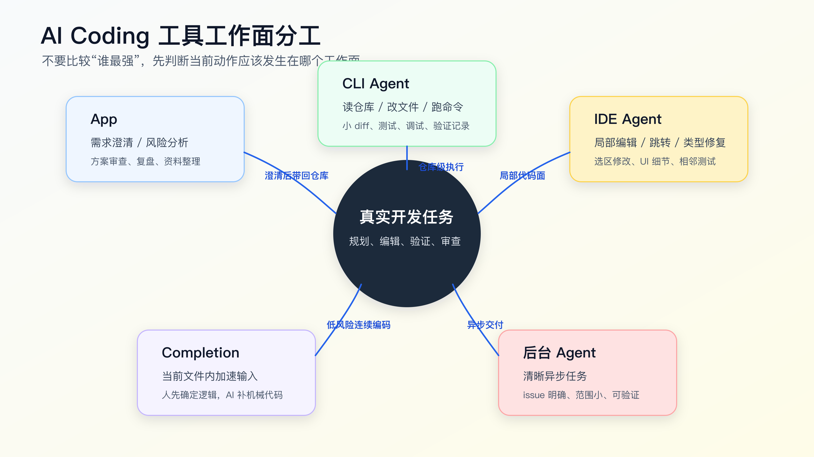

# Codex、Claude Code、Cursor、Copilot 怎么分工

程序员不需要每天换一个 AI Coding 工具。

真正要解决的问题是：一个真实需求先在哪个工作面推进，什么时候才有必要切到另一个工具。

工具选错，AI 能力再强也会难用。

很多人的 AI Coding 工作流卡在一个误区：把 Codex、Claude Code、Cursor、Copilot 当成同一类工具比较。于是问题变成“哪个更强”。这个问题太粗。

先按真实开发动作看边界，不要先按工具名排座次：

- App 类工作面：适合聊需求、拆任务、看结果、管长任务、做文件预览、异步审查和材料整理。
- CLI 类工作面：适合把 Agent 放进真实仓库，读文件、改文件、跑命令、留下可复查输出。
- IDE / AI 编辑器工作面：适合贴近代码上下文做阅读、跳转、diff 审查、断点 debug、局部编辑和交互式修改。
- 补全：适合当前文件内的低风险连续编码。
- 后台 Agent：适合清楚、范围小、可验证、可以异步处理的任务。

App 和 CLI 不是两套能力。只要 CLI Agent 能读仓库、调用工具、运行命令，规划、解释、审查、总结这些动作它也能做。差别更多在交互形态：App 更适合看结果、管理长任务、预览文件或图片、处理异步协作；CLI 更贴近 repo、终端、Git、测试和本地脚本。

一个工具可能覆盖多个工作面。比如 Codex 既有 App，也有 CLI；Claude Code 是终端里的 agentic coding 工具；Cursor 是带 AI 能力的编辑器；GitHub Copilot 同时覆盖 IDE 补全、Chat、review、coding agent 等能力。真正要学的不是工具名，而是把任务放到能产生证据、也符合自己编码习惯的工作面。



## 不要用一个工具承包所有动作

先看一个常见但低效的流程：

```text
1. 在 IDE 里问 AI：帮我实现这个需求。
2. AI 改了几个文件。
3. 测试失败，继续让它修。
4. 发现需求理解错了，回到聊天窗口解释一遍。
5. diff 越来越大，最后自己手动收拾。
```

问题不一定是 IDE 工具不好，而是工作面混在一起了。

需求澄清、代码侦察、实现、测试、调试、审查，本来就是不同性质的动作。把它们全部塞到一个聊天窗口或一个编辑器侧边栏里，信息很容易乱。

更接近真实日常的做法是：先选一个主工作面，把需求、实现和验证尽量在一条线上跑完；只有出现证据、审查或调试缺口时才切换。主工作面不固定，取决于它能不能看到真实仓库、执行必要动作、留下证据。

```text
一种可替换组合：App / CLI 类工作面聊需求、拆任务、跑工作流、开发验证
另一种可替换组合：IDE / AI 编辑器作为主工作面，终端补验证和 Git 证据
审查调试：IDE 读调用链、看 diff、断点 debug、做局部修正
界面行为：浏览器或 Playwright 复现用户路径
最终收口：回到 Git diff、测试输出和残余风险
```

这不是标准答案。有人习惯从 CLI 开始，有人习惯从 IDE 开始，有人会先在 App 里把需求聊清楚。关键不是入口，而是这条链路最后能不能回答：读了哪些文件、改了哪些 diff、跑了哪些验证、还有哪些风险。

## App 什么时候值得用

App 不是代码改动的必经入口。CLI 能做的计划、解释、审查，App 通常也能做；App 值得打开，通常是因为它的界面更适合看和管理结果。

例如：

- 管理多个异步任务。
- 预览文件、图片、报告和审查结果。
- 对比几种方案的取舍。
- 把一段调试记录整理成复盘。
- 整理文章、规则、任务卡或上下文包。
- 做独立审查，不直接碰当前 worktree。

App 的优势不是它比 CLI 更懂工程，而是展示和协作体验更好。它的缺点也很直接：如果拿不到真实工作区、命令输出和 Git diff，它就只能基于你给的材料判断。你如果只在 App 里粘几段代码，让它判断整个项目，风险很高。

适合 App 的提示通常是这样的：

```text
我准备在真实项目里做这个改动。
先不要写代码，请帮我判断任务风险：

需求：
用户 session 过期后，重新登录第一次提交表单失败。

已知上下文：
- 前端 React
- auth 逻辑在 src/auth/
- 已有 auth-refresh 测试

请输出：
- 需要确认的问题
- 可能涉及的模块
- 不适合直接交给 Agent 改的部分
- 建议的第一步验证动作
```

这类工作不需要立刻编辑文件。App 可以帮你把风险和边界整理清楚，再把结果带回仓库。需求已经清楚时，完全可以直接在 CLI 里完成这一步。

但不要在 App 里做这种事：

```text
我把几个文件贴给你，你直接给我完整 diff。
```

除非任务很小，否则这会让 diff 脱离真实仓库。真实项目里的 import、类型、测试、格式化、锁文件、生成文件、路径别名，App 可能都看不见。

## CLI 适合做什么

CLI 是 AI Coding 里最接近真实工程执行面的工作面。

它能在当前仓库里读文件、搜索、编辑、跑命令、看 Git 状态。Codex CLI 和 Claude Code 这类工具的核心价值在于：Agent 可以进入你的项目目录，执行一组可观察动作。

CLI 适合：

- 接手陌生模块。
- 做代码搜索和上下文侦察。
- 执行小步实现。
- 跑测试、lint、build。
- 根据命令输出排障。
- 整理 diff 和完成报告。
- 把规则、模板、验证记录写回仓库。

例如：

```bash
rg -n "refresh token|auth-refresh|session expired" src test
git status --short
npm test -- auth-refresh
```

这些命令的价值不是“有命令行感觉”，而是让 Agent 的判断有证据。CLI 输出能告诉你它读到了什么、改了什么、跑了什么。

CLI 的弱点也很明显：它不一定适合精细 UI 调整，不一定适合设计稿对齐，不一定适合你边跳转边看多个文件的编辑习惯。此时可以把 CLI 用作仓库侦察、工作流执行和验证证据面，把 IDE 用作代码审查、debug 和局部修正面。反过来也成立：如果 IDE 能可靠读仓库、改多文件、跑命令并返回输出，它也可以成为主工作面。

CLI 提示可以这样写：

```text
先不要改代码。

请在当前仓库中完成代码侦察：
- 用搜索找到相关入口、实现、测试。
- 列出实际读取过的文件。
- 给出最小实现计划。
- 说明建议运行的验证命令。

未经确认不要编辑文件。
```

这能让 CLI Agent 先建立证据，再进入实现。

## IDE 适合做什么

Cursor、VS Code 里的 Copilot Chat、JetBrains 里的 AI 能力，本质上都把 AI 放到了编辑器工作面。

IDE 的优势是贴近代码。你可以选中一段函数，让 AI 改；可以在当前文件里补测试；可以一边看类型报错一边调整；可以利用编辑器的跳转、诊断、Git 面板、调试器。

IDE 适合：

- 读调用链和定位真实实现入口。
- 审查 Agent 改出来的 diff。
- 断点 debug 或观察运行时状态。
- 当前文件或相邻文件的小改。
- 根据已有模式补代码。
- 修类型报错和 lint。
- 补单元测试。
- 改 UI 细节。
- 看 diff 时做小修。
- 在人工主导方案下执行局部代码修改。

例如：

```text
只修改当前选中的函数。
目标：当 response.status 为 401 且 refresh token 存在时，先刷新 token 再重试一次。
约束：不改变外部接口，不新增依赖，不吞掉非 401 错误。
```

IDE 的危险在于太顺手。你选中一段代码让 AI 改，很容易忘记它没看完整调用链；你在侧边栏聊了很久，也很容易忘记当前 diff 已经扩大。

所以 IDE 工作面要配两条规则：

```text
1. 选区改动只允许影响选区和必要相邻测试。
2. 任何跨文件、跨模块、改接口的建议，先回到计划阶段。
```

如果一个 IDE Agent 提议“顺便重构一下 auth 管理”，这已经不是当前文件编辑了。应该停下来，让它把方案写出来，再回到主工作面的任务计划或规格流程里判断。

## 补全适合做什么

补全是最容易被低估，也最容易被误用的 AI Coding 能力。

它不适合替你做业务判断，但非常适合在你已经知道要写什么的时候加速输入。

适合补全的场景：

- 重复字段映射。
- 枚举分支补齐。
- 测试断言补全。
- 类型声明。
- 小工具函数。
- 注释到代码的直接转换。
- 按已有模式写相邻代码。

补全的前提是你在驾驶位。你知道下一行应该是什么，AI 只是帮你少敲。

不适合补全的场景：

- 你还没想清业务规则。
- 你不知道该改哪个文件。
- 你不确定这个分支是否应该存在。
- 你在写安全、鉴权、金额、迁移逻辑。

很多线上问题不是因为 AI Agent 大规模改错，而是因为补全悄悄补了一段“看起来合理”的逻辑，人顺手接受了。补全越丝滑，越要保持怀疑。

一个实用做法是：高风险代码先关掉自动接受习惯，只保留手动触发。你可以用补全写重复代码，但不要让它替你决定业务语义。

## 后台 Agent 适合做什么

后台 Agent 的吸引力很明显：你开一个任务，它自己拉分支、改代码、跑检查、给结果。

但它适合的任务其实更窄。

适合后台 Agent 的任务通常有这些特征：

- Issue 描述清楚。
- 完成条件明确。
- 影响范围可预计。
- 有测试或检查命令。
- 不需要频繁人机来回确认。
- 失败后可以安全回滚或重新生成。

例如：

```markdown
## Task

Add empty state to invoice list page.

## Scope

- `src/pages/invoice/ListPage.tsx`
- related tests only

## Done when

- empty invoice response shows existing `EmptyState` component
- no query behavior changes
- related tests pass
```

这种任务适合让后台 Agent 处理。

不适合后台 Agent 的任务：

- 线上事故。
- 需求还在变。
- 需要业务现场确认。
- 涉及权限、金额、隐私、数据修复。
- 需要频繁看 UI 和调细节。
- 测试缺失，完成条件只能靠人判断。

后台 Agent 不是“更强的自动驾驶”，而是异步执行器。你给它的任务越像清晰 issue，它越有用；你给它的任务越像“帮我想办法”，它越容易跑偏。

## 一张主工作面判断表

下面这张表不是标准答案，只是判断入口的辅助。你可以按自己的习惯替换工具，只要最后能留下证据。

| 任务状态 | 首选工作面 | 原因 | 注意点 |
|---|---|---|---|
| 需求模糊 | App / CLI | 先澄清问题、拆目标、列风险 | 不要直接给完整 diff |
| 陌生模块 | CLI | 能搜索、读文件、跑命令、留证据 | 先侦察，后实现 |
| 当前文件小改 | IDE | 贴近代码上下文，编辑效率高 | 限制选区和相邻文件 |
| 重复代码/断言 | 补全 | 人在驾驶位，AI 加速输入 | 不接受业务判断型补全 |
| 中等风险实现 | 能访问仓库并留下证据的主工作面 + IDE/终端补位 | 主工作面做侦察、计划、实现和验证；IDE 做审查、debug 或局部修正 | 每步看 diff |
| UI 交互验证 | IDE + 浏览器 | 编辑和视觉反馈近 | 截图或录屏留证据 |
| 清晰异步任务 | 后台 Agent | 可以独立执行、提交结果 | issue 要写清完成条件 |
| 线上事故/高风险 | App / CLI 辅助 | 分析证据和排查路径 | 人控制执行 |

这张表不是要求你每次切很多工具，而是帮你决定主工作面。

低风险任务可以一直在 IDE 里做。中等风险任务要先选一个能读仓库、改文件、跑命令、留下 diff 和验证输出的主工作面；这个主工作面可以是 CLI，也可以是具备同等能力的 IDE 或 App。高风险任务里，AI 更适合先做证据整理、方案对比和风险枚举，关键业务决策仍然由人确认。

## 一个真实需求怎么组合工具

假设需求是：

```text
用户 session 过期后重新登录，第一次提交表单失败。
```

第一步，在 App 或 CLI 当前对话里做风险判断：

```text
请判断这个任务适合哪种 AI 授权级别：
- AI 主导
- AI 实现，人控计划
- 人主导，AI 辅助
- 只做分析

请说明理由，并列出缺失上下文。
```

这个任务涉及登录状态，但不一定涉及权限模型变化。大概率属于“AI 实现，人控计划”。

第二步，切到 CLI 做上下文侦察：

```text
先不要改代码。
请搜索 session 过期、refresh token、表单提交相关入口。
列出实际读取文件，并给最小实现计划。
```

CLI 可以跑：

```bash
rg -n "refresh token|session expired|401|submit" src test
git status --short
```

第三步，人确认计划后，让 CLI 或 IDE 做第一小步。

如果只是补一个失败测试，CLI 很适合。如果需要在一个组件里调局部状态，IDE 更顺手。

第四步，验证回到 CLI：

```bash
npm test -- auth-refresh
npm run lint
git diff --stat
```

第五步，必要时用浏览器验证真实交互。

如果这个 bug 和页面状态有关，只看测试不够。需要打开本地页面，复现过期登录后的提交路径，记录截图或步骤。

第六步，把完成证据整理成验证记录。下面用配套代码仓库 [DavidDingXu/learn-ai-coding](https://github.com/DavidDingXu/learn-ai-coding) 里的 verification ledger 样例说明格式：

```bash
cd learn-ai-coding/ai-coding-workflow-kit
node src/cli.js verify-ledger --file examples/verification-ledger.pass.md
```

实际项目里可以照着这个格式写自己的 verification ledger。

这条路径不要求工具越多越好。它要求每一步有明确目的：规划归规划，编辑归编辑，验证归验证。

## Codex、Claude Code、Cursor、Copilot 的实际分工

这里不做“谁更强”的排名。工具变化很快，排名很容易过期。先看任务需要哪个工作面。

Codex 适合承担仓库级 Agent 工作：理解任务、读文件、改文件、跑命令、报告验证。Codex CLI 适合本地仓库内的小步实现和验证；Codex 云端/网页工作面适合异步任务、PR/review、材料整理、文件预览和与 GitHub 工作流结合的场景。具体能力要以官方文档和当前产品为准。

Claude Code 适合终端里的 agentic coding，尤其是你希望 Agent 在仓库中探索、计划、编码、测试，并且能结合 `CLAUDE.md`、hooks、skills、MCP、subagents 等机制时。它的工程化能力很强，但也更需要你给清楚规则和边界。

Cursor 适合以编辑器为中心的工作。它的价值不是替代 CLI，而是在你读代码、跳转、选区编辑、局部重构、UI 调整时，把 AI 放到最贴近代码的位置。对程序员来说，Cursor 更像一个 AI-native IDE 工作面。

GitHub Copilot 适合 IDE 内补全、Chat、PR review、GitHub 任务上下文和 cloud agent 等场景。它和 GitHub issue、pull request、repository instructions 的结合很自然，适合把清晰任务放进 GitHub 工作流。

这些分工可以组合。

例如：

```text
Codex/Claude Code：仓库侦察、计划、小步实现、命令验证
Cursor/Copilot Chat：局部编辑、跳转、选区修改、UI 调整
Copilot completion：当前文件补全
GitHub/Codex cloud agent：清晰异步 issue
App：结果预览、异步任务管理、方案审查、复盘和材料整理
```

不要因为一个工具能做很多事，就让它做所有事。

## 工具组合的反例

反例一：在 IDE 里直接做复杂需求。

```text
帮我把支付流程重构一下，顺便修复偶发支付失败。
```

这个任务应该先变成规格、计划和验证路径。IDE 只适合执行其中的局部步骤。

反例二：把 UI 细节全交给 CLI。

```text
帮我把这个页面调得更舒服一点。
```

CLI 可以改代码，但它不一定看得到真实视觉效果。UI 任务需要浏览器截图、设计稿、交互状态。否则 Agent 很容易按代码想象页面。

反例三：让后台 Agent 处理模糊 issue。

```text
用户说登录体验不好，优化一下。
```

这种 issue 不适合异步 Agent。它应该先拆成可观察行为，例如“session 过期后不丢表单输入”“刷新 token 失败时显示重新登录提示”。

反例四：用补全写业务规则。

当你写到：

```ts
if (order.status === 'paid') {
```

补全可能会给出一个看起来合理的分支。但 paid 订单能不能取消、能不能退款、能不能回退，不是补全该决定的事。

## 给自己的最小工具工作台

不需要一次装满所有工具。一个程序员的最小工作台，可以先是这样：

```text
1. 一个仓库级 Agent：Codex CLI 或 Claude Code
2. 一个 AI 编辑器工作面：Cursor 或带 Copilot 的 IDE
3. 一个补全工具：Copilot 或编辑器内置补全
4. 一个浏览器验证方式：本地浏览器、Playwright 或浏览器插件
5. 一个 Git 和测试命令面：终端
```

再配三类仓库资产：

```text
AGENTS.md / CLAUDE.md / repository instructions
任务上下文包
验证记录
```

这就够了。

工具多不是能力。先把一条路径跑顺：任务分级、上下文侦察、计划、小 diff、验证、审查。其他工具只在主工作面不够用时介入。

## 什么时候该切换工具

切换工具不是为了仪式感，而是为了解决当前工作面的短板。

遇到这些情况，应该从 App 切到 CLI：

- 需要读真实仓库文件。
- 需要跑命令验证。
- 需要查看 Git diff。
- 需要生成可落盘产物。

遇到这些情况，应该从 CLI 切到 IDE：

- 需要频繁跳转和人工阅读。
- 需要精细改当前文件。
- 需要借助类型提示、调试器或 UI 插件。
- 需要你亲自掌控局部代码。

遇到这些情况，应该从 IDE 切回 CLI：

- 改动跨多个文件。
- 需要跑测试和整理输出。
- 需要检查 diff 范围。
- 需要把结果写入任务记录。

遇到这些情况，可以考虑后台 Agent：

- 任务已经写成清晰 issue。
- 完成条件明确。
- 失败不会影响现场。
- 你可以稍后 review PR 或 diff。

遇到这些情况，不要切给后台 Agent：

- 需求还没定。
- 线上正在出问题。
- 需要人工连续判断。
- 涉及核心权限、数据和金额。

## 常见问题

**只用一个工具行不行？**

可以。低风险任务完全可以只用一个工具。但随着任务进入真实项目，规划、编辑、验证和审查的需求会分化。工具组合不是为了复杂，而是为了让每个动作在合适的位置发生。

**Codex 和 Claude Code 都是 CLI Agent，怎么选？**

看你现有环境、模型偏好、团队约束和工作流资产。对个人来说，更重要的是把项目规则、上下文包和验证命令跑顺。工具可以替换，工程证据不能省。

**Cursor 和 Copilot 会不会和 CLI Agent 冲突？**

不会。IDE 工具适合局部编辑和当前文件上下文，CLI Agent 适合仓库级计划和验证。冲突通常来自人没有划边界，让多个工具同时改同一批文件。

**后台 Agent 能不能替我写完整需求？**

可以处理清晰、范围小、可验证的需求。复杂需求要先拆。后台 Agent 最怕模糊任务和频繁变化的上下文。

**工具越多，成本会不会越高？**

会。工具太多会带来上下文切换、规则重复和结果合并成本。最小工作台先跑通，再按真实痛点补工具。

## 可以先建立的个人路由规则

把下面这段放进自己的工作笔记就够用：

```markdown
# AI Coding Tool Routing

## App

Use for previews, async task management, review reading, recap, and material organization.

## CLI Agent

Use for repository exploration, small diffs, tests, debugging, and verification records.

## IDE Agent

Use for selected-code edits, local refactors, UI adjustments, and type-driven fixes.

## Completion

Use only when I already know the intended logic.

## Background Agent

Use only for clear, scoped, verifiable async tasks.
```

后面再把它细化到自己的项目，例如哪些命令必须跑，哪些目录不能改，哪些任务必须先写 spec。

工具工作台搭好以后，下一个问题会自然出现：你的本地环境、终端、浏览器、Git、测试命令和项目规则，怎么组织成一条能反复使用的开发路径。否则工具再多，也只是分散的入口。

## 可复查资料

- OpenAI Codex 官方文档：<https://developers.openai.com/codex/>
- OpenAI Codex CLI：<https://developers.openai.com/codex/cli>
- OpenAI Codex cloud：<https://developers.openai.com/codex/cloud>
- Anthropic Claude Code overview：<https://code.claude.com/docs/en/overview>
- GitHub Copilot 文档：<https://docs.github.com/en/copilot>
- Cursor 官方文档入口：<https://cursor.com/docs>

---

[课程首页](../../../README.md) · [完整目录](../README.md) · [← AI 最擅长和最不擅长的开发任务](../01-AI-Coding-%E5%BA%95%E5%B1%82%E5%BF%83%E6%99%BA/04-AI-%E6%9C%80%E6%93%85%E9%95%BF%E5%92%8C%E6%9C%80%E4%B8%8D%E6%93%85%E9%95%BF%E7%9A%84%E5%BC%80%E5%8F%91%E4%BB%BB%E5%8A%A1.md) · [一个程序员的 AI Coding 工作台怎么搭 →](06-%E4%B8%80%E4%B8%AA%E7%A8%8B%E5%BA%8F%E5%91%98%E7%9A%84-AI-Coding-%E5%B7%A5%E4%BD%9C%E5%8F%B0%E6%80%8E%E4%B9%88%E6%90%AD.md)

动手实践：[业务样例与测试](../../../personal-productivity-app/README.md)
