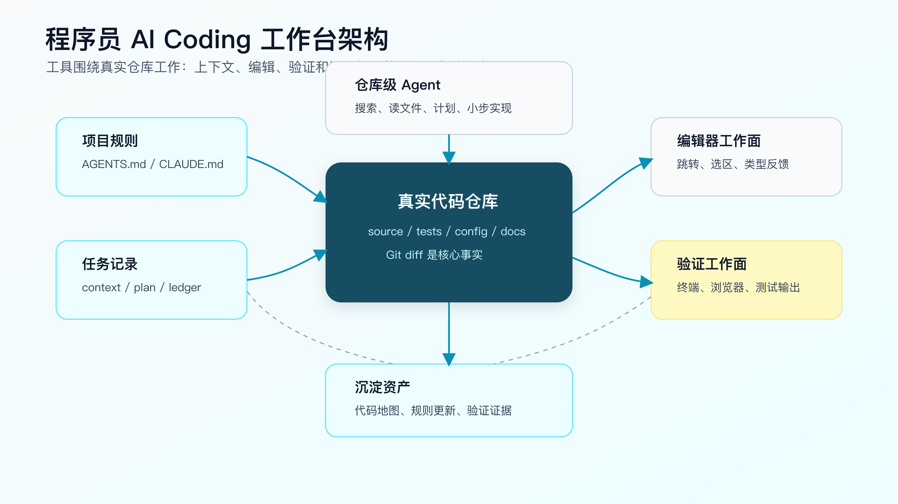
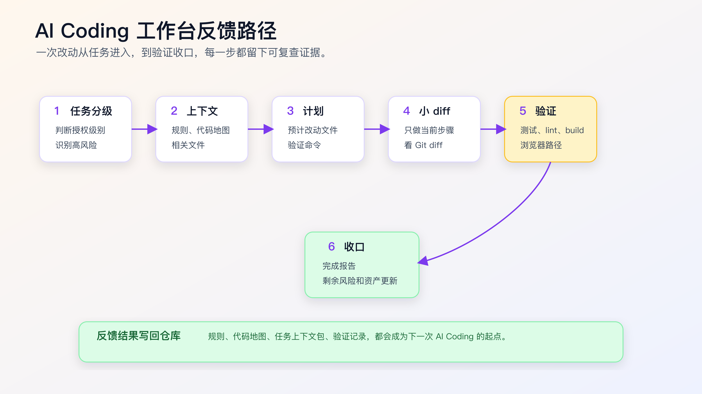

# 一个程序员的 AI Coding 工作台怎么搭

AI Coding 工作台不是把所有 AI 工具都装一遍，也不是给 App、CLI、IDE 分配一套固定职责。

更真实的情况是：不同程序员会有不同主工作面。有人先在 App 或 CLI 里聊需求、拆任务、跑工作流、开发验证；有人把 IDE 或 AI 编辑器当主工作面，只在验证和 Git 收口时回到终端。这些都成立。

工作台要解决的不是“哪个工具更正统”，而是让一次真实需求不要断在半路。

有用的工作台，要让你在真实仓库里拿到一个任务后，稳定完成这几件事：

- 找到正确上下文。
- 让 Agent 知道项目规则。
- 把需求拆成可审查的小步骤。
- 在本地跑验证命令。
- 用浏览器或接口确认用户可见行为。
- 看清 Git diff。
- 把完成证据和剩余风险留下来。

如果这些动作接不上，工具再多也只是入口很多。你会在 App、IDE、终端、浏览器之间来回复制信息，最后不知道 AI 到底读了什么、改了什么、验证了什么。

程序员的工作台应该反过来设计：先定义一条自己真的会用的开发路径，再把工具放到路径上。



## 工作台先解决三个问题

第一个问题：上下文从哪里来。

AI 不能凭空理解项目。它需要项目规则、代码地图、相关文件、历史问题、测试入口、运行命令。工作台要让这些信息容易被找到，而不是每次靠人临时回忆。

第二个问题：改动在哪里发生。

有些改动适合让仓库级 Agent 沿着任务工作流推进，有些适合在 IDE 里读调用链、打断点、审 diff 后局部改。工作台要让你随时看见 diff，不能让多个工具同时在同一批文件上乱改。

第三个问题：完成怎么证明。

AI 说完成没有意义。工作台要让测试、lint、build、浏览器、接口调用、日志和人工检查点变成可复查证据。

这三个问题一旦清楚，工具选择就简单了。

## 最小工作台长什么样

一套够用的个人工作台，可以先从你已经在用的链路开始。

```text
1. 主工作面：App、CLI、IDE 或 AI 编辑器，选一个真实需求里最常用的入口
2. 代码审查和调试面：IDE / AI 编辑器
3. 终端证据面：Git、测试、构建、脚本、日志
4. 浏览器或接口验证面：页面路径、Network、截图、接口响应
5. 项目规则：AGENTS.md、CLAUDE.md、repository instructions
6. 任务记录：context package、plan、verification ledger
```

这些部分不要求绑定某个厂商，也不要求每次同时使用。你可以把 App / CLI 类 Agent 当主工作面，也可以把 IDE、AI 编辑器或编辑器内 AI 能力当主工作面；其他工具只补它不擅长的部分。

关键是每一部分都要有明确职责。

| 组成 | 职责 | 不该承担 |
|---|---|---|
| 主工作面 | 需求讨论、仓库侦察、计划、小步实现、验证收口 | 在证据不足时直接拍板 |
| IDE / 编辑器 | 阅读调用链、审查 diff、断点 debug、局部修改、类型反馈 | 大范围自主重构 |
| 补全 | 当前文件内加速输入 | 业务规则决策 |
| 终端 | Git、测试、构建、脚本、环境检查 | 只看 AI 口头结论 |
| 浏览器 | 用户可见行为验证 | 代替接口和状态检查 |
| 项目规则 | 稳定约束 Agent 行为 | 塞满一次性背景 |
| 任务记录 | 留下上下文和验证证据 | 写成形式化报告 |

工作台不是为了让流程变重，而是为了让每个动作有去处。

## 目录结构先建起来

建议先在自己的项目里放三类轻量文件。不是每个仓库都要完全一样，但思路可以复用。

```text
.
├── AGENTS.md
├── docs/
│   ├── ai-coding/
│   │   ├── code-map.md
│   │   ├── task-context-template.md
│   │   └── verification-ledger-template.md
├── scripts/
│   └── ai/
│       ├── test-focused.sh
│       └── check-worktree.sh
└── package.json
```

`AGENTS.md` 放长期规则。比如安装命令、测试命令、禁止修改目录、新增依赖规则、完成报告要求。

`docs/ai-coding/code-map.md` 放项目结构索引。它不用很完整，但要让新对话知道入口、模块、测试、配置、生成文件在哪里。第一版可以由 Agent 或脚本生成，人只复核关键边界。

`task-context-template.md` 用来记录单次任务的目标、范围、相关文件、风险、验证命令。

`verification-ledger-template.md` 用来记录改完之后的命令、输出、证据和未覆盖风险。

`scripts/ai/` 放可以重复运行的小脚本。不要为了 AI 写一堆复杂自动化，先放最常用的检查命令就够了。

如果你不想改现有项目目录，也可以把这些文件放在 `docs/dev/`、`.github/` 或团队已有文档目录里。目录位置不是重点，重点是稳定可找。

## `AGENTS.md` 只写长期有效规则

很多人写项目规则文件时，会把一次任务的背景也塞进去。这样很快就乱。

`AGENTS.md` 适合写长期有效的工程约束：

```markdown
# Project Instructions

## Commands

- Install: `npm install`
- Focused test: `npm test -- <pattern>`
- Full test: `npm test`
- Lint: `npm run lint`

## Worktree

- Run `git status --short` before editing.
- Do not overwrite user changes.
- Do not edit generated files under `dist/`.

## Change Rules

- Bug fixes must stay scoped to the failing behavior.
- Do not add dependencies without approval.
- Do not mix refactor with behavior changes.
- If implementation requires a wider change, stop and explain.

## Verification

- Report exact commands and results.
- Explain what each command covers.
- List unverified risks before completion.
```

不要写这种规则：

```markdown
- Please be careful.
- Improve code quality as much as possible.
- Use best practices.
- Make the project better.
```

这些话不会给 Agent 提供可执行约束。

长期规则应该来自真实项目经验。比如 Agent 曾经改过生成文件，就写“不要改生成文件”。它曾经为了修测试删除断言，就写“不要删除断言来让测试通过”。它曾经顺手加依赖，就写“新增依赖必须先确认”。

## 代码地图不要做成大而全文档

代码地图的目标不是介绍整个系统，而是帮 Agent 和人快速找到入口。

一份有效的代码地图可以很短：

```markdown
# Code Map

## Runtime Entry

- `src/server.ts`: HTTP server bootstrap.
- `src/routes/`: route definitions.
- `src/modules/order/`: order domain logic.

## Tests

- `test/order/`: order behavior tests.
- `test/auth/`: auth refresh and session tests.

## Config

- `package.json`: scripts.
- `vite.config.ts`: frontend build.
- `.env.example`: local env keys.

## Do Not Edit Directly

- `dist/`
- `generated/`
- lock files unless dependency changes are approved.

## Common Commands

- `npm test -- order`
- `npm run lint`
```

可以用配套代码仓库 [DavidDingXu/learn-ai-coding](https://github.com/DavidDingXu/learn-ai-coding) 的工具 module 先生成一版轻量地图：

```bash
cd learn-ai-coding/ai-coding-workflow-kit
node src/cli.js codemap --root .
```

如果要在任务开始前检查风险边界，可以再生成上下文审计报告：

```bash
cd learn-ai-coding/ai-coding-workflow-kit
node src/cli.js context-audit --root .
```

它会列出 Agent 应优先读取的文件、候选入口、测试和验证提示，以及 generated、dist、legacy 这类需要谨慎处理的路径。生成后不要直接当事实，要复核真实运行入口、业务模块、禁止修改目录和 focused verification。

代码地图最重要的是更新频率。它不需要覆盖所有文件，但关键入口变了要改。否则 Agent 会被过期地图带偏。

## 任务上下文包把一次需求固定下来

每次中等风险任务开始前，不要只给 Agent 一句话。写一个短上下文包。

```markdown
# Task Context

## Objective

修复 session 过期后重新登录，第一次提交表单失败的问题。

## Scope

- 可能相关：`src/auth/`、`src/forms/submit.ts`
- 测试：`test/auth-refresh.test.ts`
- 不允许修改：登录接口协议、token 存储格式

## Evidence

- 错误日志：`401 refresh token missing`
- 复现路径：等待 token 过期，刷新页面，提交表单

## Verification

- `npm test -- auth-refresh`
- 浏览器复现路径手动验证

## Agent Mode

先读文件和出计划。人确认后再实现。
```

这个文件不需要正式。你也可以直接放在 issue、PR 描述或任务评论里。关键是让目标、范围、证据和验证命令同时出现。

配套工程的工具 module 里有生成基础上下文包的命令：

```bash
cd learn-ai-coding/ai-coding-workflow-kit
node src/cli.js task-context \
  --title "修复 session 过期后首次提交失败" \
  --files "src/auth/,test/auth-refresh.test.ts"
```

生成出来的内容只是起点。真正的工程判断需要你确认风险和边界。

## 终端要成为证据面

AI Coding 里，终端不是附属工具。它是证据面。

至少要把这些命令固定下来：

```bash
git status --short
git diff --stat
git diff
npm test
npm run lint
npm run build
```

具体命令按项目替换。Java 项目可能是：

```bash
./mvnw test
./mvnw -DskipTests package
```

Go 项目可能是：

```bash
go test ./...
go vet ./...
```

前端项目可能是：

```bash
npm test -- auth-refresh
npm run typecheck
npm run lint
```

不要只记命令名字，要知道每个命令覆盖什么风险。

`git status --short` 确认工作区有没有已有改动。

`git diff --stat` 看改动范围。

`git diff` 看语义。

focused test 看本次路径。

full test 看共享影响。

typecheck 看类型合同。

lint 看格式和静态规则。

build 看打包路径。

如果 Agent 只说“测试通过”，你要追问：哪个命令，在哪个目录，输出是什么，覆盖什么，没覆盖什么。

## 浏览器验证要接到工作流里

前端和交互任务不能只看测试。

浏览器验证至少要覆盖：

- 页面能否打开。
- 关键状态是否正确。
- 用户操作是否触发预期请求。
- 错误状态是否可见。
- 移动端或小屏是否变形。
- 截图中是否有文字重叠、遮挡、错位。

如果你用 Playwright，可以把 UI 验证写成可重复运行的命令：

```bash
npx playwright test auth-refresh.spec.ts
```

如果只是本地手动验证，也要留下步骤：

```markdown
## Browser Verification

- URL: `http://localhost:3000/settings`
- Steps:
  1. Login.
  2. Wait for token expiration.
  3. Refresh page.
  4. Submit profile form.
- Expected:
  - token refresh happens once
  - form submission succeeds
  - no duplicate error toast
```

不要让浏览器验证变成“我看了一下没问题”。用户可见行为应该能复现。

## Git 是最后的事实来源之一

AI 写完后，最可靠的材料之一是 Git diff。

每次完成前，至少看：

```bash
git status --short
git diff --stat
git diff
```

如果是多步任务，建议每一步结束后就看一次 diff。不要等整个任务结束再看。

看 diff 时关注五件事：

1. 是否改了计划外文件。
2. 是否混入重构、格式化或无关清理。
3. 是否删除测试或降低断言强度。
4. 是否新增依赖、脚本、配置。
5. 是否改变公共接口或数据结构。

Agent 的完成报告可以参考这个格式：

```markdown
## Change Summary

- Added refresh-token retry before form submit.
- Kept login API contract unchanged.

## Files Changed

- `src/auth/refresh.ts`: add retry guard.
- `test/auth-refresh.test.ts`: add regression case.

## Verification

- `npm test -- auth-refresh`: passed, 6 tests.
- Browser manual path: passed.

## Residual Risk

- Did not test real third-party SSO provider.
```

这比“已修复”有用得多。

## 一次改动的反馈路径

工作台搭好后，一次任务应该能沿着下面这条路径走。



第一步，任务分级。

先判断是 AI 主导、AI 实现人控计划、人主导 AI 辅助，还是只做分析。这个判断决定后面的流程重量。

第二步，生成上下文。

让 Agent 读取项目规则、代码地图和任务上下文包。陌生模块先搜索和列读取文件，不直接改。

第三步，计划。

要求它给出预计修改文件、原因和验证命令。计划没有通过，不进入编辑。

第四步，小步实现。

CLI 或 IDE 只做当前步骤。实现后停下来，看 diff。

第五步，验证。

跑 focused test、lint、build 或浏览器路径。失败先分类，不直接继续改。

第六步，收口。

输出 change summary、commands、evidence、residual risk。必要时把规则或代码地图更新回仓库。

这条路径的好处是：无论用 Codex、Claude Code、Cursor 还是 Copilot，工作台的证据结构都不变。

## 不要把工作台搭成工具负担

工作台也会过度设计。

这些做法要避免：

- 为每个任务新建一套复杂项目。
- 为了 AI 写一堆没人维护的脚本。
- 把规则文件写成几十页。
- 每个小文案改动都要求完整上下文包。
- 为了“流程完整”强制跑无关全量命令。
- 让多个 Agent 同时改同一批文件。

工作台应该按风险伸缩。

低风险任务：

```text
IDE 修改 -> git diff -> focused test 或人工检查
```

中等风险任务：

```text
任务上下文 -> CLI 侦察 -> 计划 -> 小 diff -> focused test -> diff review
```

高风险任务：

```text
需求澄清 -> 业务规则确认 -> 规格或设计 -> 分步实现 -> 多层验证 -> 人工审查
```

越高风险，越需要证据；越低风险，越要避免形式主义。

## 常见坑

**坑一：规则文件越写越长。**

规则文件应该是长期有效约束，不是任务记录。一次性背景放到任务上下文包里。过期规则要删，否则 Agent 会被旧信息污染。

**坑二：代码地图生成后没人更新。**

代码地图过期比没有地图更危险。入口、测试命令、生成目录变了，要及时改。可以把更新代码地图作为模块改造后的收尾动作。

**坑三：终端命令只为给 AI 看。**

命令是给人和机器共同看的证据。不要只跑一个看起来会绿的命令。验证命令要覆盖本次风险。

**坑四：浏览器验证没有记录。**

“页面看起来没问题”无法复查。至少留下 URL、操作步骤、期望结果。重要页面最好有截图或 Playwright 测试。

**坑五：多个工具抢同一个 diff。**

CLI Agent、IDE Agent、补全同时改同一批文件，很容易造成上下文冲突。一次只让一个工作面承担主要编辑，另一个用于审查或验证。

## 你可以今天就搭的版本

先不要做复杂系统。建三个文件就够了。

第一个：`AGENTS.md`

```markdown
# Project Instructions

## Commands

- Test: `npm test`
- Lint: `npm run lint`
- Build: `npm run build`

## Rules

- Run `git status --short` before editing.
- Do not add dependencies without approval.
- Do not edit generated files.
- Keep bug fixes scoped.

## Completion Report

- Changed files.
- Commands run.
- Result.
- Residual risk.
```

第二个：`docs/ai-coding/code-map.md`

```markdown
# Code Map

## Entry

- `src/main.ts`: main runtime entry

## Tests

- Focused test: `npm test -- <module>`

## Do Not Edit

- `dist/` and generated client directories
```

第三个：`docs/ai-coding/task-context-template.md`

```markdown
# Task Context

## Objective

## Scope

## Constraints

## Verification

## Agent Mode
```

然后用一次真实小需求试跑。不要挑最复杂的需求，也不要挑纯文案。选一个有代码、有测试、有一点风险但能本地验证的任务。

跑完后看四件事：

- Agent 是否读对文件。
- diff 是否小。
- 命令是否能证明结果。
- 有哪些规则值得写回。

这比一次性搭完整体系更有效。

## 常见问题

**没有测试的老项目怎么搭工作台？**

先不要追求自动化完整。把可复查动作写出来：手动复现步骤、接口调用、日志观察、页面截图、数据库只读查询。后续再逐步补测试。

**项目很大，代码地图会不会维护不动？**

不要做全量地图。只维护运行入口、核心模块、测试命令、配置、生成文件和禁止修改目录。按模块逐步补。

**规则文件应该全局一份还是每个目录一份？**

先全局一份。只有当目录差异明显，例如前端、后端、移动端命令完全不同，再考虑分目录规则。规则越多，维护成本越高。

**我用 Cursor 或 Copilot，还需要 CLI Agent 吗？**

不一定。当前文件小改可以留在 IDE。涉及仓库搜索、计划、命令验证和多文件修改时，再切到 CLI 工作面。

**工作台会不会让 AI Coding 变慢？**

低风险任务不应该变慢。中高风险任务看起来多了几个步骤，但减少的是返工、误改和不可审查 diff。真实项目里，这通常更快。

## 把工作台放进个人习惯

一套工作台要能长期用，关键不是文件齐不齐，而是你能不能形成固定动作：

```text
开始前：任务分级 + 上下文
实现前：计划 + 边界
实现中：小 diff + 单一编辑面
完成前：命令 + 浏览器/接口验证 + diff
完成后：验证记录 + 规则更新
```

这些动作一旦固定，后续再讲 SDD、OpenSpec、Skill、Superpowers、MCP、多 Agent，才有落点。否则新工具只会让入口变多，证据更散。

工作台搭起来以后，还要解决一个具体问题：App、CLI、IDE 什么时候切换、怎么交接上下文、怎么避免多个 Agent 互相打架。

## 工作台不是工具清单

很多人搭工作台，会从“我要装哪些工具”开始。这个顺序容易跑偏。

真正要先定的是四个出口：

```text
1. 任务从哪里进入。
2. 代码由哪个工作面主要编辑。
3. 验证结果在哪里留下证据。
4. 规则和经验最后沉淀到哪里。
```

如果这四个出口不清楚，工具越多越乱。

例如一个前端 bug：

```text
入口：任务卡写清楚页面、复现步骤、限制范围。
主工作面：能访问仓库、改文件、跑测试并留下证据的 Agent 负责推进。
审查调试面：IDE 读调用链、审 diff、必要时断点 debug。
验证证据：浏览器截图、接口响应、测试命令输出。
沉淀位置：如果发现规则缺口，写回 AGENTS.md 或验证模板。
```

另一个局部类型修复：

```text
入口：IDE 选中报错位置。
主编辑面：IDE 补全或 Agent 修改当前文件。
验证证据：typecheck 或 focused test。
沉淀位置：通常不需要沉淀，除非重复出现同类错误。
```

工作台的标准不是“工具全”，而是每次任务都能回答：谁在改、改到哪里、怎么验、验完留下些什么。

## 最小工作台的退出标准

一个最小工作台搭好以后，可以用一次真实任务验证。

不是看文档是否齐全，而是看这几个结果：

```text
Agent 能读到项目规则。
Agent 能说出实际读取文件。
Agent 能给出小步计划。
主工作面没有同时和另一个 Agent 抢同一批文件。
验证命令能运行，失败时能分类。
完成报告里有 diff、命令、结果、未覆盖路径。
```

如果这些做不到，继续装插件没有意义。

反过来，如果这些已经跑通，就算工具只有 CLI、IDE 和浏览器，也已经能支撑大多数个人 AI Coding 任务。

## 工作台出问题时先查哪里

工作台跑不顺，不一定是工具不够。

先查三个地方。

第一，入口是否混乱。任务是从聊天记录、issue、PR 评论、临时口头需求里来的，如果没有整理成目标、范围和验证，Agent 很难稳定执行。

第二，编辑面是否冲突。CLI Agent、IDE 补全、另一个聊天窗口同时改同一批文件，最终 diff 会混在一起。一次任务只保留一个主编辑面，其它工作面只做审查、预览或验证。

第三，验证出口是否缺失。如果不知道最终要跑什么命令、看哪个页面、查哪条日志，Agent 就会选择它最容易完成的验证。

很多“AI 不稳定”的问题，根因在这里。不是模型不会写代码，而是工作台没有把入口、编辑和验证收成一条线。

## 先用一次任务校准工作台

工作台搭完以后，不要马上拿最大需求试。

选一个真实但可控的任务，例如修一个 CLI 参数、补一个接口边界测试、改一个表单校验。这个任务要满足两个条件：涉及真实代码，并且能本地验证。

试运行时只看三件事。

第一，Agent 是否能从规则文件和任务卡里读到同一组约束。如果规则写“不新增依赖”，任务执行时仍然准备安装包，说明规则没有进入计划。

第二，主编辑面是否稳定。如果 CLI 已经在改文件，IDE 补全就不要同时改同一段逻辑。工具之间可以协作，但不能抢同一个 diff。

第三，完成证据是否足够复查。只有“已完成”不算。至少要有改动文件、命令输出、未覆盖路径和必要的截图或接口结果。

这次试运行结束后，只沉淀一个最有价值的改进。可能是一条规则，也可能是一个验证命令，或者是删掉一段误导 Agent 的旧说明。一次只改一个点，工作台才会稳定变好。

## 可复查资料

- OpenAI Codex `AGENTS.md` 指南：<https://developers.openai.com/codex/guides/agents-md>
- OpenAI Codex CLI：<https://developers.openai.com/codex/cli>
- Anthropic Claude Code memory：<https://code.claude.com/docs/en/memory>
- GitHub Copilot repository instructions：<https://docs.github.com/en/copilot/how-tos/copilot-on-github/customize-copilot/add-custom-instructions/add-repository-instructions>
- Playwright 官方文档：<https://playwright.dev/docs/intro>

---

[课程首页](../../../README.md) · [完整目录](../README.md) · [← Codex、Claude Code、Cursor、Copilot 怎么分工](05-Codex-Claude-Code-Cursor-Copilot-%E6%80%8E%E4%B9%88%E5%88%86%E5%B7%A5.md) · [App、CLI、IDE 怎么切换完成一次真实改动 →](07-App-CLI-IDE-%E6%80%8E%E4%B9%88%E7%BB%84%E5%90%88%E5%AE%8C%E6%88%90%E4%B8%80%E6%AC%A1%E7%9C%9F%E5%AE%9E%E6%94%B9%E5%8A%A8.md)

动手实践：[业务样例与测试](../../../personal-productivity-app/README.md)
