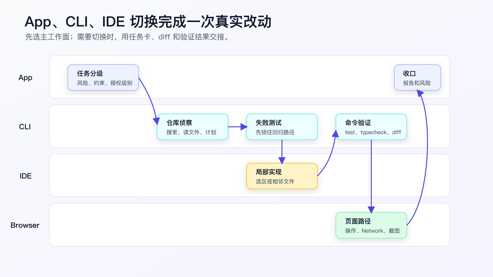
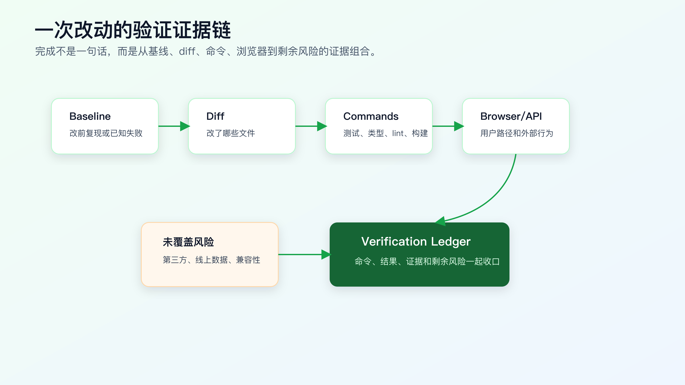

# App、CLI、IDE 怎么切换完成一次真实改动

AI Coding 进入日常开发后，很快会遇到一个具体问题：什么时候留在当前工具，什么时候才值得切换。

App、CLI、IDE 的能力有重叠，不需要每次都用一遍。多数真实需求应该先选一个主工作面跑下去，只有在需求讨论、代码审查、debug、用户路径验证或结果整理出现缺口时，才切到另一个工具。

这篇不讲工具安装，也不比较工具优劣。我们直接走一遍中等风险改动：

```text
用户 session 过期后重新登录，第一次提交资料表单失败。
```

这个需求不算特别大，但足够真实。它涉及前端状态、鉴权刷新、表单提交、错误提示和浏览器验证。它不适合直接丢给后台 Agent，也不需要上来就写完整规格。

一种贴近日常的走法是：先在 App、CLI 或 IDE 里把需求、风险和验证路径聊清楚，再让能访问仓库的主工作面做仓库侦察、实现和验证；如果问题定位到少数文件，切到 IDE 读调用链、审 diff、断点 debug 或做局部修正；最后回到测试、Git diff 和浏览器路径收口。这里没有“必须切工具”的标准动作，只有证据链哪里断了，就在哪里补工具。



## 第一步：先判断主工作面够不够

如果需求已经清楚，可以直接从你常用的主工作面开始。App 的价值是讨论、预览、长任务管理和审查，不是每次改代码的必经入口。需求含糊、风险高、你需要先拆任务时，可以先用 App 把任务风险、缺失上下文和第一步动作说清楚；如果你习惯在 CLI 或 IDE 里聊需求，也完全可以留在当前工作面完成这一步。

可以这样问：

```text
我准备在一个真实项目里修这个问题：

用户 session 过期后重新登录，第一次提交资料表单失败。

先不要写代码。请帮我判断：
1. 这个任务适合哪种 AI 授权级别？
2. 可能涉及哪些模块？
3. 哪些风险需要人确认？
4. 第一轮应该让 CLI Agent 做哪些侦察？
```

理想输出不是一段泛泛分析，而是类似这样：

```markdown
## 授权级别

AI 实现，人控计划。

原因：
- 涉及登录状态和表单提交，不能直接改。
- 但范围可能集中在 auth refresh 和 submit flow。
- 可以通过测试和浏览器路径验证。

## 需要侦察

- session 过期和 refresh token 的实现位置。
- 表单 submit 入口。
- 401 错误处理逻辑。
- 现有 auth/form 测试。

## 人工确认

- 不改变登录接口协议。
- 不改变 token 存储格式。
- 不吞掉非 401 错误。
```

这一步的产物是任务上下文，而不是代码。

你可以把它压缩成一张任务卡：

```markdown
# Task Context

## Objective

修复 session 过期后重新登录，第一次提交资料表单失败的问题。

## Constraints

- 不改变登录接口协议。
- 不改变 token 存储格式。
- 不吞掉非 401 错误。
- 不新增依赖。

## Agent Mode

CLI 先侦察并出计划；人确认后再实现。
```

这张任务卡后面可以交给 CLI Agent，也可以继续留在当前 Codex 工作面执行。工具切换时，靠的不是“你记得我们刚才聊过”，而是明确产物。

## 第二步：主工作面做仓库侦察，不改代码

切到仓库根目录后，先确认工作区状态。

```bash
git status --short
```

如果这里已经有用户改动，不要让 Agent 直接动手。先弄清楚哪些文件属于当前任务，哪些是别人或自己之前的改动。

然后让当前主工作面里的 Agent 做侦察。这里可以是 CLI，也可以是能访问仓库和命令输出的 App 或 IDE Agent：

```text
先不要改代码。

任务：
修复 session 过期后重新登录，第一次提交资料表单失败。

约束：
- 不改变登录接口协议。
- 不改变 token 存储格式。
- 不吞掉非 401 错误。
- 不新增依赖。

请做仓库侦察：
1. 用搜索找到 auth refresh、401 处理、form submit 相关入口。
2. 列出实际读取过的文件。
3. 标出可能需要修改和不应该修改的文件。
4. 给出最小实现计划和验证命令。
5. 未经确认不要编辑文件。
```

Agent 可能会跑：

```bash
rg -n "refresh token|refreshToken|401|session expired|submit" src test
rg --files | rg "auth|session|form|submit|test|spec"
```

你要看的不是它搜了多少，而是它是否找到了四类文件：

- auth refresh 逻辑。
- form submit 入口。
- API 客户端或请求拦截器。
- 相关测试。

如果它只读了表单组件，没有读 auth；或者只读了 auth，没有读 submit；或者完全没找到测试，就不要进入实现。

侦察阶段可以用配套代码仓库 [DavidDingXu/learn-ai-coding](https://github.com/DavidDingXu/learn-ai-coding) 的工具 module 先生成一份基础上下文包：

```bash
cd learn-ai-coding/ai-coding-workflow-kit
node src/cli.js task-context \
  --title "修复 session 过期后首次提交失败" \
  --files "src/auth/,src/forms/,test/auth-refresh.test.ts"
```

生成文件不是最终答案，只是把目标和候选文件固定下来。接下来要由真实仓库搜索结果补全。

## 第三步：确认计划，不让它一步到位

Agent 给出的计划应该具体到文件和命令。

可接受的计划大概是：

```markdown
## Plan

1. Add a regression test in `test/auth-refresh.test.ts`.
   - Case: expired session, refresh succeeds, first submit retries once.
   - Verification: focused auth-refresh test should fail before implementation.

2. Update `src/auth/request.ts`.
   - Add retry guard for 401 when refresh token exists.
   - Do not swallow non-401 errors.

3. Run focused tests.
   - `npm test -- auth-refresh`

4. Run browser verification.
   - login, expire session, refresh page, submit form.
```

不可接受的计划通常有这些味道：

```markdown
- 重构 auth 模块。
- 统一所有请求错误处理。
- 顺便优化表单提交体验。
- 增加一个新的状态管理库。
- 修改登录接口返回结构。
```

这些不是完全不能做，而是不应该混在这次 bug 修复里。

确认计划时，你可以给 CLI Agent 一个明确授权：

```text
只执行计划第 1 步：补回归测试。

要求：
- 不改实现。
- 不改计划外文件。
- 测试应当在当前实现下失败。
- 完成后停止，输出 diff 摘要和测试结果。
```

这一步非常关键。先写失败测试，能防止 AI 直接写一个“看起来修了”的实现。

## 第四步：IDE 做局部编辑，但不接管全局判断

有些改动在 IDE 里做更舒服。

比如测试已经写好，问题定位到 `src/auth/request.ts` 的一个请求封装函数。你可以在 IDE 里打开这个文件，选中相关函数，让 AI 做局部修改：

```text
只修改当前选中的请求函数。

目标：
- 当请求返回 401 且 refresh token 存在时，刷新 token 后重试原请求一次。

约束：
- 不改变函数签名。
- 不改变登录接口协议。
- 不吞掉非 401 错误。
- 不新增依赖。
- 不修改其他文件。
```

这里 IDE 的作用是提高局部编辑效率。你仍然要控制边界。

如果 IDE Agent 开始建议改全局状态管理、封装新客户端、修改多个调用方，就停。把建议拿回 CLI 或 App 做计划审查。

IDE 编辑完成后，马上看 diff：

```bash
git diff --stat
git diff src/auth/request.ts
```

不要等整轮任务结束再看。局部编辑最容易“顺手多改一点”。

## 第五步：验证回到能留下证据的地方

实现完成后，验证要回到能留下证据的地方。很多时候这是 CLI，因为命令输出和 diff 最容易复查；如果你的 App 或 IDE 能稳定运行命令、展示 diff、保存输出，也可以继续留在当前工作面。

先跑 focused test：

```bash
npm test -- auth-refresh
```

如果通过，再看是否需要更广一点的命令：

```bash
npm run lint
npm run typecheck
```

如果改到了共享请求封装，可能还要跑更广的测试：

```bash
npm test
```

每个命令都要回答一个问题：

| 命令 | 覆盖什么 |
|---|---|
| `npm test -- auth-refresh` | session refresh 和首次提交回归路径 |
| `npm run typecheck` | 请求函数签名和调用方类型 |
| `npm run lint` | 静态规则和格式问题 |
| `npm test` | 共享请求层是否影响其他测试 |

如果测试失败，不要立刻让 Agent 继续改。先分类：

```text
测试失败后先不要改代码。

请判断：
- 是本次引入失败，还是改前已有失败？
- 是测试预期问题、实现问题、环境问题，还是需求冲突？
- 需要查看哪些输出或文件才能确认？
```

这个动作能挡住很多无意义试错。

## 第六步：浏览器验证用户路径

这个 bug 涉及用户提交表单，所以测试通过还不够。

需要打开本地页面，走一次真实路径：

```markdown
## Browser Verification

URL: `http://localhost:3000/profile`

Steps:
1. 登录。
2. 等待 session 过期，或用测试环境手动置为过期状态。
3. 刷新页面。
4. 修改资料表单。
5. 点击提交。

Expected:
- 请求遇到 401 后刷新 token。
- 原提交请求重试一次。
- 表单提交成功。
- 不出现重复错误 toast。
- 非 401 错误仍然显示原错误。
```

如果项目有 Playwright，可以把这条路径写成测试。没有也没关系，先把手动验证步骤写清楚。

浏览器验证要特别注意两个细节：

第一，观察 Network。

确认是否真的发生了 refresh，再重试原请求。页面不报错不代表逻辑正确，可能只是错误被吞掉了。

第二，观察错误路径。

不要只验证 refresh 成功。还要确认 refresh 失败、非 401 错误、重复提交这些路径没有被破坏。

这就是为什么前面不能让 AI 吞掉非 401 错误。

## 第七步：完成报告要能复查

最后不要只写：

```text
已修复。
```

完成报告至少要包含四块：

```markdown
## Change Summary

- Added regression coverage for expired-session first submit.
- Added one retry after token refresh for 401 responses.
- Kept login API contract and token storage format unchanged.

## Files Changed

- `test/auth-refresh.test.ts`
- `src/auth/request.ts`

## Verification

- `npm test -- auth-refresh`: passed, 6 tests.
- `npm run typecheck`: passed.
- Browser path: login -> expire session -> refresh -> submit, passed.

## Residual Risk

- Did not verify third-party SSO provider in staging.
- Did not run full end-to-end suite.
```

验证记录可以照配套工程的工具 module 里的 verification ledger 格式写。

```bash
cd learn-ai-coding/ai-coding-workflow-kit
node src/cli.js verify-ledger --file examples/verification-ledger.pass.md
```

这个命令不是要替代你的判断。它只是提醒完成记录必须有 baseline、change summary、verification commands、evidence 和 residual risk。



## 工具交接时最容易丢什么

第一，丢约束。

App 里讨论过“不改登录协议”，切到 CLI 后没写进任务卡，Agent 就可能忘。工具切换时，约束要变成文本产物。

第二，丢文件边界。

CLI 侦察出只需要改 `src/auth/request.ts`，IDE 里选区修改时又让 AI 扩到别的文件。每次切工具，都要重申当前授权范围。

第三，丢验证命令。

IDE 里改完后很容易只看类型提示，不跑真实测试。实现可以在 IDE，验证要回 CLI。

第四，丢失败分类。

测试失败后，如果换到另一个工具继续修，很容易把环境问题、旧失败、本次失败混在一起。失败分类要在同一个记录里沉淀。

第五，丢最终 diff。

多个工具轮流改后，你可能不知道哪些改动是谁引入的。每个阶段结束都看 `git diff --stat`，能及时发现偏航。

## 一个常见错误：每个工具都用一遍

很多人学习 AI Coding 后，会下意识把所有工具串起来。

先在 App 里讨论需求，再让 CLI 搜索，再在 IDE 里改，再让另一个 Agent review，再打开浏览器验证。流程看起来完整，但如果没有明确主工作面，最后很容易变成工具之间互相传话。

真实项目里，工具切换有成本。

第一，状态会丢。App 里的结论如果没有整理成任务卡，CLI 只能看到一段自然语言讨论。它不一定知道哪一句是硬约束，哪一句只是猜测。

第二，权限会变。CLI 可以读仓库和跑命令，IDE 可能只看到当前文件，App 可能只能根据你提供的材料推理。你不能假设不同工具看到的是同一个世界。

第三，证据会断。CLI 跑过测试，IDE 里继续改了代码，浏览器又验证了一次。如果最后没有统一的 verification record，别人 review 时不知道哪个验证对应哪个 diff。

所以，工具组合的原则不是“都用上”，而是“一次任务一个主工作面”。

可以按下面方式判断：

| 任务状态 | 主工作面 | 其他工具 |
|---|---|---|
| 需求还不清楚 | App 或对话型工作面 | 只产出任务卡，不改代码 |
| 仓库内多文件改动 | 能访问仓库、改文件、跑命令的主工作面 | IDE 辅助阅读、debug 和审 diff，浏览器验证用户路径 |
| 当前文件局部修改 | IDE / 编辑器 AI | 终端或主工作面跑测试和看 diff |
| 用户路径验证 | 浏览器/Playwright | 主工作面提供启动命令和日志 |
| 结果审查和复盘 | App 或独立 review Agent | 输入 diff、命令、风险记录 |

如果你选 App 或 CLI 做主工作面，就让它保留完整任务上下文、计划、实现和验证。IDE 主要用来读代码、审查 diff、断点 debug 和局部修正，不要让它重新定义任务。
如果你选 IDE 做主工作面，就让它承担主要实现上下文；CLI 或 App 只补它缺的能力，例如运行命令、查看 Git diff、复现失败或整理长任务结果，不要另起一套实现计划。
如果你需要 App 参与，就把它的输出整理成任务卡或 review 结论，不要让一段长讨论直接进入实现。

## 真实切换记录应该长什么样

下面是一份可复查记录。它不需要很正式，但要能回答“这次为什么切工具、每一步留下了什么证据”。

```markdown
# Tool Handoff Record

## Task

session 过期后重新登录，第一次提交资料表单失败。

## Main Surface

CLI Agent.

Reason:
- 需要搜索仓库、读多个文件、跑测试、看 diff。
- 改动可能触及 request wrapper 和 form submit flow。

## App Output

Used only for task framing.

Confirmed:
- Agent mode: plan first.
- Constraints: do not change login API contract; do not change token storage; do not swallow non-401 errors.

## CLI Recon

Files read:
- `src/auth/request.ts`
- `src/forms/ProfileForm.tsx`
- `test/auth-refresh.test.ts`

Excluded:
- `src/generated/api-client.ts`: generated file.
- `src/demo/ProfileForm.tsx`: demo path.

Plan:
1. Add regression test for expired-session first submit.
2. Implement one retry after successful refresh.
3. Run focused auth tests.

## IDE Edit

Used only for local edit in `src/auth/request.ts`.

Scope:
- current request wrapper function.
- no signature change.
- no dependency change.

## Verification

- `npm test -- auth-refresh`: passed.
- `npm run typecheck`: passed.
- Browser path: login -> expire session -> refresh -> submit, passed.

## Residual Risk

- Did not run third-party SSO staging path.
- Did not run full E2E suite.
```

这份记录看起来长，但实际写起来很快。它把工具切换变成证据链，而不是聊天记忆。

程序员在这里要做的不是当“工具调度员”，而是控制信息边界：每次切换都要带着目标、约束、文件、验证和残余风险。

## 什么时候应该停下来

工具切换过程中，有几类信号说明任务已经不该继续往前推。

第一，CLI 找不到真实入口。

如果 Agent 只能列出几个“可能相关”的文件，但无法解释用户动作从哪里进入，就不要让它实现。先让它扩大侦察，或者回到需求确认。

第二，IDE 修改需要扩大范围。

你本来只让 IDE 改请求函数，它却发现要改状态管理、路由和多个调用方。这时不要在 IDE 里继续扩。把发现带回 CLI 或任务计划，重新拆步骤。

第三，浏览器验证和测试冲突。

测试通过但浏览器仍失败，说明验证路径没有覆盖真实行为。此时不要只调页面，也不要只改测试。应该记录冲突，回到请求、状态、接口和浏览器 Network 证据上。

第四，App 审查提出的新方向没有文件证据。

App 很适合审查方案，但如果它建议“可能是并发刷新问题”，必须回到仓库搜索、日志或测试复现。没有证据的新方向，只能进入假设列表，不能直接进入实现。

第五，diff 已经超过计划。

只要 `git diff --stat` 显示计划外文件，就先停。让 Agent 解释每个计划外文件为什么出现，再决定保留、拆分还是回滚。

这里的停，不是降低效率。它是在防止后面出现一个没人敢 review 的 diff。

## 一个可复制的工具切换模板

你可以把下面这段放到自己的工作笔记里。

```markdown
# AI Coding Change Workflow

## 1. Optional App: Task Framing

- Clarify objective.
- Classify risk.
- List constraints.
- Decide agent mode.

## 2. CLI: Recon

- Run `git status --short`.
- Search relevant files.
- Read entry, implementation, tests, config.
- Produce plan.

## 3. Human: Plan Review

- Check changed-file list.
- Check verification command.
- Reject refactor/dependency/interface changes unless intended.

## 4. CLI or IDE: Small Change

- Execute one step only.
- Do not edit out-of-scope files.
- Stop after diff.

## 5. CLI: Verification

- Run focused test.
- Run wider checks if shared code changed.
- Classify failures before editing again.

## 6. Browser/API: Behavior Check

- Verify user-visible path or API behavior.
- Record steps and expected result.

## 7. Close

- Summarize changed files.
- List commands and results.
- Record residual risk.
- Update reusable rule if needed.
```

这个模板的核心不是七个步骤，也不是按工具名分配职责，而是每次切换都要说明能力和证据：

- 这个工作面能看到哪些上下文。
- 它能不能改文件、跑命令、打开页面或调用接口。
- 它留下了什么证据：任务卡、diff、命令输出、截图、接口响应或风险记录。
- 下一个工作面接手时，哪些结论是硬约束，哪些只是待验证假设。

如果一个 App 已经能访问仓库、运行命令并展示 diff，它也可以作为主工作面；如果一个 IDE 能稳定搜索全仓、修改多文件并返回测试输出，它也可以承担主工作面。工具名字不重要，证据能力才重要。

## 什么时候不用这么完整

低风险任务不需要完整流程。

比如：

```text
把按钮文案从“保存”改成“提交”。
```

可以直接在 IDE 里改，然后看 diff。

```bash
git diff
```

如果有快照测试或页面截图，再跑一下。没必要写上下文包、计划和完整验证记录。

但下面这些信号一出现，就要升级流程：

- 涉及登录、权限、金额、状态机。
- 改动超过一个模块。
- 测试失败需要解释。
- AI 提议改接口或新增依赖。
- 需要浏览器验证复杂交互。
- 需要多人 review。

流程重量由风险决定，不由工具决定。

## 常见问题

**App 分析出来的结论要不要直接粘给 CLI？**

要粘，但要整理成任务卡。不要把整段闲聊复制过去。CLI 需要的是目标、约束、相关线索、验证命令和授权级别。

**App、CLI 和 IDE 都能改代码，应该选哪个？**

按任务风险和证据链选。当前文件、选区、类型驱动的小改留在 IDE 更自然；跨文件、需要命令验证和完成报告的任务，用能访问仓库、跑命令、留下输出的 App / CLI / IDE Agent 更自然。无论谁改，最后都要回到 Git diff 和验证命令。

**浏览器验证能不能让 AI 自动做？**

可以，前提是工具能真的打开页面、点击、截图，并把结果返回。否则就手动验证并记录步骤。不要把“页面应该没问题”当成验证。

**如果 CLI Agent 的计划和 IDE 里的直觉冲突怎么办？**

先看证据。谁读了真实文件、谁能解释调用链、谁给出可验证命令，就优先相信谁。如果仍冲突，停下来让 Agent 整理事实，不要直接改。

**一次任务里能不能用多个 Agent？**

可以，但不要让它们同时编辑同一批文件。一个负责侦察，一个负责 review，一个负责实现，都要有明确边界。多数个人任务不需要多 Agent。

**什么时候 App 比 CLI 更合适？**

当任务更像讨论、审查、预览和整理，而不是马上在 repo 里改文件。比如需求要先拆、风险要先分级、你需要对两个实现方案做取舍，或者你想让一个独立上下文审查计划和 diff。只要进入真实文件修改、断点 debug 和命令验证，就要回到能访问仓库、IDE 或终端证据的工作面。

**CLI 能做计划和总结，那 App 还有必要吗？**

有，但不是必经。App 的优势通常在长任务管理、结果预览、材料整理、异步审查和跨任务复盘。需求明确、本地仓库可访问、验证命令可运行时，CLI 直接开始更自然；如果你的 App 工作面已经接入仓库和命令，也可以继续留在 App 里推进。

**IDE 的 AI 已经能搜索全项目，还需要 CLI 吗？**

看验证和 debug 需求。如果 IDE 能可靠读仓库、改多文件、跑命令、返回输出，也可以作为主工作面。也可以把 IDE 留给代码审查和断点 debug，把 App/CLI 留给任务工作流和验证收口。关键不是名字叫 IDE 还是 CLI，而是它能不能留下可复查证据。

**工具之间结论冲突，以谁为准？**

以证据为准。读了真实文件、能解释调用链、能跑出命令输出、能展示 diff 的结论优先。没有证据的判断只能当假设。

## 把组合流程迁移到自己的项目

迁移时不要先买工具，先固定三个动作。

第一，任务入口统一。

每个中等风险任务先写一张任务卡：目标、约束、范围、验证、授权级别。

第二，编辑入口单一。

一次只让一个工作面承担主要编辑。App/CLI 做主工作面时，IDE 主要做阅读、审查、debug 和微调；IDE 做主工作面时，App/CLI 主要补需求拆解、命令验证、diff 总结和复盘材料。

第三，验证出口统一。

不管中间用了哪个工具，最后都输出同一种完成报告：改了什么、跑了什么、证据是什么、还有什么风险。

做到这三点，工具就不会互相打架。

工具工作台先讲到这里。后面进入上下文工程：为什么给 AI 更多代码，不一定会让它做得更好；过多、过期、无关的上下文反而会把它带偏。

还有一个细节：切换工作面时，不要复制整段聊天记录。

把上一个工作面的结论整理成任务卡再交给下一个工作面：

```text
目标：
已确认事实：
当前 diff：
限制：
验证命令：
未解决问题：
```

这样 CLI、IDE、App 之间传递的是工程事实，不是聊天噪音。

## 可复查资料

- OpenAI Codex 最佳实践：<https://developers.openai.com/codex/learn/best-practices>
- OpenAI Codex CLI：<https://developers.openai.com/codex/cli>
- Anthropic Claude Code 最佳实践：<https://www.anthropic.com/engineering/claude-code-best-practices>
- GitHub Copilot cloud agent 任务最佳实践：<https://docs.github.com/en/copilot/tutorials/cloud-agent/get-the-best-results>
- Playwright 官方文档：<https://playwright.dev/docs/intro>

---

[课程首页](../../../README.md) · [完整目录](../README.md) · [← 一个程序员的 AI Coding 工作台怎么搭](06-%E4%B8%80%E4%B8%AA%E7%A8%8B%E5%BA%8F%E5%91%98%E7%9A%84-AI-Coding-%E5%B7%A5%E4%BD%9C%E5%8F%B0%E6%80%8E%E4%B9%88%E6%90%AD.md) · [上下文工程：为什么不是塞越多代码越好 →](../03-%E4%B8%8A%E4%B8%8B%E6%96%87%E5%B7%A5%E7%A8%8B%E4%B8%8E%E4%BB%A3%E7%A0%81%E5%BA%93%E7%90%86%E8%A7%A3/08-%E4%B8%8A%E4%B8%8B%E6%96%87%E5%B7%A5%E7%A8%8B-%E4%B8%BA%E4%BB%80%E4%B9%88%E4%B8%8D%E6%98%AF%E5%A1%9E%E8%B6%8A%E5%A4%9A%E4%BB%A3%E7%A0%81%E8%B6%8A%E5%A5%BD.md)

动手实践：[业务样例与测试](../../../personal-productivity-app/README.md)
