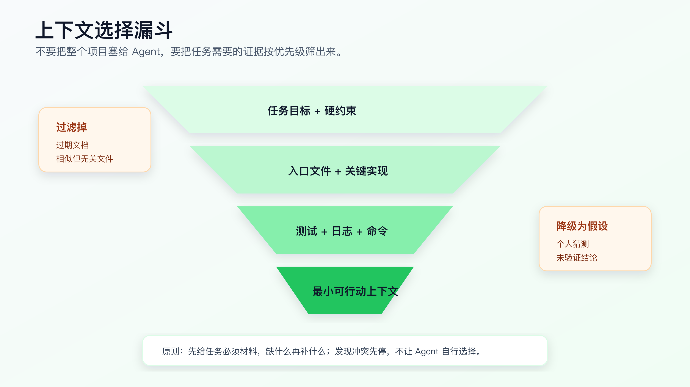
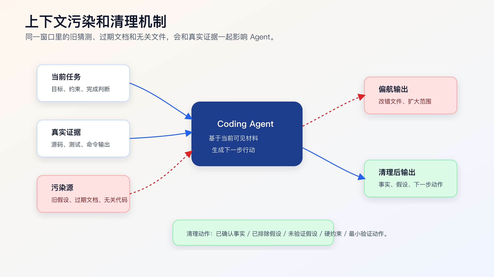

# 上下文工程：为什么不是塞越多代码越好

很多程序员第一次用 AI 改真实项目，会自然想到一个办法：多给它代码。

把相关目录贴进去，把文档贴进去，把报错贴进去，把历史聊天也贴进去。看起来越完整，AI 越应该懂项目。

实际经常相反。

上下文越多，模型能看到的信息越多，但噪音、旧结论、冲突规则、相似但无关的代码也会一起进来。Agent 不是把所有材料变成可靠事实，它会根据当前上下文里的线索生成下一步判断。你给它一堆材料，如果没有优先级和边界，它就可能被最显眼、最新、最相似但错误的线索带偏。

上下文工程不是“喂更多”，而是“给对、给少、给得有结构”。



## 为什么更多上下文会变差

真实项目里，错误上下文主要有五种。

第一种，相似但无关的文件。

比如你要修线上订单提交，仓库里同时有：

```text
src/order/submit.ts
src/order/submit.legacy.ts
src/demo/order-submit.ts
docs/order-submit.md
test/order-submit.test.ts
```

如果 Agent 先读到 `demo`，它可能按 demo 逻辑改真实代码；如果先读到 `legacy`，它可能误以为旧接口仍是主路径；如果只读 docs，可能忽略当前实现已经偏离文档。

第二种，过期文档。

文档很有用，但文档会过期。尤其是接口、状态机、部署脚本、环境变量说明。Agent 如果把过期文档当作当前事实，修改方向会很危险。

第三种，冲突规则。

用户说“快速修好”，项目规则说“不要改公共接口”，历史对话里又有人说“可以重构”。这些指令混在一起，Agent 可能抓住最显眼的那条执行。

第四种，失败假设。

排障过程中，前几轮猜测如果没有被清理，会一直污染后续判断。比如一开始怀疑是缓存，后来日志证明不是，但对话里保留了大量缓存讨论，Agent 之后仍可能继续沿着缓存方向改。

第五种，无验证结论。

“应该是前端问题”“看起来是后端返回慢”“可能是 token 过期”，这些话如果没证据，就不能进入实现上下文。它们最多是待验证假设。

上下文工程的第一条原则是：不要把未验证判断和已确认事实混在一起。

## Agent 需要的不是完整项目，而是任务视野

一次具体任务需要的上下文通常分成六层。

| 层级 | 内容 | 作用 |
|---|---|---|
| 任务目标 | 要改变的用户可见行为或代码行为 | 防止实现跑偏 |
| 硬约束 | 不能改的接口、目录、依赖、兼容规则 | 防止越界 |
| 入口文件 | 请求入口、页面入口、命令入口、模块入口 | 确定从哪里开始看 |
| 关键实现 | 业务逻辑、状态流转、核心函数 | 决定怎么改 |
| 验证材料 | 测试、复现步骤、日志、截图、命令 | 证明改动有效 |
| 项目规则 | 命令、目录、代码风格、完成报告 | 保持工程一致性 |

这六层比“把相关目录都给它”更有用。

例如修 session 过期后的首次提交失败，给 Agent 这些材料就足够开始：

```markdown
## Objective

session 过期后重新登录，第一次提交资料表单应该成功。

## Constraints

- 不改变登录接口协议。
- 不改变 token 存储格式。
- 不吞掉非 401 错误。

## Candidate Files

- `src/auth/request.ts`
- `src/forms/ProfileForm.tsx`
- `test/auth-refresh.test.ts`

## Evidence

- 错误日志：`401 refresh token missing`
- 复现路径：登录 -> 等待 session 过期 -> 刷新 -> 提交表单

## Verification

- `npm test -- auth-refresh`
- 浏览器复现路径
```

如果 Agent 读完这些后发现缺上下文，再让它搜索和补充。不要一开始就把整个 `src/` 目录塞进去。

## 上下文要有优先级

不是所有材料地位相同。

一个实用的优先级可以这样排：

```text
1. 当前任务目标和硬约束
2. 当前仓库真实源码
3. 当前测试和命令输出
4. 项目规则文件
5. 官方文档和接口契约
6. 历史 issue、PR、聊天记录
7. 个人猜测和经验判断
```

如果源码和文档冲突，不能直接相信文档；要确认当前实现和测试。
如果用户猜测和日志冲突，不能按猜测改；要回到日志。
如果历史 issue 和当前规则冲突，不能直接照历史 issue；要看它是否仍适用。

你可以把优先级写进提示：

```text
如果资料之间冲突，请按下面顺序判断：
1. 当前任务硬约束
2. 当前源码和测试
3. 实际命令输出
4. 项目规则
5. 历史文档和讨论

发现冲突时先停止并说明，不要自行选择。
```

这段话能减少 Agent 自己“合理化”的空间。

## 一个上下文选择流程

每次任务开始前，可以按下面流程选文件。



第一步，写目标。

目标必须是行为，不是愿望。

差：

```text
优化登录体验。
```

好：

```text
session 过期后重新登录，第一次提交资料表单应该成功，不应出现重复错误 toast。
```

第二步，写硬约束。

硬约束比背景更重要。

```text
不改变登录接口协议。
不改变 token 存储格式。
不新增依赖。
不吞掉非 401 错误。
```

第三步，找入口。

用 `rg` 先找候选入口：

```bash
rg -n "refresh token|refreshToken|401|session expired|submit" src test
rg --files | rg "auth|session|form|submit|test|spec"
```

不要让 Agent 只凭文件名判断。候选入口要读过才能确认。

第四步，读测试。

很多人先读实现，后读测试。AI Coding 里更建议尽早读测试。测试会告诉你当前行为边界、已有命名、断言风格和可运行命令。

第五步，标记不该改的文件。

上下文包里不仅要写“可能相关”，还要写“看起来相关但暂时不该改”。例如：

```markdown
## Do Not Edit Initially

- `src/auth/login.ts`: 登录接口协议不在本次范围。
- `src/auth/storage.ts`: token 存储格式不改。
- `src/demo/`: 示例页面，不是生产路径。
```

这能避免 Agent 把相似文件都纳入改动。

第六步，缺什么再补什么。

如果计划阶段发现缺调用链，再让 Agent 搜索；如果测试失败需要环境变量，再补 `.env.example`；如果浏览器路径不清楚，再补路由文件。上下文是按证据逐步扩展，不是一次性塞满。

## 让 Agent 做上下文侦察，而不是自己整理材料

这里容易产生误解。

上下文工程不是让程序员手工复制一堆文件、手工筛选几十条搜索结果、手工写一份漂亮文档。现在的 Agent 本来就能搜索仓库、读文件、运行命令。程序员要做的是定义侦察目标和验收格式。

一个可用的上下文侦察提示可以这样写：

```text
先不要改代码。

任务：
session 过期后重新登录，第一次提交资料表单失败。

请做上下文侦察，并输出 Context Recon Report。

要求：
1. 先列出搜索关键词，不要直接实现。
2. 搜索入口、实现、测试、配置和项目规则。
3. 每个候选文件都说明为什么相关。
4. 区分 production、test、demo/example、legacy、generated。
5. 标出看起来相关但暂时不应该修改的文件。
6. 给出缺失上下文和下一步最小验证动作。
7. 不要编辑任何文件。
```

Agent 的输出应该长这样：

```markdown
# Context Recon Report

## Objective

session 过期后重新登录，第一次提交资料表单应该成功。

## Search Terms

- session, refreshToken, 401, unauthorized, submit, ProfileForm

## Files Read

- `src/auth/request.ts`
  - reason: HTTP 401 handling and retry behavior.
- `src/forms/ProfileForm.tsx`
  - reason: user-visible submit entry.
- `test/auth-refresh.test.ts`
  - reason: existing refresh behavior tests.
- `AGENTS.md`
  - reason: project rules and verification commands.

## Excluded For Now

- `src/generated/api-client.ts`
  - generated file, do not edit directly.
- `src/demo/ProfileForm.tsx`
  - demo route, not production path.
- `docs/auth-old.md`
  - appears outdated; conflicts with current request wrapper.

## Missing Context

- Need to confirm whether original request should retry exactly once.
- Need browser path for expired session reproduction.

## Next Action

- Add or locate a failing regression test for expired-session first submit.
```

这个报告比“我读完了项目”有用得多。你能直接检查它有没有漏测试、有没有把 demo 当生产、有没有把 generated 放进修改范围。

配套代码仓库 [DavidDingXu/learn-ai-coding](https://github.com/DavidDingXu/learn-ai-coding) 的工具 module 里的 `context-audit` 可以作为第一层自动检查：

```bash
cd learn-ai-coding/ai-coding-workflow-kit
node src/cli.js context-audit --root .
```

它只做启发式扫描，不证明真实调用路径。它的价值是提醒 Agent 和人：先看哪些文件，哪些路径要谨慎，哪些结论必须复核。

## 生产项目里最常见的上下文过载

上下文过载不一定是 token 超限。更常见的是材料太多，但优先级不清楚。

第一类，旧 PR 和当前代码混在一起。

很多项目会把历史 PR、issue、设计文档贴给 Agent。它们可能解释了当时为什么这么做，但不一定代表当前系统事实。尤其是经历过多次重构的模块，旧 PR 里的入口、命名、命令可能都变了。

处理方式很简单：历史材料只能作为线索，不能直接作为实现依据。让 Agent 回到当前源码、测试和命令输出确认。

```text
下面的 issue 只能作为历史线索。
请以当前源码、测试和命令输出为准。
如果 issue 与当前实现冲突，列出冲突点，不要直接按 issue 修改。
```

第二类，多个相似模块一起进入上下文。

比如 `order`、`order-v2`、`legacy-order`、`demo-order` 同时存在。Agent 很容易选择最短、最整洁、最像标准答案的那条路径，但生产路径往往不是最漂亮的那条。

这时要让它做路径分类：

```markdown
## Path Classification

- production path:
- compatibility path:
- demo/example path:
- generated path:
- test fixture:
```

分类不清楚，就不能实现。

第三类，失败尝试污染当前判断。

调试时，前两轮假设会留下很多文本。比如先怀疑缓存，再怀疑后端，再怀疑 token。即使后面日志排除了缓存，缓存讨论仍然在上下文里，Agent 可能继续沿着旧假设修改。

处理方式是把已排除假设单独列出来：

```markdown
## Excluded Hypotheses

- Not cache: reproduced after clearing local storage and disabling cache.
- Not backend 500: submit API returns 401 before backend handler.
```

这比简单说“继续”更能保住当前证据链。

第四类，工具输出未经整理。

一大段 `rg` 输出、测试日志、浏览器 console，很容易把关键行淹没。Agent 需要原始输出时可以读，但进入实现前应该先整理成摘要。

摘要必须保留证据，不要只留结论：

```markdown
## Evidence Summary

- `test/auth-refresh.test.ts:42` covers refresh success but not original submit retry.
- `src/auth/request.ts:88` handles 401 and refresh.
- No test found for duplicate submit after refresh.
```

第五类，官方文档被当成项目事实。

官方文档能说明工具或框架当前支持什么，但你的项目可能锁在旧版本，也可能有历史约定。写法应该是：

```text
先确认当前依赖版本和项目配置。
只有在版本和配置匹配时，才按官方文档建议修改。
```

这些场景都不是理论问题。真实生产里，AI 很少因为“完全没材料”犯错，更多是因为材料太多、层级不清、旧结论没被排除。

## 给 Agent 的上下文包模板

可以直接复用这个模板：

```markdown
# Task Context Package

## Objective

用一句话说明完成后的行为。

## Constraints

- 不允许改变什么。
- 不允许新增什么。
- 必须保留什么兼容行为。

## Known Evidence

- 复现步骤：
- 错误日志：
- 截图或接口响应：

## Files To Inspect First

- `path/to/entry`
- `path/to/implementation`
- `path/to/test`

## Files Not To Edit Initially

- `path/to/generated`
- `path/to/legacy`

## Verification

- focused test:
- broader check:
- browser/API path:

## Open Questions

- 需要人确认的问题。
```

这个模板不是为了好看，而是为了把上下文分层。

配套工程的工具 module 里可以生成基础任务上下文：

```bash
cd learn-ai-coding/ai-coding-workflow-kit
node src/cli.js task-context \
  --title "修复 session 过期后首次提交失败" \
  --files "src/auth/request.ts,src/forms/ProfileForm.tsx,test/auth-refresh.test.ts"
```

生成后要复核 constraints、evidence、not-to-edit 和 verification。不要把生成结果当最终判断。

## 代码地图是上下文工程的入口

陌生仓库里，先别让 Agent 直接改。

先让它读代码地图，或者生成一份轻量代码地图：

```bash
cd learn-ai-coding/ai-coding-workflow-kit
node src/cli.js codemap --root .
```

代码地图应该帮它回答：

- 运行入口在哪里。
- 测试目录在哪里。
- 配置文件在哪里。
- 生成文件和构建产物在哪里。
- 哪些目录不应该直接改。
- 常用验证命令是什么。

代码地图不是全量架构文档。它是一张导航图。

一个老项目里，Agent 最容易误改的地方往往不是业务核心，而是旁边那些看起来相关的文件：旧入口、示例目录、生成代码、测试夹具、历史迁移脚本。代码地图要把这些地方标出来。

## 上下文污染的典型症状

你怎么知道上下文已经污染？

看这些信号。

第一，Agent 引用已经被否定的假设。

比如日志已经证明不是缓存问题，它仍然说“我们可以清理缓存”。这说明旧上下文还在影响判断。

第二，Agent 修改了相似但无关文件。

比如任务是生产订单提交，它改了 `demo/order-submit.ts`。这说明文件优先级没讲清。

第三，Agent 反复扩大范围。

一开始修 bug，后来变成重构 auth，再后来变成统一错误处理。上下文里可能混入了“顺便优化”的目标。

第四，Agent 无法解释为什么改某个文件。

如果它只能说“这个文件相关”，而不能说明入口、调用关系和验证方式，就说明上下文选择不够干净。

第五，完成报告没有“未验证风险”。

这通常意味着它把可见材料当成完整事实。

遇到这些情况，不要继续补更多材料。先清理上下文。

## 如何清理上下文

清理上下文不是删除对话，而是重新整理事实。

可以让 Agent 停下来输出：

```text
请停止修改，重新整理当前上下文。

只按证据分类：
1. 已确认事实。
2. 已排除假设。
3. 未验证假设。
4. 当前任务硬约束。
5. 下一步最小验证动作。

不要继续写代码。
```

一个好的整理结果应该像这样：

```markdown
## 已确认事实

- 表单提交时第一跳请求返回 401。
- refresh token 存在。
- refresh 接口成功返回新 token。
- 原提交请求没有重试。

## 已排除假设

- 不是表单字段校验失败。
- 不是后端提交接口 500。

## 未验证假设

- 请求封装层是否禁止重复提交。
- 是否存在并发 refresh 问题。

## 硬约束

- 不改变登录接口协议。
- 不改变 token 存储格式。

## 下一步

- 补一个 refresh 成功后重试原请求的回归测试。
```

这份整理可以作为新对话或下一步实现的干净上下文。

如果对话已经很长，直接开新对话也可以。但新对话要带整理后的事实，而不是带原始长聊天。

## 什么时候应该补更多上下文

少给上下文不是目的。给够才是目的。

需要补上下文的信号：

- Agent 无法确认真实入口。
- 计划里出现“可能”“猜测”但没有文件证据。
- 测试失败和当前 diff 对不上。
- 实现涉及公共接口或共享模块。
- 日志指向另一个服务或异步任务。
- 浏览器行为和单元测试结果冲突。

补上下文时，要补具体材料：

```text
不是：再看看整个项目。
而是：请读取 `src/auth/request.ts` 的调用方，并列出哪些路径会触发表单提交。
```

或者：

```text
不是：看看测试为什么失败。
而是：请读取失败测试输出、对应测试文件和本次 diff，判断失败类型。
```

越具体，越能避免新噪音。

## 如何处理官方文档和项目源码冲突

AI Coding 经常会用到官方文档。官方文档优先级很高，但不是项目当前事实。

例如，官方文档说某个配置默认开启，但你的项目里显式关闭；官方建议某个 API 用法，但项目里因为兼容旧版本保留了不同写法；框架文档已经更新，但项目依赖还是旧版本。

这时应该让 Agent 这样处理：

```text
请区分官方文档事实和当前项目事实。

如果二者冲突：
- 列出冲突点。
- 确认项目依赖版本和当前配置。
- 不要直接按官方最新写法修改。
- 先说明迁移成本和兼容风险。
```

工具文档、框架文档、社区经验，都不能绕过当前仓库。

## 常见错误写法

错误写法一：

```text
我把整个 src 目录都给你，你帮我看看怎么改。
```

问题是没有目标、没有优先级、没有禁止修改范围。

更好的写法：

```text
先围绕 session 过期后首次提交失败做上下文侦察。
只读 auth refresh、form submit 和相关测试。
列出读取文件和缺失上下文，不要改代码。
```

错误写法二：

```text
你已经看过这个项目了，继续修。
```

问题是“看过”不等于当前任务上下文仍然有效。

更好的写法：

```text
继续前先重新列出：
- 当前已确认事实
- 当前 diff
- 还没验证的假设
- 下一步最小动作
```

错误写法三：

```text
这是之前的讨论记录，你全部参考。
```

问题是讨论记录里通常混有猜测、被推翻的假设、旧方案和无关信息。

更好的写法：

```text
下面是整理后的事实和约束。
只把“已确认事实”和“硬约束”作为实现依据。
“未验证假设”只能用于设计验证动作。
```

## 让上下文进入仓库，而不是停在聊天里

好的上下文不要只停在对话窗口。

至少有三类内容值得落到仓库：

```text
docs/ai-coding/code-map.md
docs/ai-coding/task-context-template.md
docs/ai-coding/verification-ledger-template.md
```

项目规则放 `AGENTS.md` 或对应工具支持的规则文件里。
任务上下文可以放 issue、PR、临时 markdown 或任务系统里。
验证记录可以放 PR 描述、变更记录或本地复盘文档里。

落到仓库的好处是：换工具、换对话、换 Agent，关键上下文仍然存在。

这会影响后面讲到的 Skill、OpenSpec 和 Superpowers。它们不是“多一套框架”，而是把上下文、规则和验证从聊天里搬到可复用资产里。

## 在不同项目里怎么落地

不同项目的上下文重点不一样。

前端项目里，最容易漏的是用户路径。

Agent 读了组件，不代表它理解页面从哪里进来。上下文里要有路由、状态管理、接口封装、关键组件和浏览器验证路径。

```markdown
## Frontend Context

- Route: `src/routes/profile.tsx`
- Page: `src/pages/ProfilePage.tsx`
- Form: `src/forms/ProfileForm.tsx`
- API wrapper: `src/api/request.ts`
- State: `src/stores/session.ts`
- Browser path: login -> expire session -> refresh -> submit profile form
```

后端项目里，最容易漏的是事务和异步路径。

Agent 读到 controller 不代表它理解 job、consumer、transaction、retry 和幂等。上下文要覆盖入口、service、repository、消息队列、事务边界和测试命令。

```markdown
## Backend Context

- HTTP entry: `OrderController.cancel`
- Domain service: `OrderStatusService`
- Async callback: `PaymentCallbackConsumer`
- Transaction boundary: `OrderRepository.updateStatus`
- Focused test: `./mvnw test -Dtest=OrderStatusServiceTest`
```

老项目里，最容易漏的是隐式规则。

README 可能过期，测试可能只覆盖一部分，脚本可能只有老同事知道。上下文里要显式写“不知道什么”，不要假装完整。

```markdown
## Legacy Context

- README test command is outdated.
- `legacy/` still handles old clients; inspect only unless task says otherwise.
- `db/migrations/` is production history; do not edit existing migration files.
- Payment callback has no automated test; manual verification path required.
```

多仓项目里，最容易漏的是合同边界。

前端仓库能看到请求，后端仓库才有业务规则；SDK 仓库有生成客户端，schema 仓库有接口定义。不要让 Agent 在当前仓库里硬猜另一个仓库的行为。

```markdown
## Cross-Repo Boundary

- Current repo contains frontend submit path.
- Backend validation lives in `order-service`.
- API contract is generated from `api-schema`.
- Do not change frontend behavior until contract is confirmed.
```

这几类写法背后的原则一样：上下文不是材料堆积，而是把当前任务真正会用到的入口、约束和验证路径摆出来。

## 上下文质量怎么自检

任务开始前，可以用下面这张表检查上下文是否能进入实现。

| 检查项 | 合格 | 不合格 |
|---|---|---|
| 目标 | 写成可验证行为 | 只有“优化”“修一下” |
| 入口 | 有真实入口和证据 | 只有相似文件名 |
| 测试 | 有测试或明确缺口 | 没提验证 |
| 禁止修改 | 写出 generated/legacy/API/依赖边界 | 只写“不要影响其他” |
| 事实/假设 | 分开列 | 混在一段话里 |
| 冲突处理 | 说明冲突时停止 | 让 Agent 自己选 |
| 下一步 | 是最小验证或最小 diff | “继续看看” |

如果表里有两项不合格，就不要授权实现。先让 Agent 补上下文。

可以直接用这段：

```text
请检查当前上下文是否满足实现条件。
按表格输出：
- Objective
- Entry evidence
- Test or verification
- Do-not-edit boundary
- Facts vs hypotheses
- Conflicts
- Next smallest action

不满足时只补上下文，不要写代码。
```

这段话适合放进 `AGENTS.md` 或个人 Skill 里，作为中高风险任务的默认门槛。

## 可以先实践的一件事

下次使用 AI 改代码前，不要先问它“帮我改”。先给它这段：

```text
先不要改代码。

请基于当前任务建立上下文：
1. 任务目标是什么。
2. 硬约束是什么。
3. 需要先读哪些文件。
4. 哪些文件看起来相关但暂时不该改。
5. 需要哪些验证命令。
6. 还有哪些缺失上下文。
```

然后看它的回答。如果它说不清入口、测试和验证，就不要让它实现。

AI Coding 的上下文不是越大越好。有效上下文要能把 Agent 的下一步行动限定在正确文件、正确假设和正确验证上。

后面会讲代码地图：在陌生项目里，怎样让 AI 快速知道入口、模块、测试和禁止修改目录，而不是一上来就靠搜索结果乱猜。

## 常见问题

**上下文给少了，AI 不会漏信息吗？**

会。所以目标不是少给，而是按证据逐步给。第一轮给目标、约束、入口、测试和验证；如果 Agent 证明缺调用链、配置或外部合同，再补。不要一开始把所有材料混在一起。

**Agent 自己能读仓库，还需要上下文工程吗？**

需要。能读仓库不等于读对文件。上下文工程的价值是让它的搜索、读取、排除和下一步动作可检查。

**官方文档和当前代码冲突，听谁的？**

先听当前项目事实。官方文档说明工具或框架能力，但项目可能锁定旧版本、保留兼容写法或有特殊配置。冲突出现时，先列冲突点，再确认依赖版本和项目规则。

**历史聊天记录要不要给 AI？**

不要原样给。先整理成 Confirmed Facts、Excluded Hypotheses、Open Questions 和 Constraints。原始聊天里通常混有猜测和被推翻的方案。

**上下文包要不要长期保存？**

普通小任务不一定。高风险任务、跨天任务、多人 review 或以后可能复盘的任务，建议保存。保存时不要保留所有聊天，只保留目标、证据、约束、验证和剩余风险。

## 可复查资料

- OpenAI Codex 最佳实践：<https://developers.openai.com/codex/learn/best-practices>
- OpenAI Codex `AGENTS.md` 指南：<https://developers.openai.com/codex/guides/agents-md>
- Anthropic Claude Code memory：<https://code.claude.com/docs/en/memory>
- GitHub Copilot repository instructions：<https://docs.github.com/en/copilot/how-tos/copilot-on-github/customize-copilot/add-custom-instructions/add-repository-instructions>

---

[课程首页](../../../README.md) · [完整目录](../README.md) · [← App、CLI、IDE 怎么切换完成一次真实改动](../02-%E7%A8%8B%E5%BA%8F%E5%91%98%E5%B7%A5%E5%85%B7%E5%B7%A5%E4%BD%9C%E5%8F%B0/07-App-CLI-IDE-%E6%80%8E%E4%B9%88%E7%BB%84%E5%90%88%E5%AE%8C%E6%88%90%E4%B8%80%E6%AC%A1%E7%9C%9F%E5%AE%9E%E6%94%B9%E5%8A%A8.md) · [代码地图不是手工文档：让 Agent 生成可检查的仓库导航 →](09-%E8%AE%A9-AI-%E6%8E%A5%E6%89%8B%E9%99%8C%E7%94%9F%E9%A1%B9%E7%9B%AE%E7%9A%84%E7%AC%AC%E4%B8%80%E6%AD%A5-%E4%BB%A3%E7%A0%81%E5%9C%B0%E5%9B%BE.md)

动手实践：[陌生模块接手记录](../../../ai-coding-workflow-kit/dev-process/01-module-onboarding.md)
