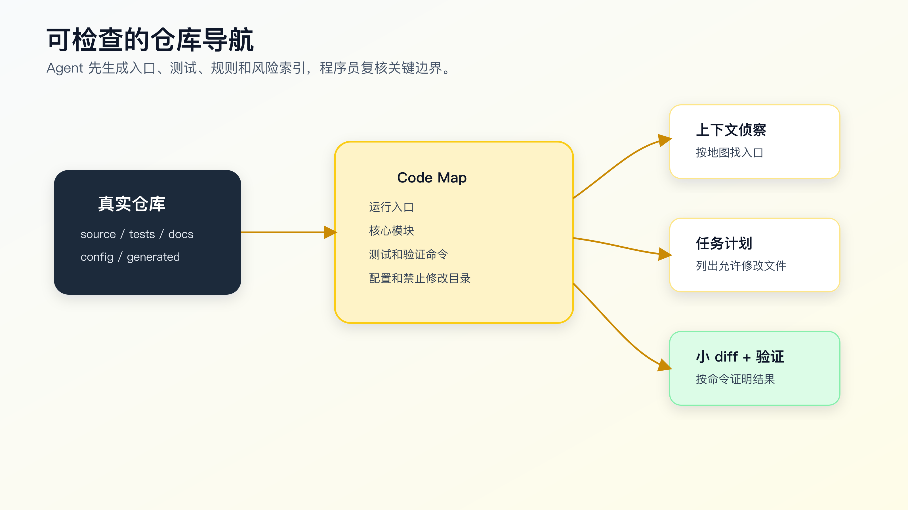

# 代码地图不是手工文档：让 Agent 生成可检查的仓库导航

让 AI 接手陌生项目，不要第一句就说“你先读一下这个项目”。

这句话太虚。Agent 会自己搜索，但你不知道它先读了什么；它会总结项目，但你不知道总结基于哪些文件；它会说“我理解了”，但你不知道它有没有漏掉入口、测试、生成目录和项目规则。

陌生项目的第一步，不是让人手写一份大文档，而是让 Agent 或工具先生成一份可检查的仓库导航。

代码地图不是完整架构文档，也不是静态大图。它是一份给人和 Agent 共用的导航索引：项目入口在哪里，核心模块在哪里，测试在哪里，配置在哪里，哪些目录不能改，常用验证命令是什么。

有了这份导航，AI Coding 的起点就从“随便搜”变成了“按证据侦察”：Agent 负责读取和生成初稿，程序员负责确认真实入口、禁止修改路径和验证命令。



## 没有代码地图，Agent 会怎样接手项目

一个陌生仓库里，Agent 常见起手动作是：

```bash
ls
find . -maxdepth 2 -type f
rg -n "keyword" .
cat README.md
```

这些动作没错，但不够。

真实项目里，文件名和目录名经常会误导它：

```text
src/order/
src/order-v2/
src/demo/order/
src/legacy/order/
docs/order-flow.md
generated/order-client.ts
test/order.test.ts
```

哪个是生产路径？哪个是旧逻辑？哪个只是示例？哪个是生成文件？哪个测试覆盖当前行为？

如果这些信息没有提前标出来，Agent 可能会：

- 改到 demo 目录。
- 按过期 docs 理解当前逻辑。
- 修改 generated 文件。
- 忽略现有测试。
- 在错误入口上补实现。
- 把 legacy 兼容逻辑删掉。

代码地图的价值，就是在 Agent 动手前，把这些导航信息显式化。

## 代码地图解决的不是“看全项目”

代码地图不是为了让 AI 一次看完整个项目。

它解决四个更具体的问题。

第一，让 Agent 知道先看哪里。

README、项目规则、package/pom/build 配置、测试目录、模块入口，是接手项目的基础材料。

第二，让 Agent 知道哪些地方危险。

生成代码、迁移脚本、历史兼容目录、构建产物、外部 API 适配层，都不应该随便改。

第三，让 Agent 知道怎么验证。

如果项目常用命令藏在 README、Makefile、package scripts 里，Agent 很可能跑错命令或只跑一个无关命令。

第四，让上下文能复用。

同一个项目里，每次新对话都让 Agent 从零搜索，会浪费时间，也容易重复踩坑。代码地图把稳定知识沉淀下来。

所以代码地图不是一次性图片，而是仓库内可维护文档。

## 一份合格代码地图长什么样

先看一个简化版：

```markdown
# Code Map

## Runtime Entry

- `src/server.ts`: HTTP server bootstrap.
- `src/routes/`: route definitions.
- `src/modules/order/`: order domain logic.

## Frontend Entry

- `src/App.tsx`: app root.
- `src/pages/`: route-level pages.
- `src/features/`: feature modules.

## Tests

- `test/order/`: order behavior tests.
- `test/auth/`: auth refresh/session tests.
- Focused command: `npm test -- order`

## Config

- `package.json`: scripts and dependencies.
- `tsconfig.json`: TypeScript config.
- `.env.example`: local env keys.

## Do Not Edit Directly

- `dist/`: build output.
- `generated/`: generated API client.
- lock files unless dependency changes are approved.

## AI Coding Notes

- Bug fixes should start from tests when possible.
- Do not change API contracts without explicit approval.
- If a task touches `src/modules/payment/`, run payment tests and manual callback check.
```

这份地图没有列出所有文件，但它给出了 Agent 接手项目时最容易漏的东西。

代码地图要短。太长会变成又一份噪音文档。它应该像机场导览图，不像城市规划档案。

## 先生成审计报告，再复核关键边界

完全靠人从零写代码地图，常常会拖延，也会只写自己记得住的部分。可执行的方式是先让 Agent 或脚本生成一份导航和审计报告，再由程序员复核关键判断。

配套代码仓库 [DavidDingXu/learn-ai-coding](https://github.com/DavidDingXu/learn-ai-coding) 的工具 module 里有一个轻量命令：

```bash
cd learn-ai-coding/ai-coding-workflow-kit
node src/cli.js codemap --root .
```

当前输出类似：

```markdown
# Code Map

- Total files scanned: 12
- Source files: 8
- Test files: 3
- Docs: 1
- Configs: 1

## Top Directories

- `src`: 5
- `test`: 3
- `.`: 2
- `examples`: 2

## Files AI Should Inspect First

- `README.md`
- `package.json`
- `test/codemap.test.js`
- `test/task-context.test.js`
- `test/verification-ledger.test.js`
```

这个命令做了几件很朴素的事：

- 统计源码文件。
- 识别测试文件。
- 识别 README、docs、`AGENTS.md`、`CLAUDE.md`。
- 识别常见配置文件。
- 统计顶层目录。
- 列出 AI 应该优先读取的文件。

它不解析 AST，不生成调用图，不判断业务边界。这是刻意的。

陌生项目接手的第一层索引，不需要一上来就做复杂代码智能。先把入口、测试、配置和文档显出来，再由人和 Agent 针对具体任务继续搜索调用链。

如果要在任务开始前做一次更贴近生产使用的检查，可以生成上下文审计报告：

```bash
cd learn-ai-coding/ai-coding-workflow-kit
node src/cli.js context-audit --root .
```

它会把“优先读取文件、候选入口、测试和验证提示、需要谨慎处理的路径”放在一起，并明确提醒哪些结论需要人确认。

注意它仍然只是启发式报告。它能发现 `generated/`、`dist/`、`legacy/` 这类高风险路径，但不能证明真实运行入口，也不能替你判断业务主路径。

## 自动地图必须复核三类信息

自动生成后，至少要复核三类内容。

第一，真实入口。

工具能看到 `src/`、`test/`、`README.md`，但不知道哪个文件是运行入口，也不知道哪个模块是当前业务主路径。你要让 Agent 给出依据，并由人确认：

```markdown
## Runtime Entry

- `src/main.ts`: app bootstrap.
- `src/routes/order.ts`: order route entry.
- `src/modules/order/service.ts`: order business logic.
```

第二，禁止修改范围。

工具可以识别一些常见目录，但无法知道每个项目的实际维护约定。你要确认哪些文件是生成的、哪些是 vendor、哪些是历史兼容：

```markdown
## Do Not Edit Directly

- `src/generated/`: generated from OpenAPI.
- `migrations/`: production migration history.
- `legacy/`: compatibility layer, modify only with explicit task approval.
```

第三，验证命令。

工具能找到 `package.json`，但不知道这次任务最小可验证路径。你要确认 focused test、full test 和必要的用户路径：

```markdown
## Verification Commands

- Focused backend test: `npm test -- order`
- Type check: `npm run typecheck`
- Full test: `npm test`
- Frontend manual path: login -> order list -> submit order
```

这三类信息能直接减少误改。它们不是为了让文档好看，而是为了让 Agent 动手前先暴露依据。

## 代码地图不是调用链

很多人会把代码地图做成复杂调用图。调用图有用，但不是第一步。

代码地图回答的是“从哪里开始看”。调用链回答的是“这个任务影响谁”。

比如你要修订单状态回退：

代码地图告诉你：

```text
订单模块在 `src/modules/order/`
订单测试在 `test/order/`
订单路由在 `src/routes/order.ts`
生成客户端在 `src/generated/`，不要直接改
```

任务开始后，Agent 还要继续查调用链：

```bash
rg -n "rollback|status|paid|pending" src/modules/order test/order
rg -n "updateOrderStatus|OrderStatus" src
```

这两层不要混。代码地图保持稳定，调用链跟任务走。

如果把所有调用关系都塞进代码地图，地图很快过期，维护成本会超过收益。

## 给 Agent 使用代码地图的提示

代码地图写好后，不要只让 Agent “参考”。要让它按地图工作。

```text
先读取 `docs/ai-coding/code-map.md` 和项目规则。

然后围绕当前任务做侦察：
1. 根据代码地图找到候选入口、测试和禁止修改目录。
2. 用搜索确认真实调用路径。
3. 列出实际读取文件。
4. 标出可能需要修改和不应该修改的文件。
5. 给出最小计划。

在完成侦察前不要编辑文件。
```

这个提示把地图变成了工作步骤，而不是背景材料。

如果 Agent 输出计划时没有引用地图里的入口、测试或禁止修改目录，要让它补：

```text
你的计划没有说明是否遵守代码地图里的 Do Not Edit 范围。
请重新检查计划，列出每个修改文件为什么允许修改。
```

## 代码地图如何保持更新

代码地图的风险是过期。

过期地图会比没有地图更糟，因为 Agent 会把旧信息当成项目事实。

建议把更新时机固定在这些节点：

- 新增或迁移运行入口。
- 测试命令变化。
- 生成文件目录变化。
- 模块拆分或合并。
- 新增重要项目规则。
- 某次 AI Coding 误改暴露了新风险。

每次更新不用大改。只改和导航有关的几行。

比如一次任务里发现 `src/generated/` 不能改，就补：

```markdown
## Do Not Edit Directly

- `src/generated/`: generated API client, run generation command instead of manual edits.
```

发现 auth 模块有专门测试命令，就补：

```markdown
## Verification Commands

- Auth focused test: `npm test -- auth-refresh`
```

代码地图不是文档项目，它是工作流资产。谁踩坑，谁补一条。

## 一份代码地图的最小检查清单

写完后，用下面清单检查。

```markdown
## Code Map Check

- [ ] 是否列出运行入口？
- [ ] 是否列出主要业务模块？
- [ ] 是否列出测试目录和 focused test 命令？
- [ ] 是否列出配置文件和环境说明？
- [ ] 是否列出生成文件、构建产物和禁止修改目录？
- [ ] 是否说明常见验证命令？
- [ ] 是否足够短，能让 Agent 快速读取？
- [ ] 是否避免过期的历史设计说明？
```

这里要控制长度。代码地图越短，越容易保持准确。

## 常见错误

错误一：把代码地图写成架构说明书。

```markdown
本系统采用分层架构，包含表现层、服务层、数据访问层……
```

这种描述可能没错，但对 Agent 接手任务帮助有限。它更需要真实路径和命令。

直接写路径、用途和验证线索：

```markdown
- `src/routes/order.ts`: order HTTP entry.
- `src/modules/order/service.ts`: order status transition.
- `test/order/status.test.ts`: status transition tests.
```

错误二：只列目录，不写用途。

```markdown
- `src/`
- `test/`
- `docs/`
```

这和 `ls` 没区别。至少要写一句用途。

错误三：不写禁止修改目录。

AI 最容易误改生成文件、构建产物、历史迁移脚本。代码地图里必须把这些地方标出来。

错误四：不写验证命令。

没有验证命令，Agent 完成时就容易只说“已检查”。代码地图至少要提供常用 focused test 和 full test。

错误五：一次生成后不维护。

自动生成只是第一版。关键边界复核和持续更新才是价值。

## 在老项目里怎么做

老项目最适合从代码地图开始。

不要一上来要求 Agent 理解全部历史。先做一份“能动手不迷路”的地图：

```markdown
# Legacy Project Code Map

## Current Entry

- `web/controller/`: current web entry.
- `service/`: business services.

## Legacy Compatibility

- `legacy/`: old endpoints, do not delete without migration task.
- `adapter/`: third-party integration compatibility.

## Tests

- `tests/`: partial coverage only.
- Manual verification required for payment callback.

## Do Not Edit Directly

- `db/migrations/`: production history.
- `generated/`: generated clients.

## Known Gaps

- Some modules have no automated tests.
- README command is outdated; use `make test`.
```

老项目里，要把“不知道”写出来。Agent 如果看到“partial coverage only”，就不会把测试通过当成完整证明。

## 代码地图和 `AGENTS.md` 怎么分工

这两个文件容易混。

`AGENTS.md` 写长期工作规则：

```markdown
- Run `git status --short` before editing.
- Do not add dependencies without approval.
- Report commands and residual risk.
```

代码地图写项目导航：

```markdown
- Runtime entry is `src/server.ts`.
- Order tests are under `test/order/`.
- Do not edit `src/generated/`.
```

规则回答“怎么工作”。地图回答“去哪里看”。

这两个文件可以互相引用，但不要重复太多。重复越多，越容易一处更新另一处忘。

## 代码地图和任务上下文包怎么分工

代码地图是长期资产，任务上下文包是单次任务材料。

代码地图：

```text
订单模块在哪里，测试在哪里，哪些目录不能改。
```

任务上下文包：

```text
这次要修订单 paid 状态回退，相关文件是哪些，不能改什么，怎么验证。
```

任务上下文包应该引用代码地图，而不是复制整份地图。

```markdown
## Context Sources

- Code map: `docs/ai-coding/code-map.md`
- Project rules: `AGENTS.md`
```

这样做的好处是：地图更新后，后续任务自然受益。

## 可以今天就落地的版本

先让 Agent 或脚本生成一份初稿：

```bash
cd learn-ai-coding/ai-coding-workflow-kit
node src/cli.js context-audit --root .
```

然后把输出中确认过的信息沉淀到仓库里的导航文件，例如：

```text
docs/ai-coding/code-map.md
```

这份文件可以很短：

```markdown
# Code Map

## Entry

- `src/main.ts`: runtime entry

## Core Modules

- `src/modules/order/`: main order flow

## Tests

- `test/order/`: order behavior tests
- Focused command: `npm test -- order`

## Config

- `package.json`: scripts and dependencies
- `.env.example`: local environment keys

## Do Not Edit Directly

- `dist/`: build output
- `src/generated/`: generated API client

## Common Verification

- Focused test: `npm test -- order`
- Full test: `npm test`
- Browser path: login -> order list -> submit order
```

不要直接把 `TODO` 长期留在仓库里。让 Agent 基于审计报告和实际文件给出候选内容：

```text
请先读取项目规则，并运行或复核上下文审计报告。
然后生成 `docs/ai-coding/code-map.md` 草稿。
要求：
1. 每个入口、测试和禁止修改路径都要写出依据。
2. 无法确认真实运行入口时停下来提问。
3. 不要修改业务代码。
```

程序员要做的是验收这份草稿：入口是否是真的，禁止修改路径是否完整，验证命令是否能跑。通过验收后，它才是可复用的上下文资产。

## 一次真实接手应该留下什么输出

代码地图不是写完就结束。它要能进入一次真实任务。

比如你准备让 Agent 接手一个陌生模块，可以要求它先输出下面这份记录：

```markdown
# Onboarding Report

## Project Shape

- Node CLI project.
- Source under `src/`.
- Tests under `test/`.
- Package scripts defined in `package.json`.

## Files Read

- `README.md`
  - purpose: commands and project boundary.
- `package.json`
  - purpose: test command and module type.
- `src/cli.js`
  - purpose: command dispatch entry.
- `src/lib/codemap.js`
  - purpose: code map generation.
- `test/cli.test.js`
  - purpose: CLI behavior contract.

## Candidate Runtime Entries

- `src/cli.js`
  - evidence: package bin points here; process argv is parsed here.

## Test Entries

- `test/cli.test.js`
  - evidence: process-level CLI behavior tests.
- `test/codemap.test.js`
  - evidence: codemap output contract.

## Treat Carefully

- `examples/`
  - fixture data; do not rewrite without checking tests.
- lock files
  - dependency changes require explicit approval.

## Verification Commands

- `npm test`
- focused: `node --test test/cli.test.js`

## Open Questions

- Does this task require CLI process behavior or only library output?
- Should generated context be persisted or printed only?
```

这份记录有几个好处。

第一，它把 Agent 读过的文件列出来。你可以直接发现它是否漏了 `package.json`、测试或项目规则。

第二，它把“候选入口”和“证据”放在一起。没有证据的入口只是猜测。

第三，它把谨慎路径提前标出来。很多误改发生在 examples、fixtures、generated、legacy、migrations 这些地方。

第四，它把验证命令前置。等实现结束后再找命令，Agent 往往会挑最容易通过的一条。

这个记录可以由 Agent 生成，不需要你手写。你的责任是验收：证据是否成立，入口是否真实，验证命令是否能跑，禁止修改范围是否符合项目约定。

## 代码地图里的“证据”怎么写

很多代码地图的问题是只写结论。

```markdown
- `src/order/service.ts`: order logic.
```

这句话有用，但不够。更好的写法是加一小段证据：

```markdown
- `src/order/service.ts`: order status transition.
  - evidence: imported by `src/routes/order.ts`; covered by `test/order/status.test.ts`.
```

证据不需要长。只要能让读者知道这个判断从哪里来。

常见证据来源有几类：

| 结论 | 可用证据 |
|---|---|
| 运行入口 | package bin、server bootstrap、route registration、framework config |
| 测试入口 | test file、script command、CI config、Makefile target |
| 生成文件 | generated header、OpenAPI config、build output path、docs rule |
| legacy 路径 | import graph、README note、route prefix、历史兼容测试 |
| 禁止修改 | project rule、generator command、migration policy、owner note |

如果 Agent 不能给证据，就让它继续侦察，不要让它把结论写进长期地图。

## 什么时候不要维护代码地图

不是所有项目都需要独立代码地图。

下面几种情况可以不写，或者只写在 `AGENTS.md` 里：

- 项目很小，入口、测试、命令在 README 和 package scripts 里已经清楚。
- 你只做一次性短任务，不会长期维护这个仓库。
- 仓库已经有准确的开发者文档，而且 Agent 能稳定读取。
- 代码结构变化太快，地图维护成本明显高于收益。

但只要出现下面任意信号，就值得维护：

- 多个同名模块容易混淆。
- 有 generated、legacy、migrations、fixtures 等高风险目录。
- 常用验证命令不明显。
- README 过期，但暂时无法彻底修。
- 多个 Agent 或多次对话都要接手同一仓库。
- 曾经发生过 AI 改错入口、删错兼容逻辑、跑错命令。

代码地图不是为了“文档完整”。它是为了降低接手成本和误改概率。没有这些问题，就不要为了形式感维护它。

## 代码地图放在哪里

位置没有唯一标准，但要满足两个条件：Agent 能找到，人能维护。

常见放法有三种。

第一，放在 `docs/ai-coding/code-map.md`。

适合已经有开发文档目录的项目。优点是不会污染根目录，能和任务上下文、验证记录放在一起。

第二，放在 `AGENTS.md` 的一个短节里。

适合小项目。比如：

```markdown
## Project Map

- CLI entry: `src/cli.js`
- Library code: `src/lib/`
- Tests: `test/`
- Do not edit fixtures under `examples/` unless a test requires it.
```

第三，放在模块目录下。

适合大仓库中的复杂模块。例如：

```text
src/modules/payment/AI-CODING.md
```

这种方式要小心，不要到处散落。只有模块规则、命令、风险和全局明显不同，才值得单独放。

不管放哪里，都要在项目规则里告诉 Agent：

```markdown
Before editing an unfamiliar module, read the code map if present.
If the code map conflicts with current source or tests, report the conflict before editing.
```

## 代码地图怎么进 review

代码地图不应该变成“写了但没人看”的文档。

当一次 AI Coding 任务踩出新规则时，review 里应该顺手检查是否需要更新地图。

比如 PR 改了订单状态入口：

```markdown
Review note:
- Runtime entry moved from `src/routes/order.ts` to `src/routes/order/index.ts`.
- Update `docs/ai-coding/code-map.md`.
```

或者发现测试命令变化：

```markdown
Review note:
- Old focused command `npm test -- order` no longer matches current test runner.
- Update Common Verification section.
```

这不是给 review 增加负担。相反，它能减少下一次 Agent 接手时的重复解释。

代码地图更新也要小 diff。不要趁机重写整份文档。只改与本次任务有关的入口、风险和验证命令。

## 常见问题

**代码地图要不要自动更新？**

可以，但不要完全依赖自动更新。自动扫描能发现文件变化，发现不了业务主路径和实际维护约定。自动生成后还要复核关键判断。

**要不要生成调用关系图？**

可以作为具体任务的补充，不建议塞进长期代码地图。调用关系变化快，长期地图只保留入口、模块、测试、配置和禁止修改范围。

**每个模块都要一份地图吗？**

先全局一份。只有模块很大、命令和规则差异明显时，再做模块级地图。目录层级太多会增加维护成本。

**代码地图会不会泄露业务信息？**

它在仓库内使用，按项目权限管理即可。不要在公开文章、公开 issue 或外部工具里暴露敏感路径、内部系统名和生产配置。

**代码地图和架构图有什么区别？**

架构图解释系统结构，代码地图服务开发定位。AI Coding 里，代码地图更偏“下一步去哪看、哪里不能改、跑什么命令”。

## 迁移建议

先别追求完整。找一个你最近最常让 AI 修改的项目，让 Agent 或脚本生成一份短地图草稿。

重点验收：

- 运行入口是否来自真实启动路径。
- 当前最常改的模块。
- 测试命令是否能直接运行。
- 生成文件和禁止修改目录是否完整。
- 最近踩过的 AI 误改规则是否沉淀进去。

然后在下一次任务里要求 Agent 先读地图，再侦察，再计划。

如果它因此少改了一个错误文件，代码地图就已经值回成本。

接下来要讲的是代码搜索和上下文选择。代码地图能告诉 Agent 从哪里开始，但具体任务仍然需要用 `rg`、文件树、调用点和测试文件一步步确认真实上下文。

## 可复查资料

- OpenAI Codex 最佳实践：<https://developers.openai.com/codex/learn/best-practices>
- OpenAI Codex `AGENTS.md` 指南：<https://developers.openai.com/codex/guides/agents-md>
- Anthropic Claude Code memory：<https://code.claude.com/docs/en/memory>
- GitHub Copilot repository instructions：<https://docs.github.com/en/copilot/how-tos/copilot-on-github/customize-copilot/add-custom-instructions/add-repository-instructions>

---

[课程首页](../../../README.md) · [完整目录](../README.md) · [← 上下文工程：为什么不是塞越多代码越好](08-%E4%B8%8A%E4%B8%8B%E6%96%87%E5%B7%A5%E7%A8%8B-%E4%B8%BA%E4%BB%80%E4%B9%88%E4%B8%8D%E6%98%AF%E5%A1%9E%E8%B6%8A%E5%A4%9A%E4%BB%A3%E7%A0%81%E8%B6%8A%E5%A5%BD.md) · [让 Agent 做代码搜索：怎样约束搜索目标、证据和停止条件 →](10-%E4%BB%A3%E7%A0%81%E6%90%9C%E7%B4%A2%E4%B8%8E%E4%B8%8A%E4%B8%8B%E6%96%87%E9%80%89%E6%8B%A9.md)

动手实践：[陌生模块接手记录](../../../ai-coding-workflow-kit/dev-process/01-module-onboarding.md)
