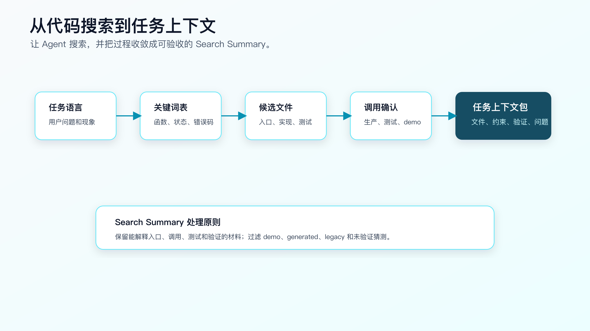
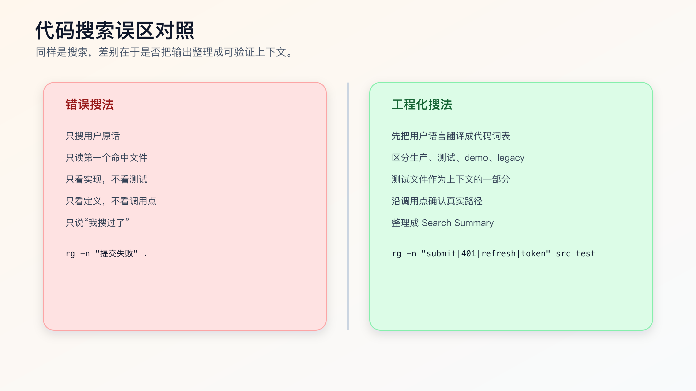

# 让 Agent 做代码搜索：怎样约束搜索目标、证据和停止条件

AI Coding 里，代码搜索不应该变成程序员手工跑一堆命令，再把输出贴给 AI。

现代 Agent 本来就能读文件、搜索代码、运行命令。程序员真正要做的是约束它怎么搜、搜完交付什么证据、什么时候停止，避免它拿第一个命中结果就开改。

搜索不是为了找到“看起来相关”的文件，而是为了确定 Agent 应该读哪些文件、不要读哪些文件、先改哪里、怎么验证。

很多失败发生在第一轮搜索。

任务是修订单提交失败，Agent 搜到一个 `submitOrder` 就开始改；任务是修登录状态，Agent 看到一个 `401` 就加重试；任务是改页面交互，Agent 只读组件不读接口和状态管理。后面即使代码写得不错，方向也可能错了。

程序员要把代码搜索当成上下文选择协议。`rg`、文件树、调用点、测试文件、配置文件、Git diff 是 Agent 可以使用的工具；你的职责是规定搜索目标、分类方式、证据格式和停止条件。



## 先明确搜索要回答什么

不要一上来就搜关键词。

先问四个问题：

1. 用户可见问题是什么？
2. 入口可能在哪里？
3. 业务规则可能在哪里？
4. 修完怎么验证？

比如任务是：

```text
session 过期后重新登录，第一次提交资料表单失败。
```

搜索目标不是“找 session”，而是确认：

- 表单提交入口在哪里。
- 401 处理在哪里。
- refresh token 逻辑在哪里。
- submit 是否会重试。
- 是否有相关测试。
- 是否有页面或 API 验证路径。

同样是搜索，目标不同，命令就不同。

## 第一组动作：先看文件结构

进入陌生仓库后，先让 Agent 看结构。下面这些命令不是要求你每次亲手执行，而是告诉 Agent 这一轮侦察应该覆盖哪些信息；当结果有争议时，你可以用它们复查。

```bash
rg --files | sed -n '1,120p'
rg --files | rg "README|AGENTS|CLAUDE|package.json|pom.xml|build.gradle|Makefile|justfile|Taskfile"
rg --files | rg "test|spec|__tests__"
```

第一条看文件树的样子。第二条找规则、文档和配置。第三条找测试。

注意：`rg --files | sed -n '1,120p'` 只是快速观察，不是为了把文件全贴给 AI。它帮 Agent 判断项目类型、目录命名、测试位置和生成目录。

如果项目很大，可以缩小范围：

```bash
rg --files src | sed -n '1,120p'
rg --files test tests __tests__ 2>/dev/null
```

看结构时要标记几类目录：

```text
src/              可能是源码
test/             测试
docs/             文档，可能过期
generated/        生成代码，谨慎修改
dist/ build/      构建产物，不改
legacy/           兼容逻辑，不能随便删
examples/ demo/   示例，不一定是生产路径
```

这一步的输出应该收敛成代码地图、上下文审计或任务上下文，而不是直接进入实现。

## 第二组动作：从用户语言到代码语言

用户说的是“提交失败”，代码里可能叫：

```text
submit
save
commit
create
update
mutation
request
checkout
```

不要只搜一个词。先列同义词。

```bash
rg -n "submit|save|create|update|mutation" src test
```

如果任务是 session 过期，可以搜：

```bash
rg -n "session|token|refresh|401|unauthorized|expired" src test
```

如果任务是订单状态，可以搜：

```bash
rg -n "OrderStatus|status|paid|pending|cancel|refund" src test
```

这里的关键是把用户语言翻译成代码语言。很多 Agent 会漏这一步，直接拿用户原话搜索。中文业务词、页面文案、错误提示未必出现在代码里。

可以让 Agent 先做词表：

```text
先不要搜索。
请把“session 过期后重新登录，第一次提交表单失败”翻译成可能出现在代码里的英文关键词、函数名、状态名和错误码。
然后再给搜索命令。
```

这个小动作能显著提高命中率。

## 第三组动作：找入口，而不是找所有匹配

`rg` 输出很多行时，不要让 Agent 直接进入实现。

先要求它筛入口。

前端任务常见入口：

```bash
rg -n "ProfileForm|SettingsPage|routes|createBrowserRouter|submit" src
```

后端任务常见入口：

```bash
rg -n "router|controller|handler|endpoint|POST|GET|/orders" src
```

CLI 或脚本任务：

```bash
rg -n "commander|yargs|process.argv|main\\(|if __name__" .
```

测试入口：

```bash
rg -n "auth-refresh|session|submit" test tests __tests__ 2>/dev/null
```

入口的判断标准不是文件名像不像，而是它是否连接用户动作和实现逻辑。

例如：

```text
ProfileForm.tsx        可能是页面组件
request.ts             可能是请求封装
auth-refresh.test.ts   可能是验证路径
token-storage.ts       可能是约束文件，不一定要改
```

这时任务上下文可以写：

```markdown
## Candidate Entry

- `src/forms/ProfileForm.tsx`: form submit entry.
- `src/auth/request.ts`: HTTP 401 handling.
- `test/auth-refresh.test.ts`: existing auth refresh coverage.
```

这比“找到很多相关文件”更有用。

## 第四组动作：沿调用点确认真实路径

找到候选文件后，要确认调用关系。

如果发现函数 `refreshToken`，继续搜调用点：

```bash
rg -n "refreshToken\\(" src test
```

如果发现类型 `OrderStatus`：

```bash
rg -n "OrderStatus" src test
```

如果发现错误码：

```bash
rg -n "AUTH_EXPIRED|TOKEN_EXPIRED|401" src test
```

调用点搜索要回答：

- 谁调用它？
- 调用前后有什么状态变化？
- 是否有多条路径？
- 哪些路径有测试？
- 是否有旧接口或兼容层？

一个常见错误是只读函数定义，不读调用点。函数本身看起来可以改，但调用方可能依赖旧行为。

给 Agent 的要求可以这样写：

```text
请不要只读函数定义。
找到候选函数后，继续搜索调用点，并区分：
- 生产调用路径
- 测试调用路径
- demo/example 调用路径
- legacy 调用路径
```

这能避免它把示例路径当生产路径。

## 第五组动作：找测试，不要后补

AI Coding 里，测试不是实现后的收尾，它是上下文的一部分。

先搜测试：

```bash
rg -n "session|refresh|submit|401" test tests __tests__ 2>/dev/null
rg --files | rg "(test|spec)\\.(js|ts|tsx|java|kt|go|py)$"
```

读测试时看四件事：

1. 当前行为怎么描述。
2. 旧边界是什么。
3. 测试命令是什么。
4. 是否有类似路径可复制。

如果没有测试，也要写清楚：

```markdown
## Test Coverage

- No existing test found for expired-session first submit.
- Existing auth tests only cover login success and refresh failure.
- Need either a regression test or manual browser verification.
```

没有测试不是不能改，但不能假装有验证。

## 第六组动作：查项目命令和规则

很多 AI 失败不是代码错，而是命令跑错。

先找项目命令：

```bash
cat package.json
rg -n "\"scripts\"" package.json
rg -n "test|lint|typecheck|build" README.md Makefile justfile Taskfile.yml 2>/dev/null
```

如果是 Java：

```bash
rg --files | rg "pom.xml|build.gradle|gradlew|mvnw"
```

如果是 Go：

```bash
rg --files | rg "go.mod|Makefile"
```

再读项目规则：

```bash
rg --files | rg "AGENTS.md|CLAUDE.md|copilot-instructions|instructions"
```

项目规则和命令应该进入任务上下文：

```markdown
## Project Rules And Commands

- Project rules: `AGENTS.md`
- Focused test: `npm test -- auth-refresh`
- Type check: `npm run typecheck`
- Do not edit: `src/generated/`
```

否则 Agent 很容易用默认命令猜。

## 搜索结果应该怎样交付

不要让 Agent 把几十行 `rg` 输出原样丢回来，也不要只接受一句“我搜过了”。

要求它整理成结构化的 Search Summary：

```markdown
## Search Summary

### Objective

session 过期后重新登录，第一次提交资料表单应该成功。

### Candidate Files

- `src/forms/ProfileForm.tsx`
  - reason: form submit entry
- `src/auth/request.ts`
  - reason: HTTP 401 handling
- `src/auth/token-storage.ts`
  - reason: token storage, do not edit initially
- `test/auth-refresh.test.ts`
  - reason: related auth refresh tests

### Not Relevant Initially

- `src/demo/ProfileForm.tsx`
  - reason: demo page, not production route
- `src/generated/api-client.ts`
  - reason: generated file

### Verification

- `npm test -- auth-refresh`
- browser path: login -> expire session -> refresh -> submit
```

整理的过程就是上下文选择。

如果 Agent 只返回原始输出，它仍然把优先级判断留给了后续生成；如果它先整理证据，你就能检查它是否把 demo、legacy、generated、tests 和生产路径区分清楚。

## Search Summary 怎么验收

Agent 给了 Search Summary，不代表它就能开始改。

你至少要检查六件事。

第一，是否覆盖入口。

对于用户可见问题，必须能找到用户动作进入系统的地方。前端是页面、路由、组件或 submit handler；后端是 route、controller、handler、job 或 consumer；CLI 是命令入口和 argv 解析。只找到工具函数，不算找到入口。

第二，是否覆盖测试。

Agent 如果没有找测试，就很容易把实现写成自己的理解。没有测试也要明说，而不是跳过。

第三，是否区分路径类型。

Search Summary 里至少要区分：

```text
production path
test path
demo/example path
legacy path
generated path
docs-only path
```

这些路径混在一起，后面一定会出问题。

第四，是否有排除理由。

“Not relevant initially” 不是垃圾桶。每个排除文件都应该有理由。比如 generated、demo、旧文档、测试夹具、历史兼容层、当前任务不允许修改。

第五，是否给出验证入口。

搜索结束时应该知道至少一个验证动作：focused test、接口调用、浏览器路径、日志检查、脚本命令。没有验证入口，就不该实现。

第六，是否列出开放问题。

真实项目里，搜索很少能回答所有问题。Open Questions 不是失败，而是防止 Agent 自己拍板。比如“原请求是否允许重试一次”“并发提交怎么处理”“旧 token 格式是否需要兼容”。

可以用下面这段话验收：

```text
请自检你的 Search Summary：
1. 是否找到真实入口？证据是什么？
2. 是否读取或确认没有相关测试？
3. 是否区分 production/test/demo/legacy/generated？
4. 每个排除文件的理由是什么？
5. 第一个验证动作是什么？
6. 哪些问题必须由人确认？

如果任一项答不上来，不要开始实现。
```

这段自检不是形式。它能把“搜过了”变成“搜对了没有”。

## 搜索误区对照



误区一：只搜用户原话。

用户说“提交失败”，代码里可能没有“提交”。要翻译成函数名、状态名、错误码、接口路径。

误区二：只读第一个命中文件。

第一个命中可能是 demo、legacy、docs 或测试夹具。要确认是否生产路径。

误区三：只搜实现，不搜测试。

测试是行为边界。没有测试，就要补测试或手动验证路径。

误区四：只看定义，不看调用点。

定义告诉你函数做什么，调用点告诉你谁依赖它。

误区五：只看当前文件，不看项目规则。

项目规则可能明确禁止改生成目录、禁止新增依赖、要求跑某些命令。

## 一个完整搜索协议的骨架

不要急着写脚本。先把 Agent 的搜索顺序固定下来。下面这些命令可以作为协议里的可复查证据，也可以在 Agent 输出异常时手动复核。

```bash
# 1. worktree
git status --short

# 2. project shape
rg --files | sed -n '1,120p'
rg --files | rg "README|AGENTS|CLAUDE|package.json|Makefile|pom.xml|build.gradle"

# 3. tests
rg --files | rg "test|spec|__tests__"

# 4. task keywords
rg -n "session|token|refresh|401|unauthorized|expired|submit" src test 2>/dev/null

# 5. candidate call sites
rg -n "refreshToken\\(|submitProfile\\(|request\\(" src test 2>/dev/null

# 6. commands
rg -n "test|lint|typecheck|build" package.json README.md Makefile 2>/dev/null
```

每一组命令后都要让 Agent 回答：这组输出改变了上下文选择吗？

如果没有，就不要把它塞进任务上下文。

## 让 Agent 搜索时怎么约束

可以直接让 Agent 执行搜索，但要约束输出。

```text
请用 `rg` 做上下文侦察，暂时不要改代码。

要求：
1. 先列关键词，不要直接搜索。
2. 搜索入口、实现、测试、配置。
3. 区分生产路径、测试路径、demo/example、legacy、generated。
4. 输出 Search Summary，不要贴完整原始输出。
5. 如果真实入口不确定，停止并提问。
```

这个提示比“你先搜一下”强得多。

它让 Agent 明确产出：关键词、分类、候选文件、排除文件、缺失上下文。

## 什么时候扩大搜索范围

一开始不要全仓乱搜，但也不能死守小范围。

需要扩大范围的信号：

- 候选入口读完后找不到实际调用。
- 测试失败指向另一个模块。
- 日志里出现异步任务或队列。
- 配置决定了运行路径。
- 接口契约在生成客户端或 schema 里。
- 同名函数有多个实现。

扩大搜索时要说清楚原因：

```text
当前 `src/auth/request.ts` 无法解释失败。
错误日志指向 `refresh queue`。
请扩大搜索到 queue 和 retry 相关文件：
`rg -n "refresh queue|retry|pending request" src test`
```

不要说：

```text
再看看别的地方。
```

模糊扩大范围最容易产生大 diff。

## 什么时候停止搜索

搜索也会失控。

有些 Agent 搜着搜着会把整个项目都读一遍，然后产出一份很长的总结。看起来勤奋，实际会增加噪音。

停止搜索的标准不是“再也没有文件可看”，而是已经具备实现前需要的最小证据。

可以用下面五个条件判断：

```text
1. 找到真实入口。
2. 找到核心实现或确认实现缺失。
3. 找到相关测试，或确认没有相关测试。
4. 找到至少一个可执行验证动作。
5. 列出本次不应该修改的相似路径。
```

满足这五项，就可以停止第一轮搜索，进入计划阶段。

如果继续搜索，必须说明新增搜索要回答什么问题。比如：

```text
继续搜索 only if it answers one of these:
- original request retry policy
- concurrent refresh behavior
- existing regression test location
```

不要用“再全面看一下”这种要求。它会把 Agent 带回全仓浏览。

搜索停止后，Agent 应该输出一个最小计划，而不是直接改代码：

```markdown
## Minimal Plan

1. Add a regression test for expired-session first submit.
2. Implement retry-after-refresh in request wrapper only if the test proves the current failure.
3. Run focused auth test and typecheck.
```

搜索的终点是计划，不是代码。

## 搜索失败时的处理策略

搜索失败也要有流程。

第一种，关键词不匹配。

比如用户说“提交资料”，代码里叫 `saveProfile`、`mutateProfile`、`updateUserInfo`。这时让 Agent 先做词表扩展，不要猜实现。

```text
当前关键词没有命中真实入口。
请从 UI 文案、route、API path、测试名、类型名五个方向扩展关键词。
```

第二种，入口在框架约定里。

有些项目入口不明显，比如 Next.js app router、Rails routes、Spring annotations、NestJS decorators、FastAPI route decorators。单纯搜 `router` 未必够。

要求 Agent 先判断框架，再按框架约定搜：

```text
请先判断项目框架和路由约定。
然后按该框架的入口规则搜索页面、route、handler 或 controller。
```

第三种，入口在另一个仓库或服务。

如果前端只看到 API 调用，但业务逻辑在后端仓库，不要让 Agent 在当前仓库硬改。

```markdown
Search Result:
- Current repo contains frontend submit path.
- Backend validation logic is not present.
- Need backend repo, API schema, or documented contract before changing behavior.
```

第四种，现有测试覆盖缺失。

没有测试时，搜索结果应该明确写：

```markdown
No existing regression test found.
Next action: add failing test or define manual verification path before implementation.
```

第五种，搜索结果互相冲突。

比如 README 写 `npm test`，package scripts 里只有 `pnpm test`；docs 说 `generated/` 不要改，但当前代码里有人手改过 generated 文件。冲突不能靠 Agent 猜。

```text
请列出冲突点、各自证据来源，并停止实现。
```

搜索失败不是坏事。坏的是失败后还继续实现。

## 如何处理搜索不到

搜索不到不等于不存在。

可能是：

- 关键词不对。
- 逻辑在配置里。
- 逻辑在生成代码里。
- 行为来自第三方库。
- 文案来自后端。
- 入口在另一个仓库。

这时不要让 Agent 猜。

可以这样问：

```text
当前关键词没有找到入口。
请列出 5 个可能原因，并为每个原因给一个最小验证动作。
不要修改代码。
```

例如：

```markdown
## Possible Reasons

1. form submit uses generic `mutate` helper.
   - search: `rg -n "mutate\\(" src`

2. 401 handling is in generated API client.
   - inspect generated client, but do not edit directly.

3. error text comes from backend.
   - search API response schema and backend error code.
```

搜索不到时，最重要的是调整搜索策略，而不是直接实现。

## 从搜索到任务上下文包

最终要把搜索结果收敛成任务上下文包。

```markdown
# Task Context

## Objective

session 过期后重新登录，第一次提交资料表单应该成功。

## Files To Inspect First

- `src/forms/ProfileForm.tsx`: submit entry.
- `src/auth/request.ts`: 401 handling.
- `test/auth-refresh.test.ts`: related tests.

## Files Not To Edit Initially

- `src/auth/token-storage.ts`: token storage format is out of scope.
- `src/generated/api-client.ts`: generated file.
- `src/demo/ProfileForm.tsx`: demo only.

## Verification

- `npm test -- auth-refresh`
- `npm run typecheck`
- browser path: login -> expire session -> refresh -> submit

## Open Questions

- Does refresh success guarantee original request can be safely retried once?
- How should concurrent submit requests behave?
```

这份上下文包才是进入实现阶段的材料。

搜索本身不是成果。能指导下一步行动、能被人复查的上下文才是成果。

## 生产里怎么留下搜索证据

搜索证据不一定要永久保存，但中高风险任务应该能在 PR 或任务记录里复查。

最小格式可以是：

```markdown
## Search Evidence

### Goal

Find expired-session first-submit path.

### Commands / Agent Actions

- searched `session|token|refresh|401|submit` under `src` and `test`
- inspected route, request wrapper, form submit, and auth tests

### Files Read

- `src/forms/ProfileForm.tsx`
- `src/auth/request.ts`
- `test/auth-refresh.test.ts`

### Excluded

- `src/demo/ProfileForm.tsx`: demo only.
- `src/generated/api-client.ts`: generated.

### Verification Candidate

- `npm test -- auth-refresh`
- browser path: login -> expire session -> refresh -> submit
```

这份记录不需要贴完整 `rg` 输出。保留完整输出反而会制造噪音。真正要留下的是搜索目标、读过的文件、排除理由和验证候选。

如果团队 review 要求更严格，可以把关键命中行也写进去：

```markdown
## Key Hits

- `src/auth/request.ts`: contains 401 handling and refresh call.
- `test/auth-refresh.test.ts`: has refresh success test, no original submit retry test.
```

注意不要写成：

```markdown
I searched around and found auth files.
```

这句话没有复查价值。

## 搜索和代码审查怎么连接

好的搜索会降低 review 成本。

reviewer 最关心的不是你搜了多少，而是你为什么只改这些文件。

PR 里可以这样写：

```markdown
## Why These Files

- `test/auth-refresh.test.ts`
  - adds regression coverage for current failure.
- `src/auth/request.ts`
  - only production path that handles 401 refresh and retry.

## Why Not These Files

- `src/auth/token-storage.ts`
  - storage was verified to contain refreshed token.
- `src/generated/api-client.ts`
  - generated client, inspected only.
- `src/demo/ProfileForm.tsx`
  - demo path, not production route.
```

这比一句“修改了 auth 逻辑”有用得多。

如果 reviewer 问“为什么没改 token storage”，你可以回到证据：Network 显示 token refresh 成功，问题在原请求未重试。这样 review 会围绕事实，而不是围绕感觉。

## 搜索协议怎么沉淀成规则

如果你发现自己经常提醒 Agent：

- 先找入口再实现。
- 区分 demo 和 production。
- 先找测试。
- 搜索不到就列原因，不要猜。
- 不要把 generated 文件当修改目标。

这些内容就应该写进长期规则或 Skill。

`AGENTS.md` 里可以放轻量版本：

```markdown
## Search Before Editing

- For unfamiliar code, search and list actual files read before editing.
- Distinguish production, test, demo/example, legacy, and generated paths.
- Do not edit generated files unless the task explicitly requests generated output changes.
- If no test is found, state the verification gap before implementation.
- If the real entry is unclear, stop and ask.
```

Skill 里可以放完整流程：关键词生成、搜索、分类、Search Summary、自检、停止条件。

规则越具体，Agent 越不容易把“搜索”理解成随便找几个命中行。

## 搜索不是代码索引的替代品

这里讲 `rg` 和 Agent 搜索，不代表所有项目都只靠文本搜索。

大型代码库里，语言服务器、IDE 索引、代码搜索平台、调用图、OpenGrok、Sourcegraph、内部代码平台都很有价值。它们能更准确地找定义、引用、调用关系和跨仓依赖。

但原则不变：工具越强，越要让结果进入 Search Summary。

你可以把搜索动作替换成：

```text
- IDE find references
- language server go to definition
- Sourcegraph query
- internal code search
- dependency graph
```

但输出仍然要回答：

- 真实入口是什么？
- 关键实现在哪里？
- 哪些路径不能改？
- 测试和验证在哪里？
- 哪些结论还没证据？

不要把代码索引工具的命中结果直接当答案。它只是更强的证据来源。

## 常见问题

**为什么不用 IDE 全局搜索就够了？**

IDE 搜索也可以。重点不是工具，而是搜索策略。`rg` 的好处是快、可复制、容易放进 Agent 工作流和完成记录里。

**搜索输出很多，应该给 AI 全部看吗？**

不建议。先分类和摘要。完整输出只有在需要复查时再给。大量无关匹配会制造噪音。

**Agent 自己会搜索，我还需要关心命令吗？**

需要关心搜索目标、分类要求和证据格式。命令可以由 Agent 执行，但 Agent 会搜索不代表它会按正确优先级搜索。

**没有测试目录怎么办？**

把“没有测试”写进上下文，并补手动验证路径、接口调用或日志检查。不要让 Agent 把没有测试理解成无需验证。

**搜索到多个入口怎么办？**

让 Agent 区分生产、测试、demo、legacy、generated。无法确认时先提问，不要直接选一个。

## 迁移建议

下次处理陌生任务时，先不要开改。让 Agent 花 5 分钟做 Search Summary。

固定写这五块：

```markdown
Objective:
Candidate files:
Not relevant initially:
Verification:
Open questions:
```

如果这五块写不出来，说明上下文还没选好。

AI Coding 不是让 Agent 替你乱搜。它应该让搜索结果更快变成可执行、可验证、可审查的任务上下文。

接下来会讲项目规则文件：`AGENTS.md`、`CLAUDE.md`、Copilot instructions 这类文件到底该写什么，哪些规则适合长期保留，哪些只应该放在单次任务里。

## 可复查资料

- ripgrep 官方仓库：<https://github.com/BurntSushi/ripgrep>
- OpenAI Codex 最佳实践：<https://developers.openai.com/codex/learn/best-practices>
- OpenAI Codex `AGENTS.md` 指南：<https://developers.openai.com/codex/guides/agents-md>
- Anthropic Claude Code memory：<https://code.claude.com/docs/en/memory>

---

[课程首页](../../../README.md) · [完整目录](../README.md) · [← 代码地图不是手工文档：让 Agent 生成可检查的仓库导航](09-%E8%AE%A9-AI-%E6%8E%A5%E6%89%8B%E9%99%8C%E7%94%9F%E9%A1%B9%E7%9B%AE%E7%9A%84%E7%AC%AC%E4%B8%80%E6%AD%A5-%E4%BB%A3%E7%A0%81%E5%9C%B0%E5%9B%BE.md) · [`AGENTS.md` / `CLAUDE.md` / Copilot Instructions →](11-AGENTS-md-CLAUDE-md-Copilot-Instructions.md)

动手实践：[陌生模块接手记录](../../../ai-coding-workflow-kit/dev-process/01-module-onboarding.md)
