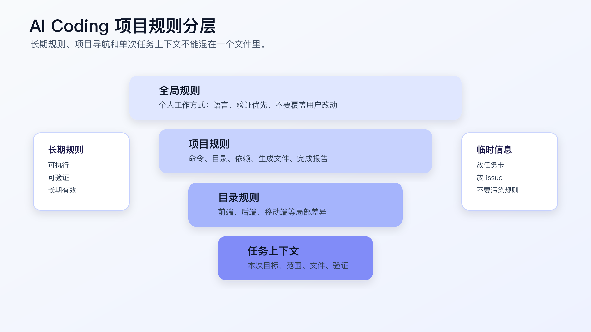
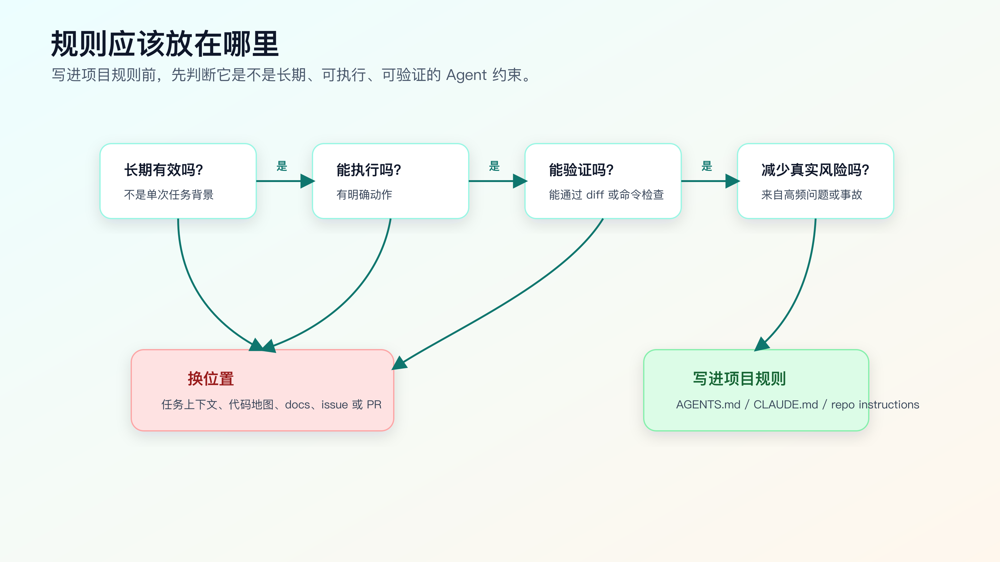

# `AGENTS.md` / `CLAUDE.md` / Copilot Instructions

AI Coding 里，项目规则文件不是给 AI 写的“温馨提示”。

它的作用更具体：把每次都要遵守的工程约束放到仓库里，让 Agent 在读代码、改文件、跑命令、写完成报告时有稳定边界。

不同工具叫法不一样。Codex 有 `AGENTS.md`，Claude Code 常用 `CLAUDE.md` 承接项目记忆和约定，GitHub Copilot 支持 repository instructions 和自定义指令。文件名和加载规则会随工具变化，写作前要看官方文档；但背后的工程问题一致：

什么规则应该长期放在项目里？什么信息只属于单次任务？规则文件怎样写，才能真正约束 Agent，而不是制造更多噪音？



## 规则文件解决什么问题

没有规则文件时，每次任务都要重复交代：

```text
先看测试。
不要改生成文件。
不要新增依赖。
不要做无关重构。
改完跑 npm test。
如果测试失败先分类。
```

重复几次以后，人会省略，Agent 会忘，结果又回到聊天式开发。

项目规则文件把这些稳定约束放进仓库。它解决四类问题：

第一，减少重复说明。

安装命令、测试命令、禁止修改目录、完成报告格式，不应该每次都靠人重新输入。

第二，限制 Agent 的默认行为。

Agent 遇到测试失败、生成文件、依赖缺失、格式化大文件时，如果没有规则，可能会按最容易完成的方向改。

第三，保持工具切换时的一致性。

你可能在 Codex、Claude Code、Cursor、Copilot 之间切换。规则文件能让项目约束留在仓库里，而不是留在某个聊天窗口。

第四，把事故沉淀成防线。

AI 曾经改错过生成文件，就写“不要改 generated”；曾经为了测试通过删断言，就写“不要删除断言来绕过失败”；曾经新增依赖没说明，就写“新增依赖先确认”。

规则文件不是写给未来的理想流程，而是写给真实踩坑后的下一次任务。

## 规则文件不应该写什么

规则文件最容易变成垃圾桶。

这些内容不应该长期放进去：

- 单次任务背景。
- 临时需求讨论。
- 某次 bug 的排查过程。
- 已经过期的方案争论。
- 大段产品 PRD。
- 个人猜测。
- “请认真”“代码要优雅”这类空话。
- 工具使用心得流水账。

例如，不要写：

```markdown
- 最近我们在修登录问题，可能和 refresh token 有关。
- 这个项目最好尽量优化用户体验。
- AI 修改代码时要小心。
- 如果有机会，可以顺便重构 auth 模块。
```

这些话要么过期，要么不可执行，要么会诱导 Agent 扩大范围。

长期规则应该满足四个条件：

```text
长期有效
可执行
可验证
能减少真实风险
```

如果一条规则不满足这四点，就应该放到任务上下文包、issue、PR 描述或临时计划里。

## 好规则和坏规则的区别

坏规则：

```markdown
- 写高质量代码。
- 使用最佳实践。
- 注意不要出错。
- 尽量提升可维护性。
```

这类规则的问题是没有动作。Agent 看完也不知道该改什么、不该改什么、跑什么命令。

好规则：

```markdown
- Run `git status --short` before editing.
- Do not edit files under `src/generated/`; update the schema and run generation instead.
- Do not add runtime dependencies without approval.
- Bug fixes must stay scoped to the failing behavior; do not mix refactor with bug fix.
- For behavior changes, run the focused test first and report the exact command output.
- If a test fails, classify it before editing again: baseline failure, introduced failure, environment failure, or requirement conflict.
```

这些规则有共同点：

- 能执行。
- 能检查。
- 能阻止常见误改。
- 不依赖抽象价值判断。

规则文件不是价值观文档。它是 Agent 工作边界。

## 规则必须绑定证据

一条规则如果没有证据出口，很容易变成口号。

比如：

```markdown
- Run tests before completion.
```

这句话看起来没问题，但它没有说清楚跑什么、什么时候跑、怎么报告。Agent 很可能跑一个最轻的命令，然后写“测试通过”。

可以改成：

```markdown
- For behavior changes, run one focused test that covers the changed path.
- If shared code changed, run the broader module test.
- Completion report must include exact command, exit result, and unverified paths.
```

这样规则就绑定了证据。

再比如：

```markdown
- Keep changes scoped.
```

这句话也太虚。可以改成：

```markdown
- Before editing, list expected files.
- If a new file must be edited, stop and explain why scope changed.
- Completion report must mention every changed file and reason.
```

AI Coding 里的规则不是为了表达态度，而是为了改变 Agent 的下一步动作。

## 一份项目规则的基本结构

可以从这个结构开始：

```markdown
# Project Agent Instructions

## Project Shape

- Runtime entry:
- Main modules:
- Test directories:
- Generated directories:

## Commands

- Install:
- Focused test:
- Full test:
- Lint:
- Type check:
- Build:

## Worktree Rules

- Run `git status --short` before editing.
- Do not overwrite user changes.
- Keep changes scoped to the task.

## Change Rules

- Do not add dependencies without approval.
- Do not edit generated files directly.
- Do not mix refactor with behavior change.
- If scope must expand, stop and explain.

## Verification

- Report exact commands and results.
- Explain what each command covers.
- List residual risks before completion.

## Reporting

- Changed files.
- Why they changed.
- Commands run.
- Unverified paths.
```

这不是固定模板。不同项目可以删减。

文档项目可以不写 build。后端服务要写启动命令和测试命令。前端项目要写浏览器验证。老项目要写手动验证和覆盖缺口。

关键是别把规则文件写得像项目百科。它只需要覆盖 Agent 工作时最容易出错的边界。

## 规则分层：全局、项目、目录、任务

AI Coding 的规则不是一层。

可以按四层理解：

| 层级 | 内容 | 示例 |
|---|---|---|
| 全局规则 | 个人长期偏好和工作方式 | 回复语言、不要覆盖用户改动、验证优先 |
| 项目规则 | 当前仓库长期约束 | 命令、目录、依赖、完成报告 |
| 目录规则 | 模块差异明显时的局部约束 | 前端目录、后端目录、移动端目录 |
| 任务上下文 | 单次任务目标、风险、相关文件 | 这次修什么、不能改什么、怎么验证 |

项目规则不要承担任务上下文的职责。

比如“这次修 session 过期后首次提交失败”，不应该写进长期规则；它属于任务上下文。

而“不要改变登录接口协议，除非任务明确要求”，如果这是项目长期约束，可以放进规则文件。

目录规则也不要过早拆。只有当目录之间命令、风险和开发方式明显不同，才值得分目录写。例如：

```text
frontend/AGENTS.md
backend/AGENTS.md
mobile/AGENTS.md
```

如果只是为了显得细，就别拆。规则层级越多，冲突和过期风险越高。

## 规则筛选流程

每次想把一句话写进规则文件前，先过这张流程。



第一问：这条规则是不是长期有效？

如果只对本次任务有效，放任务上下文。

第二问：它能不能执行？

“代码要优雅”不能执行。“不要混合重构和 bug fix”可以执行。

第三问：能不能验证？

“运行 `npm test -- auth-refresh` 并报告结果”能验证。“保证没有问题”不能验证。

第四问：它是否减少真实风险？

如果只是偏好，不要写太多。规则越多，Agent 越难抓住重点。

第五问：是否已有更合适的位置？

架构说明放 docs，接口契约放 spec，任务细节放 issue，规则文件只放 Agent 工作约束。

## 一个可直接迁移的 `AGENTS.md`

下面是一份精简版本：

```markdown
# Project Agent Instructions

## Commands

- Install: `npm install`
- Focused test: `npm test -- <pattern>`
- Full test: `npm test`
- Lint: `npm run lint`
- Type check: `npm run typecheck`

## Worktree

- Run `git status --short` before editing.
- Do not overwrite user changes.
- Do not edit generated files under `src/generated/` or build outputs under `dist/`.

## Change Scope

- Keep bug fixes scoped to the failing behavior.
- Do not mix refactor with behavior changes.
- Do not add runtime dependencies without approval.
- If the task requires changing public API, stop and explain the impact first.

## Verification

- For behavior changes, run the focused test first.
- If shared code changed, run broader tests.
- Report exact commands and results.
- If a command cannot run, explain why and what evidence is missing.

## Failure Handling

- Do not edit code immediately after a test failure.
- First classify the failure: baseline, introduced, environment, or requirement conflict.
- Do not delete tests or weaken assertions to make tests pass.

## Completion Report

- Changed files.
- Why each file changed.
- Commands run.
- Result.
- Residual risk.
```

这份规则不长，但已经能约束很多常见问题。

你可以按项目改：

- Java 项目把命令换成 `./mvnw test` 或 `./gradlew test`。
- Go 项目换成 `go test ./...`。
- 前端项目补浏览器验证。
- 老项目补手动验证路径和覆盖缺口。

## `CLAUDE.md` 怎么写

Claude Code 的 memory 文档把 `CLAUDE.md` 用作项目记忆和约定入口。写法上，原则和 `AGENTS.md` 很接近：放项目长期有效的开发约束、命令、结构、偏好。

可以这样组织：

```markdown
# Project Memory

## Useful Commands

- `npm test`
- `npm run lint`
- `npm run typecheck`

## Architecture Notes

- Auth refresh logic lives in `src/auth/request.ts`.
- Generated API client lives in `src/generated/`; do not edit directly.

## Coding Rules

- Keep bug fixes scoped.
- Do not add dependencies without approval.
- Prefer existing test style.

## Verification

- Report commands and residual risk.
```

注意，不要把 `CLAUDE.md` 写成长期聊天记录。

如果一段信息只对当前 bug 有用，放任务上下文；如果是项目长期导航，才放 `CLAUDE.md`。

## Copilot Instructions 怎么写

GitHub Copilot 的 repository instructions 和 custom instructions 适合给 Copilot 提供项目上下文和编码约束。

这里同样不要写大段背景。适合写：

- 项目使用的语言和框架。
- 测试命令和代码风格。
- 常见目录和生成文件。
- 不要新增依赖或改接口的约束。
- PR 或 review 时要重点检查的内容。

例如：

```markdown
This repository is a React + TypeScript application.

Guidelines:
- Use existing component and test patterns.
- Do not edit generated API client files under `src/generated/`.
- Do not add runtime dependencies without approval.
- For behavior changes, include or update focused tests.
- Keep bug fixes scoped; do not include unrelated refactors.
```

Copilot instructions 往往更贴近 IDE 和 GitHub 工作流。它不一定替代 `AGENTS.md`，而是服务 Copilot 使用场景。

如果项目同时使用多种工具，建议先维护一份主规则，再按工具格式同步精简版本。不要让不同工具的规则互相冲突。

同步时还要保留差异。

比如 Codex 场景里，规则更强调仓库读取、命令验证、diff 和完成报告。Claude Code 场景里，`CLAUDE.md` 往往还会承担项目记忆作用。Copilot instructions 更贴近 IDE、PR 和 GitHub 工作流。Cursor rules 可能更贴近编辑器内的代码生成和目录规则。

所以不要把一份长规则原样复制到所有工具里。

合理做法是：

```text
主规则：项目事实、禁止事项、验证要求、完成报告。
Codex：保留命令、diff、验证、权限边界。
Claude Code：保留项目记忆、架构入口、命令、长期约束。
Copilot：保留编码风格、测试模式、PR/review 重点。
Cursor：保留目录规则、生成文件限制、当前技术栈模式。
```

核心约束一致，工具细节分开。这样既不会冲突，也不会让某个工具读到大量无关信息。

## 多工具规则如何避免冲突

很多程序员会同时用 Codex、Claude Code、Cursor、Copilot。问题不是不能多工具，而是规则不能多套互相打架。

建议建立一个“主规则源”。

```text
AGENTS.md 或 docs/ai-coding/project-rules.md
```

然后按工具需要派生：

```text
CLAUDE.md
.github/copilot-instructions.md
Cursor rules
```

同步时遵守三点：

第一，核心约束一致。

比如“不要改生成文件”“新增依赖先确认”“bug fix 不混重构”，所有工具都应该一致。

第二，工具特有能力单独写。

Claude Code 的 hooks、Codex 的配置、Copilot 的 PR 场景，可以写在对应文件里，不要硬塞到所有规则。

第三，定期删旧规则。

规则文件不是只增不删。项目结构变了，命令变了，工具能力变了，旧规则要清理。

可以每月做一次 10 分钟检查：

```bash
git grep -n "npm test\\|pnpm test\\|mvn test\\|generated\\|dist/" AGENTS.md CLAUDE.md .github 2>/dev/null
```

这类命令不是为了机械找词，而是快速发现规则里是否还写着过期命令、过期目录和互相冲突的工具约束。

## 规则太多会怎样

规则太多会产生三个问题。

第一，Agent 抓不住重点。

如果规则文件几千行，真正关键的“不要改生成文件”可能被淹没。

第二，规则冲突。

前面写“保持最小 diff”，后面又写“顺便优化代码结构”，Agent 会自己选择。

第三，过期信息污染上下文。

旧命令、旧目录、旧架构说明，会把 Agent 带到错误路径。

所以规则文件要定期做瘦身。

可以用这个检查：

```markdown
## Rule Review

- 这条规则过去一个月是否仍然有效？
- 是否能被执行或验证？
- 是否和其他规则重复或冲突？
- 是否更适合放到代码地图、任务上下文或 docs？
- 是否来自真实事故或高频风险？
```

删规则和加规则一样重要。

## 规则文件如何验证有效

写了规则，不代表 Agent 会稳定遵守。

可以用一个低风险任务试跑：

```text
请读取项目规则，然后完成一个小 bug fix。
实现前先输出：
- 你读到了哪些规则。
- 这些规则如何影响你的计划。
- 哪些文件不能改。
- 需要跑哪些命令。
```

如果 Agent 输出里完全没有提到关键规则，说明规则写法或加载方式有问题。

也可以故意观察它是否会踩线：

- 它是否尝试修改 generated。
- 它是否直接新增依赖。
- 它是否把 refactor 混进 bug fix。
- 它是否跑了错误命令。
- 它是否没有报告剩余风险。

这些不是要为难 Agent，而是验证规则是否真的进入工作流。

## 规则如何进入一次任务

规则文件写好了，还要让它进入当前任务。

实际操作可以很简单：

```text
请先读取项目规则文件，不要改代码。

输出：
- 本任务必须遵守的规则。
- 这些规则会影响哪些文件和命令。
- 哪些动作需要先获得确认。
- 如果规则和任务冲突，先指出冲突，不要自行取舍。
```

这一步适合中高风险任务。低风险任务不用每次都复述规则。

如果 Agent 读完规则后只输出“我会遵守项目规范”，说明规则没有变成执行计划。你要让它具体到文件、命令、限制和停止条件。

例如前端改动：

```text
规则影响：
- 不能改 generated client。
- UI 改动需要浏览器验证。
- 只允许修改 `src/pages/order/` 和对应测试。
- 如果需要改 API response shape，先停止。
```

这种输出才有用。

## 规则没有生效时怎么排查

规则写了但 Agent 没遵守，先不要急着把规则写得更长。

按顺序查四件事。

第一，工具是否真的加载了规则。不同工具的文件名、位置和作用范围不同，`AGENTS.md`、`CLAUDE.md`、repository instructions 不一定互相识别。先看官方文档和当前工具输出，不要凭印象判断。

第二，规则是否太抽象。比如“保持高质量”不会改变行动，“如果测试失败，先分类 baseline、introduced、environment、requirement conflict”才会。

第三，规则是否冲突。前面写“不要改 public API”，后面又写“必要时调整接口更合理”，Agent 会自己取一个看起来顺手的方向。

第四，任务上下文是否覆盖了规则。一次任务里如果写“可以自由重构”，就会和项目规则里的“小 diff”冲突。冲突时应该先停下来让人确认，而不是让 Agent 自行取舍。

很多时候，修规则不是加一段说明，而是删掉冲突、改成动作、补上验证出口。

## 常见错误

**错误一：规则文件写成愿望清单。**

“提高质量”“保持优雅”“遵循最佳实践”都太虚。换成具体动作。

**错误二：把任务背景写进长期规则。**

一次 bug 的上下文应该放任务上下文包。长期规则只放稳定约束。

**错误三：不写验证命令。**

没有命令，Agent 就会猜。至少写 focused test、full test、lint 或手动验证路径。

**错误四：规则文件从不更新。**

项目命令变了，目录变了，生成文件路径变了，规则也要变。

**错误五：多工具规则不一致。**

一个工具允许改 generated，另一个工具禁止改 generated，最后一定出问题。核心约束要统一。

**错误六：把规则写成给人的项目文档。**

架构背景、业务解释、接口历史可以放 docs 或 spec。规则文件只保留 Agent 工作时必须遵守的边界。

**错误七：只写禁止，不写替代路径。**

不要只写“不能改 generated”。还要写“应该改 schema，然后运行生成命令”。否则 Agent 知道不能做什么，却不知道该怎么做。

## 今天可以先加的五条规则

如果你的项目还没有规则文件，先从五条开始：

```markdown
# Project Agent Instructions

- Run `git status --short` before editing.
- Do not overwrite user changes.
- Do not add dependencies without approval.
- Do not edit generated files or build outputs.
- For behavior changes, run a focused verification command and report the result.
```

然后根据最近一次 AI Coding 事故补一条：

```markdown
- Do not delete tests or weaken assertions to make tests pass.
```

或者：

```markdown
- If a fix touches payment, order status, or auth, stop and ask for explicit plan approval first.
```

规则要从真实风险长出来。

## 迁移建议

把规则文件落到项目里后，下一次任务先让 Agent 读它：

```text
请先读取项目规则文件。
不要改代码。

输出：
- 你读到的关键规则。
- 本任务需要遵守的硬约束。
- 计划中哪些动作受这些规则影响。
```

如果它读完规则还能给出合理计划，说明规则文件开始发挥作用。

如果它读完只复述空话，说明规则还不够可执行。

项目规则解决的是长期约束。单次任务还需要自己的上下文包：目标、范围、相关文件、验证命令和开放问题。接下来就讲一次需求到底该给 AI 什么。

## 常见问题

### `AGENTS.md` 和 `CLAUDE.md` 要不要同时维护？

看工具使用情况。

如果项目主要用 Codex，先维护 `AGENTS.md`。如果主要用 Claude Code，先维护 `CLAUDE.md`。如果两个工具都高频使用，可以维护一份主规则，再同步精简版本。不要为了“兼容所有工具”复制多份没人维护的长文档。

### 规则文件应该写中文还是英文？

看团队和工具习惯。

中文项目、中文协作可以写中文；工具关键词、命令、路径、错误分类建议保留英文。关键不是语言，而是规则是否具体、可执行、可验证。

### 规则越详细，Agent 表现越好吗？

不是。

过长规则会占上下文，也会让关键约束被淹没。规则应该少而硬：命令、禁止目录、依赖策略、验证要求、完成报告、失败处理。一次性背景不要放进去。

### 工具官方规则变化怎么办？

工具能力和加载规则变化很快，涉及 `AGENTS.md`、`CLAUDE.md`、Copilot instructions、hooks、Skill、subagents 时，写作和改项目之前都应该看当前官方文档。不要凭几个月前的印象写死。

### 规则文件能替代代码审查吗？

不能。

规则文件能减少重复错误，但它不会理解业务取舍。AI 生成的 diff 仍然要审查，尤其是公共接口、测试断言、依赖、数据和权限相关改动。

## 可复查资料

- OpenAI Codex `AGENTS.md` 指南：<https://developers.openai.com/codex/guides/agents-md>
- Anthropic Claude Code memory：<https://code.claude.com/docs/en/memory>
- GitHub Copilot repository instructions：<https://docs.github.com/en/copilot/how-tos/copilot-on-github/customize-copilot/add-custom-instructions/add-repository-instructions>

---

[课程首页](../../../README.md) · [完整目录](../README.md) · [← 让 Agent 做代码搜索：怎样约束搜索目标、证据和停止条件](10-%E4%BB%A3%E7%A0%81%E6%90%9C%E7%B4%A2%E4%B8%8E%E4%B8%8A%E4%B8%8B%E6%96%87%E9%80%89%E6%8B%A9.md) · [任务上下文包：一次需求到底该给 AI 什么 →](12-%E4%BB%BB%E5%8A%A1%E4%B8%8A%E4%B8%8B%E6%96%87%E5%8C%85-%E4%B8%80%E6%AC%A1%E9%9C%80%E6%B1%82%E5%88%B0%E5%BA%95%E8%AF%A5%E7%BB%99-AI-%E4%BB%80%E4%B9%88.md)

动手实践：[陌生模块接手记录](../../../ai-coding-workflow-kit/dev-process/01-module-onboarding.md)
