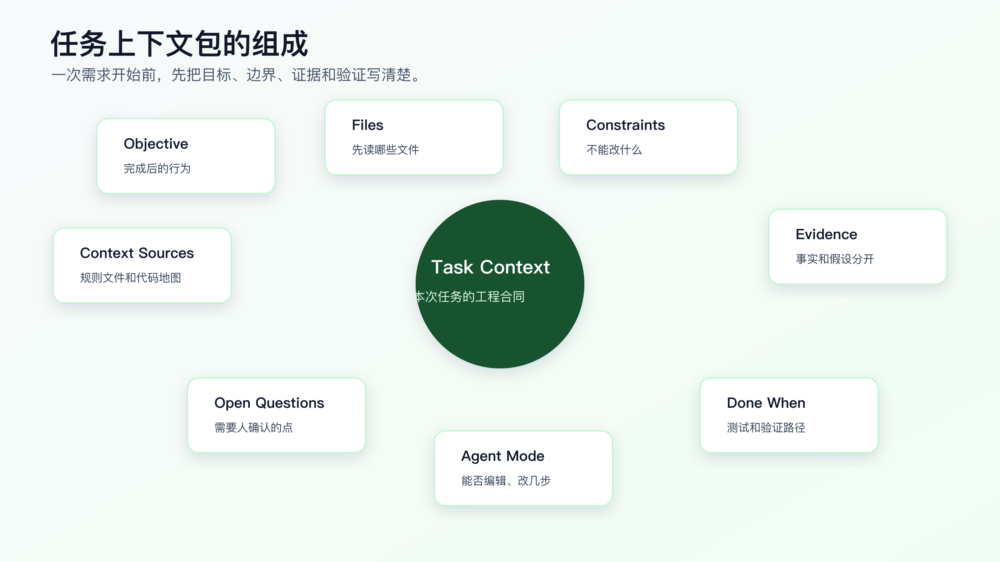

# 任务上下文包：一次需求到底该给 AI 什么

一次需求开始前，给 AI 的材料不是越多越好，也不是越少越好。

真正要给的是一份能约束行动的任务上下文包：目标、范围、相关文件、禁止修改、已知证据、验证方式、开放问题和 Agent 授权级别。

很多 AI Coding 失控，不是因为 Agent 不会写代码，而是因为任务开始时缺少合同。

你只说：

```text
帮我修一下 session 过期后第一次提交失败的问题。
```

Agent 只能自己猜：是前端表单问题？请求封装问题？token 存储问题？登录接口问题？还是后端返回问题？它猜得快，改得也快，但方向不一定对。

任务上下文包的目的，就是在实现前把这些判断显式化。它可以由 Agent 根据 issue、日志、代码搜索和上下文审计报告生成草稿，但硬约束、业务风险和授权级别必须由程序员确认。



## 任务上下文包不是 PRD

PRD 讲需求背景、用户价值、功能范围。任务上下文包讲一次代码改动怎么安全开始。

它不需要长。中等风险任务，一页就够。

一份有效的任务上下文包要回答八个问题：

| 问题 | 作用 |
|---|---|
| 要改变什么行为 | 防止实现跑偏 |
| 哪些行为不能变 | 防止破坏兼容 |
| 先读哪些文件 | 防止乱搜和漏入口 |
| 哪些文件暂时不改 | 防止误改 demo、legacy、generated |
| 已知证据是什么 | 区分事实和猜测 |
| 怎么证明完成 | 让验证在实现前出现 |
| 还有哪些未确认问题 | 防止 Agent 自行拍板 |
| Agent 当前授权级别 | 控制它能否直接编辑 |

这八个问题比“写一个好 prompt”更重要。

## 一个坏输入长什么样

看一个常见输入：

```text
登录过期后提交表单失败，你帮我修一下。
不要影响其他功能。
```

它的问题很多：

- “登录过期”没有复现路径。
- “提交表单”没有入口文件。
- “失败”没有错误日志。
- “不要影响其他功能”太空。
- 没有验证命令。
- 没有限制是否可以改登录接口。
- 没说明是否可以新增依赖。

Agent 看到这段话，会按自己搜到的第一条线索行动。

更好的输入是：

```markdown
# Task Context

## Objective

session 过期后重新登录，第一次提交资料表单应该成功，不应出现重复错误 toast。

## Files AI Should Inspect First

- `src/forms/ProfileForm.tsx`: form submit entry.
- `src/auth/request.ts`: HTTP 401 handling.
- `test/auth-refresh.test.ts`: related auth refresh tests.

## Constraints

- Do not change login API contract.
- Do not change token storage format.
- Do not add runtime dependencies.
- Do not swallow non-401 errors.

## Evidence

- Error log: `401 refresh token missing`.
- Repro path: login -> wait for session expiration -> refresh page -> submit form.

## Done When

- `npm test -- auth-refresh` passes.
- `npm run typecheck` passes if request types changed.
- Browser path passes: login -> expire session -> refresh -> submit.

## Agent Mode

First inspect files and produce a plan. Do not edit before plan approval.
```

这份材料并不复杂，但它把 Agent 的行动空间限定住了。

## 任务上下文包的八个部分

第一部分：Objective。

目标要写成行为，而不是愿望。

差：

```text
优化登录体验。
```

好：

```text
session 过期后重新登录，第一次提交资料表单应该成功，不应出现重复错误 toast。
```

行为越具体，验证越容易。

第二部分：Scope。

范围要写候选文件和原因。

```markdown
## Files AI Should Inspect First

- `src/forms/ProfileForm.tsx`: form submit entry.
- `src/auth/request.ts`: HTTP 401 handling.
- `test/auth-refresh.test.ts`: related tests.
```

不要只列路径。路径后面要写为什么相关。

第三部分：Constraints。

约束要写硬边界。

```markdown
## Constraints

- Do not change login API contract.
- Do not change token storage format.
- Do not add runtime dependencies.
- Do not edit generated files under `src/generated/`.
```

这比“不要影响其他功能”有效得多。

第四部分：Known Evidence。

证据是已经确认的事实，不是猜测。

```markdown
## Known Evidence

- Error log: `401 refresh token missing`.
- Current behavior: first submit fails after session refresh.
- Refresh API itself returns 200 in local reproduction.
```

如果只是猜测，要标成假设：

```markdown
## Hypotheses

- The original request may not be retried after refresh.
- Concurrent refresh may drop pending submit.
```

事实和假设不能混。

第五部分：Verification。

验证要在实现前写。

```markdown
## Done When

- `npm test -- auth-refresh` passes.
- `npm run typecheck` passes.
- Browser path passes: login -> expire session -> refresh -> submit.
```

如果没有自动测试，也要写手动验证：

```markdown
- Manual check: Network shows refresh request followed by one retry of original submit.
```

第六部分：Open Questions。

有不确定就写出来。

```markdown
## Open Questions

- Should original request retry exactly once or follow global retry policy?
- How should concurrent submits behave during refresh?
```

开放问题的价值是阻止 Agent 自己拍板。

第七部分：Agent Mode。

明确它当前能做什么。

```markdown
## Agent Mode

- Inspect and plan only.
- Do not edit before plan approval.
- If scope must expand, stop and explain.
```

低风险任务可以写：

```markdown
Agent may implement directly, but must keep diff scoped and report commands.
```

第八部分：Context Sources。

告诉 Agent 先读哪些长期资产。

```markdown
## Context Sources

- Project rules: `AGENTS.md`
- Code map: `docs/ai-coding/code-map.md`
```

这能把长期规则和单次任务接起来。

## 用 Agent 或工具生成草稿

任务上下文包不应该靠人从空白文档开始写。先让 Agent 根据搜索结果生成草稿，或者用配套工具生成骨架。

配套代码仓库 [DavidDingXu/learn-ai-coding](https://github.com/DavidDingXu/learn-ai-coding) 的工具 module 里有一个最小命令：

```bash
cd learn-ai-coding/ai-coding-workflow-kit
node src/cli.js task-context \
  --title "修复 session 过期后首次提交失败" \
  --files "src/auth/request.ts,src/forms/ProfileForm.tsx,test/auth-refresh.test.ts"
```

当前输出会是：

```markdown
# Task Context: 修复 session 过期后首次提交失败

## Goal

- Describe the behavior change before asking AI to edit code.

## Files AI Should Inspect First

- src/auth/request.ts
- src/forms/ProfileForm.tsx
- test/auth-refresh.test.ts

## Constraints

- List APIs, dependencies, generated files, or behaviors that must not change.

## Done When

- List tests, commands, UI checks, or manual verification evidence.

## Questions Before Coding

- Which existing behavior must remain compatible?
- Which test or command proves the change?
- What should AI do if it needs to expand the diff?
```

这个命令不会替你判断业务，也不会自动知道风险。它的作用是让 Agent 和人都别忘了最关键的几个字段。

复杂项目里，真正重要的是后续确认：

- 目标行为。
- 不能改变的接口和兼容规则。
- 错误日志和复现步骤。
- 验证命令。
- Agent 授权级别。

工具和 Agent 生成草稿，程序员确认工程判断。

## 草稿生成后怎么验收

Agent 写出的任务上下文包，不能直接当合同。

你至少要做一次验收。

第一，看 Objective 是否是行为。

“优化登录体验”不合格。
“session 过期后重新登录，第一次提交资料表单应该成功”才合格。

行为目标应该能被测试、页面路径、接口响应或日志证明。

第二，看 Files 是否有理由。

下面这种只列路径不合格：

```markdown
- `src/auth/request.ts`
- `src/forms/ProfileForm.tsx`
```

要写成：

```markdown
- `src/auth/request.ts`
  - reason: handles HTTP 401 and token refresh.
- `src/forms/ProfileForm.tsx`
  - reason: user-visible submit entry.
```

第三，看 Constraints 是否能阻止越界。

“不要影响其他功能”不合格。
“不改变登录 API contract，不改变 token storage format，不吞掉非 401 错误，不新增 runtime dependency”才有约束力。

第四，看 Evidence 是否区分事实和假设。

错误日志、复现路径、命令输出、截图是事实。
“可能是 refresh 没重试”是假设。

它们必须分开写。

第五，看 Done When 是否能执行。

“功能正常”不合格。
“`npm test -- auth-refresh` 通过，浏览器路径 login -> expire session -> refresh -> submit 通过，Network 显示 refresh 后原请求重试一次”才是可验证完成。

第六，看 Agent Mode 是否明确。

高风险任务不能只写任务上下文，还要写授权边界：

```markdown
## Agent Mode

Inspect and plan only.
Do not edit files before plan approval.
If scope expands beyond auth request wrapper and profile form submit path, stop.
```

验收可以用下面这段话让 Agent 自检：

```text
请检查这份 Task Context 是否足以授权你进入实现。

逐项回答：
1. Objective 是否能被验证？
2. Files 是否都写了用途和证据？
3. Constraints 是否足够阻止越界？
4. Evidence 和 Hypotheses 是否分开？
5. Done When 是否包含可执行命令或操作路径？
6. Agent Mode 是否明确说明你能不能编辑文件？

如果任一项不满足，请只修订 Task Context，不要写代码。
```

这一步能避免很多“任务包写了，但还是乱改”的问题。

## 不同材料怎么合并进任务上下文

一次真实任务的材料经常来自多个地方。

```text
用户描述
issue 评论
错误日志
截图
代码搜索结果
代码地图
项目规则
官方文档
历史 PR
```

不要把这些材料按原样塞进上下文包。它们的可信度不同，用法也不同。

可以按下面方式合并。

用户描述进入 Objective 和 Open Questions。

用户说“提交失败”，只能说明现象；不能直接说明根因。要把它写成目标和待确认问题：

```markdown
## Objective

session 过期后重新登录，第一次提交资料表单应该成功。

## Open Questions

- submit failure is caused by frontend retry, backend 401, or token storage?
```

错误日志进入 Known Evidence。

日志要带上下文，不要只贴一句：

```markdown
## Known Evidence

- Browser Network: first submit returns 401.
- Console log: `refresh token missing`.
- Refresh endpoint returns 200 in local reproduction.
```

代码搜索结果进入 Files To Inspect First 和 Files Not To Edit Initially。

```markdown
## Files AI Should Inspect First

- `src/auth/request.ts`
  - evidence: contains 401 handling and refresh call.

## Files Not To Edit Initially

- `src/generated/api-client.ts`
  - evidence: generated client; inspect only.
```

项目规则进入 Context Sources 和 Constraints。

如果 `AGENTS.md` 写了不能新增依赖，就不要只在 Context Sources 里引用，要把本任务相关约束拉进 Constraints。

官方文档进入 Reference，不直接覆盖项目事实。

```markdown
## Reference

- Framework docs say retry middleware can wrap request calls.
- Current project uses a custom request wrapper; follow current project contract first.
```

历史 PR 进入 Hypotheses 或 Background，不能直接变成当前事实。

```markdown
## Background

- Historical PR suggests token storage changed in an earlier refactor.
- Need current code confirmation before editing.
```

合并材料时，最重要的是保持层级。事实、假设、约束、参考资料不能混在一个段落里。

## 任务上下文包和权限控制

任务上下文包不是纯文档，它也是权限控制。

同一个需求，不同上下文包会给 Agent 完全不同的权限。

低风险写法：

```markdown
## Agent Mode

Direct implement allowed.
Keep diff limited to `src/pages/invoice/ListPage.tsx`.
Run focused UI test or provide screenshot.
```

中风险写法：

```markdown
## Agent Mode

Plan first.
Human approves plan before editing.
Implement one step at a time.
```

高风险写法：

```markdown
## Agent Mode

Analysis only.
Do not edit files.
Do not suggest production execution commands.
Output confirmed facts, hypotheses, and next verification action.
```

这里要明确一点：Agent Mode 不是礼貌提示，是任务边界。

如果 Agent 在 Inspect only 模式下开始改文件，这不是“它很主动”，而是违反任务合同。应该停下来回滚或让它解释原因。

## 什么时候需要升级到 SDD 或 OpenSpec

任务上下文包适合一次改动开始前的约束，但不是所有复杂需求都应该停留在一页上下文里。

下面这些信号说明该升级：

- 需求会持续多天。
- 需要改多个模块或多个仓库。
- 涉及公开 API、状态机、权限、金额、数据迁移。
- 需要多人 review。
- 需要把当前行为和未来行为同时记录下来。
- 任务会拆成多个可并行或可排期的小步骤。

这时要从 Task Context 升级到规格驱动：

```text
requirements.md 讲清楚用户行为和验收条件。
design.md 讲清楚技术取舍、兼容性和数据流。
tasks.md 把实现拆成可验证的小 diff。
OpenSpec changes/ 把拟议变更和当前系统行为分开管理。
```

不要把超大需求硬塞进一个任务上下文包。上下文包是启动合同，不是完整需求治理工具。

## 不同风险任务怎么调整上下文包

低风险任务可以很短。

```markdown
# Task Context

## Objective

把发票列表空状态文案从“暂无数据”改成“暂无发票”。

## Files

- `src/pages/invoice/ListPage.tsx`

## Constraints

- 不改查询逻辑。
- 不改组件结构。

## Done When

- `git diff` only shows copy change.
- 页面空状态显示正确。
```

中等风险任务要完整。

```markdown
# Task Context

## Objective

session 过期后重新登录，第一次提交资料表单应该成功。

## Agent Mode

Inspect and plan first. Human approves plan before editing.
```

高风险任务要更严格。

```markdown
# Task Context

## Objective

分析订单 paid 状态偶发回退原因。

## Agent Mode

Analysis only. Do not edit files.

## Hard Constraints

- Do not change order status transition logic.
- Do not alter payment callback behavior.
- Do not write migration scripts.

## Required Output

- Confirmed facts.
- Excluded hypotheses.
- Remaining hypotheses.
- Next smallest verification action.
- Questions for business owner.
```

同样叫任务上下文包，风险不同，授权级别不同。

## Agent Mode 是很多人漏掉的关键

任务上下文包里一定要写 Agent Mode。

常用模式有四种：

| 模式 | 用法 |
|---|---|
| Inspect only | 只读文件、搜索、整理事实 |
| Plan first | 先给计划，人确认后再实现 |
| Implement one step | 只执行计划中的一小步 |
| Direct implement | 低风险任务可直接实现 |

例如：

```markdown
## Agent Mode

Inspect only. Do not edit files.
```

或者：

```markdown
## Agent Mode

Implement step 1 only. Stop after diff summary and verification result.
```

没有 Agent Mode，Agent 会默认自己决定行动级别。

这在低风险任务里可能没问题，在中高风险任务里很危险。

## 任务上下文包如何和代码地图配合

代码地图是长期导航，任务上下文包是单次任务合同。

代码地图告诉 Agent：

```text
auth 模块在哪里，测试在哪里，generated 不要改。
```

任务上下文包告诉 Agent：

```text
这次只修 session 过期后首次提交失败，先读这三个文件，不改 token 存储。
```

任务上下文包应该引用代码地图：

```markdown
## Context Sources

- Code map: `docs/ai-coding/code-map.md`
- Project rules: `AGENTS.md`
```

但不要复制整份地图。复制会造成过期和冲突。

## 任务上下文包如何和项目规则配合

项目规则写长期约束：

```markdown
- Do not add dependencies without approval.
- Do not edit generated files.
- Run focused tests for behavior changes.
```

任务上下文包写本次约束：

```markdown
- Do not change login API contract.
- Do not change token storage format.
- Verify expired-session submit path.
```

如果任务上下文和项目规则冲突，要先停下来。

可以在任务包里写：

```markdown
## Conflict Handling

If task instructions conflict with project rules, stop and explain the conflict before editing.
```

这条规则能防止 Agent 自己在冲突里选一边。

## 任务上下文包放在哪里

不用固定。

可以放：

- issue 描述。
- PR 描述。
- 本地 `docs/ai-coding/tasks/<date>-<slug>.md`。
- 任务系统评论。
- Agent 对话第一条消息。

关键是它要能被复查。

如果是小任务，直接放对话里就行。
如果是中高风险任务，建议落到文件或 issue 里。
如果任务会拆多天，建议放仓库内文档，方便换对话和复盘。

一个轻量目录可以是：

```text
docs/ai-coding/tasks/
├── auth-refresh-submit.md
└── order-status-rollback.md
```

任务结束后，不一定长期保留所有任务包。重要任务可以归档，普通任务可以只把规则和代码地图更新回长期资产。

## 常见错误

**错误一：只写目标，不写不能改什么。**

AI 很容易为了解决一个点改动接口、依赖或状态结构。约束必须写。

**错误二：只写相关文件，不写为什么相关。**

路径后面写一句用途。否则 Agent 不知道优先级。

**错误三：把猜测写成事实。**

“可能是 refresh 没重试”要写到 Hypotheses，不要写到 Known Evidence。

**错误四：实现前不写验证。**

验证必须前置。否则实现完成后，Agent 会挑最容易通过的命令证明自己。

**错误五：不给 Agent 授权级别。**

同一份上下文，Inspect only 和 Direct implement 的风险完全不同。

## 一份高质量任务上下文包

下面是一份可以直接迁移的版本：

```markdown
# Task Context: expired session first submit failure

## Objective

After session expiration and re-login, the first profile form submit should succeed.
No duplicate error toast should appear.

## Context Sources

- Project rules: `AGENTS.md`
- Code map: `docs/ai-coding/code-map.md`

## Files AI Should Inspect First

- `src/forms/ProfileForm.tsx`
  - form submit entry
- `src/auth/request.ts`
  - HTTP 401 handling and retry behavior
- `test/auth-refresh.test.ts`
  - existing auth refresh tests

## Files Not To Edit Initially

- `src/auth/token-storage.ts`
  - token storage format is out of scope
- `src/generated/api-client.ts`
  - generated file

## Constraints

- Do not change login API contract.
- Do not change token storage format.
- Do not add runtime dependencies.
- Do not swallow non-401 errors.

## Known Evidence

- Error log: `401 refresh token missing`.
- Repro path: login -> wait for expiration -> refresh page -> submit form.

## Hypotheses

- Original request may not be retried after refresh.
- Pending submit may be dropped during refresh.

## Done When

- Add or update regression test for expired-session submit.
- `npm test -- auth-refresh` passes.
- `npm run typecheck` passes if request types change.
- Browser path passes: login -> expire session -> refresh -> submit.

## Open Questions

- Should original request retry exactly once or follow global retry policy?
- How should concurrent submits behave during refresh?

## Agent Mode

Inspect and plan first. Do not edit before plan approval.
If scope must expand, stop and explain why.
```

这份材料已经足够让 Agent 开始侦察，但还没有授权它直接改。

## 完成后怎么回收上下文

任务结束后，任务上下文包不要原封不动塞进长期规则。

要做一次回收：

```markdown
## Reuse After Completion

- 是否新增项目规则？
- 是否更新代码地图？
- 是否沉淀验证命令？
- 是否记录常见失败分类？
- 是否有可复用测试模式？
```

例如这次任务结束后，可能只需要沉淀两条：

```markdown
AGENTS.md:
- Do not swallow non-401 errors when changing auth retry logic.

code-map.md:
- Auth refresh tests: `npm test -- auth-refresh`
```

任务包本身可以归档，但长期资产只吸收稳定规则。

## 任务上下文包怎么进入 PR

很多团队的问题不是没有上下文，而是上下文只留在 AI 对话里。

如果这次改动需要 review，任务上下文包应该至少有一部分进入 PR 描述。

可以压缩成下面这种格式：

```markdown
## Task

session 过期后重新登录，第一次提交资料表单应该成功。

## Constraints

- 不改变登录 API contract。
- 不改变 token storage format。
- 不吞掉非 401 错误。

## Files

- `test/auth-refresh.test.ts`: regression coverage.
- `src/auth/request.ts`: 401 refresh and retry path.

## Verification

- `npm test -- auth-refresh`: passed.
- `npm run typecheck`: passed.
- Browser path: login -> expire session -> refresh -> submit, passed.

## Residual Risk

- 没有验证第三方 SSO staging path。
```

这不是把任务上下文包完整复制进 PR，而是把 reviewer 必须知道的边界带过去。

reviewer 看到这几段，就能知道：

- 这次要改什么。
- 哪些行为不能改。
- 为什么只改这些文件。
- 用什么证明结果。
- 哪些风险还没覆盖。

AI 生成的 PR 最怕“代码很多，解释很少”。任务上下文包能把解释补回来。

## 任务上下文包和 issue 的关系

issue 通常描述问题，任务上下文包描述如何安全开始改代码。

一个 issue 可能是：

```markdown
用户反馈 session 过期后重新登录，第一次提交资料表单失败。
```

它还不是任务上下文包。你还需要补：

```markdown
## Engineering Context

- suspected path:
- constraints:
- known evidence:
- verification:
- agent mode:
```

如果 issue 本身写得很好，可以直接把任务上下文包放在 issue 描述里。如果 issue 很长、讨论很多，建议在开始开发前由 Agent 生成一个精简 Task Context，并由人确认。

不要让 Agent 直接读取几十条 issue 评论后开始实现。issue 评论里常常混有旧猜测、过期截图、被否定方案和无关讨论。先收敛成任务上下文包。

## 任务上下文包的反例

下面这份看起来完整，但不合格：

```markdown
# Task Context

## Goal

修复登录问题，提升用户体验。

## Files

- `src/auth/`
- `src/forms/`

## Constraints

- 不要影响其他功能。

## Done When

- 功能正常。

## Agent Mode

请谨慎修改。
```

问题很具体：

- Goal 不是可验证行为。
- Files 是目录，不是入口和证据。
- Constraints 不可执行。
- Done When 没有命令或操作路径。
- Agent Mode 没有权限边界。

把它改成合格版本：

```markdown
# Task Context

## Objective

session 过期后重新登录，第一次提交资料表单应该成功，不出现重复错误 toast。

## Files AI Should Inspect First

- `src/forms/ProfileForm.tsx`
  - form submit entry.
- `src/auth/request.ts`
  - HTTP 401 handling and retry behavior.
- `test/auth-refresh.test.ts`
  - existing refresh tests.

## Constraints

- Do not change login API contract.
- Do not change token storage format.
- Do not add runtime dependencies.
- Do not swallow non-401 errors.

## Done When

- Regression test covers expired-session first submit.
- `npm test -- auth-refresh` passes.
- Browser Network shows refresh followed by one retry of original submit.

## Agent Mode

Inspect and plan first. Do not edit before plan approval.
```

这才是一份可以授权 Agent 做侦察和计划的上下文。

## 上下文包过期了怎么办

任务拖得越久，上下文包越容易过期。

常见过期信号：

- 计划里的文件已经被别人改过。
- 任务目标发生变化。
- 测试命令变化。
- Agent 发现真实入口不是原来写的入口。
- 新证据排除了原来的主要假设。

上下文包过期时，不要直接在原文下面继续追加。先更新关键段落：

```markdown
## Context Update

Date:

Changed:
- Original hypothesis `token storage missing` is excluded.
- New confirmed fact: original submit request is not replayed.

Current Next Action:
- Add retry regression test before implementation.
```

如果变化很大，就生成新版本。不要让 Agent 同时读旧上下文和新上下文，然后自己判断哪个优先。

上下文包不是越多越好。它必须保持当前有效。

## 常见问题

**每个任务都要写任务上下文包吗？**

不用。低风险小改可以写很短，甚至只写对话里的几行。中高风险任务建议写完整。

**任务上下文包是不是会降低速度？**

低风险任务可能会。但中高风险任务里，它减少的是返工和误改。写 5 分钟上下文，通常比清理一个大 diff 便宜。

**可以让 AI 帮我写任务上下文包吗？**

应该优先让 AI 写草稿。它可以根据 issue、日志、代码搜索结果和上下文审计报告整理材料。程序员不要把草稿当最终合同，重点确认硬约束、业务风险、验证命令和授权级别。

**任务上下文包和 SDD 有什么区别？**

任务上下文包更轻，适合一次改动开始前的上下文和约束。SDD 会进一步把需求、设计和任务拆成规格驱动流程，适合更复杂需求。

**任务包里要不要贴代码片段？**

尽量贴路径和搜索结果摘要，不要大段复制代码。让 Agent 去真实仓库读文件。只有外部系统、日志或无法访问材料才需要贴片段。

## 可以先实践的一件事

下次中等风险任务开始前，先写这五行：

```markdown
Objective:
Files AI should inspect first:
Constraints:
Done when:
Agent mode:
```

如果五行写不出来，就不要让 AI 实现。先让它帮你做侦察和澄清。

任务上下文包的价值，是让 AI 在写代码前知道自己处在哪个边界里。项目规则解决长期约束，代码地图解决导航，任务上下文包解决本次任务合同。

接下来会讲上下文污染与上下文清理。一次任务推进过程中，旧假设、失败尝试和无关材料会不断进入对话；如果不清理，Agent 很容易把已经被否定的内容当成事实继续执行。

## 可复查资料

- OpenAI Codex 最佳实践：<https://developers.openai.com/codex/learn/best-practices>
- OpenAI Codex `AGENTS.md` 指南：<https://developers.openai.com/codex/guides/agents-md>
- Anthropic Claude Code memory：<https://code.claude.com/docs/en/memory>
- GitHub Copilot repository instructions：<https://docs.github.com/en/copilot/how-tos/copilot-on-github/customize-copilot/add-custom-instructions/add-repository-instructions>

---

[课程首页](../../../README.md) · [完整目录](../README.md) · [← `AGENTS.md` / `CLAUDE.md` / Copilot Instructions](11-AGENTS-md-CLAUDE-md-Copilot-Instructions.md) · [上下文污染与上下文清理 →](13-%E4%B8%8A%E4%B8%8B%E6%96%87%E6%B1%A1%E6%9F%93%E4%B8%8E%E4%B8%8A%E4%B8%8B%E6%96%87%E6%B8%85%E7%90%86.md)

动手实践：[陌生模块接手记录](../../../ai-coding-workflow-kit/dev-process/01-module-onboarding.md)
