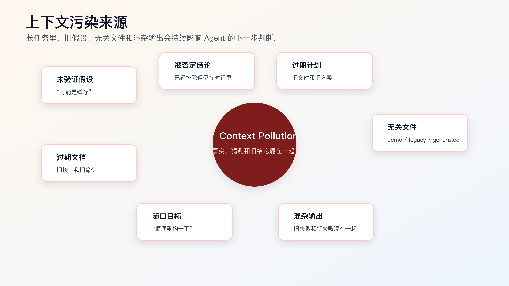
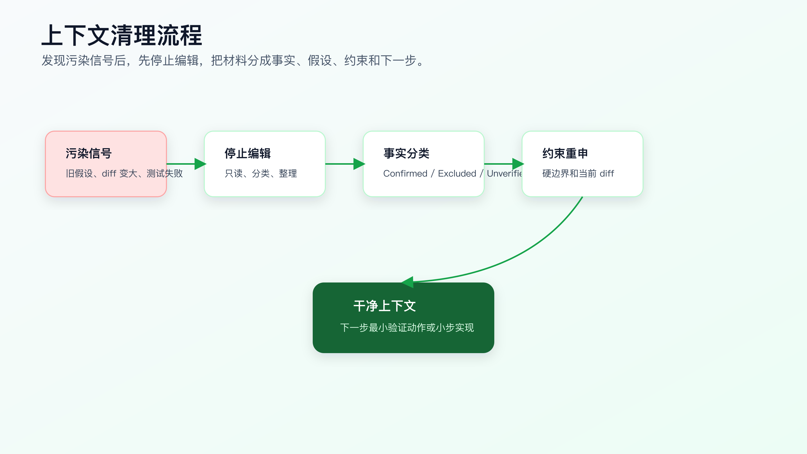

# 上下文污染与上下文清理

AI Coding 做到一半，最危险的不是 Agent 不知道，而是它以为自己知道。

排障开始时怀疑是缓存，后来日志证明不是；第一版计划准备改请求封装，后来发现真实入口在表单状态；前几轮测试失败是环境问题，后来又出现本次引入失败。对话越长，里面混入的猜测、旧方案、被否定结论、无关文件越多。

如果不清理，Agent 会继续被这些材料影响。

上下文污染不是抽象问题。它会直接导致误改文件、扩大范围、重复排错、把旧失败当成本次责任，甚至把已经排除的假设重新写进代码。

程序员要学会在合适的节点让 Agent 停下来，重新整理事实。



## 上下文污染从哪里来

第一类污染：未验证假设。

比如：

```text
可能是 refresh token 没写入。
可能是后端返回慢。
可能是表单重复提交。
```

这些话在排障早期有价值，但它们不是事实。如果后来没有被分类，Agent 很容易把“可能”当成实现依据。

第二类污染：被否定的旧结论。

日志已经证明 refresh token 写入成功，但对话里保留了大量“token 没写入”的讨论。后续 Agent 仍可能回到 token storage 方向。

第三类污染：过期计划。

第一版计划说改 `src/auth/request.ts`，后面发现真实问题在 `src/forms/ProfileForm.tsx`。如果计划没更新，Agent 可能继续围绕旧文件工作。

第四类污染：无关文件。

搜索时读了 demo、legacy、generated、docs，它们进入上下文后，Agent 后面可能继续引用。尤其是 demo 和 docs，看起来很像生产逻辑。

第五类污染：工具输出混杂。

测试输出、lint 输出、环境报错、旧失败、本次失败混在一起，没有分类。Agent 看到红色输出就开始修，结果可能修错层。

第六类污染：人类随口补充。

“应该就是前端问题”“可能顺手重构一下”“这个模块本来就有点乱”。这些话如果不加边界，会改变 Agent 的目标。

上下文污染的本质，是事实、假设、偏好、旧结论、无关材料混在一个窗口里。

## 污染出现时的信号

出现下面这些信号，就该清理上下文。

第一，Agent 开始引用已经被排除的原因。

比如你已经确认不是缓存，它又说“我们可以清缓存试试”。

第二，Agent 的计划和最新证据不一致。

最新日志指向表单状态，它的计划还在改请求封装。

第三，它无法解释为什么改某个文件。

它只说“这个文件相关”，但说不出入口、调用点和验证命令。

第四，测试失败后它直接继续改。

没有先判断是 baseline、introduced、environment 还是 requirement conflict。

第五，diff 越来越大。

小 bug 变成跨模块重构，说明目标和边界已经被污染。

第六，完成报告没有未验证风险。

它把当前可见材料当成完整事实，说明上下文里缺少不确定性分类。

这些信号出现时，不要继续喂更多上下文。先停。

## 清理上下文的核心动作

清理不是把对话删掉，也不是让 Agent 重新总结一遍。

清理要把当前材料分成五类：

```text
已确认事实
已排除假设
未验证假设
当前硬约束
下一步最小动作
```

可以直接这样要求：

```text
停止修改。

请只基于当前证据整理上下文：
1. 已确认事实。
2. 已排除假设。
3. 未验证假设。
4. 当前硬约束。
5. 当前 diff 涉及哪些文件。
6. 下一步最小验证动作。

不要继续写代码。
不要把猜测写成事实。
```

这段话很适合在排障、测试失败、计划变化、大 diff 之前使用。

整理后的输出应该像这样：

```markdown
## Confirmed Facts

- First submit after session expiration returns 401.
- Refresh request succeeds and returns a new token.
- Original submit request is not retried.
- Current diff only changes `test/auth-refresh.test.ts`.

## Excluded Hypotheses

- Token storage is not empty after refresh.
- Backend submit endpoint is not returning 500.

## Unverified Hypotheses

- Request wrapper does not replay original request after refresh.
- Concurrent submits may be dropped during refresh.

## Constraints

- Do not change login API contract.
- Do not change token storage format.
- Do not swallow non-401 errors.

## Next Smallest Action

- Read `src/auth/request.ts` and add one retry guard test before implementation.
```

这就是干净上下文。

## 清理流程图



这个流程有三个关键点。

第一，先停止编辑。

只要还在继续改文件，污染就会扩散。清理时禁止写代码。

第二，先分类，再决策。

不要一边整理一边提出修复方案。先把事实和假设分清。

第三，下一步必须小。

清理后的下一步不应该是“大概重构一下”。它应该是一个最小验证动作或一小步实现。

## 什么时候应该开新对话

不是每次污染都要开新对话。

这些情况可以在当前对话里清理：

- 任务仍然是同一个。
- diff 范围还小。
- 主要问题是测试失败分类。
- 只需要剔除一两个旧假设。

这些情况建议开新对话：

- 对话已经很长。
- 早期猜测大量存在。
- 任务从排障转成实现。
- 任务从实现转成重构。
- 多个失败尝试混在一起。
- Agent 反复回到已排除假设。

开新对话时，不要把原对话全部复制过去。

带一份交接包：

```markdown
# Handoff Context

## Objective

session 过期后重新登录，第一次提交资料表单应该成功。

## Confirmed Facts

- ...

## Excluded Hypotheses

- ...

## Current Diff

- `test/auth-refresh.test.ts`: added failing regression test.

## Constraints

- ...

## Next Action

- Inspect `src/auth/request.ts` and propose minimal implementation plan.

## Do Not Use

- Do not continue the earlier token-storage hypothesis.
- Do not modify login API contract.
```

新对话需要的是整理后的事实，不是原始聊天记录。

## 失败分类是上下文清理的一部分

测试失败后，最容易污染。

一个命令失败，可能有很多原因：

| 类型 | 说明 | 处理 |
|---|---|---|
| baseline failure | 改前就失败 | 记录基线，不作为本次引入 |
| introduced failure | 本次 diff 引入 | 回到最小 diff 修复 |
| environment failure | 依赖、服务、密钥、端口问题 | 不改业务代码，先处理环境 |
| requirement conflict | 测试期望和需求冲突 | 停下来确认业务规则 |
| coverage gap | 命令通过但没覆盖关键路径 | 补验证，不宣布完成 |

可以直接给 Agent：

```text
测试失败后不要改代码。

请先分类：
- baseline failure
- introduced failure
- environment failure
- requirement conflict
- coverage gap

说明证据和下一步最小动作。
```

如果没有这一步，Agent 很可能把环境问题改成业务代码，或者把旧失败算成自己要修的内容。

## 一个真实清理案例

看一个更完整的过程。

任务是：

```text
session 过期后重新登录，第一次提交资料表单失败。
```

第一轮，Agent 做了侦察：

```markdown
Files read:
- `src/auth/request.ts`
- `src/forms/ProfileForm.tsx`
- `test/auth-refresh.test.ts`
```

它的初始假设是：

```markdown
Hypothesis:
- refresh token may not be written to storage.
```

于是它准备改 `src/auth/token-storage.ts`。

这时你让它先看日志和 Network。结果发现：

```markdown
Evidence:
- refresh endpoint returns 200.
- new access token appears in memory state.
- original submit request is not replayed.
```

这个证据已经排除了“refresh token 没写入”的主要方向。可是如果不清理上下文，前面关于 token storage 的讨论仍然留在对话里。Agent 后续可能继续建议改 storage。

这时应该停下来：

```text
停止修改。
请重新整理上下文。
把 token storage 相关判断按证据分类，不要继续沿旧假设实现。
```

整理结果应该变成：

```markdown
## Confirmed Facts

- Refresh request succeeds.
- New access token is available after refresh.
- Original submit request is not replayed.

## Excluded Hypotheses

- Token storage is empty after refresh.
- Refresh endpoint itself fails.

## Unverified Hypotheses

- Request wrapper refreshes token but does not retry the original request.
- Submit handler may drop the pending request while refresh is running.

## Active Constraints

- Do not change token storage format.
- Do not change login API contract.
- Do not swallow non-401 errors.

## Next Smallest Action

- Add regression test for retrying original submit after successful refresh.
```

注意这个整理做了三件事。

第一，它把 token storage 从候选修改路径里移出。不是因为它一定无关，而是当前证据不支持先改它。

第二，它把下一步从“修 storage”改成“补 retry regression test”。这让任务回到可验证路径。

第三，它保留了未验证假设。比如 submit handler 是否 drop pending request，还没有证据，不能当事实。

这就是上下文清理的价值。它不是写总结，而是改变下一步动作。

## 清理前后对比

污染状态下，Agent 的计划可能是：

```markdown
Plan:
1. Refactor token storage to ensure refresh token is saved.
2. Update request wrapper to read token from storage.
3. Adjust ProfileForm submit error handling.
4. Update tests.
```

看起来完整，但风险很高。它把三个方向混在一起：storage、request wrapper、form submit。任何一个方向错了，diff 都会变大。

清理后，计划应该变成：

```markdown
Plan:
1. Add failing test: refresh succeeds, original submit retries once.
2. If test fails as expected, update request wrapper only.
3. Run focused auth-refresh test.
4. Use browser Network to confirm refresh followed by original submit retry.
```

差别在于：清理后的计划只保留当前证据支持的最小路径。

一个程序员看 AI 的计划，不要只看它有没有步骤。要看每一步是否来自已确认事实，是否避开了已排除假设，是否能用命令或操作验证。

## 上下文清理和 Git 的关系

清理上下文时，也要清理工作区认知。

不是让 Agent 直接回滚，而是先看清楚当前 diff。

```bash
git status --short
git diff --stat
git diff
```

这三条命令分别回答：

- 工作区有哪些改动。
- 哪些文件改动最大。
- 具体改了什么。

然后让 Agent 做 diff 分类：

```text
请基于当前 git diff 分类：
1. Directly related to current task.
2. Possibly related but not yet proven.
3. Refactor or cleanup.
4. Out of scope.
5. Should not decide without human review.

不要执行 git checkout、reset 或删除文件。
```

这里必须强调：不要让 Agent 擅自 `git checkout -- .` 或 `git reset --hard`。真实工作区里可能有用户改动、上一轮已经确认的改动，或者其他任务残留。上下文清理先做分类，不做破坏性恢复。

如果需要收缩 diff，可以让 Agent 输出建议：

```markdown
## Diff Shrink Proposal

Keep:
- `test/auth-refresh.test.ts`
  - regression test for current bug.
- `src/auth/request.ts`
  - minimal retry-after-refresh implementation.

Move to separate task:
- `src/auth/error-message.ts`
  - copy cleanup, not required for current bug.

Discard candidate:
- `src/auth/token-storage.ts`
  - token storage hypothesis was excluded by Network evidence.
```

程序员确认后，再决定怎么处理这些文件。

## 上下文清理和 review 的关系

如果一段 AI 生成的 PR 很难 review，通常不是 review 能力不够，而是上下文没有清理。

PR 里应该能看到：

```markdown
## Confirmed Facts

## Excluded Hypotheses

## Change Scope

## Verification

## Residual Risk
```

如果 PR 描述只有：

```text
修复 session 过期后提交失败问题。
```

reviewer 就要从 diff 里反推上下文。这会非常低效。

你可以在 review 前要求 Agent：

```text
请根据当前 diff 生成 review handoff。
必须包含：
- 本次任务目标。
- 已确认事实。
- 已排除假设。
- 为什么这些文件被修改。
- 验证命令和结果。
- 未覆盖风险。
```

这份 handoff 可以直接放进 PR 描述，也可以作为自己 review 的检查材料。

大厂代码审查里很重要的一点是：reviewer 不应该只看代码，还要看变更意图、验证证据和风险边界。AI Coding 也是同一套要求，只是更需要显式写出来。

## diff 变大时如何收缩

上下文污染常常表现为 diff 变大。

你可以让 Agent 做一次 diff 审查：

```text
停止继续实现。

请基于当前 diff 做范围审查：
1. 哪些改动直接服务本任务？
2. 哪些改动是重构、清理或顺手修改？
3. 哪些文件不应该在本任务里改？
4. 如果要收缩到最小 diff，应该保留什么、撤回什么？

不要执行撤回动作，只输出建议。
```

注意最后一句：不要执行撤回动作。

因为工作区里可能有用户改动，Agent 不应该擅自还原。先让它分类，再由人决定怎么处理。

diff 收缩的目标不是让代码更少，而是让每一行都能追溯到本次任务。

## 事实整理表

可以把下面这个表放进任务记录里：

```markdown
# Context Cleanup

## Confirmed Facts

-

## Excluded Hypotheses

-

## Unverified Hypotheses

-

## Active Constraints

-

## Current Diff

-

## Verification State

- Commands passed:
- Commands failed:
- Not run:

## Next Smallest Action

-
```

这张表最适合三个节点使用：

- 长对话中段。
- 测试失败后。
- 准备开新对话前。

## 别把总结当清理

很多 Agent 会给出漂亮总结：

```text
我们已经分析了问题，并确定需要优化请求重试逻辑。接下来将完善 auth 模块并增强错误处理。
```

这不叫清理。

清理必须可复查：

- 哪些事实有证据。
- 哪些假设已排除。
- 哪些还没验证。
- 当前 diff 是什么。
- 下一步为什么最小。

如果总结里没有分类，就让它重写：

```text
不要写概括性总结。
请按 Confirmed / Excluded / Unverified / Constraints / Next Action 分类。
```

## 长任务里的节奏控制

中等以上任务建议固定三个清理点。

第一个清理点：侦察后。

```text
读完入口、实现和测试后，整理已确认事实和缺失上下文。
```

第二个清理点：第一次验证失败后。

```text
分类失败类型，不直接继续改。
```

第三个清理点：完成前。

```text
整理命令、diff、未验证风险和需要沉淀的规则。
```

如果任务跨天，开新对话前再做一次交接包。

## 常见错误

**错误一：继续补更多上下文。**

污染时继续塞材料，常常让问题更乱。先分类，再补材料。

**错误二：把猜测整理成事实。**

“应该是请求没重试”要放 Unverified，不要放 Confirmed。

**错误三：清理时继续改代码。**

清理阶段只读、分类、计划。编辑会扩大不确定性。

**错误四：开新对话带原始聊天记录。**

原始聊天记录里有大量噪音。要带整理后的交接包。

**错误五：完成前不写剩余风险。**

没有剩余风险，通常说明验证边界没有说清。

## 一套可复用提示

排障中段：

```text
停止修改。
请把当前上下文整理成：
- Confirmed Facts
- Excluded Hypotheses
- Unverified Hypotheses
- Active Constraints
- Next Smallest Action
不要写代码。
```

测试失败后：

```text
测试失败后不要改代码。
先分类失败类型，并说明证据：
- baseline
- introduced
- environment
- requirement conflict
- coverage gap
```

diff 变大时：

```text
请审查当前 diff：
- 哪些改动服务本任务？
- 哪些是无关重构或清理？
- 哪些文件不应该改？
- 如何收缩到最小 diff？
不要执行撤回。
```

开新对话前：

```text
请生成新对话交接包：
- Objective
- Confirmed Facts
- Excluded Hypotheses
- Current Diff
- Constraints
- Next Action
- Do Not Use
```

## 如何迁移到自己的项目

先在任务记录里加一个小节：

```markdown
## Context Cleanup
```

每次遇到测试失败、计划变化或 diff 扩大时，就填一次。

如果你使用仓库内任务文档，可以放：

```text
docs/ai-coding/tasks/<task>.md
```

如果只是轻量任务，直接在对话里要求 Agent 输出这张表也可以。

关键是形成习惯：长任务不是一直往前推，而是定期把事实、假设和约束重新摆正。

## 可以先练的一次清理

找一个最近和 AI 反复改过的任务，不管最后有没有成功。

不要继续让它写代码。只让它做一次清理：

```text
请根据当前对话和 diff，输出 Context Cleanup。

必须包含：
1. Confirmed Facts
2. Excluded Hypotheses
3. Unverified Hypotheses
4. Active Constraints
5. Current Diff
6. Verification State
7. Next Smallest Action

不要继续修改文件。
```

然后你自己检查三件事：

- 它有没有把猜测写进 Confirmed Facts。
- 它有没有漏掉当前 diff 中的计划外文件。
- 它给出的 Next Smallest Action 是否真的最小。

如果这三件事都过了，再让它继续下一步。

这个练习很适合老项目。老项目里问题不一定能马上修好，但先把事实整理干净，已经能减少一大半误改。

## 哪些清理结果要写回长期资产

不是每次清理都要沉淀。

只把会反复出现、能减少后续误判的内容写回去。

适合写进 `AGENTS.md` 的，是长期规则：

```markdown
- Before editing after a test failure, classify the failure as baseline, introduced, environment, requirement conflict, or coverage gap.
- Do not continue from excluded hypotheses.
- Do not run destructive git commands to shrink diff without human approval.
```

适合写进代码地图的，是项目事实：

```markdown
- `src/generated/` is generated from OpenAPI; inspect only.
- Auth refresh focused test: `npm test -- auth-refresh`.
```

适合写进 Skill 的，是重复流程：

```text
debug cleanup -> classify evidence -> shrink diff proposal -> verification ledger
```

适合只留在任务记录里的，是本次特有事实：

```markdown
- This bug is not caused by token storage.
- Network trace showed refresh success but original submit was not replayed.
```

这个区分很重要。把一次性事实写进长期规则，会污染后续任务；把长期规则只留在聊天里，下次还会重犯。

## 什么时候清理也不够

上下文清理只能解决“材料混乱”的问题，不能替你解决需求本身不清楚的问题。

如果整理后发现这些情况，就不要继续让 Agent 实现：

- 业务规则互相冲突。
- 没有人能确认历史兼容行为。
- 验证路径完全缺失。
- 任务目标从 bug 修复变成架构调整。
- 当前 diff 已经包含多类不相关变更。
- 需要改生产数据、权限、金额或状态机。

这时下一步不是再清理一遍，而是回到需求确认、方案设计或规格驱动。比如订单状态回退问题，如果整理后发现 paid、refunding、refunded、canceled 的状态规则没有人能确认，就应该暂停编码，先把状态合同写清楚。

上下文清理的价值，是让你看清自己到底卡在哪里。有时它会把任务重新拉回最小实现；有时它会明确告诉你：这个任务已经不适合继续靠一段对话推进。

清理输出还要能被另一个人接手。

如果换一个 Agent 或 reviewer 读完清理记录，仍然不知道当前事实、当前 diff、验证状态和下一步动作，那这次清理只是重新总结了一遍聊天记录。真正有用的清理应该让人能立刻判断：继续、拆分、回滚，还是回到需求确认。

可以把这条当成验收：清理记录能不能支撑一次交接。

上下文工程到这里已经形成一条完整链路：代码地图让 Agent 知道从哪里开始，搜索让上下文可解释，项目规则约束长期行为，任务上下文包约束本次任务，上下文清理防止长任务跑偏。

接下来进入 SDD 和 OpenSpec。复杂需求不能只靠上下文包，还需要把需求、设计和任务拆成可审查、可归档的规格合同。

## 常见问题

**清理上下文是不是浪费时间？**

如果只是改文案，确实没必要。清理适合长对话、测试失败、diff 扩大、假设变化和准备交接的时候。它省的是后面继续沿错误方向改的时间。

**清理后一定要开新对话吗？**

不一定。当前对话还短、diff 还小、只需要排除一两个假设时，可以在当前对话里继续。对话很长、早期假设很多、任务阶段变化明显时，再开新对话。

**Agent 总结得很好，还需要按表格清理吗？**

要看总结是否可复查。如果总结没有区分 Confirmed、Excluded、Unverified、Constraints 和 Next Action，它只是概括，不是清理。

**清理时能不能让 Agent 自动回滚？**

不要默认允许。先让它分类 diff，再由人决定保留、拆分还是回滚。真实工作区里可能有用户改动，不能让 Agent 擅自执行破坏性命令。

**清理和 verification ledger 有什么关系？**

清理发生在任务中段，目的是把事实和假设分开；verification ledger 发生在完成前，目的是记录命令、证据和剩余风险。两者都服务同一个目标：让 AI 的结论能被复查。

## 可复查资料

- OpenAI Codex 最佳实践：<https://developers.openai.com/codex/learn/best-practices>
- Anthropic Claude Code 最佳实践：<https://www.anthropic.com/engineering/claude-code-best-practices>
- GitHub Copilot cloud agent 任务最佳实践：<https://docs.github.com/en/copilot/tutorials/cloud-agent/get-the-best-results>

---

[课程首页](../../../README.md) · [完整目录](../README.md) · [← 任务上下文包：一次需求到底该给 AI 什么](12-%E4%BB%BB%E5%8A%A1%E4%B8%8A%E4%B8%8B%E6%96%87%E5%8C%85-%E4%B8%80%E6%AC%A1%E9%9C%80%E6%B1%82%E5%88%B0%E5%BA%95%E8%AF%A5%E7%BB%99-AI-%E4%BB%80%E4%B9%88.md) · [模块实战：让 AI 接手一个陌生代码模块 →](14-%E6%A8%A1%E5%9D%97%E5%AE%9E%E6%88%98-%E8%AE%A9-AI-%E6%8E%A5%E6%89%8B%E4%B8%80%E4%B8%AA%E9%99%8C%E7%94%9F%E4%BB%A3%E7%A0%81%E6%A8%A1%E5%9D%97.md)

动手实践：[陌生模块接手记录](../../../ai-coding-workflow-kit/dev-process/01-module-onboarding.md)
