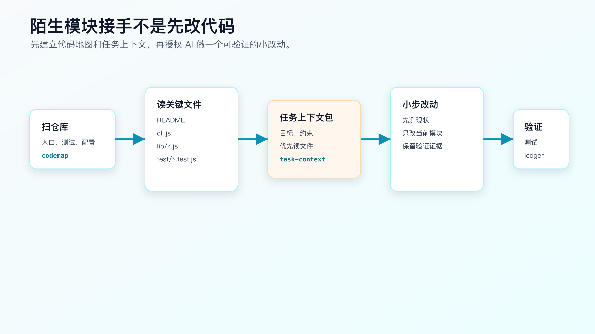
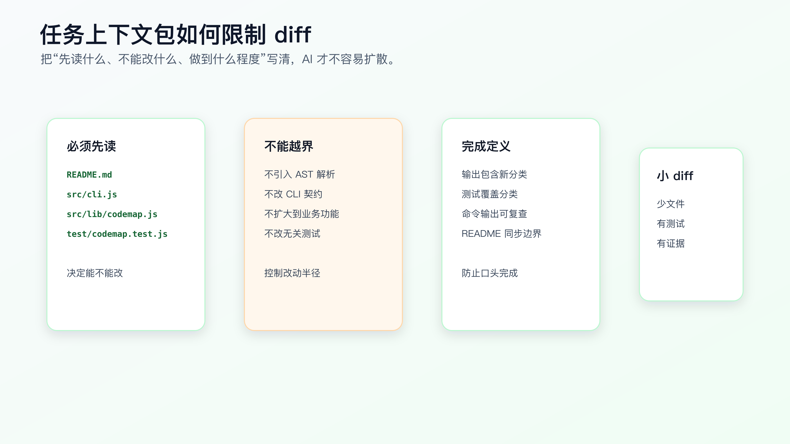

# 模块实战：让 AI 接手一个陌生代码模块

陌生模块接手，不是让 AI 进项目跑几条命令，然后听它说“我理解了”。

真实开发里，程序员更关心的是另一件事：在授权 AI 改代码之前，能不能先拿到一份可复查的接手记录。它要说明 AI 读了哪些文件、找到了哪些入口、测试在哪里、哪些目录不能乱碰、第一个小 diff 应该从哪里开始。

配套代码仓库 [DavidDingXu/learn-ai-coding](https://github.com/DavidDingXu/learn-ai-coding) 按一个大仓库组织，仓库根目录下有业务 module 和工具 module。这里用工具 module：`ai-coding-workflow-kit`。它服务上下文工程和工具工作流，不是综合业务实战主线。

这一篇用 `ai-coding-workflow-kit` 的一次接手过程做案例。过程记录在：

```text
learn-ai-coding/ai-coding-workflow-kit/dev-process/01-module-onboarding.md
```

对应的真实需求是：

```text
第一次接手这个 CLI 工具项目，准备让 AI 后续改进 CLI，但现在不能直接授权它修改代码。
```

这就是很多程序员每天会遇到的场景：项目不大，但你并不熟；需求看起来简单，但入口、测试、README、examples、OpenSpec 材料混在一起；如果 AI 一上来就改，很容易改到错误位置。



## 起点：先禁止改代码

过程记录里的起始请求不是“帮我优化这个项目”，而是：

```text
我想让 AI 帮我改进这个 AI Coding 工具项目。先不要改代码，先搞清楚项目结构、CLI 入口、测试覆盖和第一个安全的小改动应该从哪里开始。
```

这句话有三个关键约束：

```text
只做仓库侦察。
不改文件。
输出接手记录。
```

如果没有这三条，AI 很可能直接进入实现：重构 CLI、补功能、改 README，甚至顺手调整测试。你还没搞清楚模块，它已经给你一个 diff。

陌生模块的第一步不是“提高效率”，而是降低误改概率。

## 第一轮：让 AI 读真实入口

接手记录先要求 AI 读取这些文件：

```text
README.md
package.json
src/cli.js
src/lib/codemap.js
src/lib/task-context.js
src/lib/verification-ledger.js
test/cli.test.js
test/codemap.test.js
```

这组文件不是随便列的。它覆盖了当前项目的四个事实：

```text
README.md              用户入口和可运行命令
package.json           测试命令和模块类型
src/cli.js             CLI 分发入口
src/lib/*.js           核心能力实现
test/*.test.js         当前行为合同
```

让 AI 读文件时，不要只让它总结“项目做什么”。要让它带证据回答：

```text
项目提供哪些 CLI 命令？
每个命令对应哪个实现文件？
当前测试覆盖哪些行为？
examples 和 openspec 目录在这次任务里是什么角色？
第一个小改动建议是什么，为什么风险低？
```

这些问题会迫使 AI 回到文件，而不是泛泛说“这是一个提高 AI Coding 效率的工具”。

## 第二轮：生成代码地图，但不把它当结论

可以在配套工程的工具 module 里运行：

```bash
cd learn-ai-coding/ai-coding-workflow-kit
npm test
node src/cli.js codemap --root .
```

这两条命令的作用不同。

`npm test` 是改前基线。当前项目应当看到：

```text
tests 12
pass 12
fail 0
```

`codemap` 是导航证据。它会输出源码、测试、文档、配置和建议优先阅读的文件。

但代码地图不是架构真相。它只是第一层索引。程序员还要复核：

```text
src/cli.js 是否真的是入口？
test/cli.test.js 是否覆盖进程级行为？
examples/ 是否只是验证记录样例？
openspec/changes/ 是否是历史变更材料，还是当前要改的 source of truth？
```

这一步很重要。AI 容易把“看起来相关的目录”都当成当前实现路径。代码地图帮你缩小范围，但不能替你做工程判断。

## 第三轮：形成接手记录

过程记录里的 AI handoff prompt 是这样写的：

```text
你现在只做仓库侦察，不改文件。

请阅读 README.md、package.json、src/cli.js、src/lib/*.js 和 test/*.test.js，
输出一份接手记录：
1. CLI 当前命令列表。
2. 每个命令对应的实现文件和测试文件。
3. 第一个小改动建议。
4. 不应该修改的目录或文件。
5. 最小验证命令。
```

一份合格的接手记录至少应该包含：

```text
CLI 入口：src/cli.js
核心能力：codemap、context-audit、task-context、context-pack、verify-ledger
测试入口：test/*.test.js
验证命令：npm test
谨慎目录：examples/、openspec/changes/
第一个小改动候选：补齐 CLI 合同或改进 codemap 输出
```

如果 AI 没列出实际读过的文件，或者只给一段项目介绍，就不能进入实现。

接手记录的价值不在文字漂亮，而在于你能逐条检查。

## 第四轮：把第一个小改动写成任务上下文

接手完成后，仍然不要直接说“那你改吧”。

先把第一个小需求写窄。例如：

```text
改进 codemap 的优先阅读文件说明，让 AI 接手陌生项目时知道先读哪些文件，并保持现有统计字段不变。
```

可以生成任务上下文包：

```bash
node src/cli.js task-context \
  --title "改进 codemap 的优先阅读文件说明" \
  --files "src/lib/codemap.js,test/codemap.test.js,src/cli.js,README.md" \
  --constraints "不引入 AST 解析,不改变 codemap 命令名,不删除现有统计字段" \
  --done "npm test 通过,codemap 输出仍包含 Code Map 和 Files AI Should Inspect First"
```

这里的关键不是命令本身，而是任务上下文里的四个字段：

```text
目标：改什么行为。
文件：先读哪些文件。
约束：哪些事不能做。
完成定义：怎么证明完成。
```

这比“优化一下代码地图”可靠得多。

## 第五轮：人工复核后再授权

过程记录里的人工复核点包括：

```text
src/cli.js 是命令分发入口。
src/lib/codemap.js 是代码地图实现。
test/codemap.test.js 是行为保护点。
examples/ 是验证记录样例，不是生产输入。
openspec/changes/ 是变更材料，不是当前运行路径。
当前最小验证命令是 npm test。
```

复核通过后，才允许 AI 做第一个小 diff。

授权可以写得很具体：

```text
只修改 src/lib/codemap.js 和 test/codemap.test.js。
先补测试，证明输出里应该包含优先阅读文件。
不要修改 CLI 命令名。
不要引入 AST 解析。
完成后运行 npm test，并说明 diff 为什么没有影响 verify-ledger。
```

这就是从“接手模块”进入“开发需求”的边界。

如果 AI 此时要求改 `src/cli.js`、README 或 OpenSpec，也不一定错，但必须先解释为什么原授权范围不够。不能让它在同一轮里自动扩大范围。

## 验证：命令只是证据

陌生模块接手后的验证不止 `npm test`。

可以看三类证据。

第一，测试基线：

```bash
npm test
```

第二，目标命令输出：

```bash
node src/cli.js codemap --root .
node src/cli.js context-audit --root .
```

第三，diff 范围：

```bash
git diff --stat
git diff -- src/lib/codemap.js test/codemap.test.js
```

这些命令不能替代接手记录。它们只能证明两件事：

```text
当前项目还能跑。
这次授权的文件范围没有明显越界。
```

如果没有前面的任务卡、上下文侦察和人工复核，单看命令输出只能说明工具能运行，不能说明 AI 接手是可靠的。



## 这套做法怎么迁移

换到你的项目里，可以照这个顺序走。

先写真实需求：

```text
我第一次接手这个模块，准备让 AI 后续协助修改，但现在只允许它做侦察。
```

再限定文件侦察：

```text
请先找入口、核心实现、测试、配置、文档和禁止修改目录。
每个结论都要带文件路径。
不要改文件。
```

然后要求接手记录：

```text
模块职责。
调用入口。
当前测试。
风险目录。
第一个安全小改动。
最小验证命令。
不确定点。
```

最后才授权小 diff：

```text
只改一个行为。
只动明确文件。
先补测试。
跑 focused test。
报告剩余风险。
```

大仓库里不要让 AI 一次“理解整个项目”。先把范围缩到一个模块、一条入口、一组测试。

## 常见错误

**错误一：把代码地图当架构文档。**

代码地图只负责导航。真实调用链、业务边界和修改权限仍要回到源码和测试确认。

**错误二：AI 没列读过的文件就让它改。**

没有文件证据的理解，只是模型根据项目名和目录猜出来的解释。

**错误三：接手记录写得很长，但没有第一个小改动。**

接手不是写百科。最终要导向一个低风险、可验证的小 diff。

**错误四：只跑测试，不看 diff。**

测试绿了不代表范围没越界。陌生模块接手后，尤其要看 AI 是否顺手改了 README、examples、OpenSpec 或无关工具。

**错误五：把不确定点藏起来。**

真实项目里，不确定点比“我理解了”更有价值。比如调用方是否还有外部脚本、README 命令是否进入 CI、历史变更包是否仍有效。

## 可复查资料

- 接手过程记录：`learn-ai-coding/ai-coding-workflow-kit/dev-process/01-module-onboarding.md`
- 项目 README：`learn-ai-coding/ai-coding-workflow-kit/README.md`
- CLI 入口：`learn-ai-coding/ai-coding-workflow-kit/src/cli.js`
- 代码地图实现：`learn-ai-coding/ai-coding-workflow-kit/src/lib/codemap.js`
- 任务上下文实现：`learn-ai-coding/ai-coding-workflow-kit/src/lib/task-context.js`
- 测试目录：`learn-ai-coding/ai-coding-workflow-kit/test/`

---

[课程首页](../../../README.md) · [完整目录](../README.md) · [← 上下文污染与上下文清理](13-%E4%B8%8A%E4%B8%8B%E6%96%87%E6%B1%A1%E6%9F%93%E4%B8%8E%E4%B8%8A%E4%B8%8B%E6%96%87%E6%B8%85%E7%90%86.md) · [SDD 是什么：先写规格，再写代码 →](../04-SDD-%E4%B8%8E-OpenSpec-%E5%AE%9E%E6%88%98/15-SDD-%E6%98%AF%E4%BB%80%E4%B9%88-%E5%85%88%E5%86%99%E8%A7%84%E6%A0%BC%E5%86%8D%E5%86%99%E4%BB%A3%E7%A0%81.md)

动手实践：[陌生模块接手记录](../../../ai-coding-workflow-kit/dev-process/01-module-onboarding.md)
