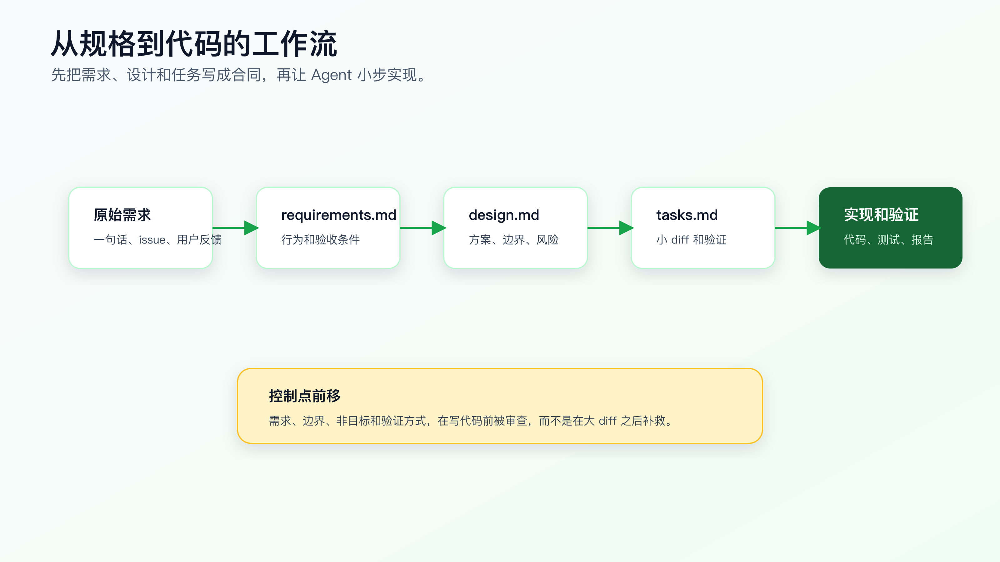
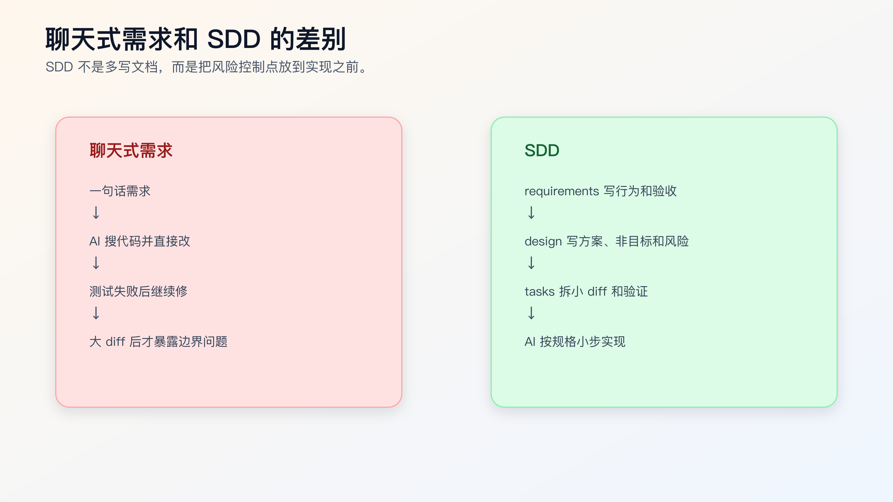

# SDD 是什么：先写规格，再写代码

复杂需求里，AI Coding 最容易失控的地方，不是代码生成，而是需求没有变成可执行合同。

一句话需求很快：

```text
帮我把订单取消逻辑改一下，已支付订单不能直接取消，要走退款流程。
```

Agent 也很快。它会搜索 `cancelOrder`、修改几个判断、补一点测试，然后告诉你完成了。

问题是，这句话里藏了太多没有说清的东西：

- 已支付订单能不能申请取消？
- 取消和退款在业务上是什么关系？
- 退款中、退款失败、部分退款怎么处理？
- 老接口返回码是否保持兼容？
- 管理后台和用户端行为是否一致？
- 历史订单怎么处理？
- 哪些测试证明完成？

这些问题如果不先写清楚，AI 会在实现时自己补。它补得越快，风险越高。

SDD，也就是 Spec-Driven Development，解决的不是“多写文档”，而是先把需求、设计和任务变成 AI 可以执行、程序员可以审查、结果可以验证的规格合同。



## SDD 不是瀑布文档

很多程序员听到“先写规格”，第一反应是慢。

如果 SDD 变成几十页需求文档、审批流程和模板填空，那确实慢，而且不适合个人 AI Coding。

这里讲的 SDD 要轻得多。它只要求在写代码前，把三类东西写清楚：

```text
requirements.md  写用户可见行为和验收条件
design.md        写技术方案、边界和取舍
tasks.md         写可执行的小步骤和验证方式
```

复杂一点的框架，比如 GitHub Spec Kit 或 OpenSpec，会把这些材料组织得更系统：从用户意图生成 spec、clarify、plan、tasks，再进入 implementation；OpenSpec 还会把 proposal、spec delta、design、tasks、archive 等流程放进仓库。

但你先不用急着上框架。

SDD 的最小价值是：让 AI 在写代码前先接受一份规格，而不是在实现过程中自己发明需求。

## 为什么 AI Coding 更需要 SDD

人类程序员拿到模糊需求时，会主动追问，也会在脑子里保留很多业务边界。

Agent 不会稳定拥有这些边界。它会根据当前上下文推断最可能的实现路径。

这在低风险任务里没问题。比如文案、样式、同类字段、局部测试。

但复杂需求里，推断会变成风险：

- 它可能把业务规则理解成普通 if/else。
- 它可能把兼容逻辑当成旧代码清掉。
- 它可能把测试改成符合新实现，而不是锁住需求。
- 它可能在一个大 diff 里混入重构。
- 它可能忽略异常路径和历史数据。

SDD 的作用，是把这些隐含判断提前暴露。

在写代码前，你要先看到：

```markdown
## Requirement

已支付订单不能直接取消。用户发起取消时，系统应该进入退款申请流程。

## Must Keep

- 未支付订单仍可直接取消。
- 已发货订单仍按现有规则拒绝取消。
- 旧接口返回码保持兼容。

## Verification

- paid order cancel returns refund-required state.
- pending order cancel still succeeds.
- shipped order cancel still fails with existing error code.
```

这段规格比一句 prompt 更能约束 Agent。

## 聊天式需求和 SDD 的差别



聊天式需求通常是：

```text
用户说一个问题。
AI 搜代码。
AI 直接改。
测试失败再修。
最后看起来能跑。
```

SDD 流程是：

```text
用户说问题。
AI 和人把问题转成 requirements。
AI 给 design，人审边界。
AI 拆 tasks，每步可验证。
AI 按 task 小步实现。
测试和 diff 证明完成。
```

区别不是多了几个文件，而是控制点前移。

聊天式开发把风险留到实现后暴露。SDD 把风险放到实现前讨论。

## SDD 最适合哪些任务

不是所有任务都需要 SDD。

适合 SDD 的任务：

- 涉及多个模块。
- 涉及状态机、权限、金额、数据迁移。
- 需求有多个角色或多个入口。
- 需要保持历史兼容。
- 测试和验证路径比较复杂。
- 需要拆多步实现。
- 人和 AI 对需求理解可能不同。

不太需要 SDD 的任务：

- 单处文案。
- 局部样式。
- 已有模式下加字段。
- 小测试补充。
- 明确的一行 bug fix。

任务越复杂，越需要先写规格。

可以用一个简单判断：

```text
如果你没法在 5 行内说清：
目标行为、不能改变的行为、相关文件、验证方式、风险边界，
就不要直接让 AI 写代码。
```

这时至少写一个轻量 SDD。

## 三种粒度：直接改、轻量 SDD、框架化 SDD

真实项目里，SDD 不是开关。不是“用了就是规范开发，不用就是乱写代码”。

真正要判断的是：这次改动需要多强的前置约束。

| 改动类型 | 合适方式 | 判断标准 |
| --- | --- | --- |
| 单点低风险改动 | 直接给 Agent 任务上下文 | 一两个文件内完成，旧行为清楚，验证命令明确 |
| 中等复杂需求 | 轻量 SDD | 涉及业务分支、状态、权限、兼容性、异常路径 |
| 多阶段需求变更 | OpenSpec / Spec Kit 这类框架 | 需要 proposal、spec delta、任务归档、多人审查或长期追踪 |

比如修一个按钮文案，写三份规格文件就是负担。
但改订单状态机、结算规则、权限策略、通知链路，只靠一句 prompt 就是在赌。

程序员要做的不是每次都上重流程，而是判断复杂度已经超过聊天式开发能控制的范围。超过了，就把需求、设计和任务拆出来，让 Agent 按合同工作。

## SDD 在生产项目里放在哪里

个人项目可以把规格放在 `docs/specs/<change-name>/`。公司项目里还要考虑审查和追踪，常见位置有三种。

第一种，放在仓库内。

```text
docs/specs/order-cancel-refund/
├── requirements.md
├── design.md
└── tasks.md
```

这种方式适合需求会影响代码结构，或者后续有人需要追溯为什么这么改。规格和代码同版本，PR 能一起审。

第二种，放在 issue 或需求系统里，仓库只保留链接。

```markdown
Spec:
- Requirements: <issue link>
- Design: <design doc link>
- Tasks: `docs/specs/order-cancel-refund/tasks.md`
```

这种方式适合公司已经有需求平台，不希望把业务需求全文放进代码仓库。但任务拆分和验证命令最好仍然靠近代码，否则 Agent 很难基于真实目录执行。

第三种，用 OpenSpec 这类工具管理变更。

```text
openspec/
├── specs/
└── changes/
    └── order-cancel-refund/
        ├── proposal.md
        ├── design.md
        └── tasks.md
```

这种方式适合规格资产开始变多，或者同一个能力会被多次变更。它的价值不是“看起来专业”，而是让变更有状态、有 delta、有归档。

不要为了形式把所有需求都塞进框架。规格文件只有在能降低误改、误解和误验收时才值得存在。

## 从 issue 到 SDD 的最小流程

真实需求通常不会一开始就是整齐的 spec。它可能是一条 issue、一次线上报警、一段用户反馈，或者同事在群里丢过来的一句话。

可以按下面顺序把它变成轻量 SDD。

```text
原始材料
-> Agent 搜索相关入口、测试、错误码、配置
-> 生成 Current Behavior 摘要
-> 人确认目标行为和非目标
-> Agent 生成 requirements/design/tasks 草稿
-> 人审草稿
-> Agent 按 task 执行
-> 用测试、diff、PR 描述回写证据
```

注意，第一步不是让 Agent 写代码，而是让它先查证。

比如：

```text
先不要改代码。
请基于 issue 描述搜索订单取消相关入口、状态枚举、错误码和测试。
输出 Current Behavior 摘要，每条带文件路径。
不确定的业务规则不要推断，写到 Open Questions。
```

这一步能把 SDD 从“凭空写文档”变成“基于仓库证据整理规格”。

如果 Current Behavior 摘要已经发现测试缺失，也不要急着实现。先在 tasks 里把“补回归测试”放到第一步。否则后面实现出来的代码，很可能只是满足 Agent 自己理解的需求。

## 最小 SDD 目录结构

一个最小结构可以这样放：

```text
docs/specs/
└── order-cancel-refund/
    ├── requirements.md
    ├── design.md
    └── tasks.md
```

也可以放到：

```text
specs/order-cancel-refund/
.ai/specs/order-cancel-refund/
openspec/changes/order-cancel-refund/
```

目录名不是重点。重点是三类文件分工清楚。

`requirements.md` 只回答“什么行为应该发生”。

```markdown
# Requirements

## User Story

用户取消已支付订单时，系统不应直接取消订单，而应进入退款申请流程。

## Acceptance Criteria

- pending 订单仍可直接取消。
- paid 订单取消返回 refund-required 状态。
- shipped 订单仍按现有规则拒绝取消。
- 旧接口错误码保持兼容。
```

`design.md` 回答“怎么改，边界在哪里”。

```markdown
# Design

## Current Flow

`cancelOrder` currently handles pending and paid orders in the same branch.

## Proposed Change

Add an explicit paid-order branch that creates refund request state.

## Non-goals

- Do not change payment provider callback logic.
- Do not change shipped order cancellation.
- Do not migrate historical order data.
```

`tasks.md` 回答“按什么顺序做，每步怎么验证”。

```markdown
# Tasks

1. Add regression tests for pending, paid, shipped cancellation.
   - Verify: focused order cancel tests fail on paid path before implementation.

2. Update cancel order status transition.
   - Verify: focused order cancel tests pass.

3. Run broader order tests.
   - Verify: `npm test -- order`.
```

这三个文件已经足够支持一次中等复杂需求。

## SDD 文件之间的边界

很多人写 SDD 会把三类内容混在一起。

`requirements.md` 不应该写技术方案。

差：

```markdown
在 `cancelOrder` 里新增 if 判断 paid 状态。
```

好：

```markdown
已支付订单取消时，系统应进入退款申请流程，不应直接变为 canceled。
```

`design.md` 不应该重新定义需求。

差：

```markdown
我们希望用户体验更好，所以订单取消要更合理。
```

好：

```markdown
在订单状态流转层新增 paid -> refund_requested 分支，保留 pending -> canceled。
```

`tasks.md` 不应该写成大任务。

差：

```markdown
完成订单取消改造。
```

好：

```markdown
1. 补 paid 订单取消回归测试。
2. 修改状态流转 guard。
3. 跑 order focused tests。
```

边界清楚，AI 才不会把需求、设计、实现混在一个大 diff 里。

## 一个完整例子：订单取消改退款

任务原话：

```text
已支付订单不能直接取消，要走退款。
```

先写 requirements：

```markdown
# Requirements

## Goal

已支付订单取消时，系统进入退款申请流程，而不是直接取消订单。

## Acceptance Criteria

- pending 订单取消后状态为 canceled。
- paid 订单取消后状态为 refund_requested。
- shipped 订单取消仍返回 existing shipped-order error。
- 旧接口返回结构不变，只允许状态值变化。

## Out Of Scope

- 支付渠道回调。
- 历史订单迁移。
- 管理后台批量取消。
```

再写 design：

```markdown
# Design

## Current Behavior

`cancelOrder` currently allows paid order to enter canceled branch.

## Proposed Change

Add explicit status transition:

- pending -> canceled
- paid -> refund_requested
- shipped -> unchanged rejection path

## Compatibility

Keep public response shape unchanged.

## Risks

- Existing clients may assume paid cancellation returns canceled.
- Refund workflow must not be triggered twice.
```

最后写 tasks：

```markdown
# Tasks

1. Add regression tests for pending, paid, shipped cancellation.
   - Verify focused tests fail only on paid path.

2. Update status transition logic.
   - Keep response shape unchanged.
   - Do not touch payment callback logic.

3. Run verification.
   - `npm test -- order-cancel`
   - `npm test -- order`
```

现在再让 Agent 实现，风险会小很多。

## 让 AI 参与写规格，而不是直接写代码

SDD 不要求人手写全部规格。AI 很适合根据原始需求、代码搜索结果、历史 bug、接口契约生成规格草稿。

可以这样开始：

```text
先不要改代码。

请基于下面需求生成轻量 SDD 草稿：
- requirements.md
- design.md
- tasks.md

要求：
- requirements 只写用户可见行为和验收条件。
- design 写技术方案、非目标和风险。
- tasks 拆成小 diff，每步带验证。
- 不确定的问题写到 Open Questions。
```

然后人审。

重点审五个地方：

- 是否遗漏旧行为。
- 是否把技术方案写进需求。
- 是否把猜测写成事实。
- 是否缺少异常路径。
- tasks 是否太大。

AI 写规格草稿没问题，但规格不能不审。

## 怎么审 AI 写出来的 SDD 草稿

让 Agent 写规格草稿是合理的，但不能把草稿当结论。审查时不要只看语言是否通顺，要看它有没有做不该做的判断。

可以按下面顺序审。

第一，审需求是否来自输入，而不是模型推断。

如果原始需求只说“已支付订单不能直接取消”，AI 草稿却写出“退款请求必须异步创建”，这就是未确认结论。它应该进入 Open Questions，而不是 Acceptance Criteria。

第二，审设计是否基于真实代码。

`design.md` 里每个 Current Flow 都应该能对应到文件路径、入口函数或测试。如果它写的是“订单模块会处理取消逻辑”，但没有路径，这份 design 不能作为执行依据。

第三，审任务是否能形成小 diff。

一个 task 如果同时写“改状态机、接退款服务、改前端、补测试”，就太大。真实执行时要拆开，否则审 diff 时不知道哪个改动导致行为变化。

第四，审验证是否覆盖风险。

如果 design 写了“重复取消可能创建重复退款”，tasks 里就必须有重复取消测试或幂等检查。风险和验证断开，规格只是提醒，不会改变执行结果。

第五，审非目标是否足够具体。

“不做额外改动”没有约束力。要写成“不改支付回调”“不改后台批量取消”“不迁移历史订单”“不改变 public API response shape”。

一份可执行的 SDD 草稿，至少要经得起这几个问题：

```text
这些需求是否都能追溯到原始输入或已确认事实？
这些设计判断是否基于真实源码？
这些 task 是否能单独审查？
每个风险是否有验证动作？
哪些地方必须停止并让人确认？
```

答不上来，就不要让 Agent 进入实现。

## SDD 和任务上下文包的关系

任务上下文包适合一次中等风险改动。它回答：

```text
这次任务要改什么，先看哪些文件，不能改什么，怎么验证。
```

SDD 适合更复杂需求。它进一步拆成：

```text
需求合同 -> 技术方案 -> 可执行任务
```

两者不是替代关系。

一个任务上下文包可以升级成 SDD：

```text
Objective        -> requirements.md
Constraints      -> requirements + design
Files            -> design
Done When        -> tasks
Open Questions   -> requirements/design clarify
```

当任务上下文包写到很长，说明它可能需要 SDD。

## SDD 和 OpenSpec / Spec Kit 的关系

SDD 是方法。OpenSpec 和 Spec Kit 是把这个方法工具化的框架。

GitHub 的 Spec Kit 把 spec-driven development 做成一套流程工具，强调从 spec、plan、tasks 进入实现。OpenSpec 也把 proposal、spec delta、design、tasks、archive 等材料放进仓库，适合管理需求变更。

对个人程序员来说，不需要一开始就决定“必须用哪个框架”。

先理解 SDD 的核心：

```text
先写需求行为。
再写技术边界。
再拆可验证任务。
最后让 AI 小步实现。
```

等你发现手写 specs 变多、变更需要归档、多个任务互相影响，再引入 OpenSpec 或 Spec Kit。

## SDD 不是让 AI 变慢，而是让返工变少

很多人排斥 SDD，是因为把它理解成“写完文档再开发”。在 AI Coding 里，真正耗时的通常不是写规格，而是后面几类返工：

- Agent 改对了一个入口，漏了另一个入口。
- 测试被改到适配新实现，旧行为没有锁住。
- 需求里的非目标没写，AI 顺手重构了相邻模块。
- 兼容性问题上线前才被前端或调用方发现。
- 一个大 diff 里混了业务改动、格式化和重命名，review 无法判断。

轻量 SDD 的成本大约是十几到几十分钟。它换来的不是“文档完整”，而是改动前先拿到几个关键证据：

```text
行为合同：requirements.md
技术边界：design.md
执行顺序：tasks.md
验证证据：每个 task 的命令和结果
```

如果这些证据能让后面少一次大返工，就已经值了。

## SDD 的交付证据长什么样

一次合格的 SDD 驱动改动，最终不应该只留下代码 diff。PR 或变更记录里至少应该能看到这些信息：

```markdown
Spec:
- requirements.md: paid order cancel enters refund flow
- design.md: status transition layer owns paid cancel rule
- tasks.md: 5 tasks, executed 1-5

Verification:
- `npm test -- order-cancel` PASS
- `npm test -- order` PASS
- API response shape compatibility check PASS

Not changed:
- payment provider callback
- admin batch cancellation
- historical order migration

Residual risk:
- old mobile client needs display check for `refund_requested`
```

这段不是给领导看的报告，而是给 reviewer、未来的自己和后续 Agent 看。半年后再改退款逻辑时，它能说明当时为什么没有动支付回调，为什么新增了 `refund_requested`，验证过哪些路径。

## SDD 和团队流程怎么兼容

即使专栏讲的是个人 AI Coding，很多读者也在公司项目里工作。轻量 SDD 不应该绕过团队流程，而是把个人使用 Agent 的过程变得可审。

如果团队已经要求 issue、设计评审、PR、CI，你可以这样嵌进去：

- issue 里保留需求背景和确认结论。
- 仓库里保留和代码强相关的 requirements/design/tasks。
- PR 描述里链接 spec，并列出验证命令。
- CI 仍然是最终合并前的硬检查。
- code review 重点看 diff 是否符合 spec，而不是只看实现是否能跑。

这套做法不会要求团队接受某个 AI 工具。即使 reviewer 不用 Agent，也能看懂：需求是什么、设计边界是什么、任务怎么拆、测试跑了什么。

个人 AI Coding 想进入生产项目，最需要的不是“把 AI 写得多厉害”，而是让别人能审查你的 AI 参与过程。

## 常见错误

**错误一：把 SDD 写成文档负担。**

如果文件很长，但没有验收条件、非目标和验证命令，那不是 SDD，只是长文档。

**错误二：requirements 里写实现。**

需求应该写行为，不写代码位置。技术方案放 design。

**错误三：design 里不写非目标。**

非目标很关键。它告诉 Agent 这次不改什么。

**错误四：tasks 太大。**

“完成订单取消改造”不是 task。task 要能形成小 diff，并有验证方式。

**错误五：规格写完不更新。**

实现过程中发现需求变化，要更新规格。否则规格会变成过期上下文。

## 常见问题

**小需求要不要写 SDD？**

不用。单点低风险改动可以直接用任务上下文包，写清目标、文件范围、不能改什么、验证命令就够。SDD 用在需求本身会分叉、会影响兼容性、会跨模块的场景。

**SDD 会不会限制 Agent 的发挥？**

会限制它在错误地方发挥。好的规格不限制实现细节，只限制业务边界、非目标和验证结果。Agent 仍然可以搜索代码、提出方案、拆任务，但不能绕过已确认的合同。

**requirements、design、tasks 一定要三个文件吗？**

不一定。小需求可以合成一个 `spec.md`。当内容开始变长、不同人需要审不同部分时，再拆成三个文件。拆分是为了降低混乱，不是为了满足格式。

**OpenSpec 或 Spec Kit 是不是必选？**

不是。它们适合规格资产变多、变更需要归档或团队需要统一流程时使用。个人程序员先掌握轻量 SDD，再判断是否引入框架。

**如果实现过程中发现规格错了怎么办？**

先停，不要让 Agent 继续补。更新 requirements 或 design，再重新生成后续 tasks。规格错了还继续实现，只会把错误固化进代码和测试。

## 可以先实践的一件事

下次遇到复杂需求，不要直接写代码。先建一个目录：

```text
docs/specs/<task-name>/
├── requirements.md
├── design.md
└── tasks.md
```

然后让 AI 先写草稿：

```text
先不要改代码。
请把这个需求整理成 requirements/design/tasks 三个文件的草稿。
不确定的地方写 Open Questions。
每个 task 必须能形成小 diff，并说明验证方式。
```

人审完后，再让 Agent 只执行第一个 task。

这就是 SDD 在个人 AI Coding 里的最小落地方式。

如果 `requirements.md` 写不清，后面的 design 和 tasks 都会漂。先把模糊需求变成能测试、能追问、能拒绝越界改动的需求合同。

## 可复查资料

- GitHub Spec Kit 官方文档：<https://github.github.com/spec-kit/>
- GitHub Spec Kit 仓库：<https://github.com/github/spec-kit>
- GitHub Blog: Spec-driven development with AI：<https://github.blog/ai-and-ml/generative-ai/spec-driven-development-with-ai-get-started-with-a-new-open-source-toolkit/>
- OpenSpec 官方站：<https://openspec.dev/>
- OpenSpec GitHub 仓库：<https://github.com/Fission-AI/OpenSpec/>

---

[课程首页](../../../README.md) · [完整目录](../README.md) · [← 模块实战：让 AI 接手一个陌生代码模块](../03-%E4%B8%8A%E4%B8%8B%E6%96%87%E5%B7%A5%E7%A8%8B%E4%B8%8E%E4%BB%A3%E7%A0%81%E5%BA%93%E7%90%86%E8%A7%A3/14-%E6%A8%A1%E5%9D%97%E5%AE%9E%E6%88%98-%E8%AE%A9-AI-%E6%8E%A5%E6%89%8B%E4%B8%80%E4%B8%AA%E9%99%8C%E7%94%9F%E4%BB%A3%E7%A0%81%E6%A8%A1%E5%9D%97.md) · [从一句需求到 `requirements.md` →](16-%E4%BB%8E%E4%B8%80%E5%8F%A5%E9%9C%80%E6%B1%82%E5%88%B0-requirements-md.md)

动手实践：[OpenSpec 业务需求实战](../../../personal-productivity-app/dev-process/01-openspec-today-plan-rollover.md)
