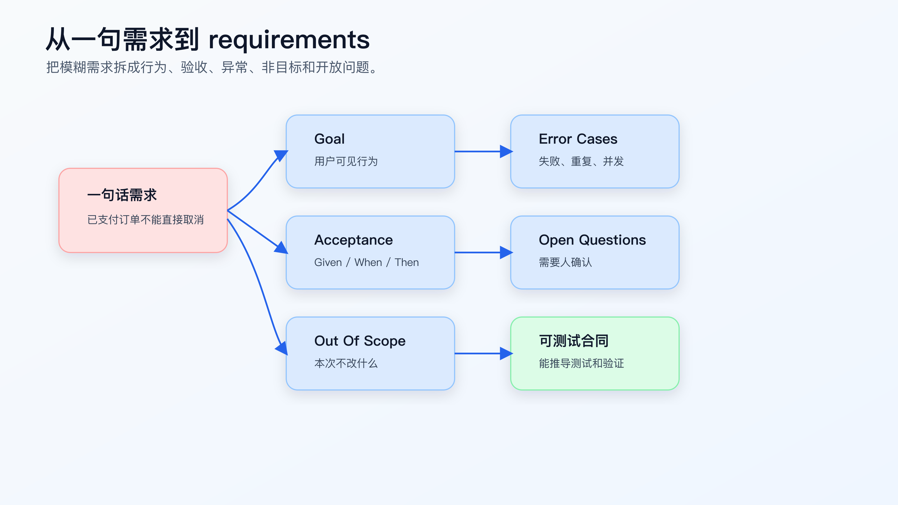
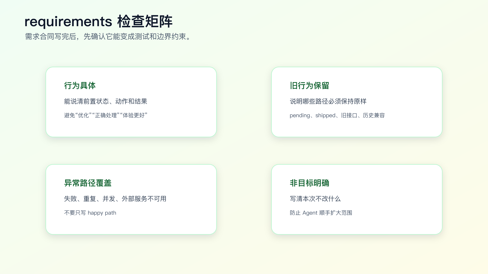

# 从一句需求到 `requirements.md`

复杂需求开始前，最不该省的是 `requirements.md`。

不是因为文档重要，而是因为需求如果没有变成可验证的行为合同，AI 会在实现过程中自己补空白。

一句话需求：

```text
已支付订单不能直接取消，要走退款。
```

听起来清楚，其实不够。它没有说明 pending 订单怎么办，shipped 订单怎么办，退款失败怎么办，旧接口返回结构能不能变，管理后台是不是同一规则，历史订单是否迁移。

`requirements.md` 的目的，就是把这些隐含问题在写代码前摊开。



## `requirements.md` 写什么，不写什么

`requirements.md` 写行为，不写实现。

它要回答：

- 谁在什么场景下触发。
- 系统应该表现出什么行为。
- 哪些旧行为必须保留。
- 哪些异常路径必须处理。
- 哪些内容不在本次范围。
- 怎么判断需求完成。
- 哪些问题还需要确认。

它不应该写：

- 改哪个函数。
- 新增哪个 if。
- 抽什么类。
- 用哪个数据库字段。
- 怎么拆 task。

这些属于 `design.md` 和 `tasks.md`。

把技术方案写进 requirements，容易让需求合同变形。后面如果实现方案变了，需求也跟着乱。

## 一个坏的 requirements 长什么样

坏版本：

```markdown
# Requirements

已支付订单不能直接取消，要在 `cancelOrder` 里面判断 paid 状态，然后调用退款服务。
如果是 pending 就照旧，如果是 shipped 就报错。
```

这段话看起来很具体，但问题很多。

第一，它直接指定了实现位置和实现方式。

第二，它没有说明返回给用户的行为。

第三，它没有定义退款服务失败怎么办。

第四，它没有说明旧接口返回结构是否保持。

第五，它没有说明验收条件。

更好的版本：

```markdown
# Requirements

## Goal

用户取消已支付订单时，系统不应直接取消订单，而应进入退款申请流程。

## Acceptance Criteria

- pending 订单取消后状态为 canceled。
- paid 订单取消后状态为 refund_requested。
- shipped 订单取消仍按现有规则拒绝。
- API response shape remains compatible with existing clients.

## Error Cases

- If refund request creation fails, order status must remain paid.
- User should receive a retryable error message.

## Out Of Scope

- Payment provider callback behavior.
- Historical order data migration.
- Admin batch cancellation.

## Open Questions

- Should paid order cancellation create refund request synchronously or asynchronously?
```

这才是需求合同。

## 从一句话需求拆成六块

一份可用的 `requirements.md` 通常包括六块。

```text
Goal
Actors / Scenarios
Acceptance Criteria
Error Cases
Out Of Scope
Open Questions
```

不是每个需求都要六块都很长，但这六块能防止 Agent 漏掉关键边界。

### Goal

Goal 写一句清楚的行为目标。

差：

```text
优化订单取消。
```

好：

```text
用户取消已支付订单时，系统进入退款申请流程，而不是直接取消订单。
```

Goal 不写技术方案。

### Actors / Scenarios

写谁在什么场景下触发。

```markdown
## Scenarios

- Buyer cancels a pending order before payment.
- Buyer cancels a paid order before shipping.
- Buyer cancels a shipped order.
- Support agent cancels an order from admin console.
```

如果不同角色规则不同，要写出来。否则 Agent 可能把用户端规则套到管理后台。

### Acceptance Criteria

验收条件要可验证。

差：

```markdown
- 订单取消逻辑正确。
```

好：

```markdown
- Given a pending order, when user cancels, then status becomes canceled.
- Given a paid order, when user cancels, then status becomes refund_requested.
- Given a shipped order, when user cancels, then existing rejection behavior remains unchanged.
```

Given/When/Then 的价值不在格式，而在强迫你写出前置状态、动作和结果。

### Error Cases

异常路径不能留给实现时猜。

```markdown
## Error Cases

- If refund request creation fails, order status remains paid.
- If duplicate cancel request arrives, no duplicate refund request is created.
- If payment provider is unavailable, user receives retryable error.
```

很多线上 bug 都出在异常路径。AI 如果只看 happy path，会写出表面可用的实现。

### Out Of Scope

非目标是 `requirements.md` 里最重要但最容易漏的部分。

```markdown
## Out Of Scope

- Do not change payment provider callback logic.
- Do not migrate historical order data.
- Do not change admin batch cancellation.
- Do not change public API response shape.
```

非目标告诉 Agent 这次不改什么。没有它，AI 很容易“顺便”做大。

### Open Questions

不确定的问题要显式列出来。

```markdown
## Open Questions

- Should paid cancellation create refund request synchronously?
- Should support agents bypass the buyer-side restriction?
- What error copy should be shown when refund request creation fails?
```

Open Questions 的价值是暂停，而不是让 Agent 自己决定。

## 把现有行为和新行为分开写

生产需求里，最容易出问题的不是“新行为没实现”，而是旧行为被顺手改坏。

所以 requirements 里建议加一张行为表，尤其是状态机、权限、接口兼容类需求。

```markdown
## Behavior Matrix

| Scenario | Current Behavior | Expected Behavior |
| --- | --- | --- |
| pending order cancel | status becomes `canceled` | unchanged |
| paid order cancel | status becomes `canceled` | status becomes `refund_requested` |
| shipped order cancel | rejected with `ORDER_ALREADY_SHIPPED` | unchanged |
| duplicate paid cancel | may create duplicate side effect | no duplicate refund request |
```

这张表对 Agent 很有用。它能明确哪些路径要改，哪些路径不能动。

它对 reviewer 也有用。review diff 时，不只看 paid 分支，还会看 pending、shipped 和 duplicate 路径有没有测试覆盖。

很多“AI 改坏旧逻辑”的问题，本质上是 requirements 没有把旧行为写成约束。Agent 看到新目标后，会自然围绕新目标重组代码。如果旧行为没有被写进合同，它就不一定知道哪些东西不能碰。

## 需求确认不是让产品补文档

个人 AI Coding 场景里，很多需求来自自己、同事、issue 或线上问题。你不一定有完整 PRD，也不应该为了写 requirements 去发起一轮重流程。

可执行的做法是：让 Agent 先根据现有材料生成草稿，然后你把不确定点发给相关人确认。

比如：

```markdown
Need confirmation:

1. Paid cancellation should create refund request synchronously or asynchronously?
2. Support agent cancellation follows buyer-side rule or has override permission?
3. Existing mobile clients can display `refund_requested` or need fallback copy?
```

这三条比“请确认订单取消需求”有效得多。它们直接指向实现会分叉的地方。

如果没有产品或业务方可以确认，也要把决定写清楚：

```markdown
Decision:
- For this change, buyer cancellation creates refund request synchronously.
- Support agent cancellation remains out of scope.
- Mobile fallback display will be handled in a separate change.

Reason:
- Current refund service already exposes synchronous create API.
- No admin batch cancellation requirement is confirmed.
```

这不是形式主义。它是在给未来的代码审查和线上问题留证据。

## 线上 bug 的 requirements 怎么写

很多程序员觉得只有新需求才需要 requirements，线上 bug 直接修就行。AI Coding 里，这个想法很容易出问题。

比如线上报警：

```text
用户重复点击取消订单后，出现两条退款申请。
```

如果直接让 Agent 修，它可能只在按钮上加防重复点击，也可能只在接口里加锁，还可能改测试让它通过。真正需要先写清楚的是：重复请求在系统层面应该如何表现。

可以写成：

```markdown
# Requirements: duplicate paid cancellation is idempotent

## Goal

When a buyer repeats paid order cancellation, the system must not create duplicate refund requests.

## Current Behavior

- Duplicate cancel requests may create multiple refund requests.
- Existing pending order cancellation is not part of this bug.

## Acceptance Criteria

- Given a paid order with no refund request, when buyer cancels once, then one refund request is created.
- Given a paid order with an existing refund request, when buyer cancels again, then no new refund request is created.
- Given a duplicate request, response shape remains compatible with existing clients.

## Error Cases

- If refund request lookup fails, order status remains unchanged.

## Out Of Scope

- Do not change UI button debounce in this fix.
- Do not change payment provider callback behavior.
- Do not migrate historical duplicate refund records.
```

这份 requirements 把修复范围限定在后端幂等行为。UI 防重复点击可以作为后续增强，但不能代替服务端幂等。

这就是 requirements 的价值：它先定义正确行为，再让 design 决定技术手段。

## 需求合同检查矩阵



写完 `requirements.md` 后，用四个维度检查。

第一，行为是否具体。

能不能从文字直接写出测试？如果不能，说明还太虚。

第二，旧行为是否保留。

新需求通常只改变一部分路径。哪些旧行为不变必须写出来。

第三，异常路径是否覆盖。

失败、重复、并发、权限、外部系统不可用，这些是否需要说明。

第四，非目标是否明确。

不在本次范围的东西，如果不写，Agent 可能当成优化空间。

## 让 AI 帮你写 requirements 草稿

AI 很适合把原始需求整理成 requirements 草稿，但不要让它直接写成最终合同。

可以这样提示：

```text
先不要写代码。

请把下面需求整理成 requirements.md 草稿：

需求：
已支付订单不能直接取消，要走退款。

要求：
- 只写用户可见行为和业务验收条件。
- 不写技术实现方案。
- 使用 Goal / Scenarios / Acceptance Criteria / Error Cases / Out Of Scope / Open Questions。
- 不确定的地方写 Open Questions，不要自行决定。
```

然后你要审。

重点看：

- 是否把实现写进了 requirements。
- 是否遗漏旧行为。
- 是否把未确认规则写成确定事实。
- 是否缺异常路径。
- 是否缺非目标。

AI 可以生成草稿，但需求合同必须人确认。

## 一个完整 requirements 示例

下面是订单取消改退款的完整版本。

```markdown
# Requirements: paid order cancellation enters refund flow

## Goal

When a buyer cancels a paid order before shipping, the system should create a refund request instead of directly canceling the order.

## Scenarios

- Buyer cancels a pending order before payment.
- Buyer cancels a paid order before shipping.
- Buyer cancels a shipped order.
- Buyer repeats a cancel request for the same paid order.

## Acceptance Criteria

- Given a pending order, when the buyer cancels it, then the order status becomes `canceled`.
- Given a paid order, when the buyer cancels it, then the order status becomes `refund_requested`.
- Given a shipped order, when the buyer cancels it, then the existing shipped-order rejection remains unchanged.
- Given a repeated cancel request for a paid order with an existing refund request, then no duplicate refund request is created.
- Existing API response shape remains compatible with current clients.

## Error Cases

- If refund request creation fails, the order status remains `paid`.
- If payment provider is temporarily unavailable, the user receives a retryable error.

## Out Of Scope

- Payment provider callback handling.
- Historical order data migration.
- Admin batch cancellation.
- Changing public API response shape.

## Open Questions

- Should refund request creation be synchronous or asynchronous?
- What user-facing copy should appear when refund request creation fails?
- Should support agents follow the same rule as buyers?
```

这份 requirements 没有说改哪个函数。它只定义行为。

requirements 通过后，`design.md` 才有明确输入：根据当前代码结构决定在哪里实现、如何保持兼容、风险在哪里。

## 验收条件怎么写得可测试

验收条件写得好不好，看它能不能变成测试。

差：

```markdown
- 系统应该正确处理已支付订单。
```

这句话没法直接测试。

好：

```markdown
- Given a paid order, when the buyer cancels it, then the order status becomes `refund_requested`.
```

它能直接变成测试用例：

```text
setup paid order
call cancel
assert status refund_requested
```

再比如：

```markdown
- Given refund request creation fails, when buyer cancels a paid order, then order status remains `paid`.
```

这能直接变成失败注入测试。

如果一个验收条件不能变成测试、截图、接口调用或人工检查步骤，它就还不够清楚。

## 非目标怎么写

非目标不要写成“暂不考虑性能”这种空话。

要写具体边界：

```markdown
## Out Of Scope

- Do not change payment provider callback behavior.
- Do not change admin batch cancellation.
- Do not migrate historical order data.
- Do not change public API response shape.
```

非目标有两个作用。

第一，它保护现有系统。
第二，它让 tasks 可以拆得更小。

如果非目标没写，Agent 很可能把“支付回调也顺便改一下”当成合理方案。

## Open Questions 不要怕多

Open Questions 是好东西。

它说明你没有把不确定性伪装成确定结论。

比如：

```markdown
## Open Questions

- Refund request creation should be sync or async?
- Should support agents follow buyer-side cancel restriction?
- What happens when refund provider returns a duplicate request error?
```

如果这些问题影响实现，就先确认；如果不影响第一步，可以写进 design 的风险和 tasks 的后续项。

AI Coding 里，真正危险的是没有 Open Questions。那通常意味着 Agent 自己在替你做业务决定。

## requirements 和测试的关系

`requirements.md` 不是测试文件，但它应该天然能推导出测试。

可以在 requirements 末尾加一段：

```markdown
## Verification Ideas

- Unit test: pending order cancel remains canceled.
- Unit test: paid order cancel creates refund_requested.
- Unit test: shipped order cancel remains rejected.
- Unit test: duplicate paid cancel does not create duplicate refund request.
- API compatibility check: response shape unchanged.
```

这不是 `tasks.md`，只是提示后续测试方向。

真正的测试命令和实现顺序放到 tasks。

## 让 Agent 生成 requirements 时，要给它证据边界

不要只说“帮我写 requirements”。这会让 Agent 按常识补业务规则。

更合适的输入是：

```text
请生成 requirements.md 草稿，不要写代码。

可用证据：
- 用户需求：已支付订单不能直接取消，要走退款。
- 当前代码：请先搜索订单取消入口、订单状态枚举、相关测试。
- 只能把源码、测试和需求中能确认的内容写成事实。
- 不确定的业务规则写进 Open Questions。

输出要求：
- 每条 Current Behavior 带文件路径。
- Acceptance Criteria 使用 Given/When/Then。
- Out Of Scope 写清不能改的模块和行为。
```

这里的关键不是模板，而是证据边界。

Agent 可以搜索代码，可以读取测试，可以根据需求生成候选验收条件。但它不能把“常见电商系统通常怎么做”写成你项目的事实。

审草稿时，重点看两类句子。

第一类是没有来源的确定句：

```markdown
Refund request should be created asynchronously.
```

如果原始需求和源码都没支持这个结论，它应该改成 Open Question。

第二类是过度抽象句：

```markdown
System should improve cancellation experience.
```

这句话不能测试，应该改成状态、响应、页面行为或错误码。

## requirements 通过前，不要进入 design

有些需求看起来急，容易直接跳到设计。但 requirements 没过，design 越详细越危险。

进入 design 前，至少确认这些问题：

```text
新行为是否能写成测试？
旧行为是否写进合同？
异常路径是否有期望结果？
非目标是否具体到模块、接口或行为？
Open Questions 里是否还有会影响实现路径的问题？
```

如果还有会影响实现的问题，比如“退款同步还是异步”“后台是否同规则”“新增状态老客户端能否识别”，就不要让 Agent 设计方案。

可以先做两件事：

- 让 Agent 搜索现有代码，补齐 Current Behavior。
- 把业务决策问题发给人确认。

这比让 Agent 在 design 里自作主张要便宜得多。

## PR 里怎么呈现 requirements

requirements 不一定要完整贴进 PR 描述，但 PR 需要能追溯到它。

可以这样写：

```markdown
Requirement summary:
- paid order cancellation now enters refund flow
- pending and shipped cancellation behavior unchanged
- response shape unchanged

Spec:
- `docs/specs/order-cancel-refund/requirements.md`

Verification mapped from requirements:
- pending cancel regression test
- paid cancel refund_requested test
- shipped cancel existing error test
- duplicate paid cancel idempotency test
```

reviewer 不需要读很长的需求文档，也能知道这次行为合同是什么。

对 AI Coding 来说，这一步还有另一个价值：后续让 Agent 做 code review 或补测试时，它可以直接拿 PR 描述和 requirements 对照，而不是重新猜需求。

## 状态值、错误码和字段名要引用真实系统

requirements 写行为，但并不意味着它可以随便命名状态和错误码。

如果当前系统里订单状态叫 `PAID`、`CANCELLED`，你在 requirements 里写 `paid`、`canceled` 只是示意没有问题；但进入真实任务时，状态值必须和代码、接口或数据库一致。

可以要求 Agent 先查这些材料：

```text
请先搜索：
- order status enum
- cancel related error codes
- public API response schema
- existing order cancel tests

输出 requirements 草稿时：
- 业务描述用自然语言。
- 状态值、错误码、字段名使用源码里的真实名字。
- 找不到的名字不要发明，写到 Open Questions。
```

这能避免一个很隐蔽的问题：requirements 看起来对，但实现时 Agent 为了匹配文档新增了一套不该存在的命名。

比如系统里已有错误码：

```text
ORDER_ALREADY_SHIPPED
ORDER_CANCEL_NOT_ALLOWED
```

requirements 就不要写成：

```markdown
- shipped order returns `SHIPPED_ORDER_ERROR`.
```

应该写：

```markdown
- shipped order still returns existing `ORDER_ALREADY_SHIPPED` error.
```

这句话同时表达了两个约束：错误码真实存在，并且本次不改。

## 需求质量不够时，Agent 会怎么误解

看一个更贴近真实工作的例子：

```text
把会员到期提醒做一下，别让用户错过续费。
```

这句话如果直接交给 Agent，至少会出现这些分叉：

- 到期前几天提醒？
- 站内信、短信、邮件、App push 哪些渠道？
- 免费会员、付费会员、企业会员是否一样？
- 已取消自动续费的用户是否提醒？
- 多次提醒是否去重？
- 发送失败是否重试？
- 法务和隐私策略是否允许发送？

如果 requirements 只写“用户到期前收到提醒”，实现就会非常随意。

更合适的写法是先把范围压住：

```markdown
## Goal

Paid individual members should receive one in-app reminder 7 days before membership expiration.

## Acceptance Criteria

- Given a paid individual member expires in 7 days, when daily reminder job runs, then one in-app reminder is created.
- Given reminder already exists for the same expiration cycle, when job runs again, then no duplicate reminder is created.
- Given enterprise member, when job runs, then no reminder is created in this change.

## Out Of Scope

- SMS, email, and push notifications.
- Enterprise membership reminder.
- Auto-renew payment retry.
- Marketing campaign copy.
```

这段 requirements 没有解决所有续费问题，但它把这次变更定义清楚了。Agent 可以围绕“个人付费会员、站内信、7 天、一次、去重”去搜索和实现。

程序员写 requirements，不是为了把需求说得宏大，而是把这次要改的行为压到可执行范围。

## 常见错误

**错误一：把技术实现写进需求。**

需求写行为，技术方案写 design。

**错误二：只有 happy path。**

复杂需求必须写 error cases。尤其是外部系统失败、重复请求、并发和权限。

**错误三：没有非目标。**

非目标不写，Agent 容易扩大范围。

**错误四：验收条件不可测试。**

“体验更好”“逻辑正确”都不可测试。改成状态、响应、页面行为或命令结果。

**错误五：把不确定问题写成确定规则。**

不确定就写 Open Questions，先确认。

## 常见问题

**requirements 要不要写中文还是英文？**

看团队习惯。代码标识、状态值、错误码、命令保留英文；业务描述用中文也可以。关键是可测试、可追溯，不是语言选择。

**如果需求来自线上 bug，requirements 还要写吗？**

要写，但可以短。线上 bug 也需要定义“修复后应该是什么行为”“哪些旧行为不能变”“怎么证明没复发”。否则很容易只修当前报错路径。

**验收条件是不是越多越好？**

不是。验收条件要覆盖会改变结果的路径。重复写同一类场景会增加噪音。优先写状态分支、权限分支、异常路径、兼容性分支。

**Open Questions 会不会显得需求没想清楚？**

不会。Open Questions 是把不确定性显式暴露。真正危险的是没确认就让 Agent 默认选择一个实现。

**requirements 变了，后面的 design 和 tasks 怎么办？**

需要同步更新。尤其是 Acceptance Criteria、Out Of Scope、Error Cases 变化时，design 的方案和 tasks 的验证命令都可能要重拆。

## 可以直接复用的模板

```markdown
# Requirements: <change name>

## Goal

<One sentence describing the behavior change.>

## Scenarios

- <Actor + situation>

## Acceptance Criteria

- Given <state>, when <action>, then <observable result>.

## Error Cases

- If <failure>, then <expected behavior>.

## Out Of Scope

- <What this change must not touch.>

## Open Questions

- <Question that needs human confirmation.>

## Verification Ideas

- <Test, command, screenshot, API call, or manual check idea.>
```

第一次写不要追求完美。先写出 Goal、Acceptance Criteria、Out Of Scope。复杂需求再补 Error Cases 和 Open Questions。

## 迁移建议

下次遇到一句模糊需求，先不要让 AI 改代码。让它生成 `requirements.md` 草稿，然后你只审三件事：

- 行为是否可测试。
- 旧行为是否保留。
- 非目标是否明确。

如果这三件事过不了，就不要进入 design。

`requirements.md` 写清后，`design.md` 才有基础。需求合同只定义要什么，设计文档要回答怎么在当前代码库里改，怎么控制兼容性、数据流、架构边界和验证风险。

还有一种情况要直接拒绝继续：需求本身要求绕过现有安全、权限、审计或合规边界，但没有明确授权。

比如：

```text
临时让所有客服都能取消已支付订单，先上线再说。
```

这不能直接写成 Acceptance Criteria。至少要先确认：

- 哪些角色可以取消。
- 是否需要操作日志。
- 是否影响退款审批。
- 是否需要灰度或开关。
- 现有权限测试是否要保留。

AI Coding 的速度越快，越不能把权限和审计当成实现细节。requirements 阶段发现这类问题，就应该停在 Open Questions，而不是让 design 替业务和安全决策背书。

## 可复查资料

- GitHub Spec Kit 官方文档：<https://github.github.com/spec-kit/>
- GitHub Spec Kit 仓库：<https://github.com/github/spec-kit>
- GitHub Blog: Spec-driven development with AI：<https://github.blog/ai-and-ml/generative-ai/spec-driven-development-with-ai-get-started-with-a-new-open-source-toolkit/>
- OpenSpec 官方站：<https://openspec.dev/>

---

[课程首页](../../../README.md) · [完整目录](../README.md) · [← SDD 是什么：先写规格，再写代码](15-SDD-%E6%98%AF%E4%BB%80%E4%B9%88-%E5%85%88%E5%86%99%E8%A7%84%E6%A0%BC%E5%86%8D%E5%86%99%E4%BB%A3%E7%A0%81.md) · [`design.md` 怎么写，AI 才不会补丁式开发 →](17-design-md-%E6%80%8E%E4%B9%88%E5%86%99-AI-%E6%89%8D%E4%B8%8D%E4%BC%9A%E8%A1%A5%E4%B8%81%E5%BC%8F%E5%BC%80%E5%8F%91.md)

动手实践：[OpenSpec 业务需求实战](../../../personal-productivity-app/dev-process/01-openspec-today-plan-rollover.md)
