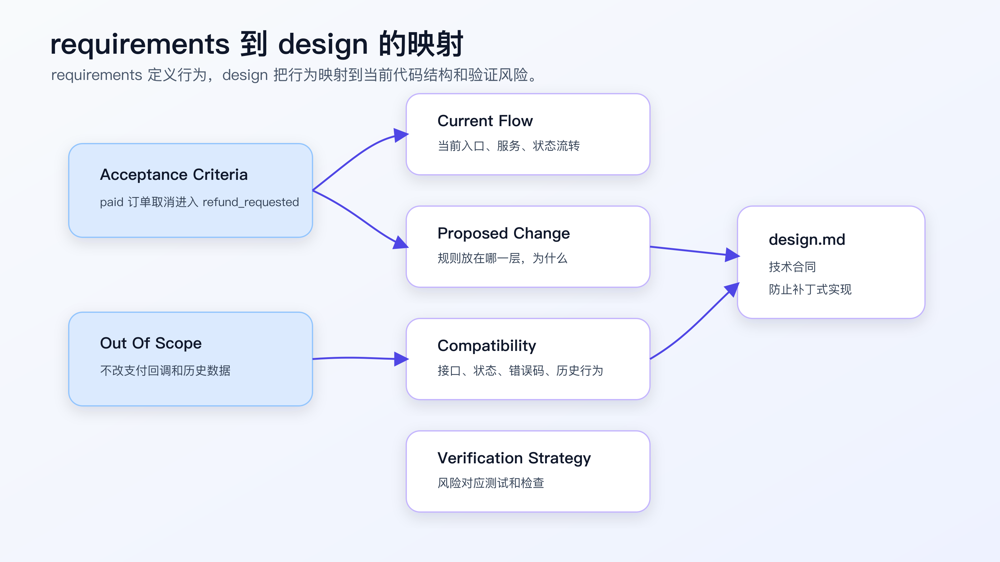
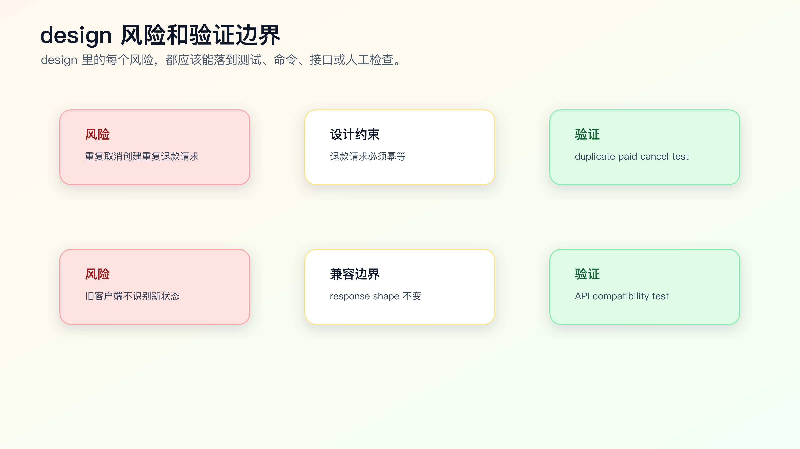

# `design.md` 怎么写，AI 才不会补丁式开发

`requirements.md` 写清楚“要什么”之后，不能直接让 AI 开始改。

复杂需求真正危险的地方，往往在“怎么改”。

同一个需求：

```text
已支付订单不能直接取消，要走退款。
```

可以有很多实现方式：

- 在 controller 里加一个 paid 判断。
- 在 service 里改状态机。
- 在订单领域层新增状态迁移规则。
- 在退款模块创建 refund request。
- 在接口层保持响应结构不变。
- 在前端根据新状态展示退款处理中。

如果不先写 `design.md`，Agent 很可能选择最容易落地的方式：在它最先看到的函数里加一个判断。这个改动可能能让测试通过，但会把业务规则散落在错误层级里。

`design.md` 的价值，是把 requirements 映射到当前代码结构，提前说明方案边界、兼容性、数据流、风险和验证策略。



## design 不是架构长文

很多 design 文档写失败，是因为它变成了架构作文。

好的 `design.md` 不需要长。它要回答七个问题：

1. 当前系统怎么做。
2. 这次改哪里。
3. 为什么改这里。
4. 哪些地方不改。
5. 数据和状态怎么流转。
6. 兼容性风险是什么。
7. 怎么验证设计成立。

它不需要写愿景，不需要写大而全架构，不需要复述 requirements。

`requirements.md` 是行为合同。
`design.md` 是技术合同。

它们之间的边界要清楚。

## 一个坏的 design 长什么样

坏版本：

```markdown
# Design

我们需要优化订单取消逻辑，让系统更加合理。
实现时在取消订单的地方判断 paid，如果已支付就走退款。
同时顺便整理订单状态相关代码。
```

这段 design 有几个问题。

第一，目标太虚。

第二，没有说当前逻辑在哪里。

第三，没有说明为什么在那个地方改。

第四，“顺便整理”扩大了范围。

第五，没有兼容性说明。

第六，没有验证策略。

更好的版本：

```markdown
# Design

## Current Flow

`OrderCancelService.cancel()` currently handles pending and paid orders in the same cancellation branch.

## Proposed Change

Move paid-order handling into the order status transition layer:

- pending -> canceled
- paid -> refund_requested
- shipped -> existing rejection path

`OrderCancelService` should call `RefundRequestService.create()` only after the transition layer returns `refund_requested`.

## Non-goals

- Do not change payment provider callback handling.
- Do not change public API response shape.
- Do not migrate historical order data.

## Compatibility

Existing clients should continue receiving the same response shape. Only `status` may differ for paid order cancellation.

## Verification

- focused order cancel tests
- response shape compatibility test
- duplicate paid cancel test
```

这份 design 才能约束 AI 不要补丁式开发。

## design 的核心：把规则放到正确层级

AI 最常见的补丁式开发，是把规则加在最容易改的地方。

比如：

```ts
if (order.status === 'paid') {
  return { status: 'refund_requested' };
}
```

如果这段逻辑加在 controller 里，可能看起来能跑，但真实问题是：订单状态流转规则被写进接口层了。后面后台任务、管理端、批处理入口可能绕过它。

`design.md` 必须回答：这个规则应该属于哪一层。

可以这样写：

```markdown
## Design Decision

Paid-order cancellation is a status transition rule, not a controller rule.

Therefore:
- controller keeps request/response handling only
- service orchestrates cancel flow
- status transition module owns allowed transitions
- refund module owns refund request creation
```

这段话能阻止 Agent 把业务规则随手塞进 controller。

## Current Flow 要带证据，不要只写结论

设计文档里最容易被忽略的部分是 Current Flow。很多失败的 design 不是方案写错，而是它建立在错误的当前理解上。

可以让 Agent 先生成一张证据表：

```markdown
## Current Flow Evidence

| Claim | Evidence |
| --- | --- |
| Buyer cancel request enters order controller | `src/order/order-controller.ts` |
| Cancel service loads order and checks status | `src/order/order-cancel-service.ts` |
| pending and paid currently share cancel branch | `src/order/order-cancel-service.ts` |
| shipped cancellation returns existing error | `test/order/cancel.test.ts` |
| refund request service already exists | `src/refund/refund-request-service.ts` |
```

这张表不是为了贴路径，而是为了防止 design 凭想象写。

如果 Agent 找不到证据，就要停下来继续搜索，或者把结论写成假设：

```markdown
Assumption:
- No dedicated status transition module was found.

Needs verification:
- Search generated order client and admin cancel path before implementation.
```

假设和事实必须分开。AI Coding 里很多误改，都是因为 Agent 把“我没看到”当成“项目没有”。

## 一份 design 的推荐结构

```markdown
# Design: <change name>

## Current Flow

当前代码怎么运行，入口在哪里，关键逻辑在哪。

## Proposed Change

这次准备怎么改，改在哪一层，为什么。

## Data / State Flow

数据、状态、事件或请求如何流转。

## Compatibility

哪些接口、字段、状态、错误码、历史行为必须保持。

## Non-goals

明确不做什么。

## Risks

可能出错的地方和需要验证的边界。

## Verification Strategy

需要哪些测试、命令、页面路径或人工检查。
```

你可以按任务删减。关键是保留 Current Flow、Proposed Change、Non-goals、Verification。

## Current Flow 怎么写

Current Flow 不是复述代码。它只写和需求相关的当前行为。

```markdown
## Current Flow

- `OrderController.cancel()` receives cancel request and calls `OrderCancelService.cancel()`.
- `OrderCancelService.cancel()` loads order and checks current status.
- pending and paid orders currently enter the same `cancelOrder()` branch.
- shipped orders are rejected with existing `ORDER_ALREADY_SHIPPED` error.
```

注意这里没有贴代码。

它写的是调用链和行为边界。

Current Flow 要基于真实源码和搜索结果，不要凭想象。可以要求 Agent：

```text
先不要写 design。
请读取相关入口、实现和测试，先输出 Current Flow。
每条都要带文件路径。
```

如果 Agent 写不出 Current Flow，就不能进入 Proposed Change。

## Proposed Change 怎么写

Proposed Change 要说明改动位置和理由。

```markdown
## Proposed Change

Add an explicit paid-order transition in `OrderStatusTransition`:

- pending -> canceled
- paid -> refund_requested
- shipped -> rejected with existing behavior

`OrderCancelService` will use the transition result to decide whether to call `RefundRequestService.create()`.

Reason:
- status transition rules should stay in one module
- controller response shape can remain stable
- refund creation can be tested independently
```

这里有三个关键信息：

- 改哪里。
- 怎么改。
- 为什么不是改别处。

“为什么不是改别处”很重要。它能减少 AI 选择近路。

## Data / State Flow 怎么写

涉及状态、数据、事件的需求，必须写流转。

```markdown
## State Flow

pending cancel:
buyer cancel -> status transition -> canceled

paid cancel:
buyer cancel -> status transition -> refund_requested -> create refund request

shipped cancel:
buyer cancel -> status transition -> reject with existing shipped error
```

如果是前后端需求，可以写请求流：

```markdown
## Request Flow

ProfileForm submit
-> API client
-> request wrapper handles 401
-> refresh token
-> retry original submit once
-> return submit result to form
```

这类流转图会直接影响实现。Agent 如果跳过流转，容易只修一个入口。

## 多入口需求要先画入口表

很多线上系统不是一个按钮对应一个后端函数。订单取消可能有用户端、客服后台、定时任务、批处理、开放接口。只改一个入口，很容易留下绕过路径。

design 里可以先列入口表：

```markdown
## Entry Points

| Entry | In Scope | Expected Behavior |
| --- | --- | --- |
| buyer order detail cancel | yes | paid -> refund_requested |
| buyer order list cancel | yes | same as detail page |
| support admin cancel | no | unchanged |
| scheduled cleanup job | no | unchanged |
| public partner API cancel | needs confirmation | do not change before confirmation |
```

这张表能直接影响方案。

如果用户端有两个入口，都走同一个 service，方案可以放在 service 或状态层。
如果客服后台不在范围内，但共享同一个 service，就要确认改动会不会影响后台。
如果 partner API 也会调用同一逻辑，但业务规则未确认，就应该写到 Open Questions 或 Stop 条件。

Agent 做代码搜索时，也要围绕入口表搜索，而不是只搜第一个命中的 `cancel`。

## Compatibility 怎么写

兼容性是 design 里最容易被 AI 忽略的部分。

要明确：

- public API response shape 是否变。
- error code 是否变。
- 状态值是否新增。
- 老客户端是否能识别。
- 历史数据是否需要迁移。
- 旧测试是否保留。

例如：

```markdown
## Compatibility

- Public response shape remains unchanged.
- Existing shipped-order error code remains unchanged.
- New status value `refund_requested` may be returned for paid cancellation.
- No historical data migration in this change.
- Existing pending cancellation behavior remains unchanged.
```

如果新增状态值本身就是兼容性风险，要写：

```markdown
## Compatibility Risk

Some clients may assume cancel success always returns `canceled`.
Need response-shape compatibility test and frontend display check for `refund_requested`.
```

这能提醒 tasks 里补测试。

## 方案选择要写出取舍，不是让 AI 投票

复杂需求通常不止一种实现方案。`design.md` 不需要把每种方案写成论文，但要说明为什么选当前方案。

比如订单取消改退款，至少有三种做法。

| 方案 | 优点 | 风险 | 结论 |
| --- | --- | --- | --- |
| controller 里判断 paid | 改动少，见效快 | 其他入口可能绕过，业务规则散落 | 不选 |
| cancel service 里判断 paid | 能覆盖主要入口 | 状态规则仍然和编排混在一起 | 可用于临时修复 |
| status transition 层新增规则 | 规则集中，可测试，可复用 | 需要确认状态值兼容性 | 作为默认方案 |

这张表不是让 AI “综合比较后得出最佳方案”。真正的决策来自代码结构和风险边界。

如果项目里没有独立状态机，强行新建一个复杂状态模块也可能过度设计。此时可以写：

```markdown
Decision:
- Put paid cancellation guard in `OrderCancelService` for this change.
- Do not introduce a new status transition module.

Reason:
- Current project has no dedicated transition layer.
- Only buyer-side cancel path is in scope.
- Introducing a new module would mix behavior change with architecture migration.

Follow-up:
- If admin cancellation joins the same rule, extract transition module in a separate change.
```

专业的 design 不是永远选“架构上最漂亮”的方案，而是把当前约束下的取舍写清楚。

## 设计里也要写“为什么不这么做”

一个成熟的 design 经常会写 rejected options。不是为了凑内容，而是防止后续实现或 review 又绕回同一个坑。

比如：

```markdown
## Rejected Options

### Add paid check in controller

Rejected because:
- admin and background cancel paths may bypass controller
- controller should not own order state transition rules
- duplicate refund prevention would be hard to test at controller level

### Change refund callback behavior

Rejected because:
- callback behavior is not part of this requirement
- changing callback affects payment reconciliation
- no source evidence suggests callback is currently wrong
```

这类内容对 Agent 很重要。否则它在实现遇到阻力时，可能又退回最容易改的 controller 分支。

Rejected options 不需要很多。只写那些看起来诱人、但风险明显的方案。

## Non-goals 怎么写

Non-goals 是防止补丁式开发扩大成重构的关键。

```markdown
## Non-goals

- Do not refactor the whole order status module.
- Do not change payment provider callback logic.
- Do not change admin batch cancellation.
- Do not migrate historical order data.
- Do not change public API response shape.
```

不要写：

```markdown
暂不考虑其他问题。
```

这种非目标没有约束力。

Non-goals 要具体到模块、行为或接口。

## Risks 和 Verification 怎么联动

风险不能只列出来，要对应验证。



例如：

```markdown
## Risks

1. Duplicate paid cancel may create duplicate refund requests.
2. Existing clients may not handle `refund_requested`.
3. Refund request creation failure may leave order in wrong state.

## Verification Strategy

- Add duplicate paid cancel test.
- Add response shape compatibility test.
- Add refund request failure test.
- Run focused order cancel tests.
```

风险如果没有验证方式，就只是提醒。

设计文档要把风险变成 tasks 的输入。

## 让 AI 写 design 草稿

AI 很适合根据 requirements 和代码搜索结果写 design 草稿。

提示可以这样：

```text
先不要改代码。

请基于 requirements.md 和当前代码搜索结果，生成 design.md 草稿。

要求：
- 先写 Current Flow，每条带文件路径。
- Proposed Change 必须说明改动层级和原因。
- 写 Non-goals，明确不改哪些模块和行为。
- 写 Compatibility，说明接口、错误码、状态值和历史数据影响。
- 写 Risks 和对应 Verification Strategy。
- 不要写具体 task 列表。
```

人审时重点看：

- Current Flow 是否基于真实文件。
- 改动层级是否正确。
- 是否把兼容性写清。
- 是否混入重构。
- 风险是否有对应验证。

AI 可以写草稿，但 design 决策不能全交给 AI。

## design 和代码地图的关系

代码地图告诉你系统入口和模块在哪里。Design 告诉你这次为什么改这些地方。

代码地图：

```text
订单模块在 `src/modules/order/`
退款模块在 `src/modules/refund/`
订单测试在 `test/order/`
```

design：

```text
本次把 paid cancel 规则放在 `OrderStatusTransition`，
由 `OrderCancelService` 编排 refund request，
不改 controller response shape。
```

不要把代码地图复制进 design。引用即可。

```markdown
## Context Sources

- Code map: `docs/ai-coding/code-map.md`
- Requirements: `requirements.md`
```

## design 和 tasks 的关系

design 不能写成任务清单。

它可以说明验证策略，但不负责拆步骤。

design：

```markdown
Verification Strategy:
- duplicate paid cancel test
- refund failure test
- response shape compatibility test
```

tasks：

```markdown
1. Add failing tests for paid cancel and duplicate cancel.
2. Implement status transition change.
3. Add refund request failure handling.
4. Run focused and broader tests.
```

如果 design 里已经写满步骤，后续 tasks 很容易重复和冲突。

## design review 要问的几个问题

在让 Agent 按 design 拆 tasks 前，先做一次设计审查。审查不需要开会，自己读一遍也行。

第一，Current Flow 是否可信。

每条当前流程都应该能追溯到文件路径、函数、路由、测试或配置。没有证据的 Current Flow，本质上是猜。

第二，规则是否放在正确层级。

如果业务规则写进 UI、controller、测试夹具、生成代码或脚本里，要问为什么。很多 AI 补丁就是这样埋下长期问题。

第三，兼容性是否被正面处理。

新增状态、字段、错误码、事件、权限规则，都可能影响调用方。design 不能只写“保持兼容”，要说清楚什么不变、什么会变、如何验证。

第四，是否混入无关重构。

“顺便整理”“统一封装”“抽象一下”要非常谨慎。除非它是实现当前需求的必要条件，否则放到后续独立任务。

第五，风险是否能进入 tasks。

design 里每个风险，后面都应该对应一个测试、命令、页面检查或人工验证步骤。如果没有，就删掉这个风险，或者补出验证办法。

可以把审查结果写成短评：

```markdown
Design review:
- Current flow verified against `src/order/cancel-service.ts` and `test/order/cancel.test.ts`.
- Paid cancel rule belongs to status transition logic, not controller.
- Response shape remains unchanged; `status` may become `refund_requested`.
- No migration, no payment callback change.
- Tasks must include duplicate cancel and refund failure tests.
```

这段短评可以放在 PR 描述或 spec 末尾。它比“设计已确认”有用，因为它说清楚确认了什么。

## 跟着真实仓库跑一次 design 审查

`design.md` 不是写完就算数。它至少要经得起一次仓库级审查：文档里的 Current Flow、Proposed Change、Compatibility 和 Verification Strategy，都要能回到真实文件、测试或命令。

可以按这个顺序跑：

```bash
rg -n "cancel|refund|OrderCancel|OrderStatus|refund_requested" src test
rg --files | rg "order|refund|cancel|status|test|spec"
git status --short
```

第一条命令找业务入口和调用点，第二条命令看相关文件分布，第三条命令确认当前工作区是否干净。真实项目里不要让 Agent 在未知改动上继续写 design，否则它可能把已有未提交改动也当成当前需求的一部分。

如果项目已有 focused test，再跑一遍基线：

```bash
npm test -- order
```

Java 项目可以替换成：

```bash
./mvnw test -Dtest=OrderCancelTest
```

Go 项目可以替换成：

```bash
go test ./... -run OrderCancel
```

跑基线不是为了证明现在没问题，而是为了知道 design 里的 Verification Strategy 后续要和哪个结果对比。老项目可能一开始就有失败测试，这时要记录 baseline，不要让 Agent 把无关失败混进当前需求。

审 design 时，把每条关键结论压成“声明 + 证据”：

```markdown
| Design Claim | Evidence |
| --- | --- |
| paid cancel should not be handled in controller | `src/order/order-controller.ts` only delegates request handling |
| cancel orchestration is in service layer | `src/order/order-cancel-service.ts` |
| refund request service exists | `src/refund/refund-request-service.ts` |
| current tests cover shipped rejection | `test/order/cancel.test.ts` |
```

如果某条 design claim 没有证据，就不能进入实现。要么继续搜索，要么写成假设和停止条件：

```markdown
Assumption:
- No partner API cancel path was found by current search.

Stop if:
- implementation finds another cancel entry that shares the same service.
```

这一步的价值很直接：它能防止 AI 把“看起来合理的设计”写成“没有源码证据的设计”。

## design 什么时候应该让实现停下来

`design.md` 不只是指导实现，也要写出停止条件。

下面这些情况出现时，不应该让 Agent 继续写代码：

```markdown
Stop implementation if:
- Current Flow conflicts with existing tests.
- Public API response shape must change.
- A database migration becomes necessary.
- Payment callback logic must be modified.
- A new dependency is required.
- Generated client or generated schema needs manual edit.
```

停止条件能防止任务从“订单取消规则调整”扩张成“支付系统改造”。

真实生产项目里，范围膨胀经常不是人故意的，而是实现时发现一个点牵出另一个点。Agent 会倾向继续解决它看到的问题。design 必须告诉它：哪些发现需要停下来让人重新判断。

## 前后端需求的 design 要多写一段展示和兼容

很多 design 示例只讲后端，但真实需求经常跨前后端。

如果后端新增 `refund_requested`，前端至少要确认：

```markdown
Frontend Display:
- Order detail page should show "退款处理中" for `refund_requested`.
- Order list should keep existing cancel button hidden for shipped orders.
- Unknown status fallback must not crash.

Compatibility:
- Old clients may receive `refund_requested`.
- API response shape unchanged.
- Mobile fallback copy needs product confirmation if old client cannot display the new state.
```

这不代表一定要在同一个 PR 改前端。它只是让 design 正视状态值被谁消费。

如果前端不在本次范围，也要写：

```markdown
Out of scope:
- Native mobile display update.

Residual risk:
- Old mobile clients may show generic status copy for `refund_requested`.
```

这类残余风险不能藏起来。它决定 tasks 是否需要加兼容测试、灰度开关或后续 issue。

## 数据变更要单独写边界

只要需求碰到数据库字段、状态值、枚举、消息队列事件、索引或迁移脚本，design 里就要单独写 Data Change。不要把它混在 Proposed Change 里。

例如：

```markdown
## Data Change

- No database schema migration in this change.
- Existing order status enum will add `refund_requested`.
- Historical paid orders remain unchanged.
- Refund request table already exists and will be reused.
- No backfill job is required.
```

如果确实需要迁移，要写得更具体：

```markdown
## Data Migration

- Add nullable column `refund_request_id` to orders.
- Backfill is not required because existing paid orders do not have refund requests.
- Rollback must drop only the new nullable column.
- Deployment order: migration first, application change second.
```

数据变更是 AI Coding 里不能含糊的地方。Agent 很容易为了实现方便新增字段、改枚举、调整 schema，却没有考虑部署顺序、回滚和历史数据。

如果 design 里出现下面几类内容，要强制停下来审：

- 新增非空字段。
- 修改现有枚举含义。
- 改 public API 字段语义。
- 增加外部事件。
- 引入后台 backfill。
- 需要多服务协同上线。

这些不是不能做，而是不能被 Agent 在实现过程中临时决定。

## 常见错误

**错误一：design 只写“怎么实现”，不写 current flow。**

没有 current flow，就无法判断方案是否贴合当前代码。

**错误二：把规则放错层。**

业务状态机写进 controller，错误处理写进 UI，接口兼容写进测试夹具，都是补丁式开发。

**错误三：没有 Non-goals。**

没有非目标，AI 很容易把需求做成重构。

**错误四：风险没有验证。**

风险列表不对应测试或检查，就不会进入 tasks。

**错误五：design 过长。**

太长会变成新噪音。只写和当前需求相关的技术合同。

## 常见问题

**design 要不要画架构图？**

看复杂度。跨模块、跨服务、状态流转或外部系统调用，建议画一张简图。单模块改动用文字流程就够。图的价值是暴露边界，不是装饰。

**AI 写的 design 看起来很完整，还要审吗？**

要审。完整不等于正确。重点看 Current Flow 是否有源码证据，Proposed Change 是否符合当前架构，Compatibility 和 Non-goals 是否具体。

**design 能不能包含代码片段？**

可以，但不要变成实现文件。设计里适合放状态表、接口契约、伪代码、关键类型，不适合放大段最终代码。大段代码应该进入 task 执行阶段。

**如果当前代码结构很差，design 要不要趁机重构？**

除非不重构就无法完成需求，否则不要混在一起。可以在 design 里写 follow-up，但当前 tasks 只做必要改动。AI 最容易在“顺便整理”里扩大 diff。

**design 和 OpenSpec 的 design 有区别吗？**

核心问题一样：当前怎么做、准备怎么改、边界和风险是什么。OpenSpec 提供目录、proposal、spec delta、archive 等组织方式；轻量 SDD 只保留个人任务所需的最小集合。

## 一个可复用模板

```markdown
# Design: <change name>

## Context Sources

- Requirements: `requirements.md`
- Code map: `docs/ai-coding/code-map.md`

## Current Flow

- `<path>`: <current behavior>

## Proposed Change

<Where to change, what to change, and why this layer owns the rule.>

## Data / State Flow

- <state/request/event flow>

## Compatibility

- <API, status, error code, data, client compatibility>

## Non-goals

- <modules or behaviors this change must not touch>

## Risks

- <risk>

## Verification Strategy

- <test, command, browser/API/manual check tied to risks>
```

第一次写可以先填 Current Flow、Proposed Change、Non-goals、Verification。复杂需求再补 Data Flow、Compatibility、Risks。

## 迁移建议

下次写完 `requirements.md` 后，不要直接让 Agent 实现。

先让它回答：

```text
当前代码里，这个规则应该属于哪一层？
为什么不是 controller / UI / test fixture / generated client？
哪些接口和旧行为必须保持兼容？
哪些风险需要对应测试？
```

如果这些问题答不清，就先写 `design.md`。

`design.md` 的目标不是让文档更完整，而是让 AI 不再把复杂需求做成几个散落的补丁。

设计确定后，复杂需求还要拆成小 diff。否则再清楚的方案，也可能被一次性实现成难审的大改动。

## 可复查资料

- GitHub Spec Kit 官方文档：<https://github.github.com/spec-kit/>
- GitHub Spec Kit 仓库：<https://github.com/github/spec-kit>
- OpenSpec concepts：<https://github.com/Fission-AI/OpenSpec/blob/main/docs/concepts.md>
- OpenSpec getting started：<https://github.com/Fission-AI/OpenSpec/blob/main/docs/getting-started.md>

---

[课程首页](../../../README.md) · [完整目录](../README.md) · [← 从一句需求到 `requirements.md`](16-%E4%BB%8E%E4%B8%80%E5%8F%A5%E9%9C%80%E6%B1%82%E5%88%B0-requirements-md.md) · [`tasks.md` 怎么拆：把复杂需求变成小 diff →](18-tasks-md-%E6%80%8E%E4%B9%88%E6%8B%86-%E6%8A%8A%E5%A4%8D%E6%9D%82%E9%9C%80%E6%B1%82%E5%8F%98%E6%88%90%E5%B0%8F-diff.md)

动手实践：[OpenSpec 业务需求实战](../../../personal-productivity-app/dev-process/01-openspec-today-plan-rollover.md)
