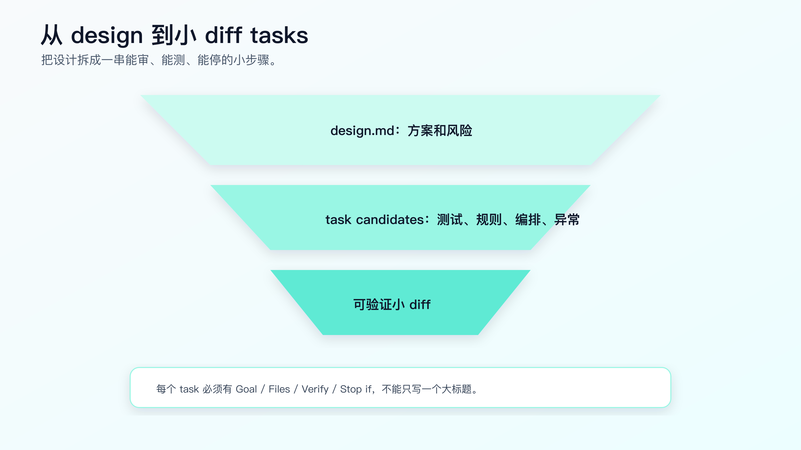
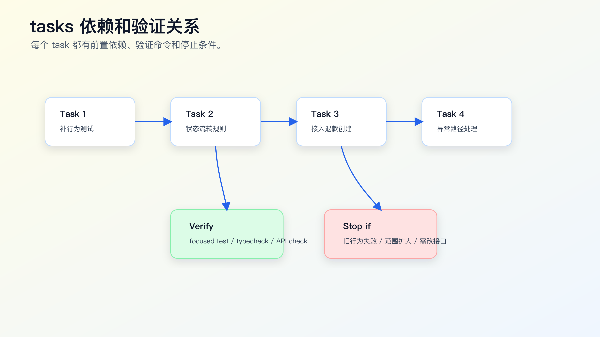

# `tasks.md` 怎么拆：把复杂需求变成小 diff

`requirements.md` 写清行为，`design.md` 写清方案，最后还不能直接让 AI 一口气实现。

复杂需求真正落地时，风险集中在 diff 粒度。

一个任务写成：

```markdown
- 完成订单取消改退款流程。
```

Agent 会把测试、状态机、退款请求、接口兼容、前端展示、错误处理混在一起改。最后可能测试能跑，但 diff 难审、失败难定位、回滚也麻烦。

`tasks.md` 的目标，是把设计拆成一串可审查、可验证、可停下来的小 diff。



## 好 task 的标准

一个好 task 要满足五个条件：

```text
单一目的
明确文件范围
可验证
可审查
失败后能停
```

坏 task：

```markdown
- 实现订单取消退款。
```

好 task：

```markdown
1. Add failing tests for paid order cancellation.
   - Files: `test/order/cancel.test.ts`
   - Verify: focused test fails only on paid path.

2. Add paid -> refund_requested transition.
   - Files: `src/order/status-transition.ts`
   - Verify: focused status transition tests pass.

3. Wire refund request creation in cancel service.
   - Files: `src/order/cancel-service.ts`
   - Verify: order cancel tests pass.
```

这不是为了流程漂亮，而是为了让 AI 一次只改一个能审的东西。

## `tasks.md` 不是 todo list

普通 todo list 只写要做什么。`tasks.md` 必须写：

- 做什么。
- 改哪些文件。
- 为什么现在做。
- 怎么验证。
- 依赖哪个前置任务。
- 失败时是否停止。

例如：

```markdown
## Task 1: Add regression tests

Goal:
- Lock pending, paid, shipped cancel behavior before implementation.

Files:
- `test/order/cancel.test.ts`

Steps:
- Add pending order cancel test.
- Add paid order cancel test expecting `refund_requested`.
- Add shipped order cancel test expecting existing rejection.

Verify:
- `npm test -- order-cancel`
- Expected before implementation: paid path fails, existing paths pass.

Stop if:
- Existing pending or shipped behavior fails before implementation.
```

这才是 AI 可以执行的 task。

## 拆任务的基本顺序

复杂需求通常按这个顺序拆：

```text
1. 锁定现有行为和新行为
2. 修改核心规则
3. 接入编排流程
4. 补异常路径
5. 扩大验证范围
6. 更新文档或规则
```

这个顺序不是固定，但它有一个原则：先让测试和证据出现，再让实现跟上。

订单取消改退款可以拆成：

```markdown
# Tasks

## 1. Add behavior tests

- pending cancel remains canceled
- paid cancel becomes refund_requested
- shipped cancel remains rejected
- duplicate paid cancel does not create duplicate refund

Verify:
- `npm test -- order-cancel`
- Expected before implementation: paid and duplicate paid cases fail.

## 2. Add status transition rule

- Add paid -> refund_requested.
- Keep pending -> canceled.
- Keep shipped rejection.

Verify:
- status transition focused tests pass.

## 3. Wire refund request creation

- Use transition result to create refund request.
- Do not change payment callback.

Verify:
- order cancel service tests pass.

## 4. Add failure handling

- If refund request creation fails, order remains paid.

Verify:
- refund failure test passes.

## 5. Run broader verification

- `npm test -- order`
- API response shape compatibility check.
```

每个 task 都有边界和验证。

## 任务粒度怎么判断

一个 task 太大，会出现这些信号：

- 涉及多个业务规则。
- 同时改测试、实现、UI、接口、数据。
- 验证命令不止一个层级。
- 失败后不知道是哪一部分导致。
- review 时很难一句话说明 diff。

一个 task 太小，也会有问题：

- 每步只有机械改名。
- 验证成本高于改动价值。
- 任务之间没有独立意义。

比较合适的粒度是：一个 task 完成后，diff 能单独解释，验证能单独运行。

例如：

```text
补 paid cancel 测试
```

这是合理 task。

```text
新增一个 import
```

太小，除非它是一次机械迁移里的可验证步骤。

```text
完成退款流程和前端展示
```

太大。

## 把坏 tasks 改成可执行 tasks

看一个常见坏版本：

```markdown
# Tasks

- 实现后端退款逻辑
- 改前端展示
- 补测试
- 自测
```

这份清单几乎不能用。它没有文件范围，没有顺序，没有停止条件，也没有说明哪些测试先失败、哪些测试后通过。

可以改成：

```markdown
# Tasks: paid order cancellation enters refund flow

## Task 1: Lock current and expected cancel behavior

Goal:
- Add behavior tests before implementation.

Files:
- `test/order/cancel.test.ts`

Verify:
- `npm test -- order-cancel`

Expected:
- pending and shipped cases pass.
- paid and duplicate paid cases fail before implementation.

Stop if:
- pending or shipped cases fail before implementation.

## Task 2: Add paid cancel transition

Goal:
- Make paid cancellation return `refund_requested`.

Files:
- `src/order/status-transition.ts`

Verify:
- `npm test -- order-cancel`

Stop if:
- implementation requires public response shape change.

## Task 3: Create refund request from cancel flow

Goal:
- Wire refund request creation after paid cancel transition.

Files:
- `src/order/cancel-service.ts`
- `src/refund/refund-request-service.ts`

Verify:
- `npm test -- order-cancel`

Stop if:
- payment provider callback logic must change.
```

这个改写的重点不是把格式变漂亮，而是让 Agent 每次只拿到一个可执行边界。

好的 tasks 读起来应该能回答三个问题：

```text
这一步为什么现在做？
这一步最多允许改哪里？
这一步完成后用什么证据证明？
```

如果回答不了，就继续拆。

## 每个 task 都要写 Stop 条件

很多 AI Coding 失控，是因为任务失败后继续往下做。

`tasks.md` 里应该写 Stop if：

```markdown
Stop if:
- Existing pending cancel test fails before implementation.
- Public API response shape must change.
- New dependency appears necessary.
- Generated file needs manual edit.
- Design assumption conflicts with current code.
```

Stop 条件不是消极。它是保护边界。

如果 Task 1 发现 pending 订单旧测试本来就失败，不能继续 Task 2。要先分类：baseline failure 还是需求理解错误。

## 先处理 baseline failure

真实仓库里，测试不一定一开始就是绿的。Agent 执行 Task 1 时，如果发现旧测试已经失败，不能把失败混进当前需求。

`tasks.md` 里可以写：

```markdown
Baseline check:
- Run `npm test -- order-cancel` before adding new tests.
- If existing pending or shipped cancellation tests fail, stop and report baseline failure.
- Do not modify implementation while classifying baseline failure.
```

baseline failure 有三种常见情况。

第一种，和当前需求无关。

比如订单列表快照测试因为文案变化失败，但取消逻辑测试是绿的。可以记录为 unrelated baseline failure，并说明当前 task 只跑 focused tests。

第二种，和当前需求相关。

比如 pending cancel 旧测试已经失败，这时不能继续实现 paid cancel。要先修复或确认现有行为，否则新需求没有稳定基线。

第三种，测试环境问题。

比如本地数据库没启动、外部服务 mock 缺失、依赖版本不一致。此时要补环境说明或替代验证，不能让 Agent 把业务代码改到测试通过。

baseline failure 的处理方式要写进报告：

```markdown
Baseline:
- `npm test -- order-cancel` failed before code changes.
- Failure: pending cancel expected `canceled`, got `pending`.
- Classification: related baseline failure.
- Action: stop before Task 2.
```

这一步很关键。否则 AI Coding 很容易把“修旧问题”和“做新需求”搅在一个 diff 里。

## 任务依赖和验证关系



tasks 不是平铺列表。它们有依赖。

比如：

```text
Task 2 依赖 Task 1 的测试。
Task 3 依赖 Task 2 的状态结果。
Task 4 依赖 Task 3 的退款创建路径。
Task 5 依赖前面所有改动。
```

可以在 `tasks.md` 里写：

```markdown
## Dependencies

- Task 2 must not start until Task 1 tests are added.
- Task 3 must not start until status transition tests pass.
- Task 5 must run only after all focused tests pass.
```

这能阻止 Agent 一口气做完。

## 让 AI 只执行一个 task

写好 `tasks.md` 后，不要说：

```text
按 tasks.md 实现。
```

这会让 Agent 一次性跑完整个清单。

一次只授权一个 task：

```text
只执行 `tasks.md` 的 Task 1。

要求：
- 不改实现代码。
- 不改 Task 1 以外文件。
- 跑指定验证命令。
- 输出 diff 摘要和测试结果。
- 完成后停止。
```

Task 1 完成后，人看 diff 和命令，再授权 Task 2。

对复杂需求，这种节奏比“一次全做完”更快。因为你少了大量返工。

## 测试先行怎么写进 tasks

不是每个任务都必须严格 TDD，但复杂需求建议先让行为测试出现。

Task 可以这样写：

```markdown
## Task 1: Add failing regression tests

Goal:
- Convert requirements into executable behavior checks.

Files:
- `test/order/cancel.test.ts`

Expected before implementation:
- pending and shipped cases pass.
- paid cancellation case fails because current behavior returns `canceled`.
- duplicate paid cancellation case fails because duplicate refund prevention is not implemented.

Stop if:
- pending or shipped cases fail before implementation.
```

这能让 AI 明确：测试失败不是坏事，预期失败是为了锁住需求。

## tasks 里的验证命令怎么写

验证命令不能只写“run tests”。

要写具体命令和覆盖范围：

```markdown
Verify:
- `npm test -- order-cancel`
  - covers pending, paid, shipped cancel behavior
- `npm test -- order`
  - covers broader order module impact
- API compatibility check
  - ensures response shape unchanged
```

如果命令不能本地跑，也要写：

```markdown
Not locally verifiable:
- Real payment provider callback.

Manual check:
- staging callback path after merge candidate.
```

不要让 Agent 自己选择最容易通过的命令。

## 回滚边界怎么写

复杂需求里，tasks 还要考虑回滚。

```markdown
Rollback:
- Task 2 can be reverted independently if status transition tests fail.
- Task 3 should not be merged without Task 2.
- No database migration in this change.
- No public API response shape change.
```

回滚边界让任务更可审。

如果一个 task 无法单独回滚，说明它可能太大或依赖没写清。

## task、commit 和 PR 不是一回事

很多人会把 `tasks.md` 误解成提交清单。实际生产里，task、commit、PR 的粒度可以不同。

task 是给 Agent 执行的最小授权单位。
commit 是本地历史记录单位。
PR 是给 reviewer 审查和交付的单位。

一个复杂需求可能是：

```text
Task 1: 补行为测试
Task 2: 改状态规则
Task 3: 接退款请求
Task 4: 补失败处理
Task 5: 跑扩大验证

Commit 1: tests for order cancel behavior
Commit 2: implement paid cancel refund flow
Commit 3: handle refund request failure

PR 1: paid order cancellation enters refund flow
```

也可能拆成两个 PR：

```text
PR 1: backend status and refund request behavior
PR 2: frontend display for refund_requested
```

什么时候拆 PR？

- 前后端可以独立上线。
- 数据迁移需要先合并。
- reviewer 不同。
- 风险需要分阶段灰度。
- 一个 PR 已经大到无法在合理时间内审完。

不要机械要求一个 task 一个 commit，也不要把十几个 task 塞进一个难审 PR。真正的目标是让每个交付单位可理解、可验证、可回滚。

## 常见错误

**错误一：tasks 只是大标题。**

“实现后端”“实现前端”“补测试”都太大。要写文件范围和验证。

**错误二：没有 Stop 条件。**

失败后 Agent 会继续改，污染 diff。

**错误三：任务顺序错。**

先实现再补测试，容易让测试配合实现，而不是锁定需求。

**错误四：一个 task 混多个层级。**

状态机、接口、前端展示、文档更新不要混在同一个 task。

**错误五：没有验收命令。**

没有验证命令，task 完成只剩口头声明。

## 一个完整 tasks 示例

```markdown
# Tasks: paid order cancellation enters refund flow

## Task 1: Add behavior tests

Goal:
- Lock pending, paid, shipped and duplicate paid cancel behavior.

Files:
- `test/order/cancel.test.ts`

Verify:
- `npm test -- order-cancel`

Expected before implementation:
- pending and shipped cases pass.
- paid and duplicate paid cases fail.

Stop if:
- pending or shipped cases fail.

## Task 2: Add status transition rule

Goal:
- Add paid -> refund_requested transition.

Files:
- `src/order/status-transition.ts`

Verify:
- `npm test -- order-cancel`

Stop if:
- public API response shape must change.

## Task 3: Wire refund request creation

Goal:
- Create refund request when transition result is refund_requested.

Files:
- `src/order/cancel-service.ts`
- `src/refund/refund-request-service.ts`

Verify:
- `npm test -- order-cancel`

Stop if:
- refund request creation requires payment callback changes.

## Task 4: Add failure handling

Goal:
- Keep order paid if refund request creation fails.

Files:
- `src/order/cancel-service.ts`
- `test/order/cancel.test.ts`

Verify:
- `npm test -- order-cancel`

## Task 5: Broader verification

Verify:
- `npm test -- order`
- API response shape compatibility check

Report:
- changed files
- commands and results
- residual risk
```

这份 tasks 可以直接驱动 Agent 小步执行。

## 每个 task 完成后要输出什么

让 Agent 执行 task 时，不要只让它说“完成”。要让它输出可审查结果。

可以固定要求：

```text
完成后停止，并输出：
1. 改了哪些文件。
2. 每个文件为什么改。
3. 执行了哪些验证命令。
4. 命令结果是什么。
5. 是否触发 Stop 条件。
6. 剩余风险或需要人确认的问题。
```

对应到 Task 2，输出应该像这样：

```markdown
Task 2 report:

Changed files:
- `src/order/status-transition.ts`: add paid -> refund_requested transition
- `test/order/status-transition.test.ts`: update expected transition behavior

Verification:
- `npm test -- order-cancel` PASS

Stop conditions:
- public API response shape did not change
- no payment callback changes required

Residual risk:
- frontend display for `refund_requested` not covered in this task
```

这个报告不需要长，但必须有证据。否则你只能相信 Agent 的口头总结。

## 并行任务要非常谨慎

Agent 能并行做事，但不是所有 tasks 都能并行。

可以并行的任务通常满足：

- 文件范围不同。
- 依赖关系弱。
- 验证命令互不影响。
- 失败后不会污染同一段代码。

比如：

```text
Task A: 后端订单状态测试
Task B: 前端状态文案展示
```

如果两者只共享接口契约，且契约已经在 requirements/design 中固定，可以并行。

不适合并行的任务：

```text
Task 1: 修改状态迁移规则
Task 2: 基于新状态接退款创建
Task 3: 基于退款创建补失败处理
```

这些任务有明确顺序。并行只会制造冲突和重复修复。

个人 AI Coding 里，我更建议默认串行。只有当任务边界特别清楚、文件不重叠、验证互不影响时，再让多个 Agent 并行。

## task 审查协议

每执行完一个 task，先审四件事，再授权下一步。

第一，diff 是否只覆盖 task 范围。

如果 Task 1 只要求补测试，结果改了实现，直接退回。测试先行任务最容易被 Agent “顺手修掉”。

第二，验证命令是否真的跑了。

不要接受“应该通过”。要看命令、结果和失败输出。如果命令没法跑，要写清原因和替代验证。

第三，是否触发 Stop 条件。

Stop 条件被触发时，不要让 Agent 继续解释着往下做。先更新 requirements 或 design，再重拆 tasks。

第四，是否产生新风险。

比如实现时发现需要新增状态值，老客户端可能不识别。这不是 Task 2 自己可以决定的范围，应该回到 design 的 Compatibility。

可以直接把这段话作为执行要求：

```text
执行 Task 3。完成后停止。
如果发现需要改 Task 3 以外的文件、需要新依赖、需要改 public API response shape，先报告，不要继续实现。
```

这类授权语句比“按 tasks 做”更适合真实项目。

## 任务失败要分类，不要马上让 Agent 猜修法

当一个 task 失败时，先分类，再决定下一步。

常见失败类型有五种。

| 失败类型 | 例子 | 处理 |
| --- | --- | --- |
| 预期失败 | 新增 paid cancel 测试失败 | 可以进入实现 task |
| 基线失败 | 旧 pending 测试先失败 | 停止，先确认现有行为 |
| 范围冲突 | 实现需要改 public API | 回到 design |
| 环境失败 | 数据库或 mock 没启动 | 修验证环境或记录替代验证 |
| 设计错误 | Current Flow 与源码不符 | 更新 design 和 tasks |

不要把所有失败都交给 Agent “继续修”。它可能为了让命令通过，改掉测试、扩大范围，或者绕过真正的设计问题。

可以这样要求：

```text
如果验证失败，先分类失败原因。
只有预期失败或 task 范围内的实现错误可以继续修。
如果是基线失败、范围冲突、环境失败或设计错误，停止并报告。
```

这条规则会明显减少大 diff 失控。

## tasks 怎么映射到 PR 描述

任务做完后，PR 描述不要只写“完成订单取消改造”。应该把 tasks 的执行证据压缩进去。

```markdown
What changed:
- paid order cancellation now creates refund request state
- pending and shipped cancellation behavior unchanged
- duplicate paid cancellation does not create duplicate refund request

Spec:
- `docs/specs/order-cancel-refund/requirements.md`
- `docs/specs/order-cancel-refund/design.md`
- `docs/specs/order-cancel-refund/tasks.md`

Task execution:
- Task 1 behavior tests: done
- Task 2 status transition: done
- Task 3 refund request wiring: done
- Task 4 failure handling: done
- Task 5 broader verification: done

Verification:
- `npm test -- order-cancel` PASS
- `npm test -- order` PASS

Not changed:
- payment provider callback
- admin batch cancellation
- historical data migration
```

这段 PR 描述给 reviewer 的不是过程流水账，而是审查索引。reviewer 可以沿着 requirements 看行为，沿着 design 看方案，沿着 tasks 看执行和验证。

## 本地验证、CI 和人工审查各管一段

`tasks.md` 里的验证命令不能替代 CI，也不能替代人工审查。它们负责的东西不同。

本地验证适合快速确认 task 是否做对：

```text
focused unit tests
typecheck
lint
small integration tests
browser smoke test
```

CI 负责更完整的自动化检查：

```text
full test suite
build
package checks
e2e tests
security or dependency checks
required status checks
```

人工审查负责自动化覆盖不到的判断：

```text
需求是否理解正确
diff 是否越界
设计层级是否合理
兼容性风险是否被接受
残余风险是否写清
```

Agent 可以运行本地命令，可以读取 CI 失败日志，也可以辅助做 review checklist。但它不能替你承担业务决策。

所以 tasks 的最后一步不要只写“跑测试”，可以写成：

```markdown
## Task 5: Delivery verification

Verify locally:
- `npm test -- order-cancel`
- `npm test -- order`
- `npm run typecheck`

Prepare PR evidence:
- summarize changed files
- map tests to requirements
- list not changed areas
- list residual risks

Wait for:
- CI required checks
- reviewer confirmation on compatibility
```

这段能把 Agent 执行、CI 和 review 连接起来。真实交付不是 Agent 说完成就结束，而是证据能通过机器和人的两层检查。

## tasks 也要防止“验证污染”

AI Coding 里还有一种常见问题：实现没改对，但测试被改到通过。

所以在 tasks 里可以写清楚哪些验证资产不能被随意修改：

```markdown
Protected verification:
- Do not weaken existing pending or shipped cancellation assertions.
- Do not delete response shape compatibility test.
- Do not replace behavior assertions with snapshot-only checks.
- Do not mark failing tests as skipped.
```

这类约束尤其适合放在测试先行任务之后。

如果 Agent 在 Task 2 修改实现时顺手改了 Task 1 的失败测试，要先问：这是需求变化，还是为了让测试通过？如果是需求变化，回到 requirements；如果只是为了通过测试，退回。

验证资产也是代码库的一部分。让 Agent 改测试没有问题，但它必须解释测试为什么要改，改动是否仍然锁住原始需求。

## 让 AI 生成 tasks 草稿

可以这样提示：

```text
先不要改代码。

请基于 requirements.md 和 design.md 生成 tasks.md 草稿。

要求：
- 每个 task 只产生一个可审查小 diff。
- 每个 task 写 Goal / Files / Verify / Stop if。
- 先测试或验证，再实现。
- 不要把重构和行为改动混在同一个 task。
- 标出任务依赖关系。
```

人审时重点看：

- Task 是否太大。
- 是否遗漏测试。
- 是否混入重构。
- Stop 条件是否具体。
- 验证命令是否匹配风险。

## tasks 和 Agent 执行的关系

`tasks.md` 不是给 Agent 一次性消费的清单。

它更像分段授权表。

每次只授权一个 task：

```text
执行 Task 2。
不要执行 Task 3。
完成后停止，输出 diff 摘要和验证结果。
```

如果 Task 2 失败，就不要继续 Task 3。

这能让人保持控制权，也能让 Agent 的上下文更干净。

这里还有一个生产里的细节：失败 task 不要直接改成“通过”。

先记录失败原因：

```text
failed command:
observed output:
likely category:
- implementation bug
- spec/design gap
- test expectation wrong
- environment issue
- scope expansion needed
decision:
- fix within task
- revise requirements/design
- split new task
- stop for human confirmation
```

这个记录很短，但能防止 Agent 在任务失败后把实现、测试和设计一起改掉。

如果失败原因属于 spec 或 design 缺口，不要在当前 task 里顺手补。先回到上游文档，把约束写清，再重新拆任务。这样后续 review 才能看出需求变化发生在哪一层。

## 迁移建议

下次复杂需求写完 design 后，先别实现。

让 AI 生成 tasks 草稿，然后你只审三件事：

- 每个 task 是否能形成小 diff。
- 每个 task 是否有验证命令。
- 每个 task 是否有停止条件。

如果这三件事过不了，就不要开工。

复杂需求不是靠一次强 prompt 做完的。它要被拆成一串能看、能测、能停的小步骤。

手写 requirements/design/tasks 能解决很多个人任务。当需求变更多、需要归档、需要 spec delta 和 proposal 时，就可以引入框架来管理这些规格资产。

## 常见问题

**每个 task 都必须测试先行吗？**

不必须。行为变更、bug 修复、状态机、接口兼容这类任务建议先写测试。纯文档、配置整理、验证补充可以先做检查命令或快照。关键是 task 开始前知道怎么判断完成。

**Agent 一次执行多个 task 会不会更快？**

小改动可以。复杂需求里，一次执行多个 task 经常让 diff 变大，失败也难定位。默认一个 task 一次授权，验证后再继续。

**task 写得很细，会不会拖慢开发？**

如果细到“新增一个 import”，会拖慢。合适粒度是一个 task 能形成独立可审 diff，并能用一个清楚的验证动作判断结果。

**任务失败后要让 Agent 继续修吗？**

看失败类型。如果是 task 范围内的测试失败，可以让它基于失败输出修。如果触发 Stop 条件，比如需要改公共接口、引入新依赖、推翻 design，就应该停下来重新审。

**tasks.md 要不要长期保留？**

中高风险需求建议保留，至少保留到 PR 合并后一段时间。它能解释改动顺序和验证证据。低风险小任务可以把任务摘要放在 PR 描述里，不一定保留文件。

## 可复查资料

- GitHub Spec Kit 官方文档：<https://github.github.com/spec-kit/>
- GitHub Spec Kit 仓库：<https://github.com/github/spec-kit>
- OpenSpec getting started：<https://github.com/Fission-AI/OpenSpec/blob/main/docs/getting-started.md>
- OpenSpec concepts：<https://github.com/Fission-AI/OpenSpec/blob/main/docs/concepts.md>

---

[课程首页](../../../README.md) · [完整目录](../README.md) · [← `design.md` 怎么写，AI 才不会补丁式开发](17-design-md-%E6%80%8E%E4%B9%88%E5%86%99-AI-%E6%89%8D%E4%B8%8D%E4%BC%9A%E8%A1%A5%E4%B8%81%E5%BC%8F%E5%BC%80%E5%8F%91.md) · [OpenSpec 实战：把需求变更放进 repo →](19-OpenSpec-%E5%AE%9E%E6%88%98-%E6%8A%8A%E9%9C%80%E6%B1%82%E5%8F%98%E6%9B%B4%E6%94%BE%E8%BF%9B-repo.md)

动手实践：[OpenSpec 业务需求实战](../../../personal-productivity-app/dev-process/01-openspec-today-plan-rollover.md)
