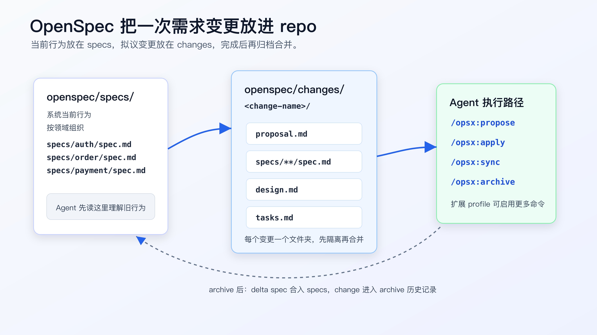
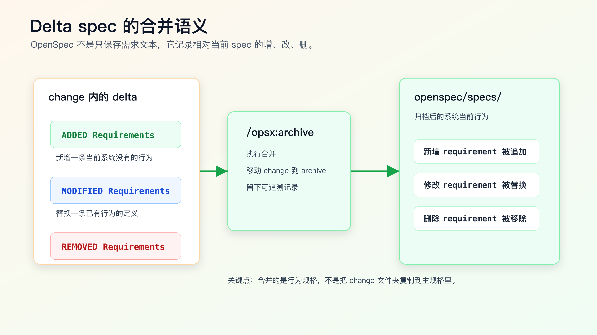

# OpenSpec 实战：把需求变更放进 repo

手写 `requirements.md`、`design.md`、`tasks.md` 已经能解决很多个人任务，但它有一个明显短板：这些文件经常只服务一次开发，需求完成后就散落在分支、聊天记录或临时目录里。

问题通常出现在下一次变更。

你让 AI 改订单取消逻辑：已支付订单取消后进入退款流程。第一次做完时，`requirements.md` 写得很清楚，测试也跑过。两个月后，产品又要增加“部分发货订单允许取消未发货部分”。AI 需要知道现在系统到底怎么工作：

- pending 订单能不能取消。
- paid 订单是不是会进入 refund_requested。
- shipped 订单现在是否拒绝取消。
- duplicate cancel 有没有幂等保护。
- 退款请求失败时订单状态怎么处理。

如果这些信息只在旧 PR、旧聊天窗口和开发者脑子里，AI 很容易重新推断一遍，然后改出一组看起来合理但和现有系统冲突的代码。

OpenSpec 解决的不是“让 AI 更会写代码”，而是把需求变更纳入 repo：当前行为有稳定位置，拟议变更有独立目录，完成后再把变更合并回当前行为规格。

这对程序员很有用。因为真实项目里，AI Coding 最大的风险不是写不出代码，而是它不知道哪些行为是现在系统的合同，哪些只是你这次想改的内容。



## OpenSpec 适合解决什么问题

OpenSpec 当前官方文档把它描述为一种和 AI coding assistant 对齐“要构建什么”的方式。它的 repo 结构围绕两个目录展开：

```text
openspec/
├── specs/              # 系统当前行为
│   └── <domain>/
│       └── spec.md
├── changes/            # 拟议变更
│   └── <change-name>/
│       ├── proposal.md
│       ├── design.md
│       ├── tasks.md
│       └── specs/
│           └── <domain>/
│               └── spec.md
└── config.yaml
```

这套结构背后的工程判断很直接：

`specs/` 写“系统现在怎么工作”，它不是愿望清单。

`changes/` 写“这次准备怎么改”，它还没有进入当前行为。

`archive` 以后，变更里的 delta spec 才合并回 `specs/`，变成新的系统事实。

对个人 AI Coding 来说，这比把所有需求都塞进一个 prompt 稳得多。Agent 可以先读 `openspec/specs/` 理解旧行为，再读 `openspec/changes/<change>/` 理解当前变更，最后按 `tasks.md` 小步实现。

## 先确认它是不是该用在这次任务上

OpenSpec 不是每个小改动都要上。

这类任务可以直接用轻量 SDD：

- 改一个字段展示。
- 补一个边界测试。
- 修一个明确 bug。
- 做一次小范围重命名。
- 调整一段内部实现，不改变外部行为。

这类任务更适合 OpenSpec：

- 需求会改变系统行为合同。
- 改动跨多个模块。
- 需要保留变更历史，方便后续 AI 继续接手。
- 同一领域会反复迭代。
- 需要同时写清当前行为和拟议行为。
- 需求容易被模型误读，例如状态机、权限、支付、库存、风控、消息投递。

一个简单判断：如果你已经准备写 `requirements.md`、`design.md`、`tasks.md`，并且希望这次变更完成后还能沉淀为长期规格，OpenSpec 就值得考虑。

如果只是改按钮文案，用它会增加不必要的目录和步骤。

## 安装和初始化要先看前置条件

OpenSpec 官方安装文档会列出当前 Node.js 版本要求和支持的安装方式。写入项目规则前，先以官方安装文档和本机 `openspec --version` 结果为准。最常见的是：

```bash
npm install -g @fission-ai/openspec@latest
openspec --version
```

进入项目根目录后初始化：

```bash
cd your-project
openspec init
```

不要在一个脏工作区里直接初始化。先看工作树：

```bash
git status --short
```

建议在单独分支里做：

```bash
git switch -c chore/adopt-openspec
openspec init
git status --short
```

你要看的不是命令有没有输出“成功”，而是它给 repo 增加了什么文件：

```bash
find openspec -maxdepth 3 -type f | sort
```

初始化之后，先不要急着让 Agent 实现需求。第一步应该是补最核心的现有行为 spec。没有现有行为，后面的 delta spec 就缺参照物。

例如订单领域可以先有：

```markdown
# Order Cancellation Spec

## Requirements

### Requirement: Pending order cancellation
The system SHALL allow a pending order to be canceled.

#### Scenario: Pending order canceled by user
- GIVEN a pending order
- WHEN the user cancels the order
- THEN the order status becomes canceled

### Requirement: Shipped order cancellation
The system SHALL reject cancellation for shipped orders.

#### Scenario: Shipped order cannot be canceled
- GIVEN a shipped order
- WHEN the user cancels the order
- THEN the cancellation is rejected
- AND the order status remains shipped
```

这段文字不是给人看的“产品说明”，而是后续 Agent 读取的系统合同。它应该尽量贴近真实行为，不要写未来设想。

## 用 `propose` 开一个变更

OpenSpec 当前 getting started 文档给出的默认快速路径是：

```text
/opsx:propose -> /opsx:apply -> /opsx:sync -> /opsx:archive
```

默认 global profile 是 `core`，包含 `propose`、`explore`、`apply`、`sync`、`archive`。扩展流程里的 `new`、`ff`、`continue`、`verify` 需要通过 profile 配置启用后更新。写到团队或个人规则里时，最好把这一点写清楚，避免不同机器上的命令不一致。

针对“已支付订单取消进入退款流程”，不要只说：

```text
/opsx:propose 支持付费订单取消
```

这个描述太短，Agent 会自己补很多业务假设。

把业务边界写进输入：

```text
/opsx:propose paid order cancellation should enter refund flow

Current behavior:
- pending orders can be canceled directly.
- shipped orders cannot be canceled.
- paid orders currently become canceled directly.

New behavior:
- paid orders should become refund_requested.
- a refund request should be created once.
- duplicate cancellation must not create duplicate refund requests.
- if refund request creation fails, order status should remain paid.

Out of scope:
- payment provider callback behavior.
- public API response shape.
- database schema migration.

Verification:
- focused order cancellation tests.
- idempotency test for duplicate paid cancellation.
- broader order module tests after focused tests pass.
```

这段输入有三层价值：

第一，它把旧行为和新行为分开。

第二，它明确不改什么。

第三，它把验证命令和风险放在变更开头，避免 Agent 只根据 happy path 生成设计。

OpenSpec 会为这个 change 创建独立目录。你要检查这些文件，而不是直接进入实现：

```text
openspec/changes/paid-order-cancel-refund/
├── proposal.md
├── design.md
├── tasks.md
└── specs/
    └── order/
        └── spec.md
```

如果目录名、领域名、文件组织明显不符合你的 repo，就先改这些规格文件，不要让 Agent 带着错误结构实现。

## proposal 要写清为什么改，不能替代 spec

`proposal.md` 适合写这次变更的动机、范围和方案概览。

比较好的内容是：

```markdown
# Proposal: Paid order cancellation enters refund flow

## Why
Paid orders cannot be treated like pending orders because payment capture has already happened. Directly marking them canceled loses refund state and makes duplicate cancel requests unsafe.

## What Changes
- Paid order cancellation creates a refund request.
- Paid order status becomes refund_requested.
- Duplicate paid cancellation does not create another refund request.
- Refund request creation failure leaves the order paid.

## Out of Scope
- Payment provider callback flow.
- Public API response shape change.
- Database schema migration.
```

不要把 `proposal.md` 写成完整技术方案，也不要把所有验收条件都堆在这里。proposal 负责“为什么”和“改什么”，真正的行为变化应该进入 delta spec。

很多人用 AI 写 spec 时会犯一个错：把所有内容都写进一个大文档。读起来完整，执行时很难定位。OpenSpec 的价值恰恰在于拆开这些职责。

## delta spec 是 OpenSpec 最关键的部分

OpenSpec 的 `changes/<change>/specs/<domain>/spec.md` 不是普通需求文档，而是相对当前 `openspec/specs/` 的变化。

官方文档里 delta spec 使用这些区域表达变化：

```markdown
## ADDED Requirements
## MODIFIED Requirements
## REMOVED Requirements
```

已支付订单取消可以写成：

```markdown
# Delta for Order

## MODIFIED Requirements

### Requirement: Paid order cancellation
The system SHALL move paid orders to refund_requested when a user cancels them.

#### Scenario: Paid order enters refund flow
- GIVEN a paid order without an existing refund request
- WHEN the user cancels the order
- THEN the order status becomes refund_requested
- AND exactly one refund request is created

#### Scenario: Duplicate paid cancellation is idempotent
- GIVEN a paid order that already has a refund request
- WHEN the user cancels the order again
- THEN no additional refund request is created
- AND the order remains refund_requested

#### Scenario: Refund request creation fails
- GIVEN a paid order
- WHEN refund request creation fails during cancellation
- THEN the order remains paid
- AND the failure is reported to the caller
```

这段 spec 有几个细节值得注意。

它没有写代码结构，也没有指定函数名。行为规格先描述系统必须满足什么。

它写了异常路径。AI 很容易只实现“paid -> refund_requested”，但真实生产问题往往出在重复请求和部分失败。

它写了可测试场景。后面的 `tasks.md` 可以直接从这些 scenario 拆出测试任务。



## design 负责技术约束，不负责重新发明需求

`design.md` 应该把实现边界写清楚。它的重点不是“我们将实现一个优雅的退款流程”，而是下面这些具体问题：

- 哪个模块拥有订单状态转换。
- 哪个模块负责创建退款请求。
- 状态更新和退款请求创建是否需要事务。
- 幂等键怎么生成。
- 失败时是否回滚状态。
- 哪些接口响应不能改变。
- 这次是否需要数据迁移。

一份可执行的 `design.md` 可以这样写：

```markdown
# Design: Paid order cancellation enters refund flow

## Current Code Ownership
- `OrderCancelService` owns user cancellation orchestration.
- `OrderStatusTransition` owns allowed status transitions.
- `RefundRequestService` owns refund request creation.

## Proposed Flow
1. `OrderCancelService` loads the order.
2. For pending orders, keep existing pending -> canceled behavior.
3. For shipped orders, keep existing rejection behavior.
4. For paid orders:
   - validate paid -> refund_requested transition.
   - create refund request with idempotency key `order:<orderId>:cancel`.
   - persist status only when refund request creation succeeds.

## Compatibility
- Do not change public API response shape.
- Do not change payment provider callback handling.
- Do not add a database migration in this change.

## Failure Handling
- If refund request creation fails, keep order status paid.
- Return existing error envelope.

## Verification
- Focused cancellation tests.
- Duplicate cancellation test.
- Broader order module tests.
```

这里有一个关键点：design 不是越长越好。

如果 design 写了很多“采用分层架构”“提高可维护性”，但没有说清事务边界、幂等策略和兼容性，它对 AI 没什么约束力。

AI Coding 里真正有用的 design，是能防止模型越界的 design。

## tasks 要让 Agent 小步执行

`tasks.md` 不能只是：

```markdown
- 实现退款流程
- 补测试
- 调整文档
```

这会让 Agent 一口气改完，最后给你一个很大的 diff。

拆成可验证任务：

```markdown
# Tasks

## 1. Add focused cancellation tests
- [ ] Add paid cancellation enters refund_requested test.
- [ ] Add duplicate paid cancellation idempotency test.
- [ ] Add refund request failure keeps order paid test.

Verify:
- `npm test -- order-cancel`

Stop if:
- existing pending or shipped cancellation tests fail before implementation.

## 2. Add paid status transition
- [ ] Add paid -> refund_requested transition.
- [ ] Keep pending and shipped behavior unchanged.

Verify:
- `npm test -- order-cancel`

Stop if:
- public API response shape must change.

## 3. Wire refund request creation
- [ ] Create refund request with idempotency key.
- [ ] Persist status only after refund request creation succeeds.

Verify:
- `npm test -- order-cancel`

Stop if:
- payment callback code needs to change.

## 4. Run broader verification
- [ ] Run order module tests.
- [ ] Record changed files and residual risks.
```

你可以让 Agent 先执行 Task 1，完成后停止：

```text
只执行 openspec/changes/paid-order-cancel-refund/tasks.md 的 Task 1。

要求：
- 不改实现代码。
- 只新增或修改 focused cancellation tests。
- 跑 tasks.md 里指定的验证命令。
- 输出失败用例和原因。
- 完成后停止。
```

这和“按 OpenSpec 实现”差别很大。前者保留人对 diff 和节奏的控制，后者容易变成一次性大改。

## `sync` 和 `archive` 不是收尾动作那么简单

OpenSpec 默认快速路径里有 `/opsx:sync` 和 `/opsx:archive`。

`sync` 的工程意义是：实现过程中发现规格、设计、任务和代码不一致时，把 artifact 拉回一致状态。比如 Task 2 做到一半才发现当前 repo 里 `RefundRequestService` 已经有幂等逻辑，不应该重复实现。此时要更新 design 和 tasks，而不是让聊天记录承担这部分事实。

`archive` 的工程意义更大。根据当前 getting started 文档，归档时：

- `ADDED` requirements 会追加到主 spec。
- `MODIFIED` requirements 会替换已有版本。
- `REMOVED` requirements 会从主 spec 删除。
- change 文件夹会移动到 `openspec/changes/archive/`，作为历史记录。

这一步完成后，`openspec/specs/order/spec.md` 才描述新的系统当前行为。

如果代码已经合并，但没有 archive，后续 AI 再读 `openspec/specs/` 时还会看到旧行为。它会以为 paid order cancellation 仍然直接 canceled。这样的 spec 比没有 spec 更危险，因为它给了 Agent 一个过期但看起来权威的上下文。

## 归档前要做的检查

不要把 `/opsx:archive` 当作“文件整理命令”。归档前至少检查这些点：

```bash
git diff -- openspec/specs openspec/changes
git diff --stat
```

重点看：

- delta spec 是否只写本次变更。
- 主 spec 是否已有对应的旧 requirement 可替换。
- design 是否和最终代码一致。
- tasks 是否还有未完成项。
- 验证命令是否真实跑过。
- change 里有没有聊天废话或临时结论。

如果你的项目有测试命令，先跑聚焦测试，再跑受影响模块测试：

```bash
npm test -- order-cancel
npm test -- order
```

如果测试不能本地跑，要在 change 里记录原因和替代验证方式。不要让 Agent 写“all tests passed”，除非你能看到命令和输出。

## OpenSpec 和轻量 SDD 的边界

轻量 SDD 的好处是快。一个 `.ai/tasks/<feature>/requirements.md` 加上 `design.md`、`tasks.md`，就能约束一次复杂任务。

OpenSpec 的好处是变更可归档。它多了三个关键能力：

- `specs/` 保存当前系统行为。
- `changes/` 隔离拟议变更。
- delta spec 在 archive 后合并进主规格。

如果你的项目长期由同一个人维护，且 AI 只做小任务，轻量 SDD 足够。

如果一个领域会反复改，或者你希望 AI 以后能读取历史行为，不要每次都重新解释，OpenSpec 更合适。

这不是工具信仰问题，而是维护成本问题。规格资产越长期，越需要明确“当前事实”和“拟议变更”的边界。

## 常见坑

**坑一：没有先补当前 spec。**

只写 change，不写 `openspec/specs/`，delta spec 就没有可靠参照。Agent 会把“当前行为”也当成自己可以猜的东西。

**坑二：把 proposal 写成大杂烩。**

proposal 里混入需求、设计、任务、验证和讨论结论，后续很难维护。它只需要写清为什么改、改什么、不改什么。

**坑三：delta spec 写实现细节。**

spec 应该写行为，不应该写“调用某个函数”“新增某个类”。这些放进 design。

**坑四：archive 前没有同步 artifacts。**

代码实现和 design 已经不一致，但 archive 仍然合并旧 design。后续 AI 会被这个过期设计带偏。

**坑五：让 Agent 一次执行完整 change。**

OpenSpec 管理的是变更，不代表每次都要全自动做完。复杂任务仍然应该按 tasks 小步授权。

**坑六：把官方命令能力写死。**

OpenSpec 仍在演进，不同 profile、不同 agent 集成可能有差异。项目规则里要写“以本 repo 当前安装结果为准”，并保留 `openspec --version`、`openspec list`、`openspec show` 这类检查动作。

## 可以先从一个高价值领域开始

不要一上来给整个项目补完整 specs。

先选一个 AI 经常改错、业务规则又比较稳定的领域：

- 订单状态。
- 权限校验。
- 支付退款。
- 库存扣减。
- 消息投递。
- 任务调度。

先补 3 到 5 条当前行为 requirement。然后选一个真实变更走完整流程：

```text
补当前 specs
开 changes/<change-name>
写 proposal
写 delta spec
写 design
写 tasks
按 task 小步实现
sync artifacts
archive 合并
```

做完后，把下一次 AI Coding 的上下文入口改成：

```text
先读取 openspec/specs/order/spec.md。
再读取 openspec/changes/<change-name>/proposal.md、specs/order/spec.md、design.md、tasks.md。
只执行 tasks.md 中当前授权的 task。
```

到这一步，OpenSpec 才算进入个人工作流。它带来的变化不在目录数量，而在 AI 理解项目的入口。

## 改完后重点看什么

落地 OpenSpec 后，先看四个结果：

- AI 是否先读 `openspec/specs/`，再读当前 change。
- 需求讨论是否沉淀到 proposal 和 delta spec，而不是留在聊天记录。
- 实现过程中发现的新事实是否同步回 design/tasks。
- archive 后主 spec 是否能独立描述新系统行为。

如果这四点做不到，OpenSpec 只是换了一个地方写文档。

如果这四点能做到，它会把 AI Coding 从“这次怎么问”推进到“这个 repo 如何长期被 AI 正确理解”。

## 常见问题

**OpenSpec 会不会太重？**

对小改动会。对状态机、权限、支付、库存这类反复变化的领域，它反而能减少重复解释和返工。

**可以只用 OpenSpec，不写测试吗？**

不建议。spec 是行为合同，测试是可执行证据。AI 最容易在自然语言和实现之间出现偏差，测试能把偏差暴露出来。

**delta spec 和 requirements.md 有什么区别？**

普通 `requirements.md` 往往描述这次要什么。delta spec 明确描述相对当前 spec 的增、改、删，并能在 archive 后合并回主 spec。

**OpenSpec 能代替设计评审吗？**

不能。它能让设计和变更有固定位置，但事务边界、兼容性、风险取舍仍然需要程序员判断。

**已经有产品 PRD 了，还需要 proposal 吗？**

需要时可以把 PRD 摘要到 proposal。PRD 通常面向产品意图，proposal 要面向 repo 里的工程变更范围。

## 可复查资料

- OpenSpec 官方站点：<https://openspec.dev/>
- OpenSpec GitHub 仓库：<https://github.com/Fission-AI/OpenSpec/>
- OpenSpec 安装文档：<https://github.com/Fission-AI/OpenSpec/blob/main/docs/installation.md>
- OpenSpec getting started：<https://github.com/Fission-AI/OpenSpec/blob/main/docs/getting-started.md>
- OpenSpec concepts：<https://github.com/Fission-AI/OpenSpec/blob/main/docs/concepts.md>

---

[课程首页](../../../README.md) · [完整目录](../README.md) · [← `tasks.md` 怎么拆：把复杂需求变成小 diff](18-tasks-md-%E6%80%8E%E4%B9%88%E6%8B%86-%E6%8A%8A%E5%A4%8D%E6%9D%82%E9%9C%80%E6%B1%82%E5%8F%98%E6%88%90%E5%B0%8F-diff.md) · [OpenSpec、Spec Kit 与轻量 SDD 怎么选 →](20-OpenSpec-Spec-Kit-%E4%B8%8E%E8%BD%BB%E9%87%8F-SDD-%E6%80%8E%E4%B9%88%E9%80%89.md)

动手实践：[OpenSpec 业务需求实战](../../../personal-productivity-app/dev-process/01-openspec-today-plan-rollover.md)
