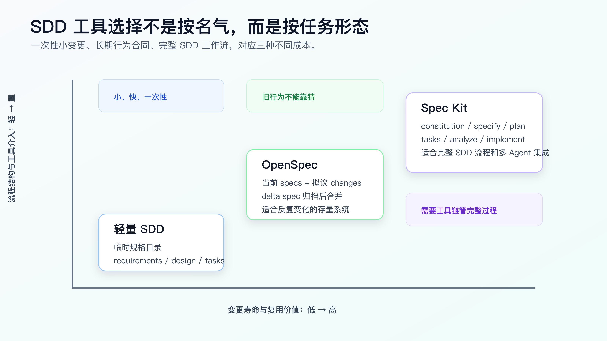
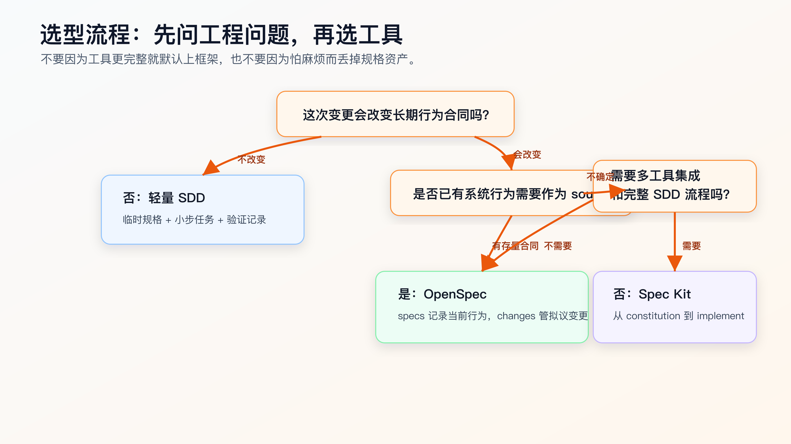

# OpenSpec、Spec Kit 与轻量 SDD 怎么选

程序员做 AI Coding，很容易在 SDD 这里走偏。

一种偏法是完全不用规格。所有需求都写进聊天窗口，要求 AI “理解代码后实现”。这在小改动里能跑通，在复杂需求里很快失控：旧行为说不清，技术边界说不清，测试意图说不清，最后只剩一个很大的 diff。

另一种偏法是看到框架就上框架。一个字段展示改动，也要搞完整 spec、plan、tasks、workflow。流程看起来正规，实际成本比收益高。

不要先问“哪个工具更强”，先看任务形态：

- 这次变更是不是一次性的。
- 它会不会改变长期行为合同。
- 是否已有系统行为需要作为 source of truth。
- 是否需要工具帮你生成、校验、串联完整 SDD artifact。
- 后续 AI 是否会反复接手同一领域。

结论先说：

小而明确、一次性的复杂任务，用轻量 SDD。

存量系统里反复变化的业务领域，用 OpenSpec。

偏 0 到 1、希望用工具链驱动完整 Spec -> Plan -> Tasks -> Implement 流程，或者需要多 Agent 集成，用 Spec Kit。

不要把三者理解成低级、中级、高级。它们解决的是不同问题。



## 先把三者的边界说清楚

轻量 SDD 是一种 repo-local 写法，不是一个官方框架。

它通常就是在项目里放一个临时规格目录：

```text
.ai/tasks/paid-order-cancel-refund/
├── requirements.md
├── design.md
├── tasks.md
└── verification.md
```

它的优势是启动成本低。你不需要安装工具，不需要改项目模板，不需要学习新命令。只要把需求、设计、任务和验证写到固定位置，就能让 Agent 读到稳定上下文。

它的弱点也明显：完成后这些文件是否归档、是否成为长期系统合同、下一次 AI 是否会优先读取，全靠你自己的工作习惯。

OpenSpec 是变更管理层。

官方文档当前把 `openspec/specs/` 定义为系统当前行为，把 `openspec/changes/` 定义为拟议变更。每个 change 里有 `proposal.md`、`design.md`、`tasks.md` 和 delta specs。归档时，delta spec 里的 ADDED、MODIFIED、REMOVED 会合并回主 `specs/`。

它的优势是把“当前事实”和“拟议变更”分开。对存量系统很重要。

它的弱点是需要你维护主 specs。如果主 specs 过期，Agent 会被一个看起来权威但实际错误的上下文带偏。

Spec Kit 是完整 SDD 工具链。

GitHub Spec Kit 官方文档当前描述的核心流程是 Spec -> Plan -> Tasks -> Implement。quick start 里还推荐在有歧义的生产功能中加入 `/speckit.clarify`、`/speckit.checklist`、`/speckit.analyze`，并提供多种 AI coding agent integration、extensions、presets、workflows 等能力。

它的优势是流程完整、集成面广、模板和命令体系清楚，适合从需求到实现的结构化推进。

它的弱点是对小任务会显得重，而且常被误用成“把完整流程跑一遍就等于质量更高”。真正的质量仍然来自规格质量、代码审查和验证证据。

## 用一张决策图先分流



实际工作里，我会先问第一个问题：

```text
这次变更会改变长期行为合同吗？
```

不会，就用轻量 SDD。

例如：

- 给已有 API 增加一个日志字段。
- 修一个明确的空指针。
- 修改页面加载状态文案。
- 给已存在行为补一组回归测试。

这些任务需要上下文和验证，但不一定需要长期规格资产。你只要写清：

```text
需求是什么
不改什么
涉及哪些文件
怎么验证
失败后怎么停
```

就够了。

第二个问题：

```text
是否已有系统行为需要作为 source of truth？
```

有，就优先考虑 OpenSpec。

例如订单、支付、权限、库存、风控、结算、消息投递。这些领域里，AI 最容易犯的错不是语法，而是重新解释业务规则。OpenSpec 的 `specs/` 可以让它先读取当前行为，再处理 `changes/` 里的拟议变更。

第三个问题：

```text
是否需要工具链帮你管理完整 SDD 流程和 Agent 集成？
```

需要，就考虑 Spec Kit。

例如你在做一个新功能包、新服务、新工具，想让工具生成规格、计划、任务，并且希望不同 AI coding agent 都能进入同一套流程。Spec Kit 的 integration、command、template、preset 更适合这类场景。

## 轻量 SDD：最适合个人高频使用

轻量 SDD 的最大价值，是让你不再把复杂需求交给一次聊天。

它适合这些任务：

- 需求不大，但有业务边界。
- 改动不需要长期归档成系统 spec。
- 你希望快速把 Agent 限制在小 diff 里。
- 项目不方便引入额外工具。
- 你还在摸索一个团队或个人的写法，不想过早绑定框架。

一个比较稳的目录是：

```text
.ai/tasks/<task-name>/
├── requirements.md
├── design.md
├── tasks.md
└── verification.md
```

`requirements.md` 写行为：

```markdown
# Requirements: paid order cancellation

## Current Behavior
- Pending orders can be canceled directly.
- Shipped orders reject cancellation.
- Paid orders currently become canceled directly.

## Target Behavior
- Paid orders become refund_requested.
- Exactly one refund request is created.
- Duplicate cancellation does not create duplicate refund requests.
- Refund creation failure leaves the order paid.

## Out of Scope
- Payment provider callback behavior.
- Public API response shape.
- Database schema migration.
```

`design.md` 写技术边界：

```markdown
# Design

## Ownership
- `OrderCancelService` orchestrates cancellation.
- `OrderStatusTransition` owns allowed transitions.
- `RefundRequestService` owns refund request creation.

## Compatibility
- Keep API response shape unchanged.
- Do not change payment provider callback.
- No database migration in this change.

## Failure Handling
- Persist refund_requested only after refund request creation succeeds.
```

`tasks.md` 写小步 diff：

```markdown
# Tasks

## Task 1: Add focused tests
Files:
- `test/order/cancel.test.ts`

Verify:
- `npm test -- order-cancel`

Stop if:
- existing pending or shipped behavior fails before implementation.

## Task 2: Add status transition
Files:
- `src/order/status-transition.ts`

Verify:
- `npm test -- order-cancel`

Stop if:
- public API response shape must change.
```

`verification.md` 记录证据：

````markdown
# Verification

## Commands

```bash
npm test -- order-cancel
npm test -- order
```

## Results
- `npm test -- order-cancel`: pass
- `npm test -- order`: pass

## Residual Risk
- Payment provider callback was out of scope.
````

注意，这里没有为了“显得工程化”新建一个样板项目。它直接服务真实变更。

轻量 SDD 的风险也要看清：

- 没有工具强制你归档。
- 没有 delta spec 合并语义。
- 没有跨 Agent 的命令集成。
- 文档结构全靠项目规则维护。

所以它适合个人高频工作流，不适合承担长期行为合同。

## OpenSpec：适合存量系统的行为变更

OpenSpec 的强项，是处理已有系统的变更。

官方 concepts 文档强调它是 brownfield-first，delta-based 的方式让你能指定对现有行为的修改，而不是只描述新系统。这一点对 AI Coding 很关键。

很多真实需求不是“做一个新能力”，而是：

- 旧逻辑 A 保持不变。
- 旧逻辑 B 改成 B2。
- 旧逻辑 C 删除。
- 新逻辑 D 加进来。

如果这些都写在一个 prompt 里，Agent 很容易把 A 也顺手改了。

OpenSpec 的目录给了明确边界：

```text
openspec/
├── specs/
│   └── order/spec.md
└── changes/
    └── paid-order-cancel-refund/
        ├── proposal.md
        ├── design.md
        ├── tasks.md
        └── specs/order/spec.md
```

主 `specs/order/spec.md` 写当前行为：

```markdown
### Requirement: Pending order cancellation
The system SHALL allow pending orders to be canceled.

### Requirement: Shipped order cancellation
The system SHALL reject cancellation for shipped orders.
```

change 里的 delta spec 写变化：

```markdown
## MODIFIED Requirements

### Requirement: Paid order cancellation
The system SHALL move paid orders to refund_requested when a user cancels them.
```

这个结构比轻量 SDD 多了一层语义：当前系统事实和当前变更不是同一个东西。

OpenSpec 适合这些情况：

- 同一领域会连续多次变更。
- 你希望 AI 每次先读取当前行为。
- 需求有增、改、删语义。
- 变更完成后需要归档成新的系统事实。
- 需要保留 change 历史，方便后续追溯。

OpenSpec 不适合这些情况：

- 项目还没有形成稳定业务领域。
- 只有一次性小改动。
- 没人维护 `openspec/specs/`。
- 团队会把 spec 当成形式文档，代码变了 spec 不更新。

最后这一点最重要。OpenSpec 不是自动真理机。它只是给规格资产一个结构。主 specs 是否可靠，仍然取决于你是否在变更后同步和归档。

## Spec Kit：适合完整 SDD 流程和工具集成

Spec Kit 更像一个完整的 SDD 工作台。

从官方 quick start 看，它不是只提供一个模板目录，而是通过 Specify CLI 初始化项目，并给 AI coding agent 提供命令。核心命令包括：

```text
/speckit.constitution
/speckit.specify
/speckit.plan
/speckit.tasks
/speckit.implement
```

生产功能里，官方 quick start 还建议把这些质量动作纳入常规流程：

```text
/speckit.clarify
/speckit.checklist
/speckit.analyze
```

这几个命令背后的工程意图很好理解：

`constitution` 写项目原则和长期约束。

`specify` 写要做什么和为什么做，尽量不在这个阶段陷入技术栈。

`clarify` 处理规格里的歧义。

`checklist` 检查需求质量。

`plan` 进入技术方案。

`tasks` 拆任务。

`analyze` 检查 spec、plan、tasks 之间的一致性。

`implement` 执行。

Spec Kit 适合这些情况：

- 你要从 0 到 1 做一个较完整功能或工具。
- 你希望工具直接生成 SDD 目录、脚本和命令。
- 你希望同一个 SDD 流程能被不同 Agent 使用。
- 你需要模板、preset、extension 去适配团队或个人规范。
- 你愿意接受更完整的流程成本，换取更强的结构化。

Spec Kit 不适合这些情况：

- 只是修一个局部 bug。
- 当前项目不想引入新的 CLI 和模板。
- 你还没有能力审它生成的 spec、plan、tasks。
- 你把 `/speckit.implement` 当成“自动写完并保证正确”的按钮。

最后一条尤其要警惕。Spec Kit 能让上下文更结构化，但不能替代工程判断。`analyze` 能检查 artifact 之间的一致性，不等于业务一定正确；`implement` 能驱动实现，不等于不用做代码审查和测试。

## 三者怎么映射到真实工作

同一个需求，在三种路线下会长得很不一样。

需求：

```text
已支付订单取消后，不再直接 canceled，而是进入 refund_requested，并创建一次退款请求。
```

如果用轻量 SDD，你会创建：

```text
.ai/tasks/paid-order-cancel-refund/
├── requirements.md
├── design.md
├── tasks.md
└── verification.md
```

然后让 Agent 逐个 task 做。

如果用 OpenSpec，你会先确认当前 specs：

```text
openspec/specs/order/spec.md
```

然后开 change：

```text
openspec/changes/paid-order-cancel-refund/
├── proposal.md
├── design.md
├── tasks.md
└── specs/order/spec.md
```

实现完成后 archive，把 delta spec 合并回主 specs。

如果用 Spec Kit，你会围绕命令流程推进：

```text
/speckit.constitution
/speckit.specify
/speckit.clarify
/speckit.checklist
/speckit.plan
/speckit.tasks
/speckit.analyze
/speckit.implement
```

然后在每个阶段审 artifact。

这三种方式都可以做同一个需求，但它们解决的主问题不同：

```text
轻量 SDD：约束一次任务
OpenSpec：维护存量行为变更
Spec Kit：驱动完整 SDD 生命周期
```

如果你只记住这三句话，选型基本不会偏得太远。

## 一个更实用的选择表

| 场景 | 推荐 | 原因 |
|---|---|---|
| 修复明确 bug，影响范围小 | 轻量 SDD | 写清复现、边界和验证即可 |
| 中等复杂需求，但不会长期维护规格 | 轻量 SDD | 成本低，能控制小 diff |
| 订单、权限、支付、库存等存量行为变化 | OpenSpec | 需要当前行为和拟议变更分离 |
| 同一领域会反复被 AI 接手 | OpenSpec | 主 specs 能成为长期上下文入口 |
| 新项目、新工具、新功能包 | Spec Kit | 完整流程更有价值 |
| 需要多 AI coding agent 使用同一套流程 | Spec Kit | integration 和命令体系更强 |
| 需要自定义模板、preset、extension | Spec Kit | 工具内建扩展机制 |
| 团队暂时没人维护规格资产 | 轻量 SDD | 先不要引入长期 spec 负债 |
| 只改文案、样式或小配置 | 不必 SDD | 直接改，但保留验证证据 |

这个表不是死规则。真实项目里可以组合使用。

例如，一个 repo 可以用 OpenSpec 维护订单、支付这些高风险领域，同时普通 UI 改动仍然用轻量 SDD。另一个新工具项目可以用 Spec Kit 初始化完整流程，再把其中的 project principles 和 task 拆分习惯迁移到自己的轻量 SDD 模板里。

工具之间不是互斥关系，真正要避免的是把它们混成一锅。

## 不要把 Spec Kit 和 OpenSpec 写进同一个任务上下文

很多人会想：“既然都好，那我把 Spec Kit、OpenSpec、自己手写的 requirements 都给 AI，看它综合一下。”

这通常会污染上下文。

因为三者对 artifact 的语义不同：

- 轻量 SDD 的 `requirements.md` 是一次任务合同。
- OpenSpec 的 `specs/` 是当前系统行为，`changes/` 是拟议变更。
- Spec Kit 的 spec/plan/tasks 是一个工具链阶段产物。

如果你同时给 Agent 三套结构，它可能分不清哪个是 source of truth。

一次任务只选一条主线。

用轻量 SDD，就明确：

```text
本次任务以 `.ai/tasks/<task>/` 为准。
不要读取其他草稿目录。
```

用 OpenSpec，就明确：

```text
先读取 `openspec/specs/<domain>/spec.md`。
再读取 `openspec/changes/<change>/` 下的 proposal、delta spec、design、tasks。
当前授权只执行 tasks.md 中指定 task。
```

用 Spec Kit，就明确：

```text
按当前 feature 的 Spec Kit artifact 推进。
先运行 analyze 或人工检查 spec/plan/tasks 一致性，再实现。
```

主线清楚，Agent 才不容易把旧草稿、旧设计和当前任务混在一起。

## 选型时最容易犯的五个错

**错误一：把轻量 SDD 当成低配方案。**

轻量不等于粗糙。对个人高频任务，它反而是最实用的起点。只要 requirements、design、tasks、verification 写得扎实，它能解决大多数复杂但一次性的变更。

**错误二：OpenSpec 只写 changes，不维护 specs。**

这会失去 OpenSpec 最核心的价值。没有当前系统行为，delta spec 就没有参照。

**错误三：Spec Kit 跑完命令就直接相信结果。**

Spec Kit 生成 artifact 后仍然要审。尤其是 clarify 是否真的消除了歧义，plan 是否符合现有代码，tasks 是否能小步验证。

**错误四：把框架能力当成项目能力。**

工具支持 integration、extension、preset，不代表你的 repo 已经适合它。项目规则、测试命令、模块边界、CI 反馈这些基础能力如果缺失，框架只能让问题更结构化地暴露出来。

**错误五：为了显得专业，把小任务流程复杂化。**

如果一个改动 30 分钟能完成，验证也清楚，不需要把它扩成完整 SDD 流程。AI Coding 要服务交付，不是让每个任务都变成仪式。

## 给个人程序员的落地顺序

如果你现在没有任何 SDD 习惯，不建议一上来装一堆框架。

先从轻量 SDD 开始。

给自己的 repo 固定一个目录：

```text
.ai/tasks/
```

每次复杂任务都写四个文件：

```text
requirements.md
design.md
tasks.md
verification.md
```

连续做 5 个真实任务后，再回看：

- 哪些需求反复出现在同一领域。
- 哪些旧行为总需要重复解释。
- 哪些变更完成后应该沉淀成长期合同。

如果答案集中在某几个业务领域，再引入 OpenSpec。

先只覆盖一个领域，例如：

```text
openspec/specs/order/spec.md
```

不要一次补全整个系统。一次补 3 到 5 条高风险行为，然后用一个真实 change 走完整流程。

如果你开始做新工具、新产品模块，或者需要让不同 Agent 共享一套 SDD 命令，再评估 Spec Kit。

安装前先做三件事：

```bash
uv --version
git status --short
specify --help
```

如果使用 one-shot：

```bash
uvx --from git+https://github.com/github/spec-kit.git specify init .
```

如果使用持久安装，先看官方安装文档和当前 release。不要把网上旧教程里的命令直接复制到生产 repo。

## 真正的选择标准：谁来维护 source of truth

所有 SDD 工具最后都会回到一个问题：

```text
这次任务完成后，谁负责维护事实？
```

轻量 SDD 的事实，通常停留在任务目录和 verification 里。它适合短生命周期。

OpenSpec 的事实，应该沉淀到 `openspec/specs/`。它适合长期行为合同。

Spec Kit 的事实，分布在它生成的 spec、plan、tasks、constitution 和扩展模板里。它适合完整流程，但也更需要你理解每个 artifact 的职责。

如果没人维护事实，工具越完整，过期信息越多。

AI Coding 最怕的不是没有文档，而是有一堆过期但看起来很正式的文档。

所以选型时不要只问“哪个框架能力最多”，要问：

- 这个 repo 是否有稳定的当前行为规格。
- 我是否愿意在代码变更后更新规格。
- Agent 下次会不会优先读取这些规格。
- 测试和验证能否证明规格没有漂移。

这些问题答不上来，先用轻量 SDD。

这些问题答得上来，再引入 OpenSpec 或 Spec Kit。

## 常见问题

**轻量 SDD 能不能和 OpenSpec 共存？**

可以，但同一次任务最好只选一条主线。OpenSpec 覆盖高风险长期领域，轻量 SDD 处理普通一次性任务，是比较实际的组合。

**Spec Kit 和 OpenSpec 谁更适合程序员？**

看任务。存量系统行为变更更偏 OpenSpec；完整 SDD 流程、新项目、多 Agent 集成更偏 Spec Kit。专业不等于选更重的工具，而是能控制成本和风险。

**已经用了 Spec Kit，还需要 AGENTS.md 吗？**

需要。Spec Kit 能生成和组织流程，但项目长期规则、验证命令、禁止事项、代码风格仍然需要在 Agent 能稳定读取的位置维护。具体位置以你使用的 agent integration 为准。

**OpenSpec 能不能替代测试？**

不能。OpenSpec 维护行为规格，测试提供可执行证据。没有测试，Agent 仍然可能实现出“看起来符合 spec”的错误代码。

**什么时候不要上任何 SDD？**

很小、风险低、验证明确的改动可以直接做。例如修 typo、改配置默认值、调整非核心样式。但也要保留最基本的 diff 审查和验证记录。

## 可复查资料

- GitHub Spec Kit 官方文档：<https://github.github.io/spec-kit/>
- GitHub Spec Kit quick start：<https://github.github.io/spec-kit/quickstart.html>
- GitHub Spec Kit integrations：<https://github.github.io/spec-kit/reference/integrations.html>
- GitHub Spec Kit CLI reference：<https://github.github.io/spec-kit/reference/overview.html>
- OpenSpec getting started：<https://github.com/Fission-AI/OpenSpec/blob/main/docs/getting-started.md>
- OpenSpec concepts：<https://github.com/Fission-AI/OpenSpec/blob/main/docs/concepts.md>

---

[课程首页](../../../README.md) · [完整目录](../README.md) · [← OpenSpec 实战：把需求变更放进 repo](19-OpenSpec-%E5%AE%9E%E6%88%98-%E6%8A%8A%E9%9C%80%E6%B1%82%E5%8F%98%E6%9B%B4%E6%94%BE%E8%BF%9B-repo.md) · [模块实战：用 OpenSpec CLI 推进一次真实产品需求 →](21-%E6%A8%A1%E5%9D%97%E5%AE%9E%E6%88%98-%E7%94%A8-OpenSpec-CLI-%E6%8E%A8%E8%BF%9B%E4%B8%80%E6%AC%A1%E7%9C%9F%E5%AE%9E%E4%BA%A7%E5%93%81%E9%9C%80%E6%B1%82.md)

动手实践：[OpenSpec 业务需求实战](../../../personal-productivity-app/dev-process/01-openspec-today-plan-rollover.md)
