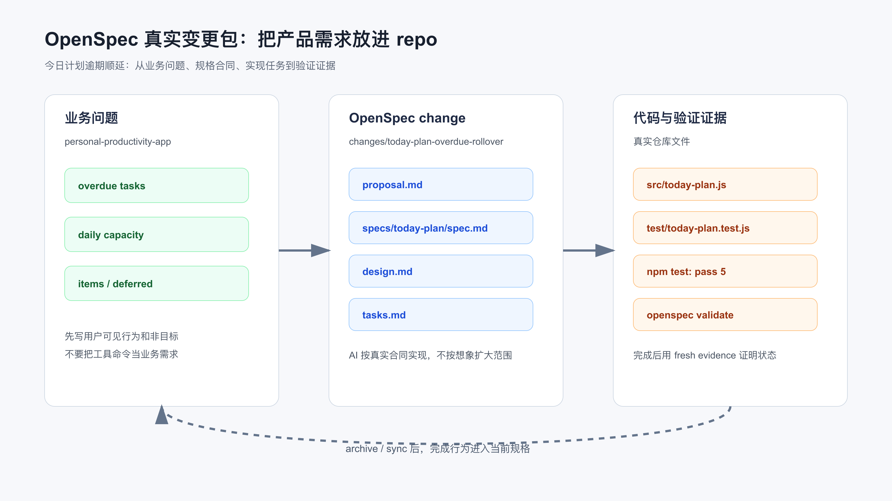

# 模块实战：用 OpenSpec CLI 推进一次真实产品需求

这次从一个真实产品需求开始：个人效率助手每天生成“今日计划”时，要自动纳入逾期未完成任务，但不能把一天排爆。

OpenSpec 在这里的作用，是把需求、设计、任务和验证证据放进同一个变更包里，让 AI 的实现有边界，也让人能复查每一步为什么这么改。

配套代码仓库 [DavidDingXu/learn-ai-coding](https://github.com/DavidDingXu/learn-ai-coding) 按一个大仓库组织，仓库根目录下有业务 module 和工具 module。这里使用业务 module：`personal-productivity-app`，后面的 OpenSpec、Superpowers、验证和规则沉淀都围绕同一条业务主线展开。

对应过程记录在：

```text
learn-ai-coding/personal-productivity-app/dev-process/01-openspec-today-plan-rollover.md
```

需求很常见：

```text
用户每天早上打开个人效率助手，希望看到今天该做什么。
昨天没做完的任务不能消失，但系统也不能把所有历史任务都塞进今天。
```

这类需求在真实项目里很容易扩散：

```text
顺手做 UI。
顺手接数据库。
顺手加提醒系统。
顺手做复杂排程算法。
顺手把 blocked 任务也塞进今日计划。
```

OpenSpec 的价值不是让文档更漂亮，而是把“为什么做、做什么、不做什么、怎么验证”放进仓库，让 AI 在动手前读合同。



## 先核对工具是真的

不能只说“按 OpenSpec 式材料做一下”。这里必须跑真实 OpenSpec CLI，并把 proposal、design、tasks、spec 和 validate 结果留在仓库里。

本机先核对当前包：

```bash
npm view @fission-ai/openspec name version bin engines --json
```

关键输出：

```json
{
  "name": "@fission-ai/openspec",
  "version": "1.4.1",
  "bin": {
    "openspec": "bin/openspec.js"
  },
  "engines": {
    "node": ">=20.19.0"
  }
}
```

本机环境：

```bash
node --version
# v24.14.1

npm --version
# 11.11.0
```

安装：

```bash
npm install -g @fission-ai/openspec
```

验证：

```bash
openspec --version
# 1.4.1
```

这一步很重要。OpenSpec、Spec Kit、Superpowers 这类工具变化很快，不能靠历史印象写命令。

## 初始化项目

示例项目不是工具项目，而是一个产品领域逻辑项目：

```text
learn-ai-coding/personal-productivity-app
```

初始化 OpenSpec：

```bash
cd learn-ai-coding/personal-productivity-app
openspec init --tools codex .
```

关键输出：

```text
OpenSpec Setup Complete

Created: Codex
5 skills and 5 commands in .codex/
Config: skipped (non-interactive mode)

Getting started:
  Start your first change: /opsx:propose "your idea"
```

这说明 OpenSpec 真实生成了：

```text
.codex/skills/
openspec/changes/
openspec/specs/
```

注意这里的 `/opsx:propose` 是 OpenSpec 给 Codex 配的 slash command 入口。为了让过程能在普通终端里复查，下面主要展示 CLI 命令。

## 创建真实 change

创建需求：

```bash
openspec new change today-plan-overdue-rollover \
  --description "今日计划自动纳入逾期未完成任务，并在每日容量限制下给出顺延列表。" \
  --goal "让个人效率助手每天生成可执行的今日计划，避免逾期任务丢失或一天被排爆。" \
  --json
```

输出里会看到 change 的真实路径：

```json
{
  "change": {
    "id": "today-plan-overdue-rollover",
    "path": "learn-ai-coding/personal-productivity-app/openspec/changes/today-plan-overdue-rollover",
    "schema": "spec-driven"
  }
}
```

此时还没有实现代码，只有一个 change 壳子。

下一步不能靠猜，要问 OpenSpec 当前 change 需要什么产物：

```bash
openspec status --change today-plan-overdue-rollover --json
```

OpenSpec 返回的工作流是：

```text
proposal -> specs/design -> tasks
```

apply 前置是：

```text
tasks
```

这意味着实现前至少要有 `proposal.md`、`specs/**/*.md`、`design.md` 和 `tasks.md`。

## proposal：把产品问题写清楚

先读取 OpenSpec 的 proposal 指令：

```bash
openspec instructions proposal --change today-plan-overdue-rollover --json
```

它要求 proposal 回答四件事：

```text
Why
What Changes
Capabilities
Impact
```

本次写入：

```text
openspec/changes/today-plan-overdue-rollover/proposal.md
```

核心内容不是“新增一个函数”，而是产品问题：

```text
今日计划如果只看当天任务，会漏掉昨天或更早没完成的任务；
如果把所有逾期任务一次性塞进今天，又会把一天排爆。
```

做什么：

```text
生成今日可执行任务。
自动纳入逾期未完成任务。
排除已完成、阻塞和未来任务。
按容量输出 items 和 deferred。
输出 usedMinutes 和 remainingMinutes。
```

能力名：

```text
today-plan
```

这会决定后续 spec 文件路径：

```text
openspec/changes/today-plan-overdue-rollover/specs/today-plan/spec.md
```

## specs：写成可测试需求

读取 specs 指令：

```bash
openspec instructions specs --change today-plan-overdue-rollover --json
```

本机 OpenSpec 明确要求：

```text
每个 requirement 使用 ### Requirement
每个 scenario 使用 #### Scenario
规范性描述使用 SHALL / MUST
每个 requirement 至少一个 scenario
```

这不是格式洁癖。

如果 scenario 写不出来，说明需求还不能被测试约束。

本次 spec 拆成三个 requirement：

```text
Generate today's executable plan
Respect daily capacity
Prioritize overdue work predictably
```

其中一个场景是：

```text
WHEN 输入包含逾期 open 任务、今天到期 open 任务和未来 open 任务
THEN 今日计划只包含逾期和今天到期的 open 任务
AND 逾期任务排在今天到期任务之前
```

这直接映射到测试：

```text
carries overdue unfinished tasks into today plan before today tasks
```

到这里，OpenSpec 已经把“用户想要什么”变成了可验证合同。

## design：限定实现边界

读取 design 指令：

```bash
openspec instructions design --change today-plan-overdue-rollover --json
```

本次 design 重点写四个决策：

```text
使用纯领域函数。
只让 open 任务进入候选。
逾期任务优先于当天任务，优先级优先于日期年龄。
容量选择采用顺序扫描，放不下进入 deferred，继续尝试后续小任务。
```

也明确不做：

```text
页面展示不放进这个 OpenSpec 变更。
不做数据库。
不做账号系统。
不接日历。
不做复杂排程优化。
```

真实项目里，设计文件不一定要长，但必须挡住需求扩散。

对 AI 来说，这比一句“不要做太多”有效得多。

这里要区分领域规则和页面展示：OpenSpec 变更先把领域规则做实，页面只能复用 `buildTodayPlan` 的输出。如果页面要引入独立状态、接口或排程逻辑，那就是另一个需求。

## tasks：让实现可以逐项审查

读取 tasks 指令：

```bash
openspec instructions tasks --change today-plan-overdue-rollover --json
```

本机 OpenSpec 要求 checkbox 格式：

```text
- [ ] 1.1 ...
```

因为 apply 阶段会解析 checkbox。

本次 tasks 拆成 8 项：

```text
1.1 跑 npm test 并记录缺失实现的失败。
2.1 新增 src/today-plan.js。
2.2 过滤 open overdue / due-today。
2.3 排序。
2.4 容量选择和 deferred 输出。
2.5 输入校验。
3.1 跑 npm test。
3.2 写过程记录。
```

用 OpenSpec 检查 apply 状态：

```bash
openspec instructions apply --change today-plan-overdue-rollover --json
```

初始输出：

```json
{
  "progress": {
    "total": 8,
    "complete": 0,
    "remaining": 8
  },
  "state": "ready"
}
```

这比“请按计划实现”更可靠。

AI 和人都能看到还有几项没完成。

## 严格校验 spec

实现前先验证 OpenSpec change：

```bash
openspec validate today-plan-overdue-rollover --strict --json --no-interactive
```

结果：

```json
{
  "summary": {
    "totals": {
      "items": 1,
      "passed": 1,
      "failed": 0
    }
  }
}
```

这一步不能省。

否则你可能写了一堆看似 OpenSpec 的文件，但工具根本识别不了。

## TDD 红灯：先证明测试能抓住缺失行为

测试已经写在：

```text
test/today-plan.test.js
```

第一次运行：

```bash
npm test
```

失败：

```text
Error [ERR_MODULE_NOT_FOUND]: Cannot find module
'/learn-ai-coding/personal-productivity-app/src/today-plan.js'
```

这个失败是有效红灯：测试已经指向 `buildTodayPlan`，但生产实现还不存在。

如果你没见过红灯，后面绿灯没有太大意义。

## 实现：只补领域函数

新增：

```text
src/today-plan.js
```

核心 API：

```js
export function buildTodayPlan({ date, capacityMinutes = 0, tasks = [] } = {}) {
  // ...
}
```

输入任务字段：

```text
id
title
dueDate
status
priority
estimateMinutes
```

输出：

```text
date
capacityMinutes
usedMinutes
remainingMinutes
items
deferred
```

这里没有接 UI，也没有写文件。

因为 OpenSpec design 已经限定：当前变更只做领域逻辑。结果页只能调用这个函数展示输出，不能改写需求合同。

## 绿灯：业务场景通过

再次运行：

```bash
npm test
```

输出：

```text
✔ carries overdue unfinished tasks into today plan before today tasks
✔ does not include completed or blocked tasks
✔ respects daily capacity and returns overflow as deferred tasks
✔ sorts overdue tasks by priority before due date age
✔ rejects invalid plan inputs before generating a plan
ℹ pass 5
ℹ fail 0
```

这组输出只覆盖领域函数测试。完整样例还会通过结果页演示测试确认页面没有另写一套业务规则。

这 5 个测试不是为了凑覆盖率。

它们分别对应：

```text
逾期任务是否顺延。
不可执行任务是否排除。
容量是否生效。
排序是否符合产品优先级。
输入边界是否被拒绝。
```

## 完成状态：让 OpenSpec 自己确认

实现和记录完成后，tasks 被勾选。

再次运行：

```bash
openspec instructions apply --change today-plan-overdue-rollover --json
```

输出：

```json
{
  "progress": {
    "total": 8,
    "complete": 8,
    "remaining": 0
  },
  "state": "all_done"
}
```

这时再说“这个 change 完成”，才有证据。

## 这类需求为什么适合 OpenSpec

不是所有需求都需要 OpenSpec。

如果只是改一个错别字、补一行日志、换一个按钮文案，用 OpenSpec 会显得重。

但这次需求值得用，因为它有：

```text
状态边界：open / done / blocked。
日期边界：overdue / due-today / future。
容量边界：items / deferred。
排序边界：priority / dueDate / id。
交付边界：当前变更只做领域函数，不做 API/存储；页面展示只能复用这个函数，不能引入另一套业务规则。
```

这些边界只靠聊天提醒，很容易在实现中丢掉。

OpenSpec 把边界放进仓库，让后续 AI、reviewer 和你自己都能复查。

## 迁移到自己的项目

你可以把这个模式迁移到很多业务需求：

```text
订单超时自动关闭。
工单 SLA 逾期升级。
会员权益到期提醒。
账单分期到期滚动。
审批任务逾期催办。
内容审核任务优先级队列。
```

只要需求里有状态、时间、优先级、容量、过滤或排序，就适合先写 spec。

给 AI 的指令可以这样写：

```text
请先读取 openspec/changes/<change>/proposal.md、design.md、specs/**/*.md、tasks.md。
只实现 tasks.md 中未完成事项。
如果实现中发现需求边界不清，先更新 OpenSpec 产物，不要直接扩大代码范围。
实现前跑现有测试，完成后跑 openspec validate 和项目测试。
```

## 配套资料

- OpenSpec 过程记录：`learn-ai-coding/personal-productivity-app/dev-process/01-openspec-today-plan-rollover.md`
- OpenSpec 变更包：`learn-ai-coding/personal-productivity-app/openspec/changes/today-plan-overdue-rollover/`
- 领域实现：`learn-ai-coding/personal-productivity-app/src/today-plan.js`
- 结果页：`learn-ai-coding/personal-productivity-app/index.html`
- 页面演示数据：`learn-ai-coding/personal-productivity-app/src/today-plan-demo.js`
- 业务测试：`learn-ai-coding/personal-productivity-app/test/today-plan.test.js`
- 页面演示测试：`learn-ai-coding/personal-productivity-app/test/today-plan-demo.test.js`
- OpenSpec 上游仓库：<https://github.com/Fission-AI/OpenSpec>

---

[课程首页](../../../README.md) · [完整目录](../README.md) · [← OpenSpec、Spec Kit 与轻量 SDD 怎么选](20-OpenSpec-Spec-Kit-%E4%B8%8E%E8%BD%BB%E9%87%8F-SDD-%E6%80%8E%E4%B9%88%E9%80%89.md) · [计划先行：让 AI 先解释它准备怎么改 →](../05-%E5%B0%8F%E6%AD%A5%E5%BC%80%E5%8F%91%E6%B5%8B%E8%AF%95%E4%B8%8E%E8%B0%83%E8%AF%95%E9%97%AD%E7%8E%AF/22-%E8%AE%A1%E5%88%92%E5%85%88%E8%A1%8C-%E8%AE%A9-AI-%E5%85%88%E8%A7%A3%E9%87%8A%E5%AE%83%E5%87%86%E5%A4%87%E6%80%8E%E4%B9%88%E6%94%B9.md)

动手实践：[OpenSpec 业务需求实战](../../../personal-productivity-app/dev-process/01-openspec-today-plan-rollover.md)
