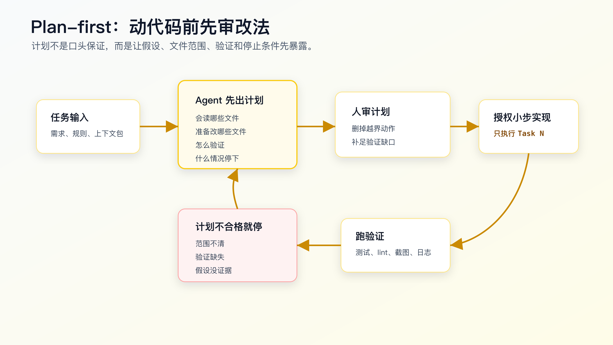

# 计划先行：让 AI 先解释它准备怎么改

很多 AI Coding 事故，不是模型不会写代码，而是它太快开始写代码。

你给它一句需求：

```text
把已支付订单取消改成走退款流程，补一下测试。
```

它马上改 `OrderCancelService`、状态机、退款服务、接口返回、测试、甚至顺手整理一些命名。最后测试可能跑过，但你打开 diff 会发现一个问题：这个改动已经很难审了。

你不知道它为什么改了这些文件，不知道它有没有先看旧行为，不知道它有没有保留 shipped 订单拒绝取消，不知道它有没有把支付回调也带进来。测试一旦失败，它还可能继续自己修，越修越远。

计划先行要解决的就是这个问题。

不是让 AI 写一段漂亮计划，也不是多一个形式步骤。计划要在动代码之前暴露五件事：上下文选择、改动范围、实现顺序、验证路径和停止条件。

计划能被人审，diff 才能被人控。



## 为什么直接实现会产生大 diff

AI 接到任务后，会自然补全缺失信息。

人类程序员听到“已支付订单取消走退款流程”，会先问：

- 当前订单状态有哪些。
- paid 取消现在怎么处理。
- 退款请求是否已有服务。
- 状态更新和退款创建是否需要事务。
- duplicate cancel 怎么办。
- API 返回是否兼容。
- 哪些测试能证明行为没坏。

Agent 如果没有被要求先计划，它可能也会搜索代码，但搜索结果和推理过程不会稳定地变成你能审查的东西。它会在写代码过程中边看边改。

这会带来三个问题。

第一，文件范围提前失控。

模型看到一个调用点，就可能顺手改调用点；看到一个旧测试，就可能顺手重写测试；看到一段风格不统一的代码，就可能顺手整理。每个动作单看都合理，合起来就变成大 diff。

第二，需求和实现混在一起。

如果它先写实现，再补测试，测试往往会贴着实现走。你看到的是“测试通过”，但不一定是需求被锁住。

第三，失败后没有停机点。

测试失败时，模型会继续猜原因。它可能把失败归因于测试写错，也可能改动更底层的逻辑。没有计划里的 Stop 条件，它不知道什么时候该停下来把问题交回给人。

计划先行不是降低 AI 的能力，而是把它的能力放进可审查路径。

## 好计划应该长什么样

一个合格计划不需要长，但必须具体。

危险计划通常长这样：

```text
我会先分析代码结构，然后实现退款流程，补充测试并运行验证。
```

这句话没有任何工程价值。

它没有说读哪些文件，没有说改哪些文件，没有说不改哪些地方，没有说先加什么测试，没有说验证命令，也没有说遇到什么情况停下。

可执行计划应该长这样：

```markdown
Plan

Context to inspect:
- `src/order/order-cancel-service.ts`
- `src/order/order-status-transition.ts`
- `src/refund/refund-request-service.ts`
- `test/order/order-cancel.test.ts`

Intended change:
1. Add focused tests for paid cancellation, duplicate paid cancellation and refund creation failure.
2. Add paid -> refund_requested transition in `order-status-transition.ts`.
3. Wire refund request creation in `order-cancel-service.ts`.
4. Keep pending and shipped cancellation behavior unchanged.

Out of scope:
- public API response shape
- payment provider callback flow
- database schema migration

Verification:
- `npm test -- order-cancel`
- `npm test -- order`

Stop if:
- existing pending or shipped tests fail before implementation.
- refund request requires callback changes.
- public API response shape must change.
```

这个计划不是“口头承诺”，它已经能被审查。

你可以马上指出：

- 少看了 repository 层。
- duplicate cancel 需要先查是否已有幂等键。
- `npm test -- order` 太慢，先跑 focused test。
- API response shape 如果必须改，需要先回到需求。

plan-first 的价值在这里：错误会先暴露在计划里，而不是混进 diff 里。

## 计划不是让 AI 自由发挥

计划阶段也要给边界。

不要只说：

```text
先给我一个计划。
```

这种输入太宽，AI 可能写出一份项目管理式计划。

把计划要求写具体：

```text
先不要改代码。

请基于当前 repo，给出一个可执行修改计划。

要求：
- 先列出你准备读取的文件和原因。
- 再列出你预计修改的文件。
- 明确不修改的范围。
- 按小 diff 顺序拆步骤。
- 每一步写验证命令。
- 写 Stop if 条件。
- 如果信息不足，先列出需要核对的问题，不要假设。
```

这段话的关键是“先不要改代码”和“如果信息不足，不要假设”。

很多 Agent 的默认行为是边读边改。你要明确把它拉回只读状态，让它先建立计划。

如果工具支持只读模式、计划模式或审批机制，可以配合使用。不同工具的名称不一样，但工程意图相同：计划阶段只读，执行阶段再授权写入。

## 计划质量看 6 个维度


审 AI 的计划，不要只看它是否“看起来完整”。

重点看六个维度。

**上下文是否具体。**

坏计划写“阅读相关代码”。好计划写具体文件、入口、调用点、测试文件。

如果它列不出文件，说明它还没真正理解任务。可以让它先做代码搜索：

```bash
rg -n "cancel|refund_requested|RefundRequest|order status" src test
```

然后基于搜索结果重写计划。

**改动范围是否收敛。**

坏计划写“实现完整退款流程”。好计划写“只改状态转换、取消编排和 focused test，不改支付回调、不改 API response shape”。

AI Coding 最怕范围不清。范围不清时，模型会把所有看起来相关的东西都纳入改动。

**实现顺序是否能小步验证。**

坏计划把测试、实现、重构混在一起。好计划先写 focused test，再改最小实现，再扩大验证。

对复杂需求，顺序比速度重要。你要让每一步都能解释 diff。

**验证路径是否有命令。**

坏计划写“运行测试”。好计划写具体命令、覆盖范围和预期结果。

例如：

```text
Task 1:
- `npm test -- order-cancel`
- before implementation: paid cancellation test fails, existing pending/shipped tests pass

Task 2:
- `npm test -- order-cancel`
- after implementation: focused tests pass

Final:
- `npm test -- order`
- covers broader module impact
```

没有命令的验证，是不可审查的验证。

**风险假设是否被列出。**

AI 经常默认某个 service、字段、状态、接口存在。计划里应该写哪些事实需要先核对。

例如：

```text
Need to verify:
- whether refund request creation already has idempotency support.
- whether order status is persisted before or after side effects.
- whether cancel API response shape is covered by snapshot or contract tests.
```

这些不是废话。它们决定实现是不是会越界。

**停止条件是否明确。**

Stop 条件不是给 AI 泼冷水，而是防止错误扩散。

例如：

```text
Stop if:
- baseline tests fail before implementation.
- existing code has no refund request service.
- implementation requires database schema changes.
- public API response shape must change.
- payment callback needs to be modified.
```

一旦触发 Stop，就不要让它继续“顺手解决”。停下来重新审需求、设计或任务范围。

## 计划要和任务粒度绑定

计划不是一个大纲。它应该直接决定执行粒度。

错误方式：

```text
计划看起来可以，开始实现。
```

授权时只放开一步：

```text
计划通过。现在只执行 Step 1：新增 focused tests。

要求：
- 不改实现代码。
- 只修改 `test/order/order-cancel.test.ts`。
- 运行 `npm test -- order-cancel`。
- 预期 paid cancellation 用例失败，pending/shipped 用例通过。
- 完成后停止，输出 diff 摘要和命令结果。
```

Step 1 完成后，你看 diff 和测试结果，再授权 Step 2。

这能避免一个常见问题：AI 计划写得很好，执行时又一次性改完整个任务。

计划必须和授权机制绑定。没有分步授权，计划只是开场白。

## 让 AI 在计划里写“不会做什么”

很多计划的问题，不在于它少写“会做什么”，而在于没写“不会做什么”。

对真实项目，out of scope 非常重要。

例如订单取消需求里，要明确：

```text
Out of scope:
- payment provider callback flow
- public API response shape
- database migration
- UI display copy
- refund settlement job
```

为什么要写这些？

因为 AI 会把语义相近的工作自动串起来。你说“退款流程”，它可能想到支付回调；你说“订单取消”，它可能想到前端订单详情页；你说“状态改成 refund_requested”，它可能想到数据库枚举迁移。

这些可能最终确实要做，但不一定在这个 diff 里做。

一个程序员要控制的不是 AI 是否“想得全面”，而是每个 diff 是否有边界。

## 计划里要写 baseline

很多测试失败不是这次改动导致的。

如果没有 baseline，AI 看到失败会直接修。修着修着，就把旧问题也混进当前 diff。

计划里可以要求：

```text
Before implementation:
- run `npm test -- order-cancel` if existing focused tests exist.
- record existing failures.
- if unrelated baseline failure appears, stop before implementation.
```

如果 focused test 还不存在，也要写清预期：

```text
After adding tests but before implementation:
- pending and shipped cancellation tests should pass.
- paid cancellation and duplicate cancellation tests should fail.
```

这个信息非常关键。它告诉 AI：某些失败是预期失败，不要在 Task 1 里偷偷改实现让它通过。

## 计划可以暴露上下文不足

计划阶段最有价值的输出之一，是发现信息不够。

一个合格 Agent 应该敢写：

```text
I cannot produce an implementation plan yet because I need to inspect:
- current order status enum
- cancel service orchestration
- refund request creation API
- existing order cancellation tests
```

这比直接给出一个自信计划更好。

你可以让它先做只读探索：

```text
先只做代码探索，不改文件。

请使用 `rg` 找到：
- 订单取消入口
- 订单状态定义
- 退款请求创建逻辑
- 现有取消测试

输出文件路径、关键函数、你对当前行为的判断，以及仍然不确定的地方。
```

探索完成后再生成计划。

真实项目里，计划通常不是一次生成就能用。它应该经历：

```text
只读探索 -> 初版计划 -> 人审 -> 修订计划 -> 分步执行
```

如果跳过只读探索，计划很容易变成模型凭项目常识写出来的模板。

## 计划不应该替代设计

计划和设计容易混。

`design.md` 负责解释技术方案、架构边界、数据流、兼容性和风险取舍。

Plan 负责解释这次执行准备怎么走。

两者可以这样分工：

```text
design.md:
- paid -> refund_requested 的状态规则
- 退款请求创建和状态更新的事务边界
- 幂等策略
- 不改 API response shape 的兼容性要求

Plan:
- 先读哪些文件
- 先补哪些测试
- 第一步改哪个文件
- 每步跑什么命令
- 遇到什么情况停止
```

设计回答“方案是否合理”。

计划回答“执行是否可控”。

一个常见坏味道是：AI 在 plan 里重新设计一套更复杂的架构。看到这种计划，要让它回到已有 design，或者先产出 design 供人审。

## 计划通过后，要变成授权记录

很多人做了 plan-first，但执行时仍然失控，原因是计划没有变成授权记录。

AI 给出计划后，你不应该只回复：

```text
可以，开始吧。
```

这会让它默认整个计划都被授权。

更好的回复是：

```text
计划通过。现在只授权 Step 1。

Step 1 scope:
- 只读或只改测试，按计划执行。
- 不改实现文件。
- 不执行 Step 2。

完成后输出：
- changed files
- verification command and result
- whether any Stop condition was hit
```

授权记录的价值在于：执行出问题时，你能判断 Agent 是计划错了、执行越界，还是任务本身出现新事实。

如果 Step 1 执行中发现必须改实现，Agent 应该停下来报告，而不是自己扩大范围。计划先行的真正控制点就在这里。

## 计划要写出证据来源

一个计划只列“准备改哪些文件”还不够，它还要说明这些文件是怎么来的。

可以要求 Agent 在计划里加一段：

```markdown
Evidence used:
- `rg -n "cancelOrder|RefundRequest|refund_requested" src test`
- `src/order/order-cancel-service.ts`: current cancel orchestration
- `test/order/order-cancel.test.ts`: existing pending/shipped behavior tests
- `src/refund/refund-request-service.ts`: refund request creation API
```

这能防止它凭常识写计划。

如果 evidence 里只有笼统描述，没有路径、命令和搜索结果，就说明计划还没站稳。让它先回到只读探索。

生产项目里尤其要警惕“看起来合理”的计划。AI 可能会写：

```text
我会修改订单服务、退款服务和前端状态展示。
```

但如果当前需求没有前端展示范围，或者前端在另一个 repo，这个计划就是扩大范围。证据来源能帮你发现它是不是读了真实代码，还是在按通用电商系统想象。

## 计划变更也要重新审

执行过程中发现新事实很正常。比如计划里以为已有 `RefundRequestService`，读代码后发现只有支付网关回调，没有独立退款请求表。

这时不要让 Agent 直接改实现。应该要求它更新计划：

```text
当前计划假设不成立。
请先更新计划，不要改代码。

更新内容：
- 哪个假设不成立。
- 新证据是什么。
- 是否影响 requirements 或 design。
- 原 Step 2 是否还能执行。
- 需要新增哪些 Stop 条件。
```

计划更新后再授权下一步。

这不是拖流程。它是在防止任务从“订单取消状态改造”滑向“退款系统建模”。真实项目里的大事故，很多都是从一个未审的计划变更开始的。

## plan-first 的适用边界

计划先行不是所有任务都要用。

可以跳过 plan-first 的任务：

- typo、文案、注释小修。
- 单个测试期望值修正，且原因明确。
- 明确的一行配置改动。
- 只读查询、生成报告、整理已有输出。

必须使用 plan-first 的任务：

- 行为变化。
- 跨模块改动。
- 涉及状态机、权限、支付、持久化、任务调度。
- 需要新增或修改测试。
- 可能影响 public API、数据库 schema、事件、队列、缓存。
- 用户让 Agent “顺便”处理多个问题。

这条边界很重要。所有事情都要求计划，会让团队讨厌计划；高风险事情不计划，会让 AI diff 失控。

## 把坏计划改成可执行计划

看一个常见坏计划：

```markdown
Plan:
1. Analyze the code.
2. Implement refund flow.
3. Add tests.
4. Run tests.
```

这份计划没有办法审。它没有证据、没有文件、没有边界、没有验证半径。

可以改成：

```markdown
Plan:

Read first:
- `src/order/order-cancel-service.ts`: cancel orchestration
- `src/order/order-status-transition.ts`: allowed transitions
- `src/refund/refund-request-service.ts`: refund request creation
- `test/order/order-cancel.test.ts`: existing behavior tests

Expected changes:
1. Add focused tests for paid, duplicate paid and refund failure paths.
2. Add paid -> refund_requested transition.
3. Wire refund request creation after transition.
4. Run focused and module-level verification.

Out of scope:
- payment provider callback
- public API response shape
- database migration
- UI display

Verification:
- after tests are added: `npm test -- order-cancel`, new paid tests fail and existing tests pass
- after implementation: `npm test -- order-cancel`, focused tests pass
- before handoff: `npm test -- order`

Stop if:
- existing pending or shipped behavior fails before implementation
- implementation needs schema migration
- refund service does not exist
- API response shape must change
```

这份计划仍然不长，但已经能审。

你可以指出：UI display 不在范围内是否符合需求？refund failure 是否需要先确认错误 envelope？`npm test -- order` 是否太慢，需要换成更聚焦命令？这些问题都能在写代码前讨论。

计划的好坏，不看它像不像“计划”，看它能不能阻止错误 diff。

## 计划要先看工作区状态

计划阶段还要看一个经常被忽略的东西：当前工作区是不是干净。

在共享工作区里，可能已经有用户改动、上一轮 Agent 改动、生成文件、未提交测试结果。计划如果不考虑这些，就可能把别人的改动当成自己可以重写的上下文。

计划前至少看：

```bash
git status --short
```

如果有未提交改动，计划里要说明：

```markdown
Workspace state:
- `src/order/order-cancel-service.ts` already modified before this task.
- I will read the current file and avoid reverting unrelated changes.
- Any new diff must be attributable to the current authorized step.
```

这条规则对 AI Coding 很重要。Agent 很容易用“恢复文件”“重写实现”来解决冲突，但那可能会覆盖用户已有工作。

如果工作区很乱，计划应该先建议隔离：

```text
Current workspace has unrelated changes.
Recommended:
- continue only on files required for this task, or
- create a branch/worktree before implementation, or
- ask which existing changes belong to this task.
```

不要在未知工作区状态下让 AI 大范围改代码。

## 计划要写 CI 之后还要看什么

计划里的验证命令不只包括本地命令。生产交付还要考虑 CI。

可以写：

```markdown
Verification plan:

Local:
- `npm test -- order-cancel`
- `npm test -- order`
- `npm run typecheck`

CI:
- wait for required checks.
- inspect failed job logs before changing code.
- do not mark broad verification complete if CI fails in affected module.

Human review:
- check response shape compatibility.
- check no payment callback changes.
- check residual risk for old clients.
```

CI 失败时，不要让 Agent 直接“修 CI”。先读日志、分类失败，再决定是否属于当前 diff。计划阶段写清这一点，后面才不会被一句“CI 失败无关”带偏。

## 一个可直接复用的 plan-first 模板

可以把这段放进你的项目规则或个人片段里：

```text
Before editing files, produce a plan and wait for approval.

The plan must include:
1. Files to inspect and why.
2. Files expected to change.
3. Files and behaviors explicitly out of scope.
4. Step-by-step implementation order, each step producing a reviewable diff.
5. Verification command for each step.
6. Expected failing tests before implementation, if tests are added first.
7. Stop conditions.
8. Open questions and assumptions.

Do not start implementation until the plan is approved.
If the required context is missing, perform read-only exploration first and update the plan.
```

如果你不想每次都手敲，可以把它写进 `AGENTS.md`：

```markdown
## Plan-first Changes

For non-trivial changes:
- inspect the code before planning.
- produce a plan before editing files.
- include expected changed files, verification commands, and stop conditions.
- do not implement until the current task step is authorized.
- stop if the change requires broader scope than requested.
```

注意，规则不要写得过大。所有小改动都强制计划，会拖慢工作。可以写“non-trivial changes”，再定义触发条件：

```markdown
Plan-first is required when:
- behavior changes.
- more than one module may be touched.
- tests need to be added or changed.
- public API, persistence, auth, payment, job, or state machine code is involved.
```

这样规则才不会变成负担。

## 常见错误

**错误一：计划太抽象。**

“分析代码、实现功能、运行测试”不是计划。它没有任何可审查信息。

**错误二：计划和实现一起做。**

AI 一边写计划一边改代码，等于没计划。计划阶段必须只读。

**错误三：计划里没有 out of scope。**

没有不改什么，就很难阻止相关代码被顺手修改。

**错误四：计划没有验证命令。**

没有命令，就无法判断每一步是不是真的完成。

**错误五：计划通过后一次性执行完。**

计划必须绑定分步授权。复杂任务一次性执行，还是会变成大 diff。

**错误六：人只看计划是否顺眼。**

审计划要像审设计一样具体。看文件、顺序、验证、风险、停机点，不看文字是否完整。

## 改完后重点看几个结果

一次 plan-first 执行结束后，不要只看测试通过。

重点看：

- 实际改动文件是否和计划一致。
- 是否有计划外文件被修改。
- 每一步验证命令是否真实运行。
- Stop 条件是否被触发过，触发后是否停住。
- 计划里的假设是否在代码中得到验证。
- 最终 diff 是否能按计划步骤解释。

如果实际 diff 和计划对不上，要追问原因。原因合理，就更新计划；原因不合理，就回滚越界改动。

计划先行不是为了让流程看起来更严谨，而是为了让 AI 写代码这件事可控。

## 常见问题

**小改动也要 plan-first 吗？**

不需要。改 typo、改一行配置、补一个明确测试，可以直接做。plan-first 用在行为变化、跨模块改动、状态机、权限、支付、持久化、任务调度这类风险更高的任务上。

**计划会不会浪费 token？**

会消耗一些上下文，但通常比大 diff 返工便宜。关键是计划要短而具体，不要让 AI 写项目管理文档。

**AI 计划写错了怎么办？**

这正是 plan-first 的价值。计划写错，比代码写错便宜。让它补充只读探索，然后重写计划。

**计划通过后 AI 仍然越界怎么办？**

把“只执行当前 step，完成后停止”写进执行指令。必要时在工具层使用审批、只读、分支或 worktree 隔离。完成后用 `git diff --stat` 和文件列表核对。

**计划和 `tasks.md` 是不是重复？**

不完全重复。`tasks.md` 是需求拆分后的任务合同，plan 是当前执行会怎么落某个任务。简单任务可以合并；复杂任务建议分开。

## 可复查资料

- OpenAI Codex best practices：<https://developers.openai.com/codex/learn/best-practices>
- OpenAI AGENTS.md guide：<https://developers.openai.com/codex/guides/agents-md>
- Claude Code common workflows：<https://code.claude.com/docs/en/common-workflows>
- GitHub Copilot coding agent best practices：<https://docs.github.com/en/copilot/tutorials/cloud-agent/get-the-best-results>

---

[课程首页](../../../README.md) · [完整目录](../README.md) · [← 模块实战：用 OpenSpec CLI 推进一次真实产品需求](../04-SDD-%E4%B8%8E-OpenSpec-%E5%AE%9E%E6%88%98/21-%E6%A8%A1%E5%9D%97%E5%AE%9E%E6%88%98-%E7%94%A8-OpenSpec-CLI-%E6%8E%A8%E8%BF%9B%E4%B8%80%E6%AC%A1%E7%9C%9F%E5%AE%9E%E4%BA%A7%E5%93%81%E9%9C%80%E6%B1%82.md) · [小步开发：为什么要限制 AI 一次改动范围 →](23-%E5%B0%8F%E6%AD%A5%E5%BC%80%E5%8F%91-%E4%B8%BA%E4%BB%80%E4%B9%88%E8%A6%81%E9%99%90%E5%88%B6-AI-%E4%B8%80%E6%AC%A1%E6%94%B9%E5%8A%A8%E8%8C%83%E5%9B%B4.md)

动手实践：[业务样例与测试](../../../personal-productivity-app/README.md)
