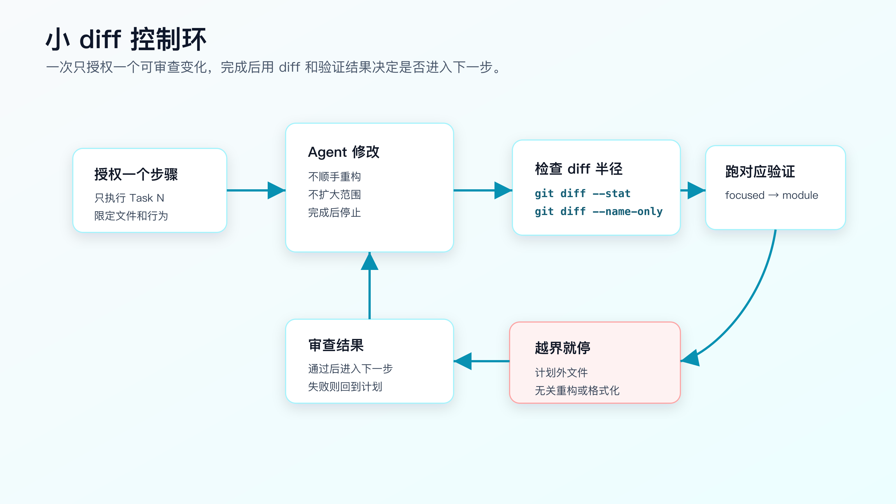
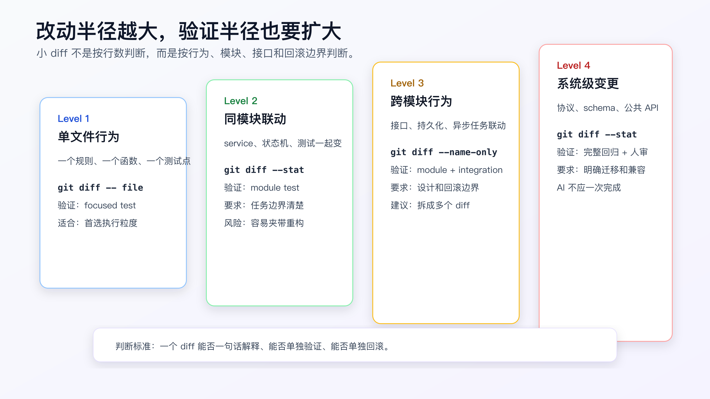

# 小步开发：为什么要限制 AI 一次改动范围

让 AI 写代码，最容易低估的一件事是 diff 管理。

很多人会把注意力放在“它有没有实现需求”。但在真实工程里，另一个问题同样重要：这个 diff 能不能被审。

一个 800 行 diff，里面同时有行为修改、测试补充、格式化、重命名、顺手重构和文档调整，就算测试通过，也很难判断它到底安全不安全。你不知道哪一行是需求必须，哪一行是模型自作主张。更麻烦的是，一旦出问题，你也不知道该回滚哪一部分。

所以 AI Coding 不能只讲“让模型完成任务”，还要讲“让模型一次只产生一个可审查变化”。

小步开发的核心不是少写代码，而是控制改动半径。

一次改动最好能满足三个条件：

```text
一句话能解释
一个命令能验证
失败后能单独回滚
```

做不到这三点，就应该继续拆。



## AI 为什么特别容易产生大 diff

人类程序员也会写大 diff，但 AI 写大 diff 的方式更隐蔽。

它有几个天然倾向。

**它会补全任务。**

你说“订单取消走退款流程”，它可能联想到状态机、退款服务、支付回调、前端展示、接口返回、日志、文档。它的联想不一定错，但一次 diff 不该吞下所有东西。

**它会顺手整理。**

模型看到命名不一致，会想统一；看到旧测试写得丑，会想重写；看到重复逻辑，会想抽函数。很多顺手改动单看有道理，但会污染当前需求。

**它会为了让测试通过扩大范围。**

测试失败时，它可能不先判断失败是否属于当前任务，而是继续改更多代码。没有范围限制时，修复路径会越走越远。

**它不天然感知 review 成本。**

对模型来说，改 3 个文件和改 15 个文件只是输出长度不同。对人来说，审查成本完全不同。

所以要主动限制 AI 的一次改动范围。

## 小 diff 不是按行数判断

很多人会用行数判断 diff 大小，这不够。

一个 20 行公共接口变更，风险可能比 200 行测试快照更新更高。

更实用的判断方式是看改动半径：



Level 1 是单文件行为变化。比如给状态转换函数增加一个 paid -> refund_requested 分支，并补一个 focused test。

Level 2 是同模块联动。比如状态机、取消服务和订单取消测试一起改。

Level 3 是跨模块行为变化。比如订单取消、退款服务、事务处理和异步任务一起改。

Level 4 是系统级变化。比如公共 API response、数据库 schema、协议、权限模型、结算规则。

AI 一次最适合做 Level 1 或边界清楚的 Level 2。

Level 3 要拆成多个小 diff。

Level 4 不应该让 AI 一次完成。它可以协助写设计、补测试、做迁移草稿，但需要更严格的人审和阶段验证。

## 开始前先限制文件范围

小步开发不是等 diff 出来后再后悔，而是在执行前就限制范围。

错误指令：

```text
按计划实现订单取消退款流程。
```

直接限制任务范围：

```text
只执行 Task 2：添加 paid -> refund_requested 状态转换。

允许修改：
- `src/order/order-status-transition.ts`
- `test/order/order-cancel.test.ts`

禁止修改：
- `src/order/order-cancel-service.ts`
- `src/refund/**`
- API response 类型
- 数据库 schema
- 支付回调逻辑

验证：
- `npm test -- order-cancel`

完成后停止，输出：
- 改动文件列表
- diff 摘要
- 验证命令和结果
```

这段指令有四个控制点：

- 只做一个 Task。
- 明确允许文件。
- 明确禁止范围。
- 完成后停止。

很多 AI 越界不是因为它不听话，而是你没有把边界写到可执行粒度。

## 每一步都用 Git 看半径

不要只读 AI 的总结。

每一步完成后，先看：

```bash
git diff --name-only
```

再看：

```bash
git diff --stat
```

如果文件数量超过计划，先不要继续。

例如计划只允许两个文件：

```text
src/order/order-status-transition.ts
test/order/order-cancel.test.ts
```

实际出现：

```text
src/order/order-status-transition.ts
src/order/order-cancel-service.ts
src/refund/refund-request-service.ts
test/order/order-cancel.test.ts
```

这已经越界。不要让 AI 解释几句就继续。先要求它说明：

```text
你修改了计划外文件。

请先不要继续实现。
说明每个计划外文件为什么被修改。
如果不是当前 Task 必需，请恢复这些文件的改动，只保留 Task 2 范围内的 diff。
```

这里要注意：恢复计划外文件时，不要粗暴 `git checkout -- .`。当前工作区可能有你自己的改动，也可能有前一步已经确认过的改动。让 Agent 根据 diff 删除自己刚产生的计划外改动，或者你手动按文件审。

小步开发的关键是“发现越界就停”，不是“越界后继续补救”。

## 不要让重构混进需求 diff

AI 很喜欢顺手重构。

它可能会说：

```text
我顺手整理了重复逻辑，提升可读性。
```

这句话在 review 里要提高警惕。

重构不是不能做，但不要和行为变更混在同一个 diff。

如果确实需要重构，拆成两个 diff：

```text
Diff 1：纯重构
- 不改变行为。
- 只移动/抽取代码。
- 所有现有测试必须保持通过。

Diff 2：行为变更
- 基于重构后的结构修改需求。
- 新增或修改测试。
```

如果重构不是需求必需，直接拒绝：

```text
当前 Task 不做重构。
请恢复命名整理、抽函数和格式化改动。
只保留 paid -> refund_requested 状态转换和对应测试。
```

一个好习惯是要求 AI 在计划里声明：

```text
No opportunistic refactoring.
No unrelated formatting.
No dependency updates.
```

这能减少大量噪音。

## 验证半径要匹配改动半径

小 diff 不是只改小，也要验证得准。

如果是 Level 1 单文件行为改动，先跑 focused test：

```bash
npm test -- order-cancel
```

如果是 Level 2 同模块联动，再跑模块测试：

```bash
npm test -- order
```

如果是 Level 3 跨模块联动，需要补集成路径：

```bash
npm test -- order
npm test -- refund
npm test -- api-contract
```

如果是 Level 4 系统级变化，除了自动化测试，还要有人工审查、迁移检查、兼容性检查和回滚方案。

很多人把“小步开发”理解成只跑小测试，这是错的。

正确做法是：

```text
先用最小测试约束当前 diff。
通过后再扩大验证半径。
验证半径随着改动半径扩大。
```

否则你会得到一个局部通过、全局出事的改动。

## 用 Task 边界控制上下文

小步开发还能降低上下文污染。

一次只执行一个 Task，Agent 当前需要关注的上下文就更少。

例如 Task 1 只加测试：

```text
只需要 requirements、现有测试、状态枚举。
不需要实现服务内部细节。
```

Task 2 只改状态转换：

```text
只需要状态机文件、相关测试、状态定义。
不需要前端、不需要支付回调、不需要数据库 migration。
```

Task 3 再接退款请求创建：

```text
才需要 refund request service、事务边界、幂等策略。
```

如果一开始就把所有文件都给 AI，它会同时考虑所有问题，输出会混在一起。

所以小步开发不只是 review 策略，也是上下文策略。

## 执行前写清“当前步骤完成定义”

一个 Task 必须有完成定义。

坏写法：

```text
完成状态转换。
```

好写法：

```text
Task 完成定义：
- `paid -> refund_requested` 状态转换存在。
- pending cancellation 行为不变。
- shipped cancellation 行为不变。
- duplicate cancellation 测试仍然失败，因为幂等还没实现。
- `npm test -- order-cancel` 中只有预期失败。
```

注意这里的“预期失败”。

小步开发不要求每一步都让所有测试通过。TDD 或分步实现时，中间步骤出现预期失败是正常的。关键是失败要被解释清楚，不能变成未知失败。

如果 Agent 看到失败就擅自实现后续 Task，就破坏了小步边界。

执行指令里可以写：

```text
如果出现预期失败，请报告，不要为了让它通过而执行下一步。
```

## 用 diff 摘要训练审查节奏

每一步完成后，让 AI 输出固定格式：

```markdown
Changed files:
- `src/order/order-status-transition.ts`
- `test/order/order-cancel.test.ts`

What changed:
- Added paid -> refund_requested transition.
- Added focused test for paid cancellation.
- Kept pending and shipped tests unchanged.

Verification:
- `npm test -- order-cancel`
- Result: paid cancellation passes, duplicate cancellation still fails as expected.

Out of scope not touched:
- payment callback
- API response shape
- database schema
```

然后你用 Git 验证它的摘要：

```bash
git diff --name-only
git diff --stat
```

AI 摘要不是证据，Git diff 和命令输出才是证据。

但固定摘要有用。它能让 Agent 养成每一步都对齐范围和验证的输出习惯。

## 计划外文件怎么处理

发现计划外文件，不要马上让 AI 继续。

先分类：

```text
必要越界：当前 Task 的设计漏了文件。
非必要越界：顺手重构、格式化、猜测性实现。
误伤越界：格式化工具、自动生成文件、锁文件变化。
```

必要越界要回到计划：

```text
当前 Task 需要扩大到 `src/refund/refund-request-service.ts`。
请先更新计划，说明为什么 Task 2 无法在原范围完成。
不要直接继续实现。
```

非必要越界要移除。

误伤越界要看项目规则。有些格式化或锁文件变化是工具自动产生的，但仍然要解释和验证。

小步开发不是禁止所有计划外变化，而是所有计划外变化都要重新授权。

## 生成文件、锁文件和依赖要单独处理

真实项目里，小步 diff 经常会碰到生成文件和锁文件。

比如：

```text
package-lock.json
pnpm-lock.yaml
openapi-generated-client.ts
prisma/schema generated files
protobuf generated files
```

这些文件不一定不能改，但不能被悄悄带进 diff。

可以在 task 里写：

```text
Generated and lock files:
- do not update dependencies in this task.
- do not regenerate API clients unless explicitly authorized.
- if a generated file changes, stop and explain which command produced it.
- if lock file changes, explain whether a dependency was added or package manager rewrote metadata.
```

为什么要这么严？

因为 AI 可能为了让类型通过，顺手升级依赖；为了接口字段对上，顺手改生成 client；为了测试通过，顺手重跑生成命令。每一步都可能合理，但合在一个行为 diff 里，review 成本会暴涨。

依赖更新最好单独成 diff：

```text
Diff A: dependency or generated artifact update
Diff B: behavior change based on updated artifact
```

这样出问题时才能判断是依赖升级导致，还是业务实现导致。

## 前端小步也要按行为切，不按组件切

前端任务容易按组件拆：

```text
改按钮
改弹窗
改列表
改详情页
```

这不一定是好拆法。

如果需求是“已支付订单取消后显示退款处理中”，更合适的切法是按用户行为：

```text
Step 1: 接口 mock 或测试数据里加入 refund_requested 状态
Step 2: 订单详情页能显示 refund_requested
Step 3: 取消成功后刷新为 refund_requested
Step 4: 重复点击被禁用或后端幂等结果被正确展示
```

每一步都能用页面测试、组件测试或截图验证。

如果按组件切，Agent 很容易同时改按钮、状态映射、API client、样式和错误处理，最后页面看起来能用，但你很难判断哪一块承担了业务行为。

前端小步同样要写 allowed files 和 forbidden changes。比如只做展示时，不应该改 API client；只做 API client 时，不应该顺手改页面样式。

## 小步执行可以用 checkpoint，但不要掩盖审查

有些 Agent 支持 checkpoint、审批、分支或 worktree。它们对小步开发很有帮助，但不能替代审查。

一个实际流程可以是：

```text
Step 1 完成
-> 查看 git diff --name-only
-> 运行 focused test
-> 记录结果
-> 接受 checkpoint
-> 授权 Step 2
```

不要把 checkpoint 当成“可以放心让它一直跑”的理由。checkpoint 只是降低回退成本，不会告诉你 diff 是否合理。

如果工具没有 checkpoint，也可以用普通 Git 做同样的事：

```bash
git diff --name-only
git diff --stat
```

如果项目允许提交，可以在每个可审小步后提交；如果当前仓库还不适合提交，就至少保留清晰的验证记录。

## 小步和 PR 的关系

小步开发不等于每一步都发一个 PR。

真实项目里的关系是：

```text
Task step 控制 Agent 一次改动半径
commit 记录相对完整的本地历史
PR 承载 reviewer 能一次理解的交付范围
```

一个需求可能有五个小步，但最后一个 PR：

```text
Step 1: 加失败测试
Step 2: 改状态转换
Step 3: 接退款请求
Step 4: 补失败处理
Step 5: 扩大验证

PR: paid order cancellation enters refund flow
```

也可能拆成两个 PR：

```text
PR 1: backend cancellation behavior
PR 2: frontend display for refund_requested
```

拆 PR 的判断标准不是“文章里说要小步”，而是 reviewer 能否在一次审查里理解和验证。

如果一个 PR 同时改后端状态、前端页面、移动端兼容、数据库迁移和运营后台，就算每一步执行时很小，最终审查仍然过重。

小步开发要服务交付。它控制 Agent 的执行半径，PR 控制人的审查半径。

## 什么时候应该停下来拆新任务

小步执行中出现这些信号，就不要继续当前任务：

- 需要新增依赖。
- 需要修改数据库 schema。
- 需要改 public API response shape。
- 需要跨 repo 改动。
- 发现当前需求和已有 spec 冲突。
- 需要把测试从 unit 升级到 E2E 才能证明行为。
- 改动文件数量超过计划两倍以上。

这些不是失败，而是任务边界变了。

正确处理是：

```text
停止当前 step。
记录新发现。
更新 requirements/design/tasks。
重新授权新的小步。
```

不要让 Agent 带着“我快做完了”的状态继续扩张。AI 不会天然感知生产交付边界，边界变化必须由人重新确认。

## 每个小步都要能说明回滚方式

小步开发还有一个很现实的指标：这一步能不能单独回滚。

如果一个 Step 改完后，必须连着后面三个 Step 才能让项目恢复可用，这一步可能切得不对。

可以在任务里写：

```markdown
Rollback:
- Step 1 tests can be reverted independently.
- Step 2 status transition depends on Step 1 tests.
- Step 3 refund request wiring should not be merged without Step 2.
- No migration or dependency update in this step.
```

回滚方式不一定是执行 `git revert`。它也可以是：

- 删除当前 Step 的新增测试。
- 恢复一个状态分支。
- 关闭一个 feature flag。
- 回退一个配置项。
- 不合并当前 PR。

关键是你要知道出问题时退哪一块，而不是回滚整天工作。

涉及数据库迁移、外部事件、队列消息、缓存 key 的任务，更要提前写回滚。AI 可以帮你生成候选方案，但是否能接受，要由程序员判断。

如果回滚说不清，就不要把它当成小步。

## 合并前再看一次整体 diff

小步执行过程中每一步都可控，不代表最终合并一定可控。

合并前要把所有小步放在一起看：

```bash
git diff --stat main...HEAD
git diff --name-only main...HEAD
```

重点看三类问题。

第一，是否有和需求无关的文件。比如锁文件、生成 client、样式文件、文档文件突然出现。

第二，是否有同一个行为被多个小步重复修改。重复修改可能说明前面的拆分不合理，也可能说明 Agent 在后续步骤推翻了前面的假设。

第三，是否有测试覆盖和改动半径不匹配。跨模块改动只跑了一个 focused test，就不能说验证充分。

小步开发的最后一步，是把局部证据合成整体交付证据。否则每一步都小，最终仍然可能是一个难审的大包。

## 不要让 AI 一次“修所有测试”

测试失败后，很多人会说：

```text
把失败的测试都修了。
```

这类指令风险很高。

先分类失败：

```text
先不要改代码。

请读取测试输出并分类：
- 当前 Task 引入的失败。
- 预期失败。
- baseline 已存在失败。
- 与当前 Task 无关的失败。

只给出分类和下一步建议，不要修。
```

分类完成后，再授权具体修复。

如果失败属于当前 Task，就在当前 diff 里修。

如果失败是后续 Task 的预期失败，不修。

如果失败是 baseline，就停止并记录。

如果失败无关，不要混进当前 diff。

这能避免 AI 把测试套件里的旧债一起拖进来。

## 一个完整的小步执行模板

可以把下面这段作为执行指令：

```text
Execute only Task <N>.

Scope:
- Allowed files:
  - <file 1>
  - <file 2>
- Forbidden changes:
  - no unrelated refactor
  - no formatting-only changes outside allowed files
  - no dependency update
  - no public API shape change unless explicitly requested

Expected result:
- <behavior change>
- <expected test state>

Verification:
- <command>

Stop if:
- you need to modify files outside the allowed list.
- baseline tests fail.
- the implementation requires a broader design change.
- the requested behavior conflicts with existing tests or specs.

After finishing:
- stop.
- report changed files.
- report verification command and result.
- do not start the next task.
```

这不是为了限制 AI 变笨，而是为了让每一步都可审查。

## 可以用配套工具辅助，但不要依赖工具替你判断

配套工程的工具 module `ai-coding-workflow-kit` 里有一个 `verify-ledger`，可以检查验证记录是否包含必要段落和命令证据：

```bash
node src/cli.js verify-ledger --file examples/verification-ledger.pass.md
```

它不会判断业务正确性，也不会替你审 diff。它只能提醒你：有没有留下命令、结果和风险记录。

小步开发最核心的证据仍然是：

```bash
git diff --name-only
git diff --stat
git diff
```

再加上对应测试命令。

工具可以帮你不漏记录，但不能替你判断“这个 diff 是否应该存在”。

## 常见错误

**错误一：把小步理解成少写几行。**

小步看的是行为边界、文件范围、验证半径和回滚能力，不是行数。

**错误二：一个 Task 混测试、实现、重构、文档。**

这些可以都要做，但不应该都在一个 diff 里。

**错误三：计划外文件出现后继续推进。**

计划外文件必须先解释、分类、重新授权。

**错误四：让 AI 修所有测试。**

测试失败先分类，再决定是否修。不要让旧失败混进当前 diff。

**错误五：只看 AI 总结，不看 Git diff。**

AI 总结可能漏掉计划外改动。`git diff --name-only` 和 `git diff --stat` 是必查动作。

**错误六：每一步都跑全量测试。**

小步阶段先跑 focused test，关键节点再扩大验证。每步都跑全量可能太慢，反而降低反馈频率。

## 改完后重点看什么

一次小步执行结束后，看这几个结果：

- 改动文件是否在允许列表里。
- 是否有无关格式化、重命名、抽函数。
- diff 能否一句话解释。
- 验证命令是否覆盖当前行为。
- 测试失败是否已经分类。
- 这一步能否单独回滚。

如果答案不清楚，先不要进入下一步。

AI Coding 的速度优势来自高频反馈，不是一次性吞下更多工作。更可控的节奏，是让 AI 快速完成一个小 diff，然后由人用证据决定是否继续。

## 常见问题

**小步会不会变慢？**

单步看会慢一点，整体通常更快。大 diff 出问题后的排查和回滚成本更高。

**一次只改一个文件是不是太死？**

不是按文件数绝对限制。关键是一个 diff 能否单独解释、验证和回滚。同模块两个文件可以是合理小步，跨模块五个文件通常要拆。

**AI 说必须重构才能实现，怎么办？**

让它先解释为什么不重构无法实现。如果确实必要，先做纯重构 diff，验证行为不变，再做行为变更 diff。

**计划外文件已经改了，能不能直接保留？**

先分类。必要越界要更新计划并重新授权；非必要越界要移除；误伤越界要解释来源和影响。

**小步开发和 TDD 什么关系？**

TDD 是很适合小步开发的一种方式。先用失败测试定义行为，再用最小实现让测试通过。后面会单独讲 TDD + AI Coding。

## 可复查资料

- Git diff 官方文档：<https://git-scm.com/docs/git-diff>
- Git status 官方文档：<https://git-scm.com/docs/git-status>
- GitHub Copilot coding agent best practices：<https://docs.github.com/en/copilot/tutorials/cloud-agent/get-the-best-results>
- VS Code Source Control：<https://code.visualstudio.com/docs/sourcecontrol/overview>

---

[课程首页](../../../README.md) · [完整目录](../README.md) · [← 计划先行：让 AI 先解释它准备怎么改](22-%E8%AE%A1%E5%88%92%E5%85%88%E8%A1%8C-%E8%AE%A9-AI-%E5%85%88%E8%A7%A3%E9%87%8A%E5%AE%83%E5%87%86%E5%A4%87%E6%80%8E%E4%B9%88%E6%94%B9.md) · [TDD + AI Coding：先让失败测试约束模型 →](24-TDD-AI-Coding-%E5%85%88%E8%AE%A9%E5%A4%B1%E8%B4%A5%E6%B5%8B%E8%AF%95%E7%BA%A6%E6%9D%9F%E6%A8%A1%E5%9E%8B.md)

动手实践：[业务样例与测试](../../../personal-productivity-app/README.md)
