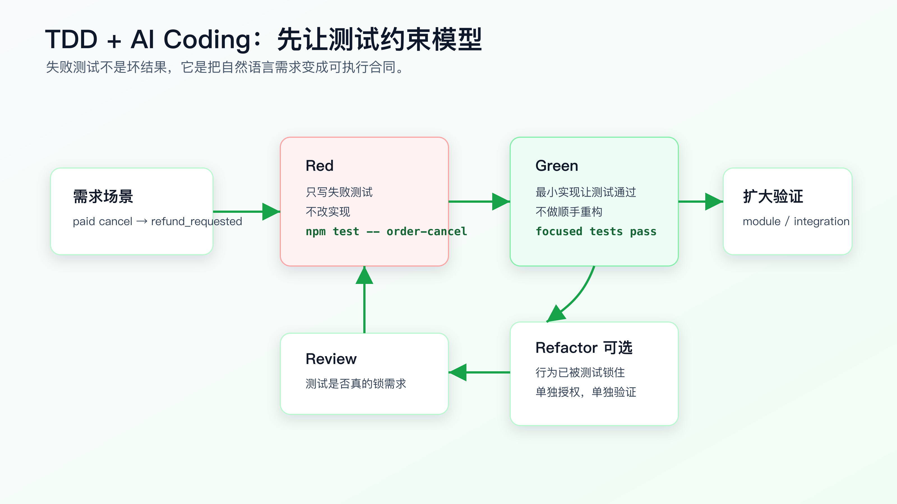
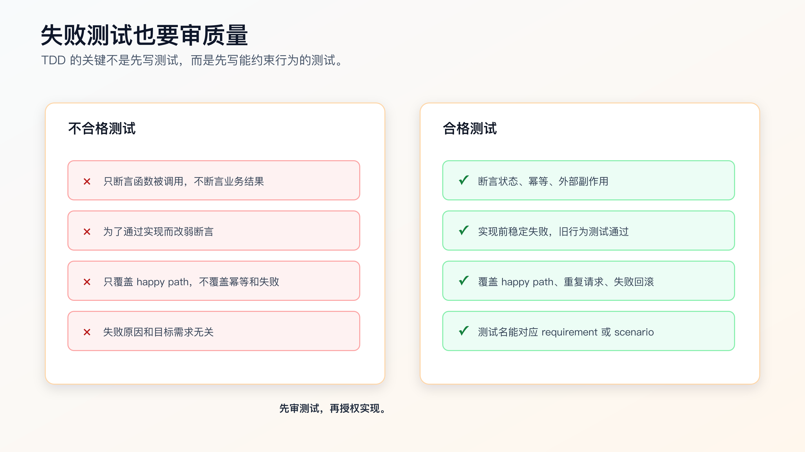

# TDD + AI Coding：先让失败测试约束模型

AI Coding 里，测试不只是验证工具。

测试是约束模型的工具。

你用自然语言告诉 AI：

```text
已支付订单取消后进入退款流程。
```

它可能理解成很多种实现：

- 订单状态直接变成 canceled，然后异步发起退款。
- 订单状态先变成 refund_requested，再创建退款请求。
- 先创建退款请求，再更新订单状态。
- 重复取消时再创建一个退款请求。
- 退款创建失败时仍然把订单状态改掉。

这些实现都可能被模型写得很像样。单靠 prompt，很难保证它选中你真正要的行为。

失败测试的价值，就是把“你想要什么”变成可执行约束。

TDD + AI Coding 的关键不是为了遵守某种开发仪式，而是先让模型面对一个明确的、当前会失败的行为检查，再让它用最小实现把这个检查变绿。



## 为什么测试比自然语言更能约束 AI

自然语言有两个问题。

第一，它容易被补全。

“走退款流程”对不同项目含义不同。模型会根据训练中的常见模式和当前代码片段补全缺失细节。

第二，它很难证明执行结果。

AI 说“我已经处理了幂等”，你还要去看代码判断它是不是真的处理。测试能把这件事变成一个命令结果。

例如需求是：

```text
paid order cancellation should enter refund_requested and create exactly one refund request.
```

一个行为测试可以直接锁住三个事实：

```js
test('paid order cancellation enters refund flow once', async () => {
  const order = await fixtures.createOrder({ status: 'paid' });

  const result = await cancelOrder(order.id);

  assert.equal(result.status, 'refund_requested');
  assert.equal(await refundRequests.countForOrder(order.id), 1);
});
```

这段测试不是为了展示语法。它在告诉 AI：

- 最终状态必须是 `refund_requested`。
- 退款请求必须创建。
- 数量必须是 1。

模型不能用“我觉得这样也合理”绕过去。只要行为不对，测试就失败。

## AI 写测试也要先审

不要直接让 AI “补测试并实现”。

这会让测试配合实现，而不是约束实现。

把测试和实现拆开：

```text
先只写测试。
不改实现。
运行 focused test。
确认测试因为目标行为缺失而失败。
人审测试是否真的表达需求。
再授权最小实现。
```

错误指令：

```text
补测试并实现 paid order cancellation refund flow。
```

指令要先限制实现：

```text
只执行测试步骤，不改实现代码。

请在 `test/order/order-cancel.test.ts` 中新增失败测试，覆盖：
- paid order cancellation enters refund_requested.
- duplicate paid cancellation does not create duplicate refund requests.
- refund request creation failure keeps order paid.

要求：
- 保留 pending 和 shipped cancellation 旧测试。
- 运行 `npm test -- order-cancel`。
- 预期新增 paid/duplicate/failure 用例失败。
- 如果旧测试失败，停止并报告。
```

这个指令的重点是“不改实现代码”。

如果 AI 在测试步骤里顺手改实现，让测试直接通过，你就失去了 TDD 的红灯阶段。看起来效率更高，实际少了最关键的证据：测试是否能在旧实现上抓到问题。

## 失败测试也要审质量

不是所有失败测试都有价值。

有些测试会失败，但失败原因和需求无关；有些测试只断言实现细节；有些测试太弱，随便写个假实现也能通过。



一个合格的失败测试要满足四个条件：

- 失败原因就是目标行为缺失。
- 旧行为的回归测试仍然通过。
- 断言业务结果，而不是只断言内部调用。
- 测试名能对应 requirement 或 scenario。

例如这个测试就偏弱：

```js
test('calls refund service when canceling paid order', async () => {
  const refundService = mockRefundService();
  await cancelOrder(paidOrder.id, { refundService });
  assert.equal(refundService.create.called, true);
});
```

它只证明调用发生过，不证明订单状态正确，不证明幂等，不证明失败时是否回滚。

更好的测试是：

```js
test('paid cancellation creates one refund request and moves order to refund_requested', async () => {
  const order = await fixtures.createOrder({ status: 'paid' });

  const result = await cancelOrder(order.id);

  assert.equal(result.status, 'refund_requested');
  assert.equal(await refundRequests.countForOrder(order.id), 1);
});
```

再补一个幂等测试：

```js
test('duplicate paid cancellation does not create another refund request', async () => {
  const order = await fixtures.createOrder({ status: 'paid' });

  await cancelOrder(order.id);
  await cancelOrder(order.id);

  assert.equal(await refundRequests.countForOrder(order.id), 1);
  assert.equal((await orders.find(order.id)).status, 'refund_requested');
});
```

再补一个失败路径：

```js
test('paid order remains paid when refund request creation fails', async () => {
  const order = await fixtures.createOrder({ status: 'paid' });
  refundRequests.failNextCreate(new Error('provider unavailable'));

  await assert.rejects(() => cancelOrder(order.id));

  assert.equal((await orders.find(order.id)).status, 'paid');
});
```

这三类测试组合起来，需求边界才被测试锁住。

## 不要让 AI 改弱测试

AI 在让测试变绿时，有时会选择修改测试。

比如测试原本断言：

```js
assert.equal(result.status, 'refund_requested');
```

实现做不到时，它可能改成：

```js
assert.ok(['canceled', 'refund_requested'].includes(result.status));
```

测试开始配合实现，约束就失效了。

执行实现步骤时，要明确：

```text
不要修改新增测试的业务断言。
如果测试断言与当前代码冲突，优先修改实现。
如果你认为测试写错，先停止并说明原因，不要直接改测试。
```

测试不是不能改。测试写错时必须改。但修改测试需要重新授权，不能在实现阶段偷偷把约束放松。

一个实用规则：

```text
Red 阶段可以改测试。
Green 阶段默认不改测试断言。
Refactor 阶段只在行为不变时整理测试结构。
```

这能减少 AI 为了通过测试而篡改目标的情况。

## 最小实现比“完整实现”更重要

TDD 的 Green 阶段，不要求一次做完整架构。

它要求用最小实现让当前测试通过。

错误指令：

```text
实现完整退款流程，并顺手优化订单取消代码。
```

指令要限制改动范围：

```text
只让当前失败测试变绿。

允许修改：
- `src/order/order-status-transition.ts`
- `src/order/order-cancel-service.ts`
- 必要时 `src/refund/refund-request-service.ts`

禁止：
- 修改新增测试的业务断言。
- 改 API response shape。
- 改 payment callback。
- 做无关重构。

验证：
- `npm test -- order-cancel`

完成后停止。
```

最小实现不是写烂代码。它的意思是：不要在没有测试约束的地方扩大设计。

如果测试只锁住 paid cancellation，就不要顺手实现退款结算 job。

如果测试只锁住重复取消幂等，就不要顺手改支付回调。

每个新增行为都应该先有测试约束。

## TDD 可以降低 AI 的“自信错”

AI 很容易写出自信但错误的代码。

比如它看到一个 `RefundRequestService.create(orderId)`，就假设它有幂等能力。实际项目里可能没有。

如果先写 duplicate cancellation 测试，模型就会被迫面对：

```text
调用两次 cancelOrder 后，refund request count 仍然必须是 1。
```

它不能只靠猜。

如果实现失败，测试会把问题暴露出来。此时不要让 AI 继续乱改，而是让它解释：

```text
测试失败了。

先不要改代码。
请基于失败输出说明：
- 失败的是哪个 requirement。
- 实际行为是什么。
- 当前实现缺哪一层约束。
- 你准备改哪个文件。
```

这会把调试从“继续尝试”拉回证据循环。

## 什么时候不适合 TDD

不是所有任务都适合严格 TDD。

这些任务可以不用完整 TDD：

- 纯文案、样式、配置调整。
- 很薄的 glue code，已有上层测试覆盖。
- 探索性 spike，目标是理解可行性。
- 大规模机械迁移，重点是脚本和 diff 审查。
- 很难本地构造依赖的外部系统交互。

但即使不用完整 TDD，也应该有验证证据。

例如前端交互可以先用浏览器截图或 Playwright 路径锁行为；外部系统交互可以用契约测试、mock server 或人工验证记录；机械迁移可以用脚本输出和抽样 diff。

TDD 是强约束方式，不是唯一方式。

## 先选测试层级，不要把所有东西塞进一个测试

AI 很容易把一个需求写成一个巨大的端到端测试。这个测试覆盖了页面、接口、数据库、副作用，读起来完整，失败时却很难定位。

TDD 阶段先选测试层级。

| 要约束的行为 | 优先测试层级 | 原因 |
| --- | --- | --- |
| 状态转换规则 | unit / domain test | 反馈快，定位准 |
| API response shape | contract / API test | 锁住调用方合同 |
| 数据持久化和事务 | integration test | 能证明数据库状态 |
| 用户点击路径 | component / E2E | 能证明真实交互 |
| 外部副作用 | service test / fake adapter | 能证明次数、幂等和失败路径 |

订单取消改退款，不应该只靠一个 Playwright 测试证明全部行为。

可以拆成：

```text
domain test: paid -> refund_requested
service test: exactly one refund request is created
API test: response shape unchanged
E2E test: 页面显示退款处理中
```

这样每个失败都有定位依据。

对 AI 来说，测试层级越清楚，它越不容易为了让一个大测试通过而乱改多层代码。

## 测试数据要贴近真实状态

AI 写测试时，经常会造一个过度简化的 fixture：

```js
const order = { status: 'paid' };
```

如果真实取消逻辑需要 `id`、`userId`、`paymentId`、`version`、`shippingStatus`，这个 fixture 可能让测试绕开关键路径。

可以要求：

```text
测试数据必须使用项目已有 fixture factory。
不要手写和生产 schema 不一致的对象。
如果 fixture 缺少能力，先报告需要扩展的字段，不要在测试里造假的最小对象。
```

好的测试数据应该表达业务状态，而不是迎合函数签名：

```js
const order = await fixtures.createOrder({
  status: 'paid',
  paymentStatus: 'captured',
  shippingStatus: 'not_shipped'
});
```

这比 `{ status: 'paid' }` 更能防止 AI 写出只在测试里成立的实现。

## mock 只能隔离边界，不能伪造业务事实

Mock 用得不对，TDD 会变成“测试模型想象中的系统”。

退款请求创建可以 mock 外部支付 provider，但不应该 mock 掉订单状态持久化。如果你要证明订单失败时保持 paid，就必须检查真实 repository 或足够接近真实的测试数据库。

可以写规则：

```text
Allowed mocks:
- external payment provider
- email / SMS / push gateway
- time and id generator

Avoid mocking:
- order status transition logic
- repository behavior under test
- API response serialization being verified
```

如果 mock 掉了正在验证的东西，测试就失去约束力。

比如这个测试不够好：

```js
mockOrderRepository.findById.returns({ status: 'paid' });
mockOrderRepository.save.returns({ status: 'refund_requested' });
```

它证明不了持久化真的发生，只证明 mock 被按预期调用。

更有价值的是用测试数据库或内存 repository 检查最终状态：

```js
const saved = await orders.find(order.id);
assert.equal(saved.status, 'refund_requested');
```

AI 可以写 mock，但你要审 mock 是否隔离的是外部边界，而不是掩盖核心行为。

## 红灯、绿灯、整理阶段要分开授权

TDD 的三个阶段在 AI Coding 里要拆成三次授权。

Red：

```text
只写失败测试。
不改实现。
运行 focused test。
报告失败是否符合预期。
```

Green：

```text
只做最小实现。
不改弱测试断言。
不做无关重构。
运行 focused test。
```

Refactor：

```text
只做行为不变的整理。
不新增功能。
所有相关测试必须保持通过。
输出重构前后 diff 摘要。
```

不要把 Green 和 Refactor 合并。AI 很容易在“让测试通过”的同时整理结构，最后你不知道行为变化来自哪里。

如果 Green 阶段代码确实很丑，可以先接受一个小的可工作实现，再单独开 Refactor 步骤。重构要靠已有测试保护，而不是靠 AI 自信。

## 红灯证据要写进记录

TDD 最容易被做成形式：文章里说先写测试，实际执行时没人保留红灯证据。

至少记录三件事：

```markdown
Red evidence:
- command: `npm test -- order-cancel`
- expected failing tests:
  - paid cancellation enters refund flow
  - duplicate paid cancellation creates one refund request
  - refund request failure keeps order paid
- existing tests:
  - pending cancellation passed
  - shipped cancellation passed
```

这段记录有两个作用。

第一，它证明新测试不是写完就被实现配合通过。
第二，它证明旧行为没有在 Red 阶段先坏掉。

如果没有红灯证据，reviewer 很难判断测试是不是事后补的。事后补测试不一定没价值，但它和 TDD 不是一回事。

## 审 AI 写的测试，先看四个问题

AI 生成测试草稿后，不要只看能不能跑。

先问四个问题：

```text
它是否对应某条 requirement？
它是否会在旧实现上失败？
它是否断言用户可见行为、持久化状态或副作用结果？
它是否依赖过度 mock 或伪造 fixture？
```

如果答案不清楚，让 Agent 先解释：

```text
请逐条说明新增测试对应哪个 requirement。
请说明为什么这些测试会在当前实现上失败。
请说明每个 mock 隔离的是外部边界还是核心行为。
```

这一步很实用。AI 有时会写很多测试，但只有一两个真正约束需求。测试数量不是质量，约束力才是质量。

## 什么时候可以接受事后补测试

生产项目里并不是所有改动都能严格 TDD。有时你是在排障，有时需要先做 spike，有时现有代码很难构造红灯。

事后补测试可以接受，但要诚实记录：

```markdown
Testing note:
- This was not strict TDD.
- Implementation came first because the failure required exploratory debugging.
- Regression test was added after root cause was confirmed.
- Test fails if the fix is reverted.
```

这比假装做了 TDD 更专业。

事后补测试的最低标准是：回退修复后测试会失败。否则它只是覆盖现状，不一定能防回归。

## 契约测试适合防 AI 改坏接口

很多 AI 实现会在不知不觉中改接口合同。

比如原 response 是：

```json
{
  "id": "123",
  "status": "canceled",
  "message": "ok"
}
```

实现退款流程后，AI 可能改成：

```json
{
  "orderId": "123",
  "state": "refund_requested",
  "refundRequestId": "r_1"
}
```

新结构可能更“合理”，但调用方会坏。

这类问题适合用契约测试先锁住：

```js
test('cancel order response shape remains compatible', async () => {
  const response = await request.post('/api/orders/paid-order-1/cancel');
  const body = await response.json();

  assert.deepEqual(Object.keys(body).sort(), ['id', 'message', 'status'].sort());
  assert.equal(body.status, 'refund_requested');
});
```

这不是为了迷信字段列表，而是告诉 Agent：这次只允许状态值变化，不允许 response shape 变化。

只要需求涉及 API、事件、队列消息、配置文件、CLI 输出，都可以考虑契约测试。AI 最容易在这些边界上“顺手优化”。

## 外部依赖要用 fake 或 contract，不要真的打生产服务

TDD 里遇到支付、短信、邮件、AI 模型、第三方 API，不应该真的调用生产服务。

可以选择：

- fake adapter：本地实现同样接口，记录调用次数和参数。
- mock server：模拟第三方响应和失败。
- contract test：验证请求 shape 和错误处理。
- staging 手工验证：作为上线前补充，不替代本地测试。

订单退款场景里，测试应该证明：

```text
refund request creation is called once.
idempotency key is stable.
failure keeps order paid.
payment callback code is untouched.
```

不应该在单元测试里真的请求支付渠道。

写给 Agent 的规则可以是：

```text
Do not call real external services in tests.
Use the existing fake provider or test adapter.
If no fake exists, stop and propose a minimal fake boundary before implementation.
```

没有 fake 时，不要让 AI 在业务测试里临时写一个和真实接口完全不相干的 mock。先定义边界，再写测试。

## 测试维护也要小步

AI 改实现时，测试也可能需要整理。但测试维护要和行为断言分开。

可以拆成：

```text
Step A: 添加新行为测试，保留旧测试结构。
Step B: 最小实现让测试通过。
Step C: 如果测试重复严重，再整理测试 helper。
```

不要在 Step A 里大规模重写旧测试。旧测试是你的 baseline，重写 baseline 会让你失去判断新需求影响的依据。

如果确实要改测试 helper，要求 Agent 证明行为不变：

```text
只重构测试 helper。
不改变任何业务断言。
重构前后同一测试命令都必须通过。
输出断言变化清单，如果断言变化为 0，请明确说明。
```

测试代码也是生产资产。AI 可以帮助维护，但不能让它在实现阶段随意削弱约束。

## 怎么把 TDD 写进 tasks

在 `tasks.md` 里，不要只写“补测试”。

要写成：

```markdown
## Task 1: Add failing behavior tests

Goal:
- Convert paid cancellation requirements into executable checks.

Files:
- `test/order/order-cancel.test.ts`

Add tests:
- paid cancellation moves order to refund_requested and creates one refund request.
- duplicate paid cancellation does not create another refund request.
- refund request creation failure keeps order paid.

Verify:
- `npm test -- order-cancel`

Expected before implementation:
- existing pending and shipped tests pass.
- new paid, duplicate and failure tests fail.

Stop if:
- existing behavior tests fail before implementation.
- test setup cannot create paid orders.
```

再写实现任务：

```markdown
## Task 2: Make focused tests pass with minimal implementation

Files:
- `src/order/order-status-transition.ts`
- `src/order/order-cancel-service.ts`
- `src/refund/refund-request-service.ts`

Verify:
- `npm test -- order-cancel`

Rules:
- Do not weaken Task 1 assertions.
- Do not change public API response shape.
- Do not modify payment callback flow.

Stop if:
- database schema changes are required.
- refund idempotency requires a broader design decision.
```

这样的 tasks 能直接驱动 AI 小步执行。

## 用本项目的测试看一个真实边界

配套工程的工具 module `ai-coding-workflow-kit` 里有一个很小的验证记录校验器。它不是业务系统，但测试展示了一个真实边界：AI 声称“验证完成”时，至少要有必要段落、命令块和通过信号。

对应测试长这样：

```js
test('reports missing sections and missing command evidence', () => {
  const result = validateLedger('## Baseline\nNo command yet.');
  assert.equal(result.ok, false);
  assert.deepEqual(result.missing, [
    'Change Summary',
    'Verification Commands',
    'Evidence',
    'Residual Risk'
  ]);
  assert.equal(result.hasCommand, false);
  assert.equal(result.hasPassedSignal, false);
});
```

它锁住的不是语法，而是行为：缺段落、缺命令、缺通过信号时不能被认为可用。

如果让 AI 改这个校验器，正确的 TDD 步骤不是“优化校验逻辑”，而是先补一个失败测试。例如要求 ledger 必须包含 baseline 命令：

```js
test('requires baseline command evidence', () => {
  const result = validateLedger(`
## Baseline
Existing failure was mentioned but no command was recorded.

## Change Summary
Restricted status transition.

## Verification Commands
\`\`\`bash
npm test
\`\`\`

## Evidence
PASS 12 tests passed.

## Residual Risk
Manual payment provider callback not covered.
`);

  assert.equal(result.ok, false);
});
```

这个测试失败后，再让 AI 修改 `verification-ledger.js`。这样它会被测试约束在“baseline 也要有命令证据”这个行为上，而不是随手重写整个校验器。

这里不是为了造代码，而是为了说明一个能迁移到多数项目的原则：先把你担心的失败模式写成测试。

## 常见错误

**错误一：让 AI 同时写测试和实现。**

这样看不到测试是否能在旧实现上失败，也容易让测试配合实现。

**错误二：只测 happy path。**

真实问题常出在重复请求、失败回滚、兼容性和边界状态。

**错误三：断言内部调用，不断言业务结果。**

内部调用可以作为补充，但核心测试要断言状态、数据、副作用和错误行为。

**错误四：实现阶段修改测试断言。**

测试写错可以改，但必须停下来说明原因并重新授权。

**错误五：测试失败后让 AI 自由修。**

先分类失败，再决定改测试、改实现还是停住。

**错误六：把 TDD 用在所有任务上。**

小文案、小配置、探索 spike 不一定需要 TDD，但仍然需要对应验证证据。

## 改完后重点看什么

TDD + AI Coding 做完后，看这些结果：

- 新测试是否先在旧实现上失败过。
- 失败原因是否对应目标需求。
- 旧行为测试是否仍然通过。
- 实现阶段是否改弱了测试断言。
- 最小实现是否只覆盖当前测试约束的行为。
- 后续是否扩大了模块测试或集成验证。

如果没有红灯证据，TDD 就只剩“先写了测试”的形式。

红灯记录还会影响后续排障。后面如果 CI 出现同一失败，reviewer 能判断它是预期红灯、旧失败，还是当前实现引入的新失败。

AI Coding 里的 TDD，是把模型从“根据文字猜实现”拉到“根据可执行行为收敛实现”。测试红灯比多写几句 prompt 更能约束结果。

## 常见问题

**让 AI 写测试靠谱吗？**

可以，但要先审测试。AI 很适合根据 requirement 生成测试草稿，不适合无人审查地决定测试是否充分。

**失败测试是不是必须真的跑一遍？**

复杂行为建议跑。没有红灯结果，你不知道测试是否能抓住旧实现的问题。跑不了时要记录原因和替代证据。

**测试写错了怎么办？**

停下来改测试。不要在实现阶段悄悄改断言。把“为什么测试错了”写清楚，再重新进入 Red 阶段。

**已有测试很多，还需要新测试吗？**

看现有测试是否覆盖目标 requirement。如果没有覆盖新增行为、幂等和失败路径，就需要补。

**TDD 会不会让 AI 速度变慢？**

单次输出会变慢，但减少返工。对状态机、权限、支付、持久化这类风险高的任务，红灯证据很值。

## 可复查资料

- Node.js Test Runner 官方文档：<https://nodejs.org/api/test.html>
- Jest getting started：<https://jestjs.io/docs/getting-started>
- Martin Fowler: TestDrivenDevelopment：<https://martinfowler.com/bliki/TestDrivenDevelopment.html>
- OpenAI Codex best practices：<https://developers.openai.com/codex/learn/best-practices>

---

[课程首页](../../../README.md) · [完整目录](../README.md) · [← 小步开发：为什么要限制 AI 一次改动范围](23-%E5%B0%8F%E6%AD%A5%E5%BC%80%E5%8F%91-%E4%B8%BA%E4%BB%80%E4%B9%88%E8%A6%81%E9%99%90%E5%88%B6-AI-%E4%B8%80%E6%AC%A1%E6%94%B9%E5%8A%A8%E8%8C%83%E5%9B%B4.md) · [系统化调试：让 AI 基于证据排障 →](25-%E7%B3%BB%E7%BB%9F%E5%8C%96%E8%B0%83%E8%AF%95-%E8%AE%A9-AI-%E5%9F%BA%E4%BA%8E%E8%AF%81%E6%8D%AE%E6%8E%92%E9%9A%9C.md)

动手实践：[业务样例与测试](../../../personal-productivity-app/README.md)
