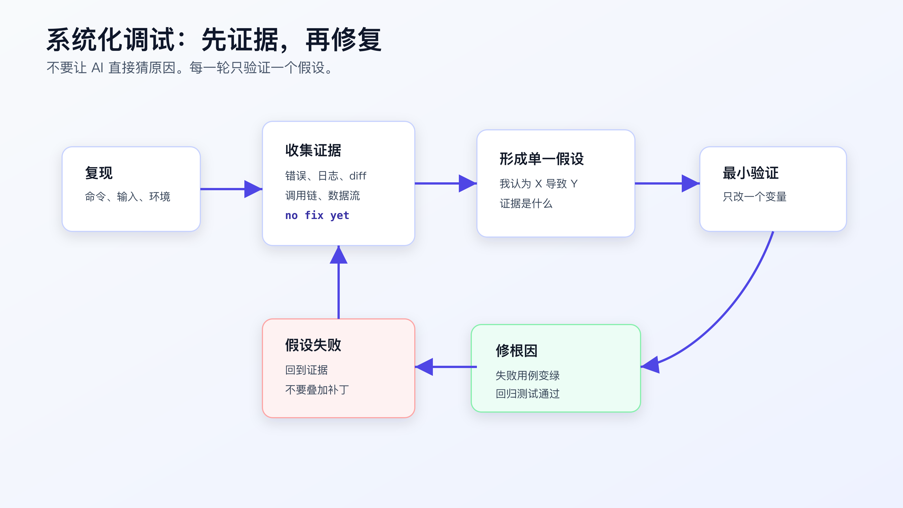
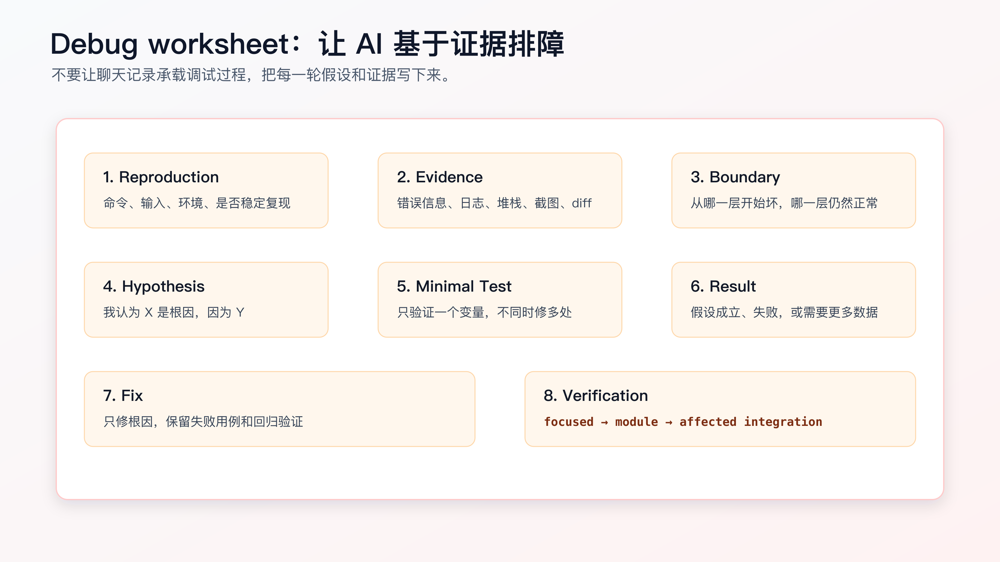

# 系统化调试：让 AI 基于证据排障

AI 写代码快，猜原因也快。

这在调试时很危险。

你贴一段报错：

```text
TypeError: Cannot read properties of undefined (reading 'status')
```

AI 很可能马上给出修复建议：

```text
这里加一个空值判断即可。
```

有时它是对的。更多时候，它只是把症状压下去了。真正的问题可能是上游查询没有返回订单、mock 数据漏字段、异步初始化顺序错了、接口响应 shape 变了，或者测试环境没有加载 fixture。

调试不是“看到错误就修”。调试是先证明问题从哪里开始，再修根因。

AI Coding 里的系统化调试，就是强制 Agent 先走证据循环：

```text
复现 -> 收集证据 -> 缩小边界 -> 提出单一假设 -> 最小验证 -> 修根因 -> 回归
```



## 先禁止直接修

调试任务的第一条指令，应该是：

```text
先不要修改代码。
```

这句话要放在最前面。

很多 Agent 默认会进入“修复模式”。它看到错误，就尝试补空值、改条件、重跑测试。如果第一次没过，再补一层判断。几轮之后，原始错误可能没了，但代码里多了一堆防御性分支，根因仍然存在。

调试输入可以这样写：

```text
先不要修改代码。

请基于下面的错误输出做系统化排障：
- 读完整错误和堆栈。
- 找到触发命令。
- 说明是否能稳定复现。
- 找出最近相关 diff。
- 沿调用链追踪 `status` 从哪里来。
- 只提出一个最可能假设。
- 给出最小验证动作。

在我确认前，不要修复。
```

这能把 AI 从“猜修复”切到“找证据”。

## 复现要写成命令，不要写成感觉

很多调试失败，是因为复现不清。

坏记录：

```text
订单取消测试偶尔失败。
```

好记录：

```bash
npm test -- order-cancel
```

输出：

```text
FAIL test/order/order-cancel.test.ts
TypeError: Cannot read properties of undefined (reading 'status')
  at cancelOrder (src/order/order-cancel-service.ts:42:18)
  at test/order/order-cancel.test.ts:87:24
```

还要记录：

```text
Reproduction:
- command: `npm test -- order-cancel`
- frequency: 5/5
- branch: `feature/paid-cancel-refund`
- last known passing state: before Task 3
```

如果不能稳定复现，不要让 AI 直接修。

应该先收集更多数据：

```text
这个失败不是稳定复现。
请先提出可以增加的诊断信息：
- 日志位置
- 关键变量
- 组件边界
- 需要重复运行的命令
不要修改业务逻辑。
```

不稳定问题最怕随机补丁。先让它变得可观察。

## 读完整错误，不要只读最后一行

AI 很容易被错误最后一行带偏。

例如：

```text
Cannot read properties of undefined (reading 'status')
```

最后一行说 `status` 是 undefined，但根因不一定在读取这一行。要看：

- 哪个对象是 undefined。
- 它从哪个函数返回。
- 这个函数的输入是什么。
- 输入为什么变了。
- 最近 diff 是否改过 fixture、mock、查询条件或状态转换。

可以让 AI 这样做：

```text
请完整读取堆栈。

输出：
- first failing line
- caller chain
- value that became undefined
- where this value is created
- which recent change could affect it
```

如果它直接给修复方案，要求它回到证据：

```text
先不要修。
你还没有证明 `order` 为什么是 undefined。
请沿调用链往上追踪来源。
```

## 沿数据流往上追

深层错误要逆着调用链追。

比如错误发生在：

```js
if (order.status === 'paid') {
  // ...
}
```

不要先加：

```js
if (!order) throw new Error('order not found');
```

这可能只是把错误换了个形式。

先追：

```text
order 从哪里来？
```

可能是：

```js
const order = await orderRepository.findById(orderId);
```

继续追：

```text
orderId 从哪里来？
```

可能是测试里：

```js
const order = await fixtures.createOrder({ state: 'paid' });
await cancelOrder(order.id);
```

再追：

```text
fixtures.createOrder 返回的 id 是否真实落库？
```

这时可能发现根因：Task 3 改了 fixture 默认字段，把 `status` 写成 `state`，repository 查询条件仍然按 `status` 查。

要修的不是 `cancelOrder` 的空值判断，而是 fixture 或 repository 的字段映射。

根因和症状的差别就在这里。

## 一次只提出一个假设

AI 调试时常见坏味道是一次给多个可能原因：

```text
可能是数据未初始化、异步时序问题、mock 配置错误或状态字段不一致。
```

这没有错，但不能直接进入修复。

下一步要选一个最可能假设，并说明证据：

```text
Hypothesis:
- `fixtures.createOrder` now writes `state`, but `orderRepository.findById` expects `status`.

Evidence:
- failing test creates order through fixture.
- stack shows `order` is undefined inside cancel service.
- recent diff changed fixture field names.
- repository query still filters by `status`.

Minimal verification:
- inspect the created fixture record before cancel.
- run only `npm test -- order-cancel -- --test-name-pattern paid`.
```

这才是可验证假设。

如果假设失败，不要叠加第二个补丁。回到证据：

```text
这个假设不成立。
请记录验证结果，并基于新证据提出一个新的单一假设。
```

调试最怕“改一点再改一点”。每一轮必须能说明上一轮假设为什么成立或失败。

## 最小验证动作不是完整修复

假设阶段的验证动作应该尽量小。

例如怀疑 fixture 字段写错，可以先加临时诊断或直接查看测试数据，而不是马上改业务代码。

可用动作包括：

```bash
npm test -- order-cancel -- --test-name-pattern paid
git diff -- test/order/order-cancel.test.ts
rg -n "createOrder|status|state" test src
```

前端问题可以用 Playwright 调试：

```bash
npx playwright test order-cancel.spec.ts --debug
```

CI 问题可以先看 workflow logs。GitHub Actions 官方文档也把 workflow run logs 作为排障入口。不要在本地猜一个“可能的环境变量问题”，先看日志里哪一步失败、输入是什么、环境差异是什么。

最小验证的原则：

```text
一次只验证一个变量。
不要把验证动作和修复动作混在一起。
```

## 修复前最好有失败用例

如果问题能被测试表达，先写失败用例。

例如你确认根因是 duplicate cancel 会创建两条退款请求，那么修复前先补：

```js
test('duplicate paid cancellation creates only one refund request', async () => {
  const order = await fixtures.createOrder({ status: 'paid' });

  await cancelOrder(order.id);
  await cancelOrder(order.id);

  assert.equal(await refundRequests.countForOrder(order.id), 1);
});
```

然后再修。

如果问题很难写自动化测试，也要保留复现脚本、日志、截图或命令输出。不要只让 AI 写“已修复”。

修复阶段的指令可以写：

```text
现在只修已确认根因：duplicate paid cancellation lacks idempotency.

要求：
- 保留刚才新增的失败测试。
- 只修改 refund request 幂等逻辑。
- 不改 API response shape。
- 不改 payment callback。
- 跑 `npm test -- order-cancel`。
- 完成后停止。
```

这和“修一下测试失败”完全不同。

## 多层系统要定位坏在哪一层

真实项目常见的调试不是单函数问题，而是多层链路：

```text
前端页面 -> API -> service -> repository -> database
```

或者：

```text
CI workflow -> build script -> test command -> environment variables
```

这时不要在最深处猜。

要按边界收集证据：

```text
API 收到的 payload 是什么？
service 传给 repository 的参数是什么？
repository 返回了什么？
数据库里实际记录是什么？
测试 fixture 写入了什么？
```

可以让 AI 先画出链路：

```text
先不要修。
请画出这条失败路径的数据流：
- test input
- service call
- repository query
- database record
- returned object

标出每一层当前证据和缺失证据。
```

然后只补缺失证据。

不要让 AI 直接“检查一下相关代码”。先让它补齐缺失证据。

## 证据要分三层

调试时，证据可以分成三层。

第一层是症状证据：

```text
哪个命令失败。
哪条断言失败。
实际值和期望值是什么。
第一条错误在哪里。
```

第二层是路径证据：

```text
失败路径经过哪些函数、组件、接口、配置。
本次 diff 改了哪些路径上的文件。
哪些路径没有被改。
```

第三层是根因证据：

```text
哪个输入、状态、数据或环境变量导致错误。
用什么最小验证证明它就是根因。
修复后同一证据如何变化。
```

很多 AI 调试只停在第一层：看到错误，补一个判断。系统化调试要求至少走到第二层，复杂问题要走到第三层。

可以让 Agent 按这个格式输出：

```markdown
Evidence layers:

Symptom:
- `npm test -- order-cancel` fails on duplicate paid cancellation.
- Expected refund request count 1, received 2.

Path:
- test -> `cancelOrder` -> `RefundRequestService.create`
- changed files include cancel service and refund request service.

Root cause candidate:
- refund request creation lacks idempotency by order id.

Minimal verification:
- call cancel twice and inspect refund request count.
```

这比“可能是幂等问题”更可审。

## Debug worksheet 可以固定下来

调试过程不要只留在聊天里。

可以在任务目录里放一个 `debug.md`：



模板如下：

```markdown
# Debug Worksheet

## Reproduction
- Command:
- Frequency:
- Environment:
- Last known passing state:

## Error
- First failing line:
- Full stack:
- Actual:
- Expected:

## Evidence
- Recent diff:
- Relevant files:
- Logs / screenshots:
- Data flow:

## Boundary
- Works:
- Fails:
- Unknown:

## Hypothesis
- I think:
- Because:

## Minimal Verification
- Command or check:
- Expected result:

## Result
- Confirmed / rejected:
- New evidence:

## Fix
- Root cause:
- Changed files:
- Why this fixes root cause:

## Verification
- Focused:
- Broader:
- Residual risk:
```

这个文件不需要每次都完整填写。遇到复杂 bug、CI 失败、线上问题、间歇性测试失败时，它能减少排障时的遗漏。

## 调试时怎么和 AI 对话

可以按阶段给指令。

复现阶段：

```text
先不要改代码。
请读取失败输出，整理 reproduction、first failing line、caller chain。
如果信息不足，只列出需要补充的命令。
```

证据阶段：

```text
请使用 `rg` 查找相关调用点和最近修改文件。
输出 working path 和 failing path 的差异。
不要提出修复。
```

假设阶段：

```text
基于当前证据，只提出一个最可能根因。
写出支持证据、反证可能、最小验证动作。
```

修复阶段：

```text
只修已确认根因。
不做无关重构。
保留失败测试。
跑指定验证命令。
完成后停止。
```

回归阶段：

```text
请汇总：
- root cause
- changed files
- focused verification
- broader verification
- residual risk
```

这样做会让 AI 少猜很多。

## 什么时候要停下来回到设计

调试中经常会发现：问题不是一个 bug，而是设计假设错了。

比如订单取消失败，看起来是空指针，追下去发现根因是：

```text
paid -> refund_requested 需要事务保证，
但当前实现先更新订单状态，再创建退款请求。
退款请求失败后，订单已经变成 refund_requested。
```

这不是加空值判断能解决的问题。它涉及状态更新和副作用顺序，应该回到 design。

出现下面情况，要停止调试并升级为设计问题：

- 修复需要改变事务边界。
- 修复需要改变 public API response shape。
- 修复需要新增状态、事件或数据库字段。
- 根因涉及多个入口共用规则。
- 当前 tests 无法表达正确行为，需要重写 requirement。
- 需要引入新依赖或新基础设施。

这时可以写：

```markdown
Debug result:
- Symptom: refund request failure leaves order in wrong state.
- Root cause: state is persisted before side effect succeeds.
- This is a design boundary issue, not a local null-check bug.

Action:
- stop implementation.
- update design.md failure handling.
- update tasks.md with transaction / rollback behavior.
- add failing test before changing implementation.
```

AI 调试时最容易一路修下去。程序员要判断这是不是还在 bug 修复范围内，还是已经进入设计变更。

## CI 失败不要直接本地乱改

CI 失败经常和本地不同。

常见差异包括：

- Node、Java、Python 版本不同。
- 环境变量缺失。
- 数据库、浏览器、系统依赖不同。
- 测试顺序不同。
- 时区、locale、文件路径不同。
- 缓存或依赖锁文件问题。

看到 CI 红，不要直接说：

```text
修复 CI。
```

更好的输入：

```text
先不要改代码。
请根据 CI 日志做排障：
- 哪个 job、step、command 失败。
- 本地是否有同样命令。
- CI 环境和本地环境差异。
- 最近 diff 是否影响该 step。
- 最小复现命令是什么。
- 一个最可能假设是什么。
```

如果本地无法复现，就不要假装已经验证。要写清：

```text
Not locally reproduced.
Evidence from CI log:
- ...
Next verification:
- rerun failed job after config change
```

这比“本地测试通过，应该没问题”可靠得多。

## 间歇性失败先提高可观察性

间歇性失败最容易被 AI 随机修坏。

比如：

```text
order-cancel E2E occasionally fails waiting for 退款处理中.
```

不要马上加超时。

先收集：

- 失败频率。
- 失败时网络请求是否成功。
- 前端状态是否更新。
- 后端日志里订单状态是什么。
- 测试数据是否唯一。
- 是否有并发测试污染。

可以让 Agent 先做诊断计划：

```text
先不要修改业务逻辑。
请为这个 flaky test 设计诊断步骤：
- 需要增加哪些临时日志或 trace。
- 需要重复运行哪个命令多少次。
- 如何区分前端等待问题、接口失败、数据污染和异步竞态。
- 哪些诊断改动最终必须删除。
```

Playwright 的 trace、截图、视频、网络日志都能帮助定位。后端测试可以加唯一 id、隔离数据库、固定时间和随机数。

只有确认是等待条件不准确，才考虑调整等待逻辑。没有证据时直接把 timeout 从 5 秒改 30 秒，通常只是把问题藏起来。

## 修复后要删除诊断噪音

调试过程中可能会加日志、临时断言、临时脚本。这些东西不一定都该进最终 diff。

修复完成后，让 Agent 自查：

```text
请检查本次 diff 中是否还有临时诊断内容：
- console.log / print / debug output
- temporary comments
- skipped tests
- widened timeouts
- broad catch blocks
- diagnostic-only scripts

如果保留，请说明为什么它是生产需要，而不是调试残留。
```

调试残留很常见，尤其是 AI 修复多轮失败后。它可能留下过宽的 catch、过长的 timeout、无意义日志，表面上测试通过，代码质量下降。

真正的修复应该比调试过程干净。

## 修复说明要能被 reviewer 复查

调试完成后，不要只写“修复了空指针”。

可复查的修复说明应该包含：

```markdown
Root cause:
- `fixtures.createOrder` wrote `state`, but repository lookup expected `status`.

Fix:
- align fixture field with production schema.
- keep repository query unchanged.

Why this is root cause:
- before fix, created test record lacked `status`.
- after fix, `orders.find(order.id)` returns the paid order.

Verification:
- `npm test -- order-cancel -- --test-name-pattern paid`: PASS
- `npm test -- order-cancel`: PASS

Not changed:
- cancel service null handling
- API response shape
- payment callback flow
```

这段说明能让 reviewer 复查：修的是根因，不是把症状掩盖掉。

如果修复说明写不出“为什么这就是根因”，说明调试还没完成。

## 回归验证不能只跑失败用例

失败用例通过，只能证明当前症状消失。

修复后至少要跑两层：

```text
focused reproduction:
- 证明原失败用例通过。

neighbor regression:
- 证明相邻旧行为没坏。
```

订单取消例子里，修 duplicate paid cancellation 后，不能只跑 duplicate 测试。还要跑 pending、paid、shipped、refund failure 这些相邻路径。

可以要求 Agent：

```text
修复后请运行：
1. 原失败用例。
2. 同文件全部测试。
3. 受影响模块测试。

分别说明每个命令证明什么。
```

如果只跑原失败用例，很可能把一个 bug 修成另一个 bug。

## 一个 CI 失败案例：本地绿，CI 红

假设本地验证通过：

```text
npm test -- order-cancel
PASS
```

但 CI 失败：

```text
FAIL test/order/order-cancel.test.ts
duplicate paid cancellation creates one refund request
Expected: 1
Received: 2
```

不要让 AI 直接“修 CI”。先让它整理差异：

```markdown
CI evidence:
- job: test-linux
- command: `npm test -- order-cancel`
- failing test: duplicate paid cancellation creates one refund request
- actual: 2 refund requests
- expected: 1 refund request

Local evidence:
- same command passed locally.

Diff surface:
- `src/order/order-cancel-service.ts`
- `src/refund/refund-request-service.ts`
- no lockfile change
- no CI config change

Environment difference:
- CI runs tests in parallel.
- local run uses default serial mode.
```

这时一个合理假设是：幂等逻辑在并发情况下不成立。

最小验证不是改代码，而是先复现并发：

```text
Minimal verification:
- run duplicate cancellation test with parallel workers or concurrent requests.
- inspect whether idempotency key has unique constraint.
- inspect refund request creation transaction.
```

修复可能需要数据库唯一约束、事务或 upsert。这个结论已经超出“本地绿 CI 红”的表面现象。

如果直接加 sleep、延长 timeout、重试测试，可能让 CI 暂时绿，但生产里的重复退款问题仍然存在。

这个案例说明：CI 失败不是麻烦，它经常暴露本地没覆盖的执行条件。让 AI 基于 CI 证据排障，才能避免把真实并发问题当成环境问题。

## 给 Agent 的排障指令可以固定成四段

复杂调试时，直接贴错误让 AI 发挥，通常会得到一堆猜测。可以把指令固定成四段。

第一段，先锁住只读：

```text
先不要修改代码。
你现在只做排障，不做修复。
```

第二段，要求复现和证据：

```text
请整理：
- failing command
- first failing line
- actual vs expected
- stack / caller chain
- changed files that may affect this failure
```

第三段，要求单一假设：

```text
只提出一个最可能根因。
必须写支持证据和反证可能。
不要列 5 个可能原因后直接修。
```

第四段，要求最小验证：

```text
给出一个最小验证动作。
验证动作不能同时修改业务逻辑。
验证完成前不要进入修复。
```

完整指令可以这样写：

```text
先不要修改代码。

请对下面失败做系统化排障：
1. 记录 failing command、first failing line、actual vs expected。
2. 沿调用链找出值从哪里来。
3. 对照 git diff，判断失败路径是否经过本次修改。
4. 只提出一个最可能根因。
5. 给出最小验证动作。

输出排障报告，不要修复。
```

这段指令的重点不是格式，而是阻止 AI 从错误直接跳到补丁。

## 排障报告的最低标准

一次排障报告至少要包含：

```markdown
## Reproduction
- command:
- frequency:
- environment:

## Failure
- failing test / scenario:
- actual:
- expected:
- first failing line:

## Path
- caller chain:
- data source:
- changed files on path:

## Hypothesis
- root cause candidate:
- supporting evidence:
- possible counter-evidence:

## Minimal verification
- command / check:
- expected result:

## Stop condition
- what would make this a design issue:
```

如果 Agent 输出里没有 command、actual/expected、caller chain，只给修复建议，直接退回。

调试工作不是靠“看起来懂了”推进，而是靠每一步证据能被复查。

## 不要把防御性代码当成修复

AI 调试时最常见的“假修复”是加防御性代码。

比如：

```js
if (!order) {
  return null;
}
```

或者：

```js
if (!order?.status) {
  return { status: 'unknown' };
}
```

这类代码可能让报错消失，但它没有解释为什么订单不存在，也没有证明业务应该返回 `null` 或 `unknown`。

防御性代码只有在满足下面条件时才合理：

- 这个输入在生产中确实可能为空。
- requirements 或接口合同定义了空值行为。
- 有测试覆盖空值路径。
- 不会掩盖上游数据错误。

否则它只是把异常藏起来。

可以要求 Agent：

```text
如果你建议加 guard clause，请先证明：
- 空值是合法业务输入，还是上游 bug。
- 合法时应该返回什么。
- 哪个测试覆盖这个分支。
- 为什么不是修上游数据来源。
```

这条规则能挡住大量“看起来稳妥”的错误修复。

## 线上问题要保留可复现材料

线上问题不一定能在本地完全复现，但也不能只靠文字描述。

至少保留：

```text
request id / trace id
时间范围
用户角色或租户
关键日志
输入 payload
实际响应
相关数据快照
当前版本或 commit
```

给 Agent 时，先脱敏，再让它基于这些材料找路径。

```text
先不要修改代码。
基于以下脱敏 trace，找出请求经过的代码路径和可能的状态来源。
不要根据业务常识猜测缺失字段。
```

线上排障尤其不能让 AI 直接改。它缺少生产上下文，必须先把 trace、日志、数据和代码路径对齐。

## 调试后的 PR 描述要写根因，不写过程流水

PR 里不用贴完整 debug worksheet，但要留下能审的摘要。

```markdown
Root cause:
- Duplicate paid cancellation created two refund requests because refund creation was not guarded by an idempotency key.

Fix:
- Use `order:<orderId>:cancel` as idempotency key.
- Reuse existing refund request when the key already exists.

Verification:
- `npm test -- order-cancel`: PASS
- duplicate paid cancellation test added
- refund failure path still keeps order paid

Not changed:
- payment provider callback
- public API response shape
```

这样的摘要比“修复重复取消问题”更有价值。它让 reviewer 能判断修复是否对着根因，测试是否覆盖风险，边界是否保持。

## 调试完成后的上线前检查

调试修复进入交付前，再做一遍短检查：

```text
Root cause:
- 是否一句话说得清。

Patch:
- 是否只改根因相关文件。
- 是否没有临时日志、skip、only、扩大 timeout。

Regression:
- 原失败用例是否通过。
- 相邻路径是否通过。
- broader command 是否跑过或记录了原因。

Risk:
- 是否改变接口、数据、权限、副作用。
- 是否有未验证外部依赖。
```

这段检查适合放在 PR 自查里。

AI 可以协助生成自查报告，但你要用 diff 和命令输出核对。尤其要看它有没有为了让测试通过而保留不该保留的诊断代码。

如果调试修复很小，也至少保留：

```text
root cause + changed files + verification command
```

没有这三项，后续再出问题时很难判断当时修了什么。

还有一个简单判断：如果你删掉修复代码，原失败用例不会重新失败，那这个用例就没有锁住根因。此时要补回归测试，或者至少保留可复现脚本。否则这次调试只是一次临时处理，不能算真正闭环。

如果修复依赖外部条件，例如特定时区、特定浏览器、特定 CI runner，也要把条件写进记录。否则后续换环境后，同一个问题会被重新误判。

还有一种检查很有用：反证检查。

修复后可以让 Agent 回答：

```text
如果这个根因判断是错的，哪些现象应该不会出现？
当前证据里有没有反例？
有没有其它假设也能解释同一组现象？
我们是否验证过这些假设？
```

这不是让流程变学术，而是防止“第一个看起来合理的解释”变成根因。线上问题、CI 偶发失败、异步竞态、缓存问题，尤其需要这一步。

反证检查还可以帮助你判断是否应该继续让 Agent 修改代码。如果仍有多个假设能解释同一现象，下一步应该是补证据，而不是补补丁。

## 常见错误

**错误一：看到报错就补空值判断。**

空值判断可能需要，但先证明为什么为空。

**错误二：一次改多个可能原因。**

同时改 fixture、service、repository，最后不知道哪个修好了问题。

**错误三：没有复现命令。**

没有复现，就没有可靠验证。

**错误四：只读最后一行错误。**

堆栈、上游调用、最近 diff 才能定位根因。

**错误五：调试过程只留在聊天记录。**

复杂问题要沉淀 debug worksheet，否则后面很难复盘。

**错误六：CI 失败按本地经验猜。**

先看 CI job、step、command、环境差异和日志。

## 改完后重点看什么

一次调试完成后，看这些结果：

- 是否有稳定复现或明确说明无法稳定复现。
- 是否定位到 first failing line 和上游来源。
- 是否提出并验证过单一假设。
- 修复是否针对根因，而不是只压症状。
- 是否有失败用例或等价复现证据。
- focused 和 broader verification 是否都跑过。
- 是否记录了 residual risk。

如果这些都没有，只是 AI 改完后测试绿了，你还不能确信它修对了。

调试的目标不是让错误消失，而是让错误为什么出现、为什么被修复、为什么不会回归，都有证据。

## 常见问题

**简单 bug 也要写 debug worksheet 吗？**

不需要。简单、稳定复现、根因明显的问题，可以直接记录命令和修复。但只要开始猜，或者第二次修还没好，就应该写下来。

**AI 已经知道怎么修，还要先排查吗？**

让它先说证据。能用代码、日志、堆栈证明的“知道”，才值得相信。

**没有测试怎么验证修复？**

先争取写最小复现测试。写不了就保留脚本、日志、截图、手工步骤和预期结果。

**调试阶段可以加日志吗？**

可以，但要区分诊断日志和最终代码。临时日志用于定位，修复后要删除或转成有意义的结构化日志。

**多个假设都很可能怎么办？**

按最小验证成本排序，一次验证一个。不要把多个修复混在一个 diff。

## 可复查资料

- Playwright debugging：<https://playwright.dev/docs/debug>
- Node.js debugger：<https://nodejs.org/api/debugger.html>
- GitHub Actions workflow logs：<https://docs.github.com/en/actions/monitoring-and-troubleshooting-workflows/using-workflow-run-logs>
- OpenAI Codex best practices：<https://developers.openai.com/codex/learn/best-practices>

---

[课程首页](../../../README.md) · [完整目录](../README.md) · [← TDD + AI Coding：先让失败测试约束模型](24-TDD-AI-Coding-%E5%85%88%E8%AE%A9%E5%A4%B1%E8%B4%A5%E6%B5%8B%E8%AF%95%E7%BA%A6%E6%9D%9F%E6%A8%A1%E5%9E%8B.md) · [前后端验证闭环：页面、接口、数据库和副作用怎么一起验 →](26-%E5%89%8D%E5%90%8E%E7%AB%AF%E9%AA%8C%E8%AF%81%E9%97%AD%E7%8E%AF-%E9%A1%B5%E9%9D%A2%E6%8E%A5%E5%8F%A3%E6%95%B0%E6%8D%AE%E5%BA%93%E5%92%8C%E5%89%AF%E4%BD%9C%E7%94%A8%E6%80%8E%E4%B9%88%E4%B8%80%E8%B5%B7%E9%AA%8C.md)

动手实践：[业务样例与测试](../../../personal-productivity-app/README.md)
