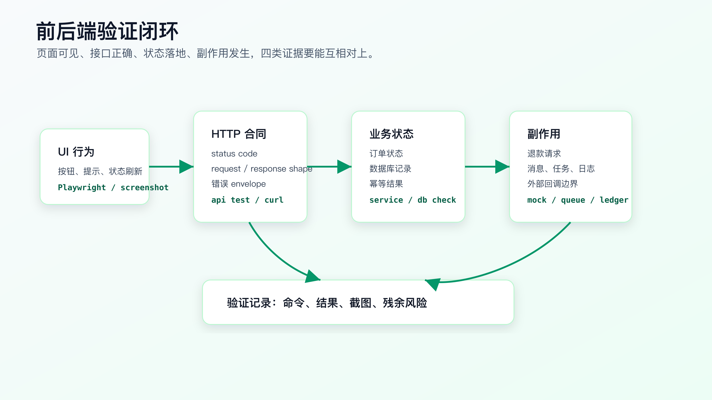
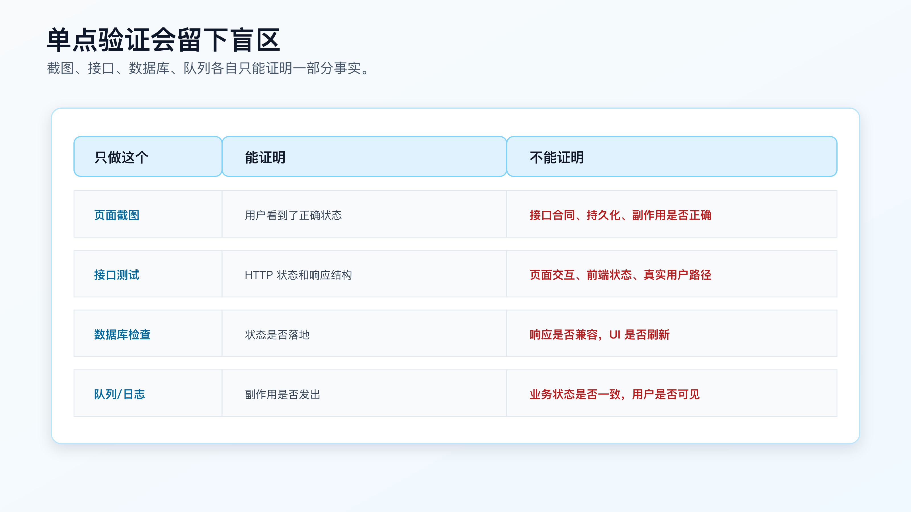

# 前后端验证闭环：页面、接口、数据库和副作用怎么一起验

AI 做完一个前后端改动后，最常见的危险说法是：

```text
我已经测试过了，页面正常。
```

或者：

```text
接口测试通过。
```

这两句话都可能是真的，但都不够。

页面正常，只能证明用户眼前看到的东西在某个路径下符合预期。它不能证明接口响应结构没变、数据库状态正确、副作用只发生一次。

接口测试通过，也不能证明页面交互真的可用、前端状态会刷新、错误提示正确、按钮不会重复提交。

真实产品里的一个功能，通常跨四层：

```text
UI 行为 -> HTTP 合同 -> 业务状态 -> 外部副作用
```

AI Coding 的验证闭环，就是让这四类证据能互相对上。



## 为什么单点验证不够

继续用订单取消进入退款流程这个例子。

需求是：

```text
用户取消已支付订单后，页面显示“退款处理中”，后端订单状态变成 refund_requested，并且只创建一个退款请求。
```

如果只做页面验证：

```text
点击取消后，页面显示“退款处理中”。
```

这只能证明前端最终显示了这个文案。

它不能证明：

- 后端状态是不是 `refund_requested`。
- 是否创建了退款请求。
- 重复点击是否创建多条退款请求。
- API response shape 是否兼容。
- 失败时页面是否提示正确。

如果只做接口验证：

```bash
curl -X POST /api/orders/123/cancel
```

看到 200，也不能证明：

- 页面是否调用了正确接口。
- UI 是否禁用了重复点击。
- 错误状态是否显示。
- 用户刷新页面后状态是否一致。

所以前后端功能不能用单点证据收尾。



## 先定义这次要证明什么

验证闭环不是测试越多越好。

先把需求拆成可证明事实：

```text
UI:
- paid order detail page shows cancel action.
- after cancel succeeds, page shows refund_requested / 退款处理中.
- duplicate click is prevented or handled.

HTTP:
- POST /api/orders/:id/cancel returns expected status code.
- response shape remains compatible.
- failure uses existing error envelope.

Business state:
- order status becomes refund_requested.
- pending and shipped behavior remains unchanged.
- failed refund request leaves order paid.

Side effects:
- exactly one refund request is created.
- duplicate cancellation does not create another request.
- payment provider callback is not changed in this task.
```

这一步比直接写 Playwright 更重要。

因为你要先知道“验证什么”，再决定用什么工具。

## 页面验证：证明用户路径真的可走

页面验证适合证明：

- 用户能看到入口。
- 用户能完成交互。
- 页面状态会刷新。
- 加载、成功、失败提示符合预期。
- 重复点击、禁用状态、错误提示正确。

如果使用 Playwright，可以让 AI 生成测试草稿，但要给清楚路径：

```text
请写前端 E2E 测试草稿，覆盖 paid order cancellation 用户路径。

要求：
- 从订单详情页进入。
- 点击取消。
- 等待 API 成功响应后页面显示“退款处理中”。
- 验证取消按钮不再可重复触发。
- 不 mock 掉页面本身的状态更新逻辑。
- 不验证数据库，数据库由后端测试覆盖。
```

Playwright 测试可以类似：

```ts
test('paid order cancellation shows refund requested state', async ({ page }) => {
  await page.goto('/orders/paid-order-1');

  await page.getByRole('button', { name: '取消订单' }).click();

  await expect(page.getByText('退款处理中')).toBeVisible();
  await expect(page.getByRole('button', { name: '取消订单' })).toBeHidden();
});
```

这段测试证明用户路径，不证明后端副作用。

不要让 AI 把所有验证都塞进 E2E。E2E 成本高、失败原因复杂，适合覆盖关键路径，不适合承担所有业务状态断言。

## 接口验证：证明合同没有被破坏

接口验证适合证明：

- status code。
- response body shape。
- 错误 envelope。
- 鉴权和权限边界。
- 幂等请求的响应。

例如：

```bash
curl -i -X POST http://localhost:3000/api/orders/123/cancel \
  -H 'Content-Type: application/json'
```

要看：

```text
HTTP/1.1 200 OK
```

也要看 response body：

```json
{
  "id": "123",
  "status": "refund_requested",
  "message": "Refund request created"
}
```

如果项目有 API test，可以写：

```ts
test('cancel paid order returns refund_requested without response shape change', async ({ request }) => {
  const response = await request.post('/api/orders/paid-order-1/cancel');
  expect(response.status()).toBe(200);

  const body = await response.json();
  expect(body).toMatchObject({
    id: 'paid-order-1',
    status: 'refund_requested'
  });
  expect(Object.keys(body).sort()).toEqual(['id', 'message', 'status'].sort());
});
```

这里的重点是 response shape。AI 很容易为了实现需求顺手改返回结构，前端当前页面可能没坏，但其他调用方会坏。

接口验证不能被页面截图替代。

## 业务状态：证明数据真的落地

业务状态验证适合证明：

- 数据库记录是否正确。
- 状态转换是否符合规则。
- 事务失败是否回滚。
- 旧状态行为是否保持。

后端 focused test 可以写：

```ts
test('paid order cancellation persists refund_requested status', async () => {
  const order = await fixtures.createOrder({ status: 'paid' });

  await cancelOrder(order.id);

  const saved = await orders.find(order.id);
  expect(saved.status).toBe('refund_requested');
});
```

失败路径也要有：

```ts
test('order remains paid when refund request creation fails', async () => {
  const order = await fixtures.createOrder({ status: 'paid' });
  refundRequests.failNextCreate();

  await expect(cancelOrder(order.id)).rejects.toThrow();

  const saved = await orders.find(order.id);
  expect(saved.status).toBe('paid');
});
```

如果没有数据库测试条件，也要保留人工或脚本化检查：

```sql
select id, status from orders where id = '123';
```

不要只看接口返回。接口返回可能是内存对象，数据库写入可能失败。

## 副作用：证明外部动作没有多发或漏发

退款、消息、邮件、队列、外部 API 调用，都属于副作用。

副作用验证最容易被忽略，因为页面和接口可能都看起来正常。

订单取消场景里，至少要证明：

```text
paid cancel creates exactly one refund request.
duplicate cancel does not create another refund request.
refund request failure does not leave order in wrong state.
payment provider callback remains out of scope.
```

测试可以是：

```ts
test('duplicate paid cancellation creates one refund request', async () => {
  const order = await fixtures.createOrder({ status: 'paid' });

  await cancelOrder(order.id);
  await cancelOrder(order.id);

  expect(await refundRequests.countForOrder(order.id)).toBe(1);
});
```

如果副作用通过队列发出，要检查队列消息：

```text
Queue evidence:
- topic: refund.requested
- key: order:123:cancel
- count: 1
```

如果外部服务不能在本地调用，要明确边界：

```text
Not locally verified:
- real payment provider callback.

Verified instead:
- refund request record is created.
- provider callback code path was not changed.
- staging callback verification remains required before release.
```

这比假装“已完整验证”更专业。

## 测试数据也要进入验证闭环

前后端验证经常漏掉测试数据。

页面显示对了、接口返回对了，但如果测试数据不是目标状态，验证仍然不可信。

订单取消场景里，要明确：

```text
Test data:
- order id: paid-order-1
- order status before cancel: paid
- payment status: captured
- shipping status: not_shipped
- existing refund request: none
```

如果验证 duplicate cancel，还要写：

```text
Before second cancel:
- order status: refund_requested
- refund request count: 1
```

这能防止 AI 用一个名字叫 `paid-order-1`、实际状态不是 paid 的 fixture 去跑测试。

对前端 E2E，测试数据准备方式也要写清：

- 通过 seed 脚本创建。
- 通过 API 创建。
- 使用固定 fixture。
- 使用 mock server。

不同方式证明的东西不同。mock server 证明前端响应某个合同；seed + real API 更接近真实链路。

## 验证 ledger 要能让别人复查

前后端验证完成后，可以把结果写成 ledger：

````markdown
# Verification Ledger

## Test Data

- paid order: `paid-order-1`
- initial status: `paid`
- existing refund request count: 0

## Commands

```bash
npm test -- order-cancel
npm test -- order-api
npx playwright test order-cancel.spec.ts
```

## Evidence

- backend focused test: PASS, covers status and idempotency
- API contract test: PASS, response keys remain `id`, `status`, `message`
- Playwright path: PASS, page displays 退款处理中 after cancel

## Not Verified

- real payment provider callback
- old mobile client display

## Residual Risk

- staging check required for provider callback signature
````

ledger 不需要替代测试报告。它的价值是把多层证据串起来，让 reviewer 知道每个命令证明了什么。

如果没有 ledger，AI 很容易把“跑了几个命令”写成“验证完成”，但别人无法复查边界。

## 验证顺序：先内后外，再串起来

前后端验证建议按这个顺序：

```text
1. 后端 focused test
2. API contract test
3. 前端组件或页面路径
4. E2E 关键路径
5. 副作用和残余风险记录
```

为什么不先跑 E2E？

E2E 失败时原因太多：选择器、网络、鉴权、后端状态、异步加载、数据准备都可能导致失败。先用后端和接口测试确认核心行为，再用 E2E 验用户路径，定位成本更低。

但最后不能只停在后端测试。用户路径也要验证。

比较稳的执行指令：

```text
请按下面顺序验证，不要跳步：

1. 运行后端 focused test：`npm test -- order-cancel`
2. 运行 API contract test：`npm test -- order-api`
3. 运行前端关键路径：`npx playwright test order-cancel.spec.ts`
4. 汇总每个命令证明了什么，以及仍然没有证明什么。
```

AI 如果只跑最容易通过的命令，就要求它补齐缺口。

## 让 AI 输出验证矩阵

完成后不要只让 AI 写：

```text
测试已通过。
```

要求它输出验证矩阵：

```markdown
| Evidence | Command / Check | Proves | Does not prove |
|---|---|---|---|
| Backend focused test | `npm test -- order-cancel` | status transition, idempotency, failure rollback | UI path |
| API contract | `npm test -- order-api` | status code, response shape | browser rendering |
| E2E path | `npx playwright test order-cancel.spec.ts` | user can cancel and see refund state | real payment callback |
| Queue check | `refund.requested count = 1` | side effect emitted once | external provider success |
```

这个矩阵很有用。

它迫使 AI 说清每个证据的边界，避免把“某个测试通过”夸成“功能完全没问题”。

## 错误路径也要验证

前后端功能最容易漏错误路径。

至少要看：

- 后端返回 400/409/500 时页面怎么显示。
- 重复点击是否被禁止或幂等处理。
- 权限不足是否进入正确提示。
- 网络失败是否保留可重试状态。
- 后端部分成功时前端是否会显示错误状态。

例如：

```ts
test('cancel failure keeps user on paid state with error message', async ({ page }) => {
  await page.route('**/api/orders/*/cancel', route => {
    route.fulfill({
      status: 500,
      contentType: 'application/json',
      body: JSON.stringify({ error: { message: 'Refund service unavailable' } })
    });
  });

  await page.goto('/orders/paid-order-1');
  await page.getByRole('button', { name: '取消订单' }).click();

  await expect(page.getByText('Refund service unavailable')).toBeVisible();
  await expect(page.getByText('已支付')).toBeVisible();
});
```

这段测试证明的是前端错误状态，不证明数据库状态。数据库状态仍然要后端测试覆盖。

## 并发和重复提交要单独验证

前后端链路里，重复提交是高发问题。

用户可能双击按钮，浏览器可能重试请求，移动端可能在弱网下重复发送。页面禁用按钮有价值，但不能替代后端幂等。

订单取消场景至少要验证两层：

```text
UI:
- first click disables or hides cancel action.
- repeated click does not send a second request, or handles idempotent response.

Backend:
- repeated cancel request creates at most one refund request.
- repeated request returns compatible response.
```

前端测试可以证明按钮行为：

```ts
await page.getByRole('button', { name: '取消订单' }).dblclick();
await expect(page.getByText('退款处理中')).toBeVisible();
```

后端测试证明副作用次数：

```ts
await cancelOrder(order.id);
await cancelOrder(order.id);
expect(await refundRequests.countForOrder(order.id)).toBe(1);
```

如果只验证 UI，不验证后端，脚本或移动端仍然可能绕过。
如果只验证后端，不验证 UI，用户可能看到重复加载、错误提示或状态抖动。

AI 很容易把“按钮禁用”当成完整幂等方案。验证闭环要把这两层分开。

## 权限和角色不要漏

前后端功能还要验证谁能做这件事。

同一个“取消订单”动作，可能有：

- 买家入口。
- 客服后台入口。
- 商家后台入口。
- 定时任务入口。
- 开放 API 入口。

如果需求只覆盖买家入口，就要写清：

```text
Verified:
- buyer paid order cancellation.

Not changed:
- support admin cancellation.
- merchant cancellation.
- scheduled cleanup job.
```

如果权限会变，至少要有 API 层测试：

```ts
test('buyer cannot cancel another buyer order', async () => {
  const response = await requestAs(otherBuyer).post('/api/orders/paid-order-1/cancel');
  expect(response.status()).toBe(403);
});
```

页面看不到按钮，不代表接口不能被调用。权限类需求必须在后端验证。

## 不要让 mock 掩盖真实问题

前端测试经常 mock API。

mock 有价值，能稳定验证前端状态。但 mock 也可能掩盖真实合同问题。

如果前端测试 mock 了 response：

```json
{ "status": "refund_requested" }
```

而真实后端返回：

```json
{ "orderStatus": "refund_requested" }
```

前端 E2E mock 测试会过，真实联调会挂。

所以关键路径至少要有一个不 mock 合同的验证：

```text
API contract test verifies real response shape.
Front-end route test verifies UI state.
One integration or E2E path verifies the two meet.
```

不要让 AI 为了测试稳定，把真实合同全部 mock 掉。

## 验证记录要包含残余风险

真实项目里，不是每件事都能本地验证。

比如：

- 真正的支付 provider。
- 第三方短信或邮件。
- 生产级队列重试。
- 大数据量下的性能。
- 某些权限组合。

不能验证就要写出来：

```markdown
## Residual Risk

- Real payment provider callback was not executed locally.
- Staging verification is required for callback signature and provider state transition.
- Queue retry policy was not changed in this task.
```

这不是示弱。它是在防止 AI 把未验证内容说成已验证。

## 验证环境也要写清

验证结果离不开环境。

同一个命令，在本地、CI、staging 的意义不同。

ledger 里可以写：

```markdown
## Environment

- local node: 20.x
- database: local test container
- browser: Chromium via Playwright
- API base: local dev server
- payment provider: fake adapter
```

这样 reviewer 才知道结果的边界。

如果用 mock server，要写清 mock 覆盖了什么；如果用真实 dev server，要写清测试数据怎么创建和清理。

AI 常会省略环境，直接写“测试通过”。生产验证不能这么写。

## 一个完整验证计划长什么样

把订单取消改退款作为例子，一份可执行验证计划可以这样写：

```markdown
Verification Plan: paid order cancellation

## Test Data

- paid order: `paid-order-1`
- pending order: `pending-order-1`
- shipped order: `shipped-order-1`
- paid order has captured payment and no refund request before test

## Backend

- `npm test -- order-cancel`
  - paid -> refund_requested
  - pending -> canceled unchanged
  - shipped -> existing rejection unchanged
  - duplicate paid cancel creates one refund request
  - refund request failure keeps order paid

## API

- `npm test -- order-api`
  - status code remains 200 for accepted cancel
  - response shape remains `id`, `status`, `message`
  - error envelope remains compatible

## Frontend

- `npx playwright test order-cancel.spec.ts`
  - user can cancel paid order from detail page
  - page shows 退款处理中
  - cancel action no longer repeats
  - failure response keeps paid state and shows error

## Side Effects

- refund request count for order is 1
- idempotency key is stable
- payment provider callback path not touched

## Residual Risk

- real provider callback requires staging verification
- old mobile client display not covered in this web test
```

这份计划不追求“所有测试都写在一个地方”。它把证据分层，每层证明自己的事情。

如果 Agent 完成后只报告 `npm test -- order-cancel` 通过，就能看出缺口：API、页面、副作用和残余风险都还没闭合。

## 给 Agent 的验证指令不要只写“跑测试”

更好的指令是让它按证据层输出。

```text
请按验证计划执行，不要自行缩减命令。

输出必须包含：
1. Test data：使用了哪些订单、初始状态是什么。
2. Commands：实际执行的命令。
3. Evidence：每个命令证明什么。
4. Not verified：哪些路径没有验证。
5. Residual risk：未验证路径是否阻塞发布。
```

如果某个命令跑不了，也不能跳过：

```text
如果命令无法执行：
- 写出失败原因。
- 说明它原本要证明什么。
- 给出替代验证。
- 标记残余风险。
```

比如 Playwright 跑不了，不能直接写“前端未测”。要说明是浏览器依赖缺失、dev server 未启动、登录态不可用，还是测试本身不存在。不同原因对应的处理完全不同。

## 验证闭环要防“只验证改动路径”

AI 经常只验证新增路径：paid order cancel。旧路径 pending、shipped、权限、失败回滚容易被漏掉。

可以让它输出覆盖表：

```markdown
| Scenario | Verified | Evidence |
| --- | --- | --- |
| pending cancel unchanged | yes | `npm test -- order-cancel` |
| paid cancel refund_requested | yes | `npm test -- order-cancel` |
| shipped cancel rejected | yes | `npm test -- order-cancel` |
| duplicate paid cancel idempotent | yes | `npm test -- order-cancel` |
| refund failure keeps paid | yes | `npm test -- order-cancel` |
| page shows refund state | yes | Playwright |
| old mobile client display | no | residual risk |
```

这张表能一眼看出是否只测了 happy path。

验证不是为了证明 AI 做对了，而是为了找出它可能没做对的地方。

## 验证命令要和风险一一对应

验证计划里每个风险都应该有对应证据。

```markdown
| Risk | Evidence |
| --- | --- |
| paid order status not persisted | backend integration test |
| response shape changed | API contract test |
| duplicate refund request | idempotency test |
| page does not refresh after cancel | Playwright path |
| old pending cancel broken | regression test |
| payment callback accidentally changed | diff review + callback tests unchanged |
```

如果某个风险没有证据，就不要把它从风险列表里删掉。要么补验证，要么保留 residual risk。

AI 很容易只跑测试，不解释测试覆盖了哪个风险。风险到证据的映射，是前后端验证闭环的核心。

## 手工验证也要可复查

有些路径短期没有自动化测试，只能手工验证。手工验证不是随便点一点。

记录格式可以是：

```markdown
Manual check:
- environment: staging
- account: buyer test account
- order: paid order created by seed script
- steps:
  1. open order detail
  2. click cancel
  3. confirm modal
  4. refresh page
- expected:
  - page shows 退款处理中
  - cancel button hidden
  - order API returns refund_requested
- evidence:
  - screenshot path or attached image
  - request id / log id
```

手工验证不能替代所有自动化测试，但它可以作为外部服务、真实浏览器、权限组合的补充证据。

不要让 AI 把“我手工看了”写成验证结论。手工验证也要有步骤和结果。

## 上线前把证据压成一句话

验证材料很多，最后要能压成一句 reviewer 能理解的话。

例如：

```text
Paid order cancellation was verified at backend, API, web UI and side-effect layers:
focused order tests passed, API response shape stayed compatible, Playwright covered the cancel path,
refund request count stayed 1 under duplicate cancel, real provider callback remains staging-only residual risk.
```

中文 PR 里可以写：

```text
已验证后端状态、接口合同、Web 页面路径和退款请求副作用：
订单 focused tests 通过，API response shape 未变，Playwright 覆盖取消路径，
重复取消只创建一条退款请求；真实支付回调未在本地验证，需 staging 复核。
```

这句话不是替代详细 ledger，而是给 reviewer 一个入口。

如果你压不出这句话，说明验证证据还没有串起来。

## 数据清理和可重复执行也要检查

前后端验证如果依赖固定数据，要确认测试能重复跑。

常见问题：

- 第一次测试创建 refund request，第二次测试因为数据残留失败。
- E2E 用固定账号，状态被上一次测试改掉。
- 本地数据库没有清理，CI 每次干净环境，结果不同。
- 并行测试使用同一个 order id。

验证计划里可以写：

```text
Data isolation:
- each test creates its own order id.
- refund request table is cleaned between tests.
- E2E seed runs before each test.
- no test depends on previous test order.
```

这类细节很工程化，但生产里非常常见。AI 如果只写一个能跑一次的测试，后面会变成 flaky test。

## 验证失败时不要继续补页面

前后端任务里，常见错误是后端验证失败时继续改页面。

比如 API contract 已经发现 response shape 变化，Agent 仍然去改前端适配新 shape。这样页面可能恢复正常，但合同已经被破坏。

规则应该是：

```text
如果后端 focused 或 API contract 验证失败，先停止。
不要通过修改前端来掩盖后端合同变化。
```

页面适配只有在合同变化被 requirements/design 明确接受后才做。否则就是让调用方迁就一次未审的后端改动。

同理，如果页面验证失败，也不要先改后端去迎合页面。先确认 API 合同和业务状态是否正确，再判断页面是状态映射问题、缓存问题、异步刷新问题，还是后端确实返回错了。

验证闭环不是“哪层红就改哪层”，而是先定位红灯属于哪一层。

定位清楚后，再按层修复：合同错修后端，展示错修前端，数据错修 seed 或业务状态，副作用错修服务边界。不要让一个层的补丁掩盖另一个层的问题。

如果时间紧，也要保留验证顺序。

可以少跑一些命令，但不要颠倒层次：

```text
先确认合同。
再确认状态。
再确认页面。
最后确认副作用和残余风险。
```

否则页面补丁可能掩盖接口破坏，mock 测试可能掩盖真实合同变化，副作用遗漏可能在上线后才暴露。

## 常见错误

**错误一：只看页面截图。**

截图不能证明接口合同、数据库状态和副作用。

**错误二：只跑接口测试。**

接口测试不能证明用户路径、前端状态刷新和错误提示。

**错误三：mock 掉所有后端。**

mock 能稳定前端测试，但不能替代真实合同验证。

**错误四：只测成功路径。**

失败、重复点击、权限不足、网络异常是前后端问题高发区。

**错误五：不写残余风险。**

没验证外部 provider，就不要写“端到端验证完成”。

**错误六：让 AI 自己挑验证命令。**

它可能选最容易过的命令。验证命令应该来自 tasks、项目规则或人工授权。

## 改完后重点看什么

一次前后端改动结束后，看这些结果：

- 页面路径是否验证。
- HTTP status 和 response shape 是否验证。
- 数据库或业务状态是否验证。
- 副作用是否验证。
- 错误路径是否验证。
- mock 和真实合同是否区分。
- 残余风险是否写清。

如果只有“页面看起来正常”或“接口测试通过”，验证闭环还没完成。

AI Coding 的交付质量，最终不是看它写了多少代码，而是看它留下了多少能互相印证的证据。

## 常见问题

**没有 E2E 测试基础怎么办？**

先从关键路径的一条 Playwright 测试开始，不要试图一次覆盖所有页面。也可以先用手工步骤加截图记录，但要明确它不是自动化回归。

**前端测试 mock API 还算验证吗？**

算前端状态验证，不算真实合同验证。要配接口测试或至少一次真实 API 检查。

**后端已经有测试，还要页面验证吗？**

只要需求包含用户交互，就要验证页面路径。后端测试不能证明按钮、提示、状态刷新和重复点击行为。

**外部服务不能本地跑怎么办？**

用 mock 或 contract 测本地边界，记录真实外部路径未验证，并安排 staging 或人工验证。

**验证命令太慢怎么办？**

先 focused，再 module，再关键 E2E。不要每一步都跑全量，但合并前要覆盖受影响面。

## 可复查资料

- Playwright intro：<https://playwright.dev/docs/intro>
- Playwright assertions：<https://playwright.dev/docs/test-assertions>
- Playwright API testing：<https://playwright.dev/docs/api-testing>
- MDN HTTP response status codes：<https://developer.mozilla.org/en-US/docs/Web/HTTP/Status>
- MDN Fetch API：<https://developer.mozilla.org/en-US/docs/Web/API/Fetch_API>

---

[课程首页](../../../README.md) · [完整目录](../README.md) · [← 系统化调试：让 AI 基于证据排障](25-%E7%B3%BB%E7%BB%9F%E5%8C%96%E8%B0%83%E8%AF%95-%E8%AE%A9-AI-%E5%9F%BA%E4%BA%8E%E8%AF%81%E6%8D%AE%E6%8E%92%E9%9A%9C.md) · [AI 说“测试失败无关”时，程序员该怎么判断 →](27-AI-%E8%AF%B4%E6%B5%8B%E8%AF%95%E5%A4%B1%E8%B4%A5%E6%97%A0%E5%85%B3%E6%97%B6%E7%A8%8B%E5%BA%8F%E5%91%98%E8%AF%A5%E6%80%8E%E4%B9%88%E5%88%A4%E6%96%AD.md)

动手实践：[业务样例与测试](../../../personal-productivity-app/README.md)
