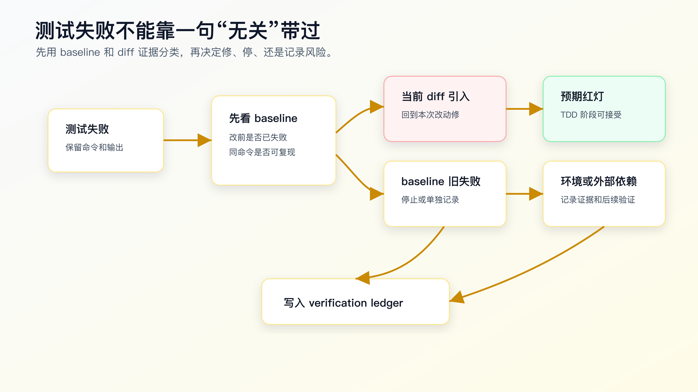
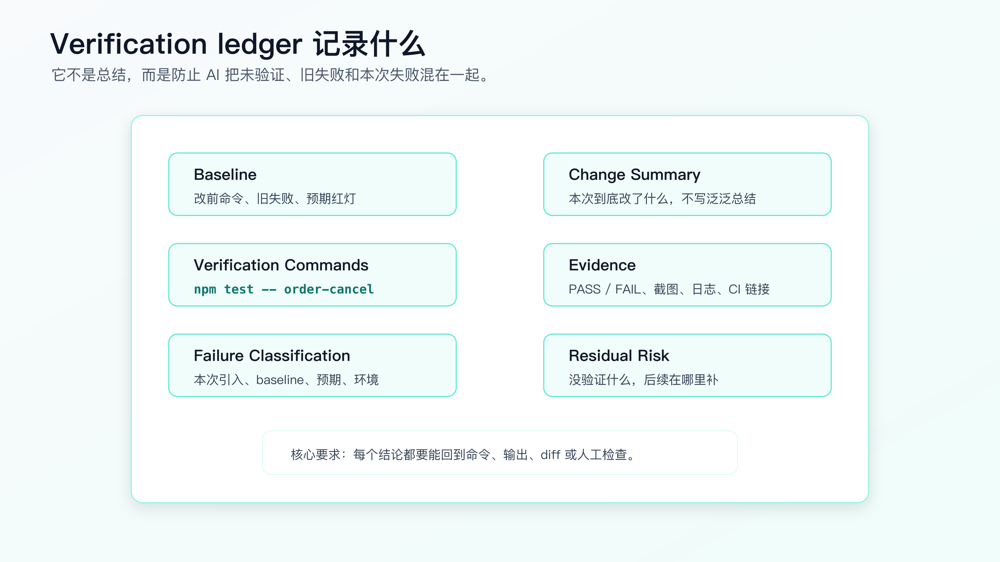

# AI 说“测试失败无关”时，程序员该怎么判断

AI Coding 里有一句话特别危险：

```text
这个测试失败和本次修改无关。
```

它可能是真的。

真实项目里确实会有 baseline failure：改代码前就已经失败的测试、环境不稳定导致的失败、外部依赖不可用、CI 上才出现的问题。

但它也可能是 AI 在逃避当前 diff 的影响。

如果你直接相信这句话，就可能把本次改坏的行为带进下一步。如果你完全不信，又会被旧失败拖住，无法推进。

程序员需要的不是态度，而是分类方法。

判断一个测试失败是否“无关”，至少要回答四个问题：

```text
改前是否已经失败？
同一个命令能否复现？
失败路径是否经过本次修改？
失败行为是否被当前需求覆盖？
```

回答不了，就不能说无关。



## 先保留原始失败证据

第一步不是问 AI 怎么看。

第一步是保留命令和输出。

例如：

```bash
npm test -- order-cancel
```

输出：

```text
FAIL test/order/order-cancel.test.ts
  duplicate paid cancellation creates one refund request

Expected: 1
Received: 2
```

这类失败看起来就很可能和本次修改有关，因为它直接对应订单取消和退款请求。

另一个例子：

```text
FAIL test/user/avatar-upload.test.ts
Timeout waiting for image resize worker
```

它可能无关，但还不能直接下结论。要看本次 diff 有没有改 worker 配置、测试环境、全局 setup、依赖版本。

所以不要让 AI 用一句话盖过去。要求它输出：

```text
Failure:
- command
- failing test
- first failing assertion
- actual / expected
- stack or log
- changed files that could affect it
```

没有这些证据，所谓“无关”只是判断，不是结论。

## baseline 是判断的关键

baseline 的意思是：改动前，同一个命令是什么状态。

最理想的情况，是你在开工前就跑过：

```bash
npm test -- order-cancel
```

并记录：

```text
Baseline:
- `npm test -- order-cancel`: pass
```

如果改后失败，那就不能轻易说无关。

如果改前已经失败，要记录：

```text
Baseline:
- `npm test -- avatar-upload`: failed before this change.
- failure: Timeout waiting for image resize worker.
- evidence: CI run #123 / local command output.
```

问题是，很多时候你没有改前 baseline。

这时可以用 Git 辅助判断：

```bash
git diff --name-only
git diff -- test/order/order-cancel.test.ts
```

还可以回到最近的干净提交或主分支复现。但要注意，不要在当前工作区粗暴切分支，避免丢掉未提交改动。可以使用单独 worktree，或者在 CI 里看历史结果。

没有 baseline 时，最多只能写：

```text
Not proven unrelated.
Current evidence suggests it may be unrelated because ...
Need baseline confirmation.
```

不能写“确认无关”。

## baseline 可以从哪里来

baseline 不一定只能来自你开工前本地跑过的命令。

常见来源有几种：

- 开工前本地命令输出。
- 主分支或目标分支的 CI 结果。
- 最近一次通过的 workflow run。
- 单独 worktree 上复现结果。
- 团队已知 flaky test 记录。
- issue 或测试稳定性看板。

每种证据强度不同。

最强的是同一分支、同一命令、同一环境、改动前已经失败或通过。

CI 历史有用，但要看是否同环境。同一个测试在 macOS 本地通过、Linux CI 失败，不能简单归类。

如果要在本地验证主分支，不要在当前脏工作区乱切分支。可以用单独 worktree：

```bash
git worktree add ../baseline-check main
cd ../baseline-check
npm test -- order-cancel
```

如果仓库不适合新建 worktree，就查 CI 历史，或者记录 baseline 未确认。

关键是不要让 AI 用“我觉得不像相关”代替 baseline。

## 失败可以分成四类

测试失败通常可以分成四类。

**第一类：当前 diff 引入。**

特征：

- 改前通过，改后失败。
- 失败路径经过本次修改文件。
- failure assertion 对应当前需求或相邻行为。
- 回滚当前 diff 后失败消失。

这类必须在当前任务里处理，不能记录成残余风险。

**第二类：baseline 旧失败。**

特征：

- 改前已经失败。
- 与本次 diff 没有调用路径或配置关系。
- 失败日志和历史失败一致。

这类可以记录，但不要混进当前 diff。需要单独任务修。

**第三类：预期红灯。**

TDD 阶段新增失败测试，本来就应该失败。

例如 Task 1 只写测试：

```text
Expected before implementation:
- paid cancellation test fails.
- duplicate cancellation test fails.
- pending and shipped tests pass.
```

这种失败不是无关，也不是 bug。它是当前阶段的预期证据。

**第四类：环境或外部依赖。**

例如浏览器下载失败、测试数据库不可用、CI secrets 缺失、第三方服务不可达。

这类也不能直接忽略。要记录：

- 哪个环境失败。
- 本地是否复现。
- 失败是否阻断当前结论。
- 后续在哪里验证。

只有分类清楚，才能决定下一步。

## 让 AI 先分类，不要先修

看到失败后，不要说：

```text
修一下测试。
```

要说：

```text
先不要改代码。

请对测试失败做分类：
- current diff introduced
- baseline existing failure
- expected red test
- environment / external dependency

要求：
- 引用失败命令和关键输出。
- 检查本次 changed files。
- 说明失败路径是否经过本次修改。
- 如果不能证明无关，就写 not proven unrelated。
- 不要修复。
```

这能阻止 AI 直接把失败压掉。

如果它说“无关”，继续追问：

```text
你需要给出证据：
- 改前是否失败？
- 哪个日志或历史运行证明？
- 本次 diff 为什么不可能影响它？
- 是否存在共享配置、全局 setup、依赖版本、测试数据影响？
```

没有证据，就不能接受。

## 失败路径是否经过本次 diff

这是很实用的判断。

看改动文件：

```bash
git diff --name-only
```

看失败堆栈：

```text
at cancelOrder (src/order/order-cancel-service.ts:42:18)
at test/order/order-cancel.test.ts:87:24
```

如果堆栈经过本次修改文件，就高度相关。

如果失败是前端 E2E：

```text
Timeout waiting for getByText('退款处理中')
```

本次 diff 改了：

```text
src/order/order-cancel-service.ts
src/api/order-controller.ts
src/ui/order-detail.tsx
```

也不能说无关。页面等不到文案，可能是后端没返回新状态、接口 shape 变了、前端状态没刷新。

反过来，如果失败是：

```text
test/user/avatar-upload.test.ts
```

本次 diff 只改：

```text
src/order/order-status-transition.ts
test/order/order-cancel.test.ts
```

且没有共享测试 setup、依赖、全局配置变化，才有初步无关的可能。

注意，是“初步可能”，不是直接确认。

## 验证 ledger：把判断写下来

测试失败分类不能只留在聊天里。

可以写到 verification ledger。



一个可用结构：

```markdown
# Verification Ledger

## Baseline

- `npm test -- order-cancel`: pass before Task 2.
- No known failure in order cancellation tests.

## Change Summary

- Added paid -> refund_requested transition.
- Wired refund request creation.
- Did not change payment provider callback.

## Verification Commands

```bash
npm test -- order-cancel
npm test -- order
```

## Evidence

- `npm test -- order-cancel`: PASS, 12 tests.
- `npm test -- order`: FAIL, `avatar-upload.test.ts` timeout.

## Failure Classification

- `avatar-upload.test.ts` failure is not proven related to this diff.
- It does not pass through changed files.
- No dependency, global setup, or worker config changed.
- Baseline still needs confirmation from main branch or CI history.

## Residual Risk

- Broader `npm test -- order` did not complete cleanly.
- Do not claim full module verification until baseline is confirmed.
```

注意这段没有写“测试全过”。它写的是更准确的结论：

```text
focused tests pass.
broader command has an unclassified or not-proven-related failure.
full module verification not complete.
```

这比 AI 的一句“无关失败”更可信。

## 配套工具能检查记录是否完整

配套工程的工具 module 里有一个很小的 `verify-ledger` 命令，用来检查验证记录是否至少包含必要段落、命令块和通过信号。

通过样例：

```bash
node src/cli.js verify-ledger --file examples/verification-ledger.pass.md
```

输出：

```text
Verification ledger looks usable: required sections, command block, and pass signal found.
```

失败样例：

```bash
node src/cli.js verify-ledger --file examples/verification-ledger.fail.md
```

输出：

```text
Verification ledger is incomplete.
Missing sections: Change Summary, Verification Commands, Evidence, Residual Risk
Missing command block with the verification command.
```

这个工具不判断业务正确性，也不判断失败是否真的无关。

它只做一件事：防止验证记录连基本证据都没有。

真正的判断仍然要靠你看命令、输出、diff、堆栈和影响范围。

## AI 说“无关”时的追问模板

可以直接用这段：

```text
不要只说无关。

请按下面格式证明：

1. Failing command:
2. Failing test / assertion:
3. Actual vs expected:
4. Changed files in this diff:
5. Does the failing stack/path pass through changed files?
6. Was this failing before the change? Evidence?
7. Could shared setup/config/dependency/test data connect it to this diff?
8. Classification:
9. Recommended action:

如果缺少 baseline evidence，请写 "not proven unrelated"。
```

这个模板能逼 AI 从结论退回证据。

## 哪些失败不能归为无关

下面这些情况，不要轻易接受“无关”：

- 失败测试和本次需求同领域。
- 失败堆栈经过本次修改文件。
- 失败 assertion 对应本次需求的边界。
- 本次 diff 改了共享工具、测试 setup、配置、依赖、全局类型。
- 本次 diff 改了 API response shape。
- 本次 diff 改了异步时序、缓存、队列、事务边界。
- 没有改前 baseline。

特别是共享配置和依赖。

很多看似无关的失败，实际来自：

```text
test setup
mock server
global fixture
date/time helper
serializer
dependency lockfile
environment variable
```

AI 很容易只看业务文件名，忽略这些共享层。

## 什么时候可以接受“先记录，不阻塞”

不是所有失败都要在当前任务里修。

可以先记录、不阻塞的条件是：

- focused tests 覆盖当前需求且通过。
- broader failure 有证据显示不是当前 diff 引入。
- 失败已经有 baseline 或历史记录。
- 当前 diff 没有触碰共享 setup、配置、依赖。
- ledger 里明确写了残余风险。
- 后续有单独任务或 CI 跟踪。

例如：

```text
Accept with residual risk:
- `npm test -- order-cancel`: pass.
- `npm test -- order`: fails on existing `avatar-upload.test.ts` timeout.
- Same failure exists on main branch CI run #123.
- Current diff touches only order status transition and order cancel tests.
- Follow-up issue: stabilize avatar upload worker test.
```

这时可以继续，但不能把验证口径写成“所有测试通过”。

只能写：

```text
Focused verification passed. Broader suite has known baseline failure.
```

## 什么时候必须阻塞

下面这些情况不能放行：

- focused tests 失败。
- 失败路径经过本次修改文件，且没有反证。
- 本次需求的核心 scenario 失败。
- API contract、数据库状态或副作用验证失败。
- baseline 未确认，且失败在同一业务领域。
- 测试被 AI 改弱后才通过。
- CI 必需检查失败，且失败与当前模块相关。

这时应该写：

```text
Blocked:
- failure may be related to current diff.
- baseline is not confirmed.
- do not proceed to next task.
```

“记录残余风险继续推进”只适合已证明不影响当前交付核心结论的情况。否则就是把未知风险往后推。

## 检查 shared setup，别只看业务文件

很多“看起来无关”的测试失败，最后都来自共享层。

需要重点检查：

```text
test setup
global fixture
mock server
serializer
date/time helper
environment variables
dependency lockfile
build config
browser config
database migration
```

比如本次只改订单取消，但顺手改了 `test/setup.ts` 里的全局 mock，头像上传测试失败就不能直接说无关。

可以让 AI 输出：

```text
Shared surface check:
- Did this diff touch test setup? no
- Did this diff touch dependency lockfile? no
- Did this diff touch serializers or API client? yes, `src/api/client.ts`
- Could failing test use that API client? yes
- Classification: not proven unrelated
```

这比只看失败测试文件名可靠得多。

## AI 改测试后，要重新分类

如果 AI 在修复过程中改了测试，原来的失败分类可能失效。

需要看：

- 是否删除了失败断言。
- 是否放宽了 expected。
- 是否把测试改成 skip 或 only。
- 是否把真实路径换成 mock 路径。
- 是否改了 fixture，让测试不再覆盖原场景。

可以要求：

```text
请列出本次测试文件改动：
- 新增了哪些断言。
- 删除或放宽了哪些断言。
- 是否有 skip/only。
- 是否改变 fixture 状态。
- 每个测试改动对应哪个 requirement。
```

如果测试被改弱，不能接受“测试通过”作为证据。要回到 requirement 和失败输出重新判断。

## 把无关失败变成可追踪事项

确认是 baseline 旧失败后，也不要只在聊天里说一句“无关”。

至少写进 ledger 或 issue：

```markdown
Known baseline failure:
- `test/user/avatar-upload.test.ts` timeout.
- Exists on main branch CI run #123.
- Current diff does not touch upload, worker setup, or shared test config.
- Follow-up: stabilize avatar upload worker test.
```

这样后续不会反复争论同一个失败。

如果是团队项目，最好有 issue 或 CI 注释承接。否则“无关失败”会不断消耗 review 信任。

## 一个判断案例：avatar 测试失败是否无关

场景：

```text
本次改动：
- `src/order/order-status-transition.ts`
- `test/order/order-cancel.test.ts`

验证：
- `npm test -- order-cancel`: PASS
- `npm test -- order`: FAIL `test/user/avatar-upload.test.ts`
```

AI 说：

```text
avatar-upload 和订单取消无关，可以忽略。
```

这句话不能直接接受。先查四件事。

第一，改动文件是否真的只在订单模块：

```bash
git diff --name-only
```

如果没有共享文件、锁文件、test setup、API client 变化，初步支持无关。

第二，失败堆栈是否经过本次改动：

```text
avatar-upload -> image resize worker -> upload service
```

如果路径不经过订单模块，也支持无关。

第三，baseline 是否存在。

如果主分支 CI 上同一个 avatar 测试已经失败，证据更强。没有 baseline，就只能写 not proven unrelated。

第四，当前验证口径怎么写。

可以写：

```markdown
Focused verification:
- `npm test -- order-cancel`: PASS

Broader verification:
- `npm test -- order`: FAIL on `avatar-upload.test.ts`

Classification:
- not proven related to current diff.
- changed files limited to order status and order cancel tests.
- failing path does not pass through changed files.
- baseline still needs confirmation.

Conclusion:
- do not claim full module verification.
- current order focused verification passed.
```

如果后来确认主分支也失败，再更新：

```markdown
Baseline confirmed:
- same avatar-upload timeout exists on main CI run #123.
- follow-up issue linked.
```

这样既不被旧失败拖住，也不会把未知失败包装成已验证。

## 给 Agent 的失败分类指令

可以固定使用这段：

```text
先不要修改代码。

请对当前测试失败做分类：
1. current diff introduced
2. baseline existing failure
3. expected red test
4. environment / external dependency

必须输出：
- failing command
- failing test / assertion
- actual vs expected
- changed files
- whether failing path passes through changed files
- shared setup / config / dependency check
- baseline evidence, if any
- classification
- recommended action

如果没有 baseline evidence，不要写 confirmed unrelated，只能写 not proven unrelated。
```

这段指令会迫使 AI 把“无关”拆成证据。

## 放行结论要分级

测试失败后的结论不要只有“能不能继续”两档。

可以分四级：

```text
Pass:
- required focused and broader checks passed.

Pass with known baseline:
- focused checks passed.
- broader failure confirmed as baseline.
- residual risk recorded.

Blocked:
- failure may be related to current diff.
- baseline missing or path overlaps.

Expected red:
- failure is expected in current TDD step.
- implementation not started yet.
```

对应写法：

```markdown
Verification conclusion:
- Pass with known baseline.
- Current order cancel focused tests passed.
- Broader suite still has known avatar-upload baseline failure.
- Full suite is not clean; follow-up issue linked.
```

这比“测试基本通过”准确得多。

## 不要把环境失败当成业务成功

有些失败看起来和业务无关，比如浏览器没装、数据库没启动、CI secret 缺失。它们确实可能不是当前 diff 引入的，但它们也意味着某部分验证没有完成。

例如：

```text
Playwright browser executable not found.
```

不能写：

```text
前端验证无关，后端通过即可。
```

应该写：

```markdown
Frontend E2E not executed:
- reason: Playwright browser missing in local environment.
- planned evidence: user path shows refund state after cancel.
- replacement: none yet.
- residual risk: page path not verified.
```

环境失败不一定阻塞所有任务，但必须降低验证结论的等级。

## PR 里怎么写失败分类

PR 描述里可以这样写：

```markdown
Verification:
- `npm test -- order-cancel`: PASS
- `npm test -- order`: FAIL on `test/user/avatar-upload.test.ts`

Failure classification:
- avatar failure is a known baseline failure on main CI run #123.
- current diff does not touch upload, worker setup, shared test config, or lockfile.
- order focused tests cover the changed behavior and passed.

Residual risk:
- full `npm test -- order` is not clean in this workspace.
- follow-up issue: stabilize avatar upload worker test.
```

这段话不会把失败藏起来，也不会让旧失败阻塞当前订单改动。

如果没有 baseline，就要改成：

```markdown
Failure classification:
- avatar failure is not proven unrelated.
- current diff does not appear to touch the failing path.
- baseline confirmation is still missing.

Conclusion:
- do not claim full module verification.
- decide whether this blocks merge based on release risk.
```

这种表达比“无关测试失败”更准确，reviewer 也能直接复查。

## 失败分类要防止范围漂移

如果为了证明失败无关，Agent 开始修改失败测试所在模块，那任务已经漂移。

比如当前任务是订单取消，AI 为了处理 avatar baseline failure，开始改图片 worker timeout。即使改对了，也不该混进当前 PR。

可以要求：

```text
如果失败分类指向 baseline 旧失败：
- 不要修这个失败。
- 只记录证据和 follow-up。
- 当前 diff 不要新增与本任务无关的文件。
```

旧失败要修，应该开独立任务。这样当前需求的 diff 才保持可审。

## 最终判断要写得克制

测试失败分类后的结论不要夸大。

可以写：

```text
Confirmed unrelated
```

只有在 baseline、路径、共享层都查清楚时才用。

多数情况下更适合写：

```text
Not proven related to current diff.
```

或者：

```text
Known baseline failure, tracked separately.
```

这几个表达差别很大。

“确认无关”是强结论；“未证明相关”是当前证据下的保守判断；“已知 baseline”说明有外部证据支持。

程序员最需要学会的是这种克制。AI Coding 不是把所有不方便的失败都解释掉，而是把证据强度和结论强度对齐。

如果结论强度不够，就不要用它支撑合并决策。可以继续补 baseline，也可以把失败作为阻塞项。

## 常见错误

**错误一：没有 baseline 就说无关。**

没有改前证据，只能说尚未证明相关或无关。

**错误二：只看文件名。**

测试文件名不相关，不代表共享配置、fixture、依赖不相关。

**错误三：让 AI 直接修所有失败。**

先分类，再决定修不修。否则旧失败会污染当前 diff。

**错误四：把预期红灯当成 bug。**

TDD 阶段新增失败测试可以是预期结果，要写清 expected before implementation。

**错误五：把残余风险写成验证通过。**

没跑完 broader suite，就不要写 full verification passed。

**错误六：验证记录只有总结，没有命令。**

没有命令和输出，就无法复查。

## 改完后重点看什么

判断测试失败是否无关，最后看这些证据：

- 是否有 failing command。
- 是否有 actual vs expected。
- 是否有改前 baseline。
- 是否检查了 changed files。
- 是否检查失败路径和共享 setup。
- 是否分类为当前 diff、baseline、预期红灯或环境问题。
- 是否写入 verification ledger。
- 是否准确表达 residual risk。

如果这些都没有，AI 的“无关”不值得采信。

AI Coding 的验证纪律，不是要求所有测试永远全绿，而是不能把未知失败包装成无关失败，也不能把部分验证包装成完整验证。

## 常见问题

**如果没有时间确认 baseline 怎么办？**

不要写“确认无关”。写“baseline 未确认，focused tests passed，broader failure unresolved”，并把它作为残余风险或阻塞项。

**CI 上有旧失败，本地没有，算 baseline 吗？**

要看同分支、同命令、同环境。CI 历史可以作为证据，但要说明环境差异。

**AI 已经修好了失败，还需要分类吗？**

需要。否则你不知道它修的是当前问题、旧问题，还是把测试改弱了。

**所有测试都通过，还需要 ledger 吗？**

复杂任务建议要。ledger 不只是记录失败，也记录你跑了什么、证明了什么、没证明什么。

**verify-ledger 能判断测试失败是否无关吗？**

不能。它只检查记录是否有基本结构和命令证据。业务判断必须由人看 diff、日志和测试覆盖。

## 可复查资料

- GitHub Actions workflow logs：<https://docs.github.com/en/actions/monitoring-and-troubleshooting-workflows/using-workflow-run-logs>
- GitHub Actions troubleshooting workflows：<https://docs.github.com/en/actions/monitoring-and-troubleshooting-workflows/troubleshooting-workflows>
- Git diff 官方文档：<https://git-scm.com/docs/git-diff>
- Git status 官方文档：<https://git-scm.com/docs/git-status>

---

[课程首页](../../../README.md) · [完整目录](../README.md) · [← 前后端验证闭环：页面、接口、数据库和副作用怎么一起验](26-%E5%89%8D%E5%90%8E%E7%AB%AF%E9%AA%8C%E8%AF%81%E9%97%AD%E7%8E%AF-%E9%A1%B5%E9%9D%A2%E6%8E%A5%E5%8F%A3%E6%95%B0%E6%8D%AE%E5%BA%93%E5%92%8C%E5%89%AF%E4%BD%9C%E7%94%A8%E6%80%8E%E4%B9%88%E4%B8%80%E8%B5%B7%E9%AA%8C.md) · [模块实战：用 AI 完成一次 CLI 交互改造 →](28-%E6%A8%A1%E5%9D%97%E5%AE%9E%E6%88%98-%E7%94%A8-AI-%E5%AE%8C%E6%88%90%E4%B8%80%E6%AC%A1-CLI-%E4%BA%A4%E4%BA%92%E6%94%B9%E9%80%A0.md)

动手实践：[业务样例与测试](../../../personal-productivity-app/README.md)
