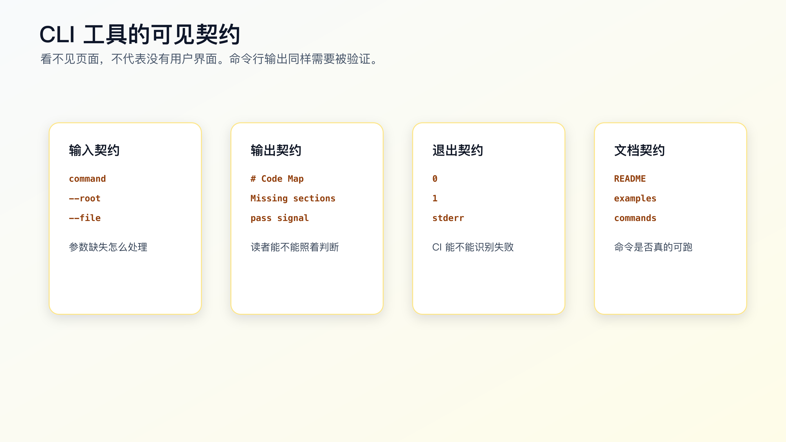
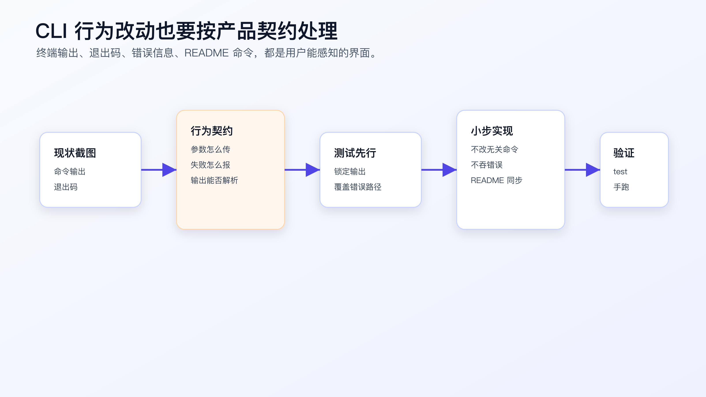

# 模块实战：用 AI 完成一次 CLI 交互改造

CLI 交互改造看起来像改输出文案，实际是在改用户可见合同。

真实项目里的 CLI 经常被人、脚本、CI、Git hooks 或 README 复制命令调用。这个合同至少包括：

```text
stdout
stderr
exit code
README 示例命令
```

这几个面任何一个漂移，都会让“测试通过”的改动变成真实用户路径上的问题。

配套代码仓库 [DavidDingXu/learn-ai-coding](https://github.com/DavidDingXu/learn-ai-coding) 按一个大仓库组织，仓库根目录下有业务 module 和工具 module。这里用工具 module：`ai-coding-workflow-kit`。它适合承载 CLI 合同、验证记录和只读工具边界这类工作流样例，不替代综合业务实战。

这一篇复盘 `ai-coding-workflow-kit` 的一次 CLI 合同改造。过程记录在：

```text
learn-ai-coding/ai-coding-workflow-kit/dev-process/02-cli-contract-change.md
```

对应真实需求是：

```text
未知命令必须失败并输出可读命令列表。
verify-ledger 缺少 --file 必须失败。
verify-ledger 校验失败时 exit code 必须为 1。
README 中的命令必须引用仓库里真实存在的文件。
```

重点不是证明 `node src/cli.js unknown` 能跑，而是看 AI 如何围绕 CLI 合同做一个可审的小 diff。



## 先把任务写成合同

过程记录里的任务卡先限定目标：

```text
补齐 CLI 用户可见交互合同，保证 stdout、stderr、exit code 和 README 示例可验证。
```

范围也写得很窄：

```text
src/cli.js
test/cli.test.js
README.md
```

非目标更关键：

```text
不引入 commander/yargs。
不重做 CLI 架构。
不改变成功命令的 Markdown 输出格式。
不修改 lib 层业务函数。
```

如果没有这些非目标，AI 很可能把“补错误路径测试”扩大成“升级 CLI 框架”。那不是这次需求。

CLI 改造最容易出问题的地方，就是把用户可见行为当成内部实现细节。

## 先测进程边界，不先改实现

库函数测试不能证明 CLI 合同。

例如 `validateLedgerFile()` 返回错误，不等于命令行进程会：

```text
把错误写到 stderr。
返回非 0 exit code。
保持 stdout 为空。
```

所以这次先补进程级测试：

```text
test/cli.test.js
```

测试方式是用 Node 内置能力启动真实 CLI：

```js
import { spawnSync } from 'node:child_process';

function runCli(args) {
  return spawnSync('node', ['src/cli.js', ...args], {
    cwd: new URL('..', import.meta.url),
    encoding: 'utf8'
  });
}
```

这段测试比直接调用函数更慢一点，但它测到的是用户真正会遇到的边界。

本次覆盖三条路径：

```text
unknown command -> stderr + non-zero exit code
verify-ledger without --file -> stderr + non-zero exit code
failing ledger -> non-zero exit code
```

对 CLI 来说，这些就是行为合同。

## 实现只允许小 diff

当前 CLI 入口在：

```text
learn-ai-coding/ai-coding-workflow-kit/src/cli.js
```

实现保持手写分发，不引入新框架：

```text
codemap
context-audit
task-context
context-pack
verify-ledger
unknown command
```

未知命令走 stderr：

```text
Unknown command: <name>
Commands: codemap, context-audit, task-context, context-pack, verify-ledger
```

缺少 `--file` 也走 stderr：

```text
--file is required
```

这次不改变成功命令的 Markdown 输出。原因很简单：成功输出可能已经被人复制、被文档引用、被其他脚本消费。目标是补齐错误路径证据，不是重新设计 CLI。

## README 也是用户路径

这次还有一个真实问题：README 里的 `verify-ledger` 示例必须指向仓库里存在的文件。

过程记录要求 README 使用：

```text
examples/verification-ledger.pass.md
examples/verification-ledger.fail.md
```

如果 README 写的是不存在的 `verification-ledger.md`，测试可能仍然全绿，但读者复制命令就会失败。

所以 CLI 合同不只在 `src/cli.js`。它还包括：

```text
README 里的命令是否能运行。
examples 文件是否真实存在。
失败示例是否返回非 0。
```

这就是为什么实战不能停在“跑一下命令”。命令只是验证点之一，真正的需求是让用户路径稳定。



## 给 AI 的执行指令

让 AI 做这类改动时，不要写：

```text
优化一下 CLI 错误提示。
```

应该写成：

```text
请先读取：
- learn-ai-coding/ai-coding-workflow-kit/dev-process/02-cli-contract-change.md
- learn-ai-coding/ai-coding-workflow-kit/src/cli.js
- learn-ai-coding/ai-coding-workflow-kit/test/cli.test.js
- learn-ai-coding/ai-coding-workflow-kit/README.md
- learn-ai-coding/ai-coding-workflow-kit/examples/

只处理 CLI 用户可见合同：
1. 未知命令必须 stderr 输出可读命令列表，并返回非 0。
2. verify-ledger 缺少 --file 必须 stderr 输出错误，并返回非 0。
3. 失败 ledger 必须返回非 0。
4. README 命令必须引用真实 examples 文件。

不要引入 CLI 框架。
不要改变成功命令的 Markdown 输出格式。
不要修改 lib 层函数。
先补进程级测试，再做最小实现。
完成后运行 npm test，并手动执行三条 CLI 命令。
```

这段指令把任务压回了真实需求：用户可见合同。

## Review 要看四个面

审查这次 diff 时，不要只看测试文件有没有新增。

要逐项检查：

```text
stdout：成功输出是否保持不变？
stderr：错误信息是否写到 stderr？
exit code：失败路径是否非 0？
README：示例命令是否真实可运行？
```

还要看 scope：

```text
是否只改 src/cli.js、test/cli.test.js、README.md？
是否引入了新依赖？
是否改了 lib 层业务函数？
是否把帮助信息复制到多个地方导致未来漂移？
```

如果 AI 为了“体验更好”改了成功 Markdown 输出，即使测试通过，也要退回。因为这已经超过本次合同改造。

## 验证：自动测试加手动命令

自动测试：

```bash
cd learn-ai-coding/ai-coding-workflow-kit
npm test
```

当前结果应为：

```text
tests 12
pass 12
fail 0
```

手动命令：

```bash
node src/cli.js unknown
node src/cli.js verify-ledger
node src/cli.js verify-ledger --file examples/verification-ledger.pass.md
node src/cli.js verify-ledger --file examples/verification-ledger.fail.md
```

检查点不是“有没有输出”，而是：

```text
unknown 是否非 0。
unknown 是否只写 stderr。
缺 --file 是否非 0。
pass ledger 是否返回 0。
fail ledger 是否返回 1。
README 示例是否能复制执行。
```

命令输出是证据，不是实战主体。实战主体是：任务卡、TDD、最小实现、review checklist、验证和残余风险。

## 残余风险要写出来

过程记录没有把任务说成“完美解决”。

它保留了两个残余风险：

```text
README 命令没有单独文档测试，只靠人工命令复核。
CLI 当前仍是手写 parser，后续命令增多时要重新评估是否需要框架。
```

这类记录很重要。

真实项目里，完成不是把所有风险消灭，而是清楚哪些风险已经被测试覆盖，哪些风险只是人工复核，哪些风险留到后续任务。

## 迁移到你的项目

只要你的 CLI、脚本或命令行工具被人复制使用，就可以套这个流程。

先列合同面：

```text
命令名。
参数。
stdout。
stderr。
exit code。
README 或文档示例。
脚本调用方。
```

再写测试策略：

```text
库函数测试覆盖业务逻辑。
进程级测试覆盖真实 CLI 行为。
README 命令至少人工抽查，关键项目可以加文档命令测试。
```

最后限制 AI：

```text
只修当前合同。
不重构 CLI 框架。
不改变成功输出格式。
不删除失败路径测试。
完成前必须报告 stdout/stderr/exit code。
```

CLI 是文本界面。文本就是协议。

## 常见错误

**错误一：只测函数，不测进程。**

函数测试通过，不代表 stderr、exit code 和参数解析都对。

**错误二：把 README 当文档，不当用户路径。**

README 命令不可运行，就是用户路径失败。

**错误三：顺手换 CLI 框架。**

除非需求就是框架迁移，否则这会把一个小合同修复变成大风险改造。

**错误四：只断言包含某个词。**

CLI 测试要覆盖 stdout/stderr/exit code，不只是字符串包含。

**错误五：没有记录残余风险。**

README 命令是否有自动化测试、是否有外部脚本调用方，这些都应该写清楚。

## 可复查资料

- CLI 合同改造过程记录：`learn-ai-coding/ai-coding-workflow-kit/dev-process/02-cli-contract-change.md`
- CLI 入口：`learn-ai-coding/ai-coding-workflow-kit/src/cli.js`
- CLI 进程级测试：`learn-ai-coding/ai-coding-workflow-kit/test/cli.test.js`
- README 示例命令：`learn-ai-coding/ai-coding-workflow-kit/README.md`
- 验证记录样例：`learn-ai-coding/ai-coding-workflow-kit/examples/`
- OpenSpec 变更记录：`learn-ai-coding/ai-coding-workflow-kit/openspec/changes/cli-contract-tests/`

---

[课程首页](../../../README.md) · [完整目录](../README.md) · [← AI 说“测试失败无关”时，程序员该怎么判断](27-AI-%E8%AF%B4%E6%B5%8B%E8%AF%95%E5%A4%B1%E8%B4%A5%E6%97%A0%E5%85%B3%E6%97%B6%E7%A8%8B%E5%BA%8F%E5%91%98%E8%AF%A5%E6%80%8E%E4%B9%88%E5%88%A4%E6%96%AD.md) · [Skill 是什么：从提示词到可复用工作流 →](../06-Skill-Superpowers-%E4%B8%8E%E5%B7%A5%E4%BD%9C%E6%B5%81%E5%9B%BA%E5%8C%96/29-Skill-%E6%98%AF%E4%BB%80%E4%B9%88-%E4%BB%8E%E6%8F%90%E7%A4%BA%E8%AF%8D%E5%88%B0%E5%8F%AF%E5%A4%8D%E7%94%A8%E5%B7%A5%E4%BD%9C%E6%B5%81.md)

动手实践：[CLI 交互改造记录](../../../ai-coding-workflow-kit/dev-process/02-cli-contract-change.md)
