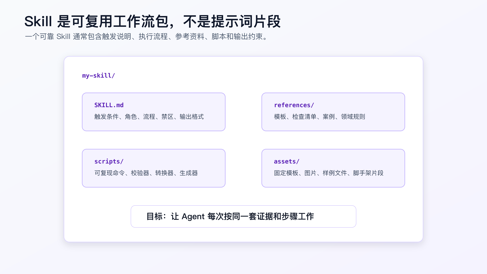
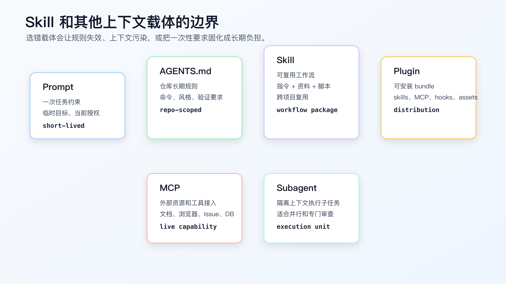

# Skill 是什么：从提示词到可复用工作流

很多程序员第一次看到 Skill，会把它理解成“高级 Prompt”。

这个理解太窄。

Prompt 解决的是当前这一次怎么说。Skill 解决的是以后每一次类似任务都按什么流程、读取什么资料、使用什么脚本、产出什么证据。

比如你已经形成了一套 AI Coding 调试方法：

```text
先复现
读完整错误
追调用链
提出单一假设
最小验证
修根因
跑回归
记录残余风险
```

如果每次调试都把这段复制进聊天窗口，它只是 prompt。

如果你把它做成一个 Skill，让 Agent 在遇到 bug、测试失败、CI 失败时自动读取这套流程，并配合 references、scripts、模板和输出要求，那它就是可复用工作流。

Skill 的价值，不是让 AI 多记几句话，而是把个人经验从“临时提醒”变成“可重复执行的工程程序”。



## Skill 适合固化什么

不是所有经验都适合做成 Skill。

一次性的任务要求，放 prompt。

某个 repo 的长期规则，放 `AGENTS.md`、`CLAUDE.md` 或对应工具的项目规则。

跨项目反复使用的工作流，才适合做 Skill。

适合 Skill 的场景通常有几个特征：

- 每次任务都有固定步骤。
- 步骤中需要查固定资料或模板。
- 需要运行固定脚本或校验器。
- 需要防止 AI 走常见错误路径。
- 输出有固定结构。
- 这个流程会在多个项目或多类任务里复用。

例如：

- 代码审查。
- 系统化调试。
- TDD 实现。
- 文章发布检查。
- API 文档核对。
- 生成项目代码地图。
- 前后端验证记录。
- 技术方案 red-team。

这些都不是一句 prompt 能长期解决的。

## 一个 Skill 通常包含什么

不同工具对 Skill 的具体格式不完全一样，但从当前 Codex Skills、Claude Code Skills 和 Superpowers 的结构看，核心思路很接近：用一个入口说明文件告诉 Agent 什么时候使用、怎么使用、有哪些资料和脚本。

一个常见结构是：

```text
my-skill/
├── SKILL.md
├── references/
│   ├── checklist.md
│   └── examples.md
├── scripts/
│   └── validate-output.js
└── assets/
    └── template.md
```

`SKILL.md` 是入口。它至少要说明：

- skill 名称。
- 什么时候触发。
- 执行前要读什么。
- 执行步骤。
- 哪些行为禁止。
- 输出格式。
- 验证方式。

`references/` 放相对稳定的资料，例如检查清单、案例、模板说明、领域规则。

`scripts/` 放可执行工具，例如校验 Markdown 结构、生成索引、检查链接、转换文件。

`assets/` 放固定资产，例如模板、样例、图片、脚手架片段。

Skill 不是把所有内容都塞进一个超长 prompt。它应该让 Agent 按需读取相关资料，必要时运行脚本，最后产出可验证结果。

## Skill 和 Prompt 的区别

Prompt 是一次性的。

例如：

```text
请帮我 review 这个 PR，重点看 bug、风险和测试缺口。
```

Skill 是持久的。

它会把 review 方法固定下来：

```text
先读需求和 diff。
按严重程度输出 findings。
每个 finding 必须有文件和行号。
先列问题，再写摘要。
没有问题就明确说没有发现。
必须说明未运行的测试。
```

Prompt 的问题是容易漏。今天你记得说“先列问题”，明天可能忘了。Agent 也可能在长上下文里被别的任务带偏。

Skill 的作用是把这些长期有效的行为放到稳定入口里。

但不要把所有 prompt 都变成 Skill。

如果一个要求只对当前任务有效，例如“这次只改订单模块，不改支付回调”，它就应该留在 prompt 或当前 `tasks.md`，不要写进 Skill。

## Skill 和项目规则的区别

很多人会把 Skill 和 `AGENTS.md` 混用。

这会导致两个问题：

- 项目规则变成工具教程。
- Skill 变成某个 repo 的一次性约定。

边界可以这样判断：

```text
这个约束是否只属于当前 repo？
```

如果是，放项目规则。

例如：

```markdown
## Test Commands

- Backend focused tests: `npm test -- order`
- Frontend tests: `npm test -- web`
- E2E tests: `npx playwright test`
```

这属于项目规则。

再问：

```text
这个流程是否可以跨 repo 复用？
```

如果是，放 Skill。

例如：

```text
调试时必须先复现、收集证据、提出单一假设，再修复。
```

这属于工作流。

Skill 可以引用项目规则，但不要替代项目规则。一个 TDD Skill 可以要求“运行项目指定的 focused test”，具体命令应该来自 repo。



## Skill 和 Plugin 的区别

Plugin 更像分发单位。

一个 plugin 里可以包含多个 skills，也可以包含 MCP 配置、hooks、资源、应用或其他安装信息。Superpowers 就是一个典型例子：它不是单个 skill，而是一组围绕软件开发流程的技能和安装方式。

对个人程序员来说，可以先这样理解：

```text
Skill = 一个可复用工作流
Plugin = 一组能力的安装包
```

如果你只是想固化“怎么做代码审查”，写 Skill。

如果你想把一组工作流、脚本、资源和工具配置打包给另一个工具或另一台机器安装，再考虑 Plugin。

不要一开始就做 plugin。先让单个 Skill 在自己的项目里跑通。

## Skill 和 MCP 的区别

Skill 不是外部工具接入。

MCP 更适合让 Agent 访问外部资源或执行外部能力，例如文档、Issue、浏览器、只读数据库、代码索引服务。

Skill 负责“怎么做”。

MCP 负责“能访问什么”。

例如调试一个线上问题：

- Skill 规定先复现、收集日志、提出假设。
- MCP 可以提供只读日志查询工具、Issue 读取工具、监控查询工具。

如果只接 MCP，没有 Skill，Agent 可能拿到很多数据但不知道怎么排障。

如果只有 Skill，没有 MCP，Agent 有方法但拿不到外部证据。

两者可以组合，但不要混淆。

## Skill 在 AI Coding 工作流里的位置

把前面讲过的内容放到一条链路里，Skill 通常不负责定义需求，也不负责保存系统长期行为。它更像执行阶段的工作流入口。

```text
requirements / issue / spec
-> task context / design / tasks
-> Skill 触发对应执行纪律
-> Agent 读文件、改代码、跑命令
-> verification ledger / PR / review
```

例如：

- OpenSpec 保存“当前系统行为”和“拟议变更”。
- tasks.md 定义“这次要做哪几个小 diff”。
- TDD Skill 规定“执行行为变更前先写失败测试”。
- Debug Skill 规定“失败时先复现、找根因，再修复”。
- Verification Skill 规定“声明完成前必须报告命令和残余风险”。

这样看，Skill 不是又一层文档，而是把任务执行过程里的高频纪律变成可复用流程。

如果你的任务上下文本身已经足够具体，但 Agent 仍然经常跳步骤，那就适合把跳过的步骤做成 Skill。

## 从项目规则提取到 Skill 的时机

不要一开始就把规则写成 Skill。

很多规则先出现在项目里。比如你在一个支付项目中反复提醒 Agent：

```text
不要改支付回调签名。
不要把幂等失败当成普通异常。
改状态机必须补状态转换测试。
完成前必须跑 payment focused tests。
```

这些话先应该进入当前 repo 的项目规则，因为它们高度依赖业务边界。

等你在多个项目里看到同一种问题，才考虑提取为 Skill。

例如下面这部分可以跨项目复用：

```text
涉及状态机、持久化、认证、支付或 job 的行为变更：
- 先识别状态来源和副作用。
- 先写能失败的 focused test。
- 不把 refactor 和行为变化混在一个 diff。
- 完成前报告命令、结果和未验证范围。
```

这已经不是某个支付项目的规则，而是一类高风险改动的执行纪律。

提取时要保留边界。

Skill 里不要写：

```text
Run `npm test -- payment`.
```

应该写：

```text
Run the focused test command documented by the repository. If no focused command exists, inspect project scripts and report the chosen command before using it as evidence.
```

这样 Skill 负责流程，项目规则负责具体命令。

## Skill 的生命周期

Skill 不是写完就永远正确。

一个个人 Skill 通常会经历四个阶段。

```text
试用：从一次真实失误里提炼流程。
收敛：只保留会改变 Agent 行为的触发、步骤、停止点和输出。
脚本化：把格式、链接、字段、命令记录这类确定性检查交给脚本。
淘汰：工具能力变化、流程不再适用或被项目规则替代时删除。
```

很多 Skill 失效，不是因为模型变差，而是因为它已经过期。

例如一个文档核对 Skill 里写死了某个工具的旧命令。半年后工具安装方式变了，Agent 仍然会按旧命令执行。正确做法是把易变事实换成核对动作：

```text
Before using tool-specific commands, verify the current official installation and command reference.
```

再把稳定流程留下：

```text
先核对当前版本。
再列出破坏性变化。
只改当前任务需要的调用点。
最后用测试证明改动。
```

维护 Skill 时，不要只追加规则。

每次修改都问一句：

```text
这条规则是否还在真实任务里发挥作用？
```

如果答案不清楚，先删掉或移到 reference，而不是继续增加主流程噪音。

## 一个最小 Skill 应该怎么写

假设你想把“验证记录检查”固化成 Skill。

先不要写复杂工具。一个最小 `SKILL.md` 可以这样：

```markdown
---
name: verification-ledger-review
description: Use when reviewing whether an AI Coding task has enough verification evidence before declaring completion.
---

# Verification Ledger Review

Use this skill before claiming an implementation is complete.

## Required Inputs

- changed file list
- verification commands and output
- known baseline failures
- residual risks

## Workflow

1. Read the task goal and changed files.
2. Check whether focused verification was run.
3. Check whether broader verification was needed and run.
4. Classify any failures as current diff, baseline, expected red test, or environment.
5. Reject completion if command evidence is missing.
6. Report residual risk explicitly.

## Output

- Completion status: complete / incomplete
- Evidence used
- Missing verification
- Failure classification
- Residual risk
```

这已经比临时 prompt 稳定。

但它还不够强。下一步可以加 references：

```text
references/
└── failure-classification.md
```

再加脚本：

```text
scripts/
└── check-ledger.js
```

Skill 的演进路线应该是：

```text
先固化流程
再补参考资料
再加脚本校验
最后才考虑分发
```

不要反过来，一上来就做很重的目录和安装流程。

## 好 Skill 的关键是触发条件

Skill 写得再好，触发条件模糊也会出问题。

坏 description：

```text
Use this skill to improve code quality.
```

这个范围太大，Agent 不知道什么时候该用。

好 description：

```text
Use when encountering a bug, test failure, CI failure, or unexpected runtime behavior before proposing fixes.
```

它明确：

- 触发对象是 bug、测试失败、CI 失败、异常行为。
- 触发时间是在提出修复之前。

再比如 TDD Skill：

```text
Use when implementing a behavior change where a focused automated test can be written before implementation.
```

这比“Use for development”清楚得多。

触发条件要具体到工程场景，而不是写抽象价值。

## Skill 里不要写工具事实以外的幻想能力

写 Skill 时，一个常见错误是把愿望写成能力。

例如：

```text
The agent must guarantee the implementation is production ready.
```

这没有用。Agent 不能保证生产就绪。

更好的写法是：

```text
Before declaring completion, the agent must report:
- changed files
- verification commands and outputs
- tests not run and why
- residual risk
```

Skill 不能替代真实验证。它只能规定 Agent 必须怎样收集、使用和报告证据。

另一个错误是写太多“永远”“必须”但没有可执行动作。

例如：

```text
Always write high-quality maintainable code.
```

这不如：

```text
Do not combine refactoring with behavior changes unless explicitly authorized.
If a refactor is required, stop and request a separate refactor step.
```

Skill 里的规则必须能落到行为。

## Skill 什么时候不该写

下面这些不适合做 Skill：

- 只服务一次任务的约束。
- 某个 repo 的具体命令和路径。
- 还没被你实际验证过的流程。
- 过长的工具百科。
- 没有稳定触发条件的经验总结。
- 只是为了显得“工作流化”的 prompt 集合。

尤其是“还没被验证过的流程”。

一个 Skill 会放大你的经验。如果经验是错的，它会稳定地产生错误。

先在真实任务里跑几次，再固化。

## Skill 也要能被验证

一个 Skill 是否有用，不能靠感觉。

你可以拿同一类任务做对照：

```text
没有 Skill：
- Agent 是否直接写代码？
- 是否遗漏验证命令？
- 是否没有报告 residual risk？

使用 Skill：
- 是否先读要求的上下文？
- 是否按阶段停住？
- 是否输出了证据？
- diff 是否更小、更可审？
```

如果使用 Skill 后行为没有明显变化，原因通常有三种：

- 触发条件不够具体。
- 停止条件太软。
- 输出要求不可检查。

这时不要继续堆更多说明。先改这三处。

例如 verification Skill 如果没有拦住“测试已通过”这种空结论，就应该把输出要求改成：

```text
Do not accept completion unless the response includes:
- command
- result
- failures or explicit no failures
- what was not verified
```

Skill 的效果要看它是否改变 Agent 行为，而不是看它写得多像规范。

## Skill 要接到交付证据上

Skill 最后要落到交付证据。

否则它只是对话里的流程提示。

以 verification Skill 为例，任务完成时至少应该能回答：

```text
这次 Skill 触发了吗？
它要求的上下文读了吗？
它要求的停止点有没有触发？
它要求的验证命令跑了吗？
结果是什么？
哪些范围没有验证？
```

可以把这段写进 PR 描述、任务记录或本地 verification ledger：

```markdown
Workflow evidence:
- skill: verification-ledger-review
- trigger: before completion claim
- changed files checked: yes
- focused command: `npm test -- order-cancel`
- result: pass, 18 tests
- not verified: payment provider sandbox callback
```

这样 reviewer 才能判断 Agent 是按流程做了，还是只说自己做了。

Skill 和交付记录之间缺一层证据，就会回到老问题：AI 说完成，人不知道该不该信。

## 一个坏 prompt 到 Skill 的改造过程

坏 prompt：

```text
以后调试要认真点，先分析原因，不要乱改。
```

这句话对人有提醒作用，对 Agent 的约束很弱。

改成 Skill 时，要拆成行为：

```markdown
Use when:
- bug, test failure, CI failure, unexpected runtime behavior.

Before editing:
- reproduce or record why reproduction is unavailable.
- read full error output.
- identify first failing line.
- inspect recent diff.
- trace the value or state source.

Stop if:
- reproduction is missing.
- fix requires changing public API or schema.
- failure may be baseline and baseline is not confirmed.

Output:
- root cause.
- changed files.
- verification commands and results.
- residual risk.
```

这样 Agent 才知道具体该做什么、什么时候不能继续、最后要交什么证据。

Skill 改造的关键，是把抽象要求翻译成可检查行为。

## Skill 的投入产出怎么判断

写 Skill 需要维护成本，所以要算值不值。

适合写 Skill 的任务，通常满足：

```text
高频：一个月会遇到多次。
高风险：漏一步会导致错误 diff、错误文章或错误验证。
跨项目：不是某个 repo 的独有规则。
可检查：结果能用命令、diff、清单或输出结构判断。
```

例如“完成前验证”值得写。因为 AI 经常提前宣布完成，漏掉命令、失败分类和残余风险。

“某个项目的订单取消目录结构”不适合写。它属于项目规则或代码地图。

“某个库的旧 API 用法”也不适合写。它可能很快过期，应该通过官方文档或项目依赖版本核对。

一个实用判断：

```text
如果这个规则明天换一个 repo 仍然成立，可以考虑 Skill。
如果换一个 repo 就失效，先放项目规则。
```

## 个人程序员可以先做三类 Skill

不要一开始做很多。

我建议从三类开始。

**第一类：调试 Skill。**

触发测试失败、CI 失败、异常行为。核心流程是先证据、再假设、后修复。

**第二类：验证 Skill。**

在 AI 声称完成前触发。检查命令、输出、失败分类、残余风险。

**第三类：写作或文档 Skill。**

如果你经常写技术文档、变更说明、PR 描述，可以把结构、禁用口径、证据要求固化。

这三类最容易产生复用价值，而且不会强行改变项目架构。

## 常见错误

**错误一：把 Skill 写成 prompt 合集。**

Skill 应该有触发、流程、资料、脚本和输出约束，不只是几段提示词。

**错误二：把 repo 命令写进跨项目 Skill。**

跨项目 Skill 应该说“运行项目指定测试命令”，具体命令由项目规则提供。

**错误三：触发条件太泛。**

“提高质量”“写更好代码”没有触发价值。

**错误四：没有验证方式。**

Skill 执行完也要能检查结果。没有输出约束和检查点，工作流会漂。

**错误五：把 MCP 和 Skill 混为一谈。**

Skill 是方法，MCP 是外部能力接入。两者可以组合，但职责不同。

**错误六：过早做 Plugin。**

先让单个 Skill 在真实任务中稳定，再考虑打包分发。

## 改完后重点看什么

一个 Skill 写完后，不要只看文件结构。

重点看：

- 触发条件是否具体。
- 是否明确什么时候不该用。
- 流程是否能按步骤执行。
- 是否引用了必要资料。
- 是否有脚本或检查方式。
- 输出是否可审查。
- 是否避免写入项目私有命令。
- 是否在真实任务里跑过。

如果一个 Skill 不能让 Agent 按固定步骤留下证据，它就只是换了位置的 prompt。

Skill 的目标，是把你已经证明有效的 AI Coding 方法，沉淀成下一次还能被正确调用的工作流资产。

## 常见问题

**Skill 是不是越多越好？**

不是。Skill 多了会增加触发冲突和维护成本。先做高频、高风险、可复用的流程。

**Skill 可以替代 AGENTS.md 吗？**

不能。AGENTS.md 适合 repo 规则；Skill 适合跨项目工作流。两者职责不同。

**Skill 需要写代码吗？**

不一定。最小 Skill 可以只有 `SKILL.md`。当流程需要稳定校验或生成时，再加脚本。

**Skill 能保证 AI 不犯错吗？**

不能。它只能提高流程一致性，要求 AI 使用证据、模板和校验。最终还要看 diff、测试和人工判断。

**什么时候该把 Skill 做成 Plugin？**

当你需要分发一组 skills、脚本、MCP 配置或其他资源，并希望跨工具安装时，再考虑 Plugin。

## 可复查资料

- OpenAI Codex Agent Skills：<https://developers.openai.com/codex/skills>
- Anthropic Claude Code Skills：<https://code.claude.com/docs/en/skills>
- Superpowers GitHub 仓库：<https://github.com/obra/superpowers>
- Model Context Protocol 文档：<https://modelcontextprotocol.io/docs/getting-started/intro>

---

[课程首页](../../../README.md) · [完整目录](../README.md) · [← 模块实战：用 AI 完成一次 CLI 交互改造](../05-%E5%B0%8F%E6%AD%A5%E5%BC%80%E5%8F%91%E6%B5%8B%E8%AF%95%E4%B8%8E%E8%B0%83%E8%AF%95%E9%97%AD%E7%8E%AF/28-%E6%A8%A1%E5%9D%97%E5%AE%9E%E6%88%98-%E7%94%A8-AI-%E5%AE%8C%E6%88%90%E4%B8%80%E6%AC%A1-CLI-%E4%BA%A4%E4%BA%92%E6%94%B9%E9%80%A0.md) · [Skill 原理解析：它如何约束 Agent 行为 →](30-Skill-%E5%8E%9F%E7%90%86%E8%A7%A3%E6%9E%90-%E5%AE%83%E5%A6%82%E4%BD%95%E7%BA%A6%E6%9D%9F-Agent-%E8%A1%8C%E4%B8%BA.md)

动手实践：[Superpowers 业务工作流](../../../personal-productivity-app/dev-process/02-superpowers-today-plan-workflow.md)
