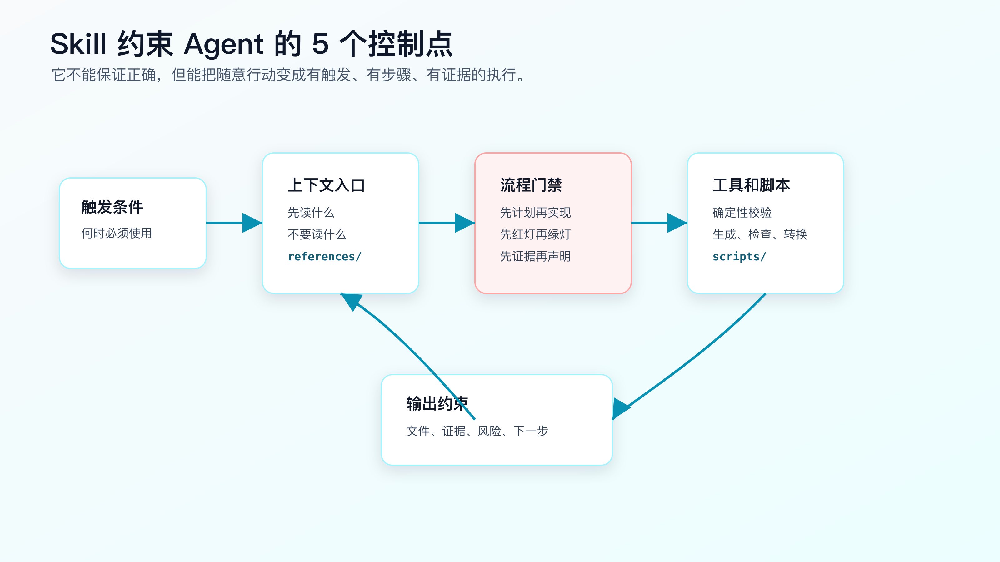
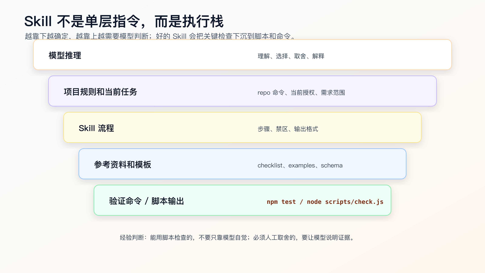

# Skill 原理解析：它如何约束 Agent 行为

Skill 不能让 AI 变成不会犯错的程序员。

它能做的，是减少 Agent 的自由发挥空间。

一个没有 Skill 的 Agent，拿到任务后通常靠当前 prompt、上下文、模型习惯和工具反馈行动。它可能先写代码，也可能先读文件；可能先跑测试，也可能直接总结；可能遇到失败就排查，也可能补一个看似合理的判断。

Skill 的作用，是在某类任务出现时，把 Agent 拉进一条固定轨道：

```text
什么时候触发
先读什么
先做什么
哪些事不能做
什么时候必须停
要运行什么检查
最后如何报告证据
```

所以 Skill 的原理不是“提示词更长”，而是给 Agent 增加控制点。



## 第一个控制点：触发条件

Skill 的第一层约束，是触发。

如果触发条件写得好，Agent 会在正确场景下进入正确流程。

比如调试类 Skill 的触发条件可以是：

```text
Use when encountering a bug, test failure, CI failure, or unexpected runtime behavior before proposing fixes.
```

这里有两个关键信息：

- 场景：bug、测试失败、CI 失败、异常行为。
- 时机：提出修复之前。

这会阻止 Agent 看到报错就直接修。

触发条件写坏，Skill 就会失效。

坏写法：

```text
Use this skill for better engineering quality.
```

这个范围太大，几乎等于没写。Agent 不知道何时必须用，也不知道什么时候不用。

Skill 的 description 应该像函数签名一样精确：

```text
输入场景是什么
触发时间是什么
任务边界是什么
```

对 AI Coding 来说，触发条件越具体，越能减少误用。

## 第二个控制点：上下文入口

Skill 还能规定 Agent 先读什么。

同一个任务，如果上下文入口错了，后面的推理都会偏。

例如 review Skill 可以要求：

```text
Before reviewing:
- read the task goal.
- inspect the diff.
- inspect relevant tests.
- do not summarize before listing findings.
```

调试 Skill 可以要求：

```text
Before proposing fixes:
- read the full error output.
- identify the first failing line.
- trace the value source.
- inspect recent diff.
```

这不是格式要求，而是上下文控制。

没有这个控制，Agent 可能只读最后一行错误，只看当前打开文件，或者根据常见模式猜原因。

Skill 可以把“先读什么”写成入口，让 Agent 每次先看指定材料。

## 第三个控制点：流程门禁

好的 Skill 会设置门禁。

门禁不是口号，而是阶段顺序。

例如 TDD：

```text
先写失败测试
确认测试按预期失败
再写最小实现
确认测试通过
再考虑重构
```

例如验证完成：

```text
先确定要证明什么
运行命令
读取输出
确认退出码和失败数量
再声明结果
```

例如复杂需求：

```text
先写计划
人审计划
只授权当前步骤
完成后停止
```

这些门禁会改变 Agent 的执行节奏。

没有门禁时，Agent 会倾向于一次性完成任务。门禁把任务切成可审查阶段。

Superpowers 这类框架之所以值得研究，不是因为它的文字更强，而是它把 brainstorming、TDD、systematic debugging、verification-before-completion、code review 等环节做成了一组可触发的流程门禁。

这背后的工程价值是：把“希望 Agent 自觉”变成“Agent 每次都要走流程”。

## 第四个控制点：参考资料

Skill 可以把稳定知识放进 references。

例如：

```text
references/
├── failure-classification.md
├── review-severity.md
└── verification-ledger-template.md
```

这比把所有规则塞进 `SKILL.md` 更好。

入口文件只写流程和路由，细节资料按需读取。

这样有三个好处：

- 减少主指令噪音。
- 让长资料可维护。
- 让 Agent 在需要时读取具体参考，而不是每次吞下全部内容。

但 reference 也有边界。

它适合放稳定模板、检查清单、案例、术语说明。

不适合放当前项目路径、当前任务结论、某次任务里的临时取舍、过时工具能力。

如果 reference 过期，Skill 会稳定地产生过期行为。

## 第五个控制点：脚本和确定性校验

Skill 最容易被低估的部分，是 scripts。

能用脚本检查的东西，不要只靠模型自觉。

比如验证记录是否包含必要段落、命令块、通过信号，可以用脚本检查。

比如 Markdown 链接是否能访问，可以用脚本检查。

比如生成的配置是否符合 schema，可以用脚本检查。

模型擅长理解和取舍，但不适合做机械一致性检查。

一个成熟 Skill 应该尽量把确定性检查下沉到脚本：

```text
模型负责判断：
- 哪些证据相关。
- 哪些风险需要说明。
- 当前任务是否越界。

脚本负责检查：
- 文件结构是否存在。
- 必要字段是否齐全。
- 命令输出是否包含 pass/fail。
- 生成格式是否有效。
```



所以 Skill 不该只停在一个 `.md` 文件。最小 Skill 可以只有说明，但高价值 Skill 往往会逐步长出脚本。

## 第六个控制点：输出约束

Skill 还要规定输出。

没有输出约束，Agent 可能执行了流程，但最后只给你一句：

```text
已完成。
```

这对工程没有价值。

验证类 Skill 的输出应该包含：

```text
Completion status
Changed files
Commands run
Command results
Failures
Residual risk
What was not verified
```

代码审查类 Skill 的输出应该包含：

```text
Findings first
Severity
File and line
Why it matters
Suggested fix only when useful
Tests not run
```

调试类 Skill 的输出应该包含：

```text
Reproduction
Evidence
Hypothesis
Minimal verification
Root cause
Fix
Verification
Residual risk
```

输出约束的作用，是让人能审。

AI Coding 不是让 Agent 自己满意，而是让人能判断它做得对不对。

## 第七个控制点：停止条件

很多 Skill 只写“应该怎么做”，没有写“什么时候不能继续”。

这会留下一个大洞。

AI Coding 里最危险的行为，往往发生在信息不够时：

```text
需求边界不清，继续实现。
复现失败，继续猜原因。
测试命令找不到，继续说已验证。
工具不可用，继续编一个结论。
改动会影响 public API，但没有停下来确认。
```

停止条件要写得硬。

例如调试 Skill 可以写：

```text
Stop if:
- the failure cannot be reproduced after two focused attempts.
- the proposed fix changes public API, schema, or persistence behavior not mentioned in the task.
- the failure may be baseline but no baseline evidence has been collected.
```

代码审查 Skill 可以写：

```text
Stop and report missing context if:
- no diff is available.
- no task goal is provided.
- line references cannot be produced.
```

停止不是让 Agent 放弃，而是避免它在证据不足时继续扩大错误。

一个 Skill 如果没有 stop conditions，只能算流程建议，还不能算工程约束。

## Skill 不能替代工具权限

Skill 只是指令和资源。

它不能凭空获得权限，也不能绕过工具限制。

如果一个 Skill 说“查询生产数据库”，但当前环境没有只读数据库工具，Agent 不能真的查询。

如果一个 Skill 说“打开浏览器验证”，但当前会话没有浏览器能力，它只能说明无法执行，不能伪造结果。

这点要写清楚。

例如：

```text
If the required tool is unavailable, report the missing tool and provide the next best local verification. Do not claim the unavailable verification was performed.
```

好的 Skill 应该约束证据口径：

```text
没有运行，就说没有运行。
不能访问，就说不能访问。
只有推断，就标明推断。
```

否则 Skill 会让错误结论看起来像按流程得出的结果。

## Skill 的执行证据怎么审

审一个 Skill 是否被正确执行，不要看 Agent 有没有提到 Skill 名称。

要看证据。

例如 review Skill 执行得好，输出里应该有：

```text
任务目标。
diff 范围。
检查过的文件。
按严重程度排序的 finding。
文件和行号。
没有运行的测试。
open questions。
```

如果输出只是：

```text
我已经根据 review skill 检查过，整体没问题。
```

这等于没审。

调试 Skill 也是一样。

有效证据应该包括：

```text
复现命令。
完整错误的关键行。
最小假设。
验证这个假设的动作。
根因和修复之间的对应关系。
修复后的回归命令。
```

没有这些证据，Skill 就没有提供可审查价值。

程序员审 Skill 执行结果时，可以用一个短问题：

```text
如果我不相信 Agent 的结论，只看它给出的证据，能不能复查到同样判断？
```

能，就说明 Skill 输出可用。

不能，就让 Agent 补证据，而不是继续下一步。

## Skill 也不能替代人工判断

Skill 可以要求 Agent 先做计划，但计划是否合理仍然需要人审。

Skill 可以要求 Agent 写失败测试，但测试是否覆盖业务风险仍然需要人审。

Skill 可以要求 Agent 输出验证记录，但残余风险是否可接受仍然需要人判断。

所以 Skill 的定位应该是：

```text
提高流程一致性
减少遗漏
暴露证据
降低重复沟通成本
```

而不是：

```text
自动保证质量
自动替代评审
自动做完交付
```

一旦把 Skill 当作质量保证本身，就会过度信任工具。

## 一个反例：坏 Skill 怎么误导 Agent

坏 Skill：

```markdown
---
name: complete-task
description: Use for all coding tasks.
---

# Complete Task

Always implement the requested feature cleanly.
Make sure code quality is high.
Run tests if needed.
Summarize what you did.
```

这个 Skill 几乎没有价值。

问题在于：

- 触发条件太宽。
- 没有上下文入口。
- 没有阶段门禁。
- 没有禁止事项。
- 没有具体验证命令。
- 没有输出证据结构。
- “if needed” 给了模型逃避空间。

改成有约束的写法：

```markdown
---
name: focused-change-execution
description: Use when executing an approved implementation task that should produce a small reviewable diff.
---

# Focused Change Execution

## Before Editing

- Read the approved task.
- List allowed files and forbidden changes.
- Identify the focused verification command.
- Stop if required files are outside the approved scope.

## During Editing

- Execute only the current task.
- Do not perform unrelated refactoring.
- Do not change public API shape unless explicitly authorized.
- Do not start the next task.

## After Editing

- Report changed files.
- Run the focused verification command.
- Report command output.
- State residual risk.
```

这才像一个可执行工作流。

## 约束不是越多越好

Skill 里的约束要服务任务风险。

如果一个 Skill 对所有任务都要求计划、TDD、review、全量测试，它会让小任务变慢，也会让 Agent 在不需要的地方加载大量上下文。

更合理的写法是分层触发：

```text
Low risk:
- typo、文案、小配置，不触发完整流程。

Medium risk:
- 单模块行为改动，触发 plan-first 和 focused verification。

High risk:
- 状态机、权限、支付、持久化、跨模块改动，触发 SDD/TDD/debug/review/verification 链路。
```

Skill 的职责是让风险和流程匹配，而不是让所有事情都重流程。

如果一个 Skill 触发太频繁，程序员会开始忽略它。忽略几次后，它就失去约束力。

## Skill 之间会冲突

一个任务可能同时命中多个 Skill。

例如修一个测试失败：

- Debug Skill 想先复现、找根因。
- TDD Skill 想先写失败测试。
- Small diff Skill 想限制文件范围。
- Verification Skill 想完成前检查证据。

这些不一定冲突，但必须有主次。

可以写成：

```text
Primary workflow:
- systematic-debugging for root cause.

Supporting constraints:
- focused-change-execution for small diff.
- verification-before-completion before completion claim.
```

不要让多个 Skill 同时定义 source of truth。

任务主线只能有一条：当前是调试、实现、review，还是验证？主线确定后，其他 Skill 只能提供约束，不能抢流程。

这也是为什么项目规则里要写清楚：当用户给出更具体的 spec、plan 或 task 时，以当前 task 为准，Skill 服务于当前 task。

一个实际排序例子：

```text
场景：实现过程中测试失败。

Primary:
- systematic-debugging，先确定失败是不是当前 diff 引入。

Supporting:
- focused-change-execution，限制修复文件范围。
- verification-before-completion，修复后要求新鲜验证。

Not primary:
- test-driven-development，此时已经进入调试，不重新启动 TDD 流程。
```

如果主线不清，Agent 可能一边调试、一边补测试、一边重构，最后又回到大 diff。

Skill 越多，越需要主线排序。

## 工具不可用时，Skill 也要给出口径

生产任务里经常会遇到工具不可用。

浏览器起不来，日志工具没有权限，MCP server 超时，测试环境缺变量。

这时 Skill 不能只写“使用某某工具验证”。它还要规定不可用时怎么说。

正确输出应该像这样：

```markdown
Verification not performed:
- required tool: browser preview
- reason: dev server failed to start, missing DATABASE_URL
- fallback used: component tests only
- risk: real browser interaction and network request not verified
```

错误输出是：

```text
页面应该可以正常工作。
```

前者能让人判断风险，后者只是猜。

所以验证类 Skill、MCP 类 Skill、前端检查 Skill 都要有 unavailable 分支。

只写成功路径的 Skill，在真实工程里不够用。

## reference 和 scripts 也会过期

Skill 的入口文件会过期，reference 和 scripts 也会。

reference 过期的表现通常是：

```text
引用旧工具命令。
保留已经废弃的 API。
把旧项目里的目录当成通用规则。
示例输出和当前工具不一致。
```

scripts 过期的表现更隐蔽：

```text
检查字段和新模板不匹配。
把合法的新格式判成失败。
只检查结构，不检查关键证据。
依赖旧 Node/Python 版本。
```

所以成熟 Skill 应该有自检。

最简单的办法是给 Skill 准备两个样例：

```text
examples/pass.md
examples/fail.md
```

再让脚本跑：

```bash
node scripts/check-ledger.js examples/pass.md
node scripts/check-ledger.js examples/fail.md
```

pass 样例应该通过，fail 样例应该失败，并且失败原因要准确。

这不是为了把 Skill 做成软件项目，而是为了防止一个已经过期的检查器继续给 Agent 提供错误约束。

## Skill 的失败模式

Skill 也会失败，而且失败方式很隐蔽。

第一种，触发失败。

任务明明是 CI 失败，调试 Skill 没触发。通常是 description 没写到 CI failure，或者触发时机没写“before proposing fixes”。

第二种，执行失败。

Skill 触发了，但 Agent 仍然直接改代码。通常是停止条件太软，或者输出没有要求复现证据。

第三种，过度触发。

改 typo 也触发完整调试流程。说明 description 太宽，或者没有写 do not use。

第四种，资料过期。

reference 里写了旧工具命令，Agent 稳定执行过期步骤。

第五种，冲突失败。

多个 Skill 同时定义流程，Agent 不知道以哪个为准。

所以维护 Skill 时，要看失败属于哪一类。

不要一失败就加更多文字。先判断是触发、流程、资料、输出还是冲突问题。

## 怎么测试一个 Skill 是否有效

Skill 写完后，要用真实任务试。

可以看四个结果：

**它有没有在正确场景触发。**

如果调试任务没有触发调试流程，description 可能太弱。

**它有没有改变 Agent 行为。**

如果 Agent 仍然直接修、不复现、不跑验证，流程门禁写得不够硬。

**它有没有减少遗漏。**

比如每次都能报告 changed files、commands、residual risk。

**它有没有制造新负担。**

如果小任务也被迫走长流程，Skill 触发范围太大。

不要只测试 happy path。

故意给一个测试失败，让调试 Skill 触发；给一个没有验证记录的完成声明，让验证 Skill 拦住；给一个需要 TDD 的行为改动，看它是否先要求失败测试。

## Skill 的维护成本

Skill 是资产，也是负债。

它需要维护：

- 工具命令变化。
- 官方文档变化。
- 项目实践变化。
- 模板和脚本 bug。
- 触发条件过宽或过窄。

所以不要无限增加 Skill。

建议定期做三件事：

```text
删除低频 Skill
合并重复 Skill
把有效规则沉淀到脚本或模板
```

如果一个 Skill 三个月没有触发，或者每次触发都要人工纠正，它可能不值得保留。

## 常见错误

**错误一：把 Skill 当成绝对约束。**

Skill 是指令和工作流，不是形式化证明。最终还要看工具执行和证据。

**错误二：只写原则，不写步骤。**

“保持高质量”没有用。要写先做什么、禁止什么、怎么验证。

**错误三：没有停止条件。**

Agent 遇到范围扩大、工具缺失、验证失败时必须知道何时停。

**错误四：不使用脚本。**

所有检查都靠模型，会增加遗漏。能确定性校验的地方应下沉到脚本。

**错误五：输出不可审查。**

没有 changed files、commands、results、risk，就无法判断执行质量。

**错误六：触发范围太大。**

所有任务都触发同一个 Skill，会让流程变重，也会产生上下文噪音。

## 改完后重点看什么

评估一个 Skill，不看它写得多完整。

看这些结果：

- 触发是否准确。
- 是否减少 Agent 直接行动。
- 是否把关键阶段拆开。
- 是否要求读取正确上下文。
- 是否使用确定性脚本或命令。
- 是否输出可审查证据。
- 是否明确无法验证时的口径。

好的 Skill 不是让 AI “更聪明”，而是让它少走你已经知道不可靠的路。

## 常见问题

**Skill 能不能强制 Agent 一定照做？**

不能从工程上绝对保证。它能提高触发和执行一致性，但仍要用 diff、测试、脚本和人工审查验证。

**Skill 里要不要写很多硬性用语？**

只在关键门禁处写硬规则。泛泛的强硬措辞没有意义。硬规则必须能对应行为和检查。

**脚本是不是必须有？**

不是。最小 Skill 可以没有脚本。但当检查能被程序化时，脚本比模型自查可靠。

**Skill 会不会污染上下文？**

会。触发条件过宽、references 太大、内容过期，都会污染上下文。所以要精简、分层、按需读取。

**Skill 和多 Agent 有什么关系？**

Skill 规定怎么做，多 Agent 规定谁去做、在哪个上下文做。多 Agent 任务也需要 Skill 约束，否则只是并行放大错误。

## 可复查资料

- OpenAI Codex Agent Skills：<https://developers.openai.com/codex/skills>
- Anthropic Claude Code Skills：<https://code.claude.com/docs/en/skills>
- Superpowers GitHub 仓库：<https://github.com/obra/superpowers>
- Superpowers `test-driven-development`：<https://github.com/obra/superpowers/blob/main/skills/test-driven-development/SKILL.md>
- Superpowers `verification-before-completion`：<https://github.com/obra/superpowers/blob/main/skills/verification-before-completion/SKILL.md>

---

[课程首页](../../../README.md) · [完整目录](../README.md) · [← Skill 是什么：从提示词到可复用工作流](29-Skill-%E6%98%AF%E4%BB%80%E4%B9%88-%E4%BB%8E%E6%8F%90%E7%A4%BA%E8%AF%8D%E5%88%B0%E5%8F%AF%E5%A4%8D%E7%94%A8%E5%B7%A5%E4%BD%9C%E6%B5%81.md) · [Superpowers 工作流拆解：把工程纪律变成 Skill 链 →](31-Superpowers-%E5%B7%A5%E4%BD%9C%E6%B5%81%E6%8B%86%E8%A7%A3-%E6%8A%8A%E5%B7%A5%E7%A8%8B%E7%BA%AA%E5%BE%8B%E5%8F%98%E6%88%90-Skill-%E9%93%BE.md)

动手实践：[Superpowers 业务工作流](../../../personal-productivity-app/dev-process/02-superpowers-today-plan-workflow.md)
