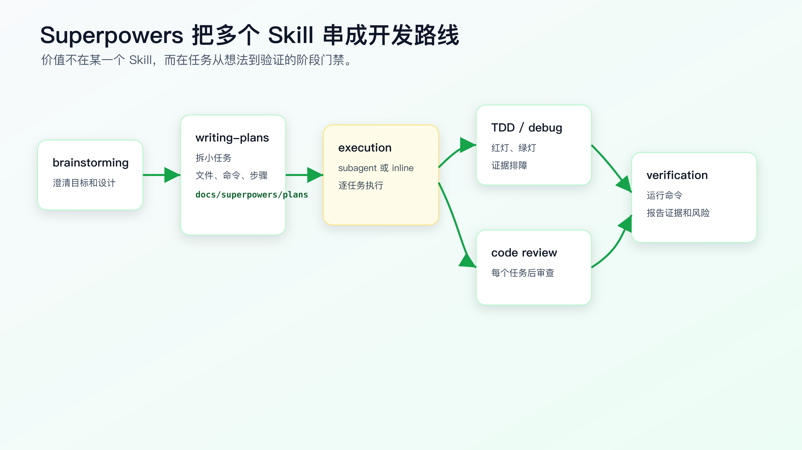
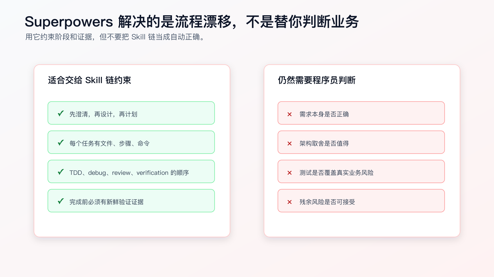

# Superpowers 工作流拆解：把工程纪律变成 Skill 链

Superpowers 值得拆开看。

它的价值不在于替你选定唯一框架，而在于把软件开发纪律拆成多个可触发的 Skill：

```text
brainstorming
writing-plans
test-driven-development
systematic-debugging
requesting-code-review
verification-before-completion
subagent-driven-development / executing-plans
finishing-a-development-branch
```

这些 Skill 单独看都不神秘。设计前澄清需求、写计划、TDD、系统化调试、代码审查、完成前验证，程序员本来就知道。

难点在于：AI 做任务时，经常跳过这些步骤。

先拆清楚一个基础问题：Superpowers 到底把哪些工程动作拆成了 Skill 链，为什么它和前面的 SDD / OpenSpec 不重复。

SDD / OpenSpec 解决的是“这次需求到底是什么、边界在哪里、任务怎么拆”。Superpowers 解决的是“开发过程中哪些动作不能跳过、失败时怎么收敛、完成前怎么留证据”。一个偏需求合同，一个偏执行纪律。

Superpowers 的思路是把这些步骤变成一条 Skill 链，让 Agent 在不同阶段进入不同工作流，而不是靠一条万能 prompt 从头管到尾。



## 它解决的是流程漂移

AI Coding 常见的流程漂移是这样的：

```text
需求还没澄清 -> 直接实现
设计还没确认 -> 开始改代码
测试还没失败 -> 写实现
调试还没找根因 -> 补判断
review 还没做 -> 继续下一步
验证没运行 -> 声称完成
```

每一步看起来都只是“快一点”。合起来就是不可控。

Superpowers 把这些容易被跳过的动作前置成门禁：

- 做东西前先 brainstorming。
- 有 spec 后再 writing-plans。
- 实现行为前触发 TDD。
- 遇到失败先 systematic-debugging。
- 完成任务后 requesting-code-review。
- 声称完成前 verification-before-completion。

它约束的不是语言能力，而是 Agent 进入下一步前必须经过哪些证据点。

## 一个业务需求大概怎么走

还是用“已支付订单取消进入退款流程”的需求。

如果随手让 AI 做：

```text
把 paid order cancel 改成 refund_requested，并创建退款请求。
```

它可能一次性改出一个大 diff。

用 Superpowers 思路，流程应该拆开。

第一步，brainstorming 负责把需求变成设计。

要澄清：

```text
paid 订单当前行为是什么？
pending 和 shipped 是否保持不变？
退款请求失败时订单状态怎么处理？
重复取消是否幂等？
payment provider callback 是否在范围内？
API response shape 是否允许变化？
```

输出不是代码，而是设计。

如果项目已经有 OpenSpec change、issue 或设计文档，brainstorming 不应该另起一套需求。它更适合用来检查缺口：哪些业务状态没说清楚，哪些异常路径没确认，哪些兼容性风险没有进入当前需求合同。

第二步，writing-plans 把设计拆成任务。

计划里要写：

```text
Task 1: Add failing tests
Task 2: Add paid -> refund_requested transition
Task 3: Wire refund request creation
Task 4: Add failure handling
Task 5: Run broader verification
```

每个任务要有文件、步骤、命令和预期结果。

如果前面已经有 `tasks.md`，writing-plans 也不是重新发明任务列表，而是把任务落到更细的执行步骤、文件路径、测试命令和预期输出。

第三步，执行任务。

如果平台支持 subagent，可以每个任务独立执行并审查。没有 subagent，也可以按 executing-plans 的方式在当前会话里分批执行。

关键不是“必须用 subagent”，而是每个任务都要小、可审、可验证。

第四步，TDD 和 debugging 在执行中触发。

Task 1 必须先写失败测试并确认红灯。

如果测试失败不是预期红灯，就进入 systematic debugging，先找根因。

第五步，review 和 verification 收尾。

每个任务之后看 diff。完成前跑新鲜验证命令，不能只靠上一次输出或 Agent 总结。

这条路线比“一个 prompt 做完”慢一点，但它把风险拆开了。

到这里为止，仍然只是工作流拆解。真正落到项目里，还必须看到真实文件、测试、diff、验证输出和 review 风险。否则“实战”两个字就会变成概念演示。

## Superpowers 的几个关键 Skill 怎么分工

**brainstorming：把想法变成设计。**

它不是头脑风暴聊天，而是防止 AI 在需求不清时直接实现。对个人程序员来说，可以把它理解成“需求和设计闸门”。

用在：

- 新功能。
- 行为变化。
- 不确定方案。
- 需要权衡边界的改动。

不适合：

- 明确 typo。
- 单行配置。
- 已有 tasks 里的小步骤。

**writing-plans：把设计拆成执行计划。**

它强调 exact file paths、具体步骤、验证命令、bite-sized tasks。这和我们前面讲的 `tasks.md` 一致。

它能防止：

- 计划只有大标题。
- 任务里没有验证。
- AI 一次性吞掉整个需求。

**test-driven-development：用红灯约束实现。**

它要求先写失败测试，确认失败，再写最小实现。

这对 AI 很关键，因为 AI 很容易先写实现，再让测试配合实现。

**systematic-debugging：遇到失败先找根因。**

它要求复现、读错误、查最近改动、追数据流、提出单一假设，再修。

这能防止 AI 看到错误就补空值判断。

**requesting-code-review：引入独立审查。**

它强调 reviewer 只看工作产物和需求，不继承当前会话历史。这个限制能减少当前会话带来的偏见。

当前会话里的 Agent 已经带着自己的推理路径和偏见，独立 review 可以减少“自己审自己”的盲区。

**verification-before-completion：完成前必须有证据。**

它的核心是：没有新鲜验证命令，就不能声称通过。

这是防止 AI 过早宣布完成的关键 Skill。

## 它的边界要说清楚

Superpowers 不会替你判断需求是否正确。

它也不会保证生成的计划一定合理。

它更不会保证测试覆盖了真实业务风险。

它能做的是把过程变得更难跳过：



适合交给 Skill 链约束的是：

- 阶段顺序。
- 任务粒度。
- TDD 红绿步骤。
- 调试证据循环。
- review 触发。
- 完成前验证。

仍然需要程序员判断的是：

- 需求本身是否正确。
- 设计取舍是否值得。
- 测试是否真的覆盖风险。
- review 反馈是否成立。
- 残余风险是否可接受。

如果你把 Superpowers 当成自动驾驶，就会过度信任。

如果把它当成“工程纪律执行器”，它适合个人工作流。

## 使用时不要全盘照搬

Superpowers 的默认工作流很强，但不一定适合每个任务。

对个人程序员，建议先借鉴三点。

第一，借鉴阶段门禁。

```text
设计通过前不实现
计划通过前不改代码
测试红灯前不写实现
验证前不声称完成
```

第二，借鉴小任务。

每个任务要能在几分钟内完成、单独验证、单独 review。

第三，借鉴证据输出。

不要让 AI 只说“完成”。让它报告 changed files、commands、results、residual risk。

你不必一开始就完整引入所有 Skill，也不必所有任务都走完整链路。

小任务用轻流程。

复杂行为改动用完整链路。

## 一个可执行的使用路线

如果你已经安装了 Superpowers，可以这样用在复杂需求上。

先给任务，但不让它实现：

```text
我们要修改 paid order cancellation 行为：
- paid cancel enters refund_requested.
- exactly one refund request is created.
- duplicate cancel is idempotent.
- refund request failure keeps order paid.
- payment provider callback is out of scope.

先不要改代码。
请按设计和计划流程推进。
```

然后看它是否先澄清和设计。

设计通过后，再让它写 plan。

计划应该包含：

```text
Task 1: failing tests
Task 2: status transition
Task 3: refund request creation
Task 4: failure handling
Task 5: verification
```

每个 task 要有：

```text
Files
Steps
Commands
Expected result
Stop conditions
```

执行时不要说“全部做完”。

指令只放开一个任务：

```text
只执行 Task 1。
完成后停止。
不要修改实现代码。
运行指定测试并报告红灯结果。
```

Task 1 通过 review 后，再进入 Task 2。

这样就能把 Superpowers 思路落到个人工作流里。

## 失败时不要跳过调试链路

Superpowers 这类 Skill 链最容易在失败时被绕开。

常见情况是：

```text
Task 1 写了失败测试。
Task 2 开始实现。
测试失败了，但失败信息和预期不一样。
Agent 说“这可能是测试环境问题”，然后继续改实现。
```

这时应该切到 systematic-debugging。

处理顺序是：

```text
读取完整错误。
确认是预期红灯、实现缺口、基线失败还是环境问题。
如果无法分类，停止实现。
提出一个假设。
用最小命令或文件读取验证假设。
分类清楚后再继续原任务。
```

比如订单取消测试失败：

```text
Expected: refund_requested
Received: cancelled
```

这可能是预期红灯，可以继续实现。

如果失败变成：

```text
Cannot connect to test database
```

这就不是业务红灯。继续写实现只会污染证据。

Skill 链不是线性流水线。遇到非预期失败时，要允许流程回到调试，而不是为了完成计划继续往前走。

## review 反馈要进入决策

requesting-code-review 的价值不是让另一个 Agent 说几句意见。

它的价值是让当前会话的惯性停下来。

但 review 反馈不能照单全收。

处理 review 的方式应该是：

```text
finding 有文件、行号和可复现输入：优先处理。
finding 是需求理解差异：回到 spec 或 plan 核对。
finding 只是风格偏好：看项目规则是否有约束。
finding 会扩大范围：拆成后续任务，不混进当前 diff。
```

例如 reviewer 提出：

```text
OrderService.cancelPaidOrder 里创建 refund request 后没有处理 duplicate cancel。
```

如果需求里明确要求幂等，这就是当前任务问题。

如果 reviewer 又提出：

```text
可以顺手重构整个 OrderService 状态机。
```

这可能是好建议，但不应该混进当前交付。

Superpowers 的工程纪律不是“谁提反馈就改谁”，而是让反馈有证据、有归属、有边界。

## 不要把 Superpowers 讲成必选框架

Superpowers 值得研究，但不是程序员 AI Coding 的唯一入口。

你可以不用它，仍然采用同样的纪律：

```text
需求不清先澄清。
设计不清先计划。
行为变化先测试。
失败先排障。
完成前跑验证。
复杂任务要独立 review。
```

Superpowers 的优势是把这些纪律打包成已经写好的 Skill 链，少了自己从零整理的成本。

它的成本是：你要理解每个 Skill 的触发条件、适用边界和输出要求。如果只是安装后盲目执行，也可能让小任务变重，或者让当前任务被不合适的流程包住。

实际使用时先选最有价值的几个：

- systematic-debugging
- test-driven-development
- writing-plans
- verification-before-completion
- requesting-code-review

这几个覆盖了 AI Coding 最常见的失控点。

等你熟悉后，再考虑 subagent-driven-development、executing-plans、finishing-a-development-branch 这类更完整的协作流程。

## 什么时候不适合用完整链路

下面这些任务不适合重流程：

- 改错别字。
- 调整一行配置。
- 改一个明确的测试断言文案。
- 更新 README 中过期命令。
- 一次性探索命令输出。

如果所有任务都强制 brainstorming、plan、TDD、review，会让工作流变成负担。

可以直接定义触发条件：

```text
Use full Superpowers-style workflow when:
- behavior changes.
- multiple modules may be touched.
- tests need to be added.
- bug root cause is not obvious.
- public API, payment, auth, persistence, jobs, or state machine code is involved.
```

这样既保留纪律，也不拖慢小改动。

## 怎么检查 Superpowers 是否真的发挥作用

不要只看它有没有被安装。

看结果：

- 它是否在实现前澄清了需求。
- 是否写了可执行 plan。
- 是否把任务拆小。
- 是否先写失败测试。
- 遇到失败是否先排障。
- 是否在任务后做 review。
- 声称完成前是否运行了验证命令。
- 是否报告没有验证的范围。

如果这些都没有发生，只是工具名出现在环境里，那它没有真正进入工作流。

## 和 OpenSpec / Spec Kit 怎么搭配

OpenSpec 和 Spec Kit 更偏规格和开发流程组织。

Superpowers 更偏 Agent 执行纪律。

可以这样组合：

```text
OpenSpec:
- 管 specs、changes、delta spec、archive。

Spec Kit:
- 管 constitution、spec、plan、tasks、implement 这条 SDD 流程。

Superpowers:
- 管 Agent 在设计、计划、TDD、调试、review、验证时是否按纪律执行。
```

不要在同一次任务里给 AI 三套互相竞争的 artifact。

如果当前任务以 OpenSpec 为主，就让 Superpowers 的执行纪律服务于 OpenSpec change：

```text
以 openspec/changes/<change>/tasks.md 为任务来源。
执行时遵守 TDD、debug、review、verification 流程。
```

如果当前任务以 Spec Kit 为主，就让 Superpowers 服务于 Spec Kit 生成的 tasks。

主线只能有一条。

## 一个任务里的 Skill 链报告

使用 Superpowers 思路后，最终应该能留下类似报告：

```markdown
Workflow evidence:

- Brainstorming / design:
  - clarified paid, pending, shipped and duplicate cancel behavior.

- Plan:
  - 5 tasks created, each with files and commands.

- TDD:
  - paid cancel and duplicate cancel tests failed before implementation.

- Debug:
  - no unexpected failure; expected red tests classified.

- Review:
  - reviewed diff for API response shape, callback changes and migration.

- Verification:
  - `npm test -- order-cancel`: PASS
  - `npm test -- order`: PASS
  - residual risk: real payment provider callback not verified locally.
```

这份报告不需要很长。它说明 Skill 链确实改变了执行路径，而不是只在对话里喊了几个工具名。

## 怎样把它迁移到自己的项目规则

如果你不想直接安装整套 Superpowers，也可以把关键纪律写进项目规则。

例如：

```markdown
## Complex Changes

For behavior changes involving state, persistence, auth, payment, jobs, or public APIs:
- produce a plan before editing.
- split into reviewable tasks.
- write failing tests before implementation when practical.
- use systematic debugging for unexpected failures.
- run focused verification before completion.
- report commands, results, and residual risks.
```

这不是复制 Superpowers，而是把它的工程精神迁移到自己的 repo。

等你发现这些规则在多个项目里反复出现，再把它们沉淀成个人 Skill。

迁移时不要带入工具专属话术。项目规则要写你真正执行的命令、目录和验证方式。

## 对个人程序员最有价值的三条纪律

如果只能从 Superpowers 学三件事，我会选这三条。

第一，完成前验证必须是新鲜的。

不能用“之前跑过”或“应该通过”。完成前要跑当前命令，读取输出，并报告未验证内容。

第二，调试前先找根因。

遇到失败时，先复现、读堆栈、看 diff、提单一假设。不要先补判断。

第三，计划要能交给别人执行。

一个 plan 如果只有你当前会话知道上下文，就不够。它应该写清文件、步骤、命令、预期结果和停机点。

这三条足以覆盖大多数 AI Coding 事故：

```text
过早宣布完成。
猜修复。
大 diff。
```

工具可以换，但这三条纪律不该换。

## 常见错误

**错误一：以为装了就会自动变稳。**

安装只是开始。要看 Agent 是否真的按 Skill 链执行。

**错误二：把所有任务都走完整链路。**

小任务重流程会降低效率。要定义触发条件。

**错误三：跳过计划审查。**

计划是后续执行的合同。计划错了，执行越认真越危险。

**错误四：把 TDD 当形式。**

没有红灯证据，就不能证明测试约束了旧实现。

**错误五：忽略 review 反馈。**

独立 review 的意义在于打断当前会话的惯性。不能只挑喜欢的反馈看。

**错误六：没有新鲜验证就说完成。**

完成前必须跑当前命令、读输出、报告结果。

## 改完后重点看什么

一次 Superpowers 风格任务完成后，看这些结果：

- 设计是否明确。
- plan 是否具体到文件、步骤、命令。
- 每个 task 是否小。
- 测试是否经历红绿过程。
- 调试是否有根因证据。
- review 是否有独立视角。
- completion claim 是否有新鲜验证。
- 残余风险是否写清。

如果这些证据完整，说明 Skill 链确实在工作。

如果只有“工具已安装”和“AI 说完成”，那还不够。

## 常见问题

**Superpowers 是否必须使用？**

不是。你可以不用它，但应该借鉴它背后的工程纪律：设计、计划、小步、TDD、调试、review、验证。

**没有 subagent 支持还能用吗？**

可以用 inline execution，但独立 review 和任务隔离会弱一些。复杂任务上，subagent 或独立会话确实更有价值。

**它和自己写的 Skill 冲突怎么办？**

一次任务只保留一条主流程。项目规则里写清当前任务以哪个 plan、spec 或 change 为 source of truth。

**它会不会太重？**

对小任务会。对复杂行为改动、bug 修复和跨模块需求，它能减少返工。

**能不能只借鉴 Superpowers 的工作流？**

可以。重点看它如何拆 Skill、如何设置门禁、如何要求证据，而不是照抄所有话术。

## 可复查资料

- Superpowers GitHub 仓库：<https://github.com/obra/superpowers>
- Superpowers `writing-plans`：<https://github.com/obra/superpowers/blob/main/skills/writing-plans/SKILL.md>
- Superpowers `test-driven-development`：<https://github.com/obra/superpowers/blob/main/skills/test-driven-development/SKILL.md>
- Superpowers `systematic-debugging`：<https://github.com/obra/superpowers/blob/main/skills/systematic-debugging/SKILL.md>
- Superpowers `requesting-code-review`：<https://github.com/obra/superpowers/blob/main/skills/requesting-code-review/SKILL.md>
- Superpowers `verification-before-completion`：<https://github.com/obra/superpowers/blob/main/skills/verification-before-completion/SKILL.md>

---

[课程首页](../../../README.md) · [完整目录](../README.md) · [← Skill 原理解析：它如何约束 Agent 行为](30-Skill-%E5%8E%9F%E7%90%86%E8%A7%A3%E6%9E%90-%E5%AE%83%E5%A6%82%E4%BD%95%E7%BA%A6%E6%9D%9F-Agent-%E8%A1%8C%E4%B8%BA.md) · [自定义 Skill：把你的经验固化成个人能力 →](32-%E8%87%AA%E5%AE%9A%E4%B9%89-Skill-%E6%8A%8A%E4%BD%A0%E7%9A%84%E7%BB%8F%E9%AA%8C%E5%9B%BA%E5%8C%96%E6%88%90%E4%B8%AA%E4%BA%BA%E8%83%BD%E5%8A%9B.md)

动手实践：[Superpowers 业务工作流](../../../personal-productivity-app/dev-process/02-superpowers-today-plan-workflow.md)
