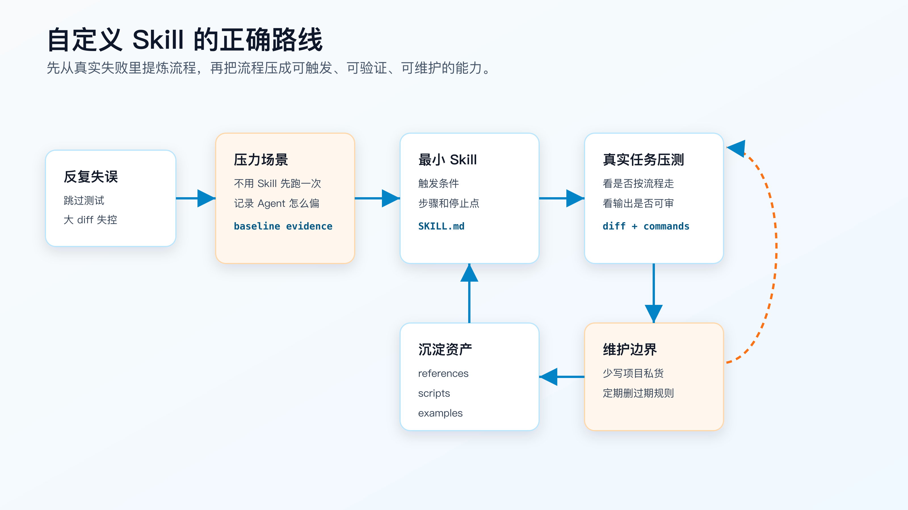
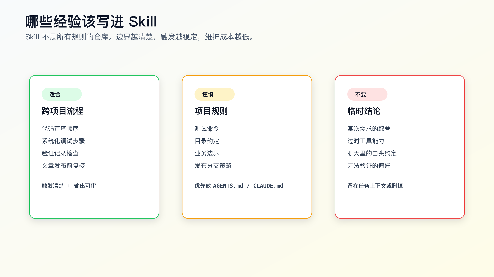

# 自定义 Skill：把你的经验固化成个人能力

程序员用 AI Coding 一段时间后，通常会有一类很烦的问题。

你已经知道怎么让 AI 稳一点，但每次都要重新提醒。

比如：

```text
先读 diff，不要直接总结。
先复现失败，不要猜原因。
改动不要跨模块扩大。
跑完命令再说结果。
引用官方文档，不要靠记忆写工具能力。
```

这些话说一两次还行。一个月后，同一批提醒会在不同项目、不同工具、不同会话里反复出现。

自定义 Skill 适合处理这种重复。

自定义 Skill 的目标不是写一份更长的提示词，而是把你已经验证过的个人工程经验，固化成 Agent 能稳定触发、能按步骤执行、能留下证据的工作流。

Skill 写得好，它会变成你的个人能力放大器。

Skill 写得差，它只是换了位置的 prompt。



## 先从真实失误开始，不要从模板开始

很多人写 Skill 的第一步是找模板。

这会把路带偏。

模板只能告诉你文件长什么样，不能告诉你这个 Skill 到底要解决什么工程问题。

一个值得写成 Skill 的流程，应该来自真实反复出现的失误。

比如你经常遇到这样的场景：

```text
需求：修复订单取消时库存回滚异常。

AI 的常见行为：
- 直接改 cancelOrder。
- 没看库存扣减入口。
- 没看幂等表。
- 没跑失败用例。
- 看到测试失败后说“可能是已有问题”。
```

这不是一个“订单 Skill”。

订单逻辑属于当前项目，不该写进跨项目 Skill。

可复用的是调试流程：

```text
遇到 bug 时，必须先复现。
必须定位第一个失败信号。
必须追数据来源。
必须检查最近 diff。
必须提出单一假设。
必须用最小命令验证。
修复后必须跑回归。
最后必须报告残余风险。
```

这才适合沉淀。

写 Skill 前，先把失误写成一段事实记录：

```markdown
## Repeated Failure

- Task type: bug fix
- Symptom: agent proposes a fix before reproducing the failure
- Consequence: patch hides the symptom but leaves inconsistent state
- Desired behavior: reproduce, isolate, fix root cause, verify regression
```

这段记录不是正文给读者看的东西，而是你写 Skill 时的设计输入。

没有真实失误，Skill 会写成空泛流程。

## Skill 的本质是行为合同

自定义 Skill 要回答四个问题：

```text
什么时候用？
先读什么？
按什么顺序做？
怎么证明做完？
```

这四个问题比“怎么写得全面”重要。

Skill 不是知识库。它更像一个小型行为合同。

例如代码审查 Skill 的合同可以是：

```text
触发：用户要求 review、检查 PR、看 diff。
输入：任务目标、diff、相关测试、项目规则。
流程：先列问题，按严重程度排序，每个问题必须有文件和行号。
输出：findings、open questions、test gaps，不把摘要放在问题前。
```

调试 Skill 的合同可以是：

```text
触发：bug、测试失败、CI 失败、异常行为。
输入：完整错误、复现步骤、最近 diff、相关日志。
流程：复现 -> 定位信号 -> 单一假设 -> 验证 -> 修根因 -> 回归。
输出：root cause、fix、verification、residual risk。
```

写作检查 Skill 的合同可以是：

```text
触发：准备发布技术文章。
输入：正文、来源链接、配图、禁用口径、发布平台要求。
流程：事实核对 -> 结构检查 -> 语气清理 -> 风险审查 -> 文件落盘。
输出：修改摘要、仍未验证的事实、最终文件路径。
```

这些合同不需要很长，但必须可执行。

如果一个 Skill 只能写出“提高质量”“认真检查”“保持专业”，它没有约束力。

## 一个可迁移的 Skill 骨架

不同工具对 Skill 的目录和元数据支持不完全一样。OpenAI Codex Skills、Claude Code Skills 和 Superpowers 的实现细节不同，但核心结构接近：入口文件负责触发和流程，辅助文件负责按需提供资料，脚本负责确定性检查。

可以从这个结构开始：

```text
my-debug-workflow/
├── SKILL.md
├── references/
│   ├── failure-classification.md
│   └── verification-ledger.md
└── scripts/
    └── check-ledger.js
```

最小版本只需要 `SKILL.md`。

不要一开始就把目录做满。

先写能改变 Agent 行为的入口文件：

```markdown
---
name: systematic-bug-fix
description: Use when fixing a bug, failed test, CI failure, or unexpected runtime behavior before proposing code changes.
---

# Systematic Bug Fix

## Purpose

Use this workflow to prevent speculative fixes. The goal is to reproduce the failure, isolate the cause, make the smallest correct change, and verify the result.

## Before editing

1. Read the full error or bug report.
2. Identify the first failing signal.
3. Find the code path that produces the signal.
4. Inspect the current diff.
5. State one hypothesis and the command or file read that will test it.

## Hard stops

- Do not edit code before a reproduction path is known.
- Do not add broad fallback logic without showing the failing data path.
- Do not claim the failure is unrelated without baseline evidence.

## Verification

Report:

- changed files.
- commands run.
- exact pass or fail result.
- risk that remains.
```

这个 Skill 已经能用。

它还不完美，但它有触发、步骤、停止点和输出。

很多团队和个人写不好 Skill，是因为一开始就想写成一本手册。Agent 真正需要的不是长篇解释，而是清楚的执行路线。

## description 要像触发器，不要像广告语

Skill 最容易写坏的是 `description`。

它决定 Agent 什么时候加载 Skill。

坏写法：

```yaml
description: Improve coding quality with a professional engineering workflow.
```

这个描述没有实际触发价值。

好写法：

```yaml
description: Use when fixing a bug, failed test, CI failure, or unexpected runtime behavior before proposing code changes.
```

差别在三个地方：

```text
任务类型明确：bug、failed test、CI failure。
触发时机明确：before proposing code changes。
行为意图明确：不是泛泛提高质量，而是阻止先改代码。
```

另一个例子，代码审查 Skill。

坏写法：

```yaml
description: Use this to perform high-quality code review.
```

好写法：

```yaml
description: Use when reviewing a code diff, pull request, or implementation against a stated requirement, before summarizing the work.
```

这里要看 “before summarizing the work”。

它能阻止 Agent 先写一段礼貌摘要，再把问题埋到后面。

触发条件要写成可识别场景，不要写成价值主张。

## 流程要短，但停止点要硬

Skill 不是越详细越好。

长流程有两个问题：

```text
Agent 不一定能稳定执行。
你自己后面也不愿意维护。
```

一个好的 Skill 应该把篇幅花在停止点上。

停止点就是不满足条件时不能继续。

例如：

```markdown
## Stop conditions

Stop and ask for clarification when:

- the requested behavior conflicts with repository rules.
- the failing command cannot be reproduced after two attempts.
- the task requires credentials or production access that are not available.
- the implementation would require changing public API behavior not mentioned in the task.
```

这比写十段“注意安全”“保持谨慎”有效。

AI Coding 里最危险的不是 Agent 不会写代码，而是它在不该继续时继续。

Skill 要把这些点写死。

## references 放稳定资料，不放临时结论

入口文件应该短。

细节资料可以放到 `references/`。

例如代码审查 Skill 可以有：

```text
references/
├── severity-rubric.md
├── test-gap-patterns.md
└── review-output-examples.md
```

调试 Skill 可以有：

```text
references/
├── failure-classification.md
├── log-reading-guide.md
└── rollback-risk.md
```

但 reference 不是垃圾桶。

不要把这些内容放进去：

```text
某次需求讨论。
某个项目的专属路径。
还没验证的工具能力。
一次失败后的情绪判断。
某次任务里的临时取舍。
```

reference 一旦被 Skill 反复读取，就会把旧结论放大成长期行为。

如果资料只对当前 repo 有效，优先放项目规则。

如果资料只对当前任务有效，放任务上下文。

只有跨项目稳定复用的资料，才值得进入 Skill。



## 和项目 AGENTS.md 怎么配合

个人 Skill 最常见的落地方式，是和项目规则一起工作。

项目规则回答：

```text
这个 repo 怎么跑？
哪些目录不能动？
测试命令是什么？
代码风格和架构边界是什么？
发布或迁移有什么约束？
```

个人 Skill 回答：

```text
遇到 bug 怎么排障？
做行为变更怎么走 TDD？
完成前怎么核验证据？
review 时怎么输出问题？
```

两者不要互相替代。

例如一个验证 Skill 可以写：

```markdown
Before completion:
- read repository instructions for test commands.
- choose the focused command that matches the changed surface.
- if no command is documented, inspect project scripts and report the basis.
- do not invent a command and treat it as official.
```

项目 `AGENTS.md` 则写：

```markdown
## Test Commands

- Unit tests: `npm test`
- CLI focused tests: `npm test -- cli`
- Lint: `npm run lint`
```

这样换项目时，Skill 不需要改。项目只需要维护自己的命令。

如果把 `npm test -- cli` 写进个人 Skill，到了下一个 Java、Go 或 Python 项目就会污染上下文。

一个简单规则：

```text
命令、路径、模块边界，留在 repo。
行为顺序、停止条件、证据格式，放进 Skill。
```

这个边界清楚，个人 Skill 才能长期复用。

## scripts 只做确定性工作

Skill 里可以带脚本，但不要为了显得高级而写脚本。

脚本适合做确定性检查：

```text
Markdown 是否包含必要段落。
JSON 是否符合 schema。
链接是否能访问。
验证记录是否包含命令和结果。
文件名是否符合约定。
生成资产是否存在。
```

脚本不适合替代工程判断：

```text
这个需求该不该做。
这个设计是否合理。
这个风险是否可接受。
这个测试是否覆盖真实业务。
```

在 AI Coding 里，一个实用的原则是：

```text
模型判断相关性和取舍。
脚本检查结构和一致性。
```

例如验证记录检查可以用脚本做：

```bash
node src/cli.js verify-ledger --file examples/verification-ledger.pass.md
```

输出应该像这样：

```text
Verification ledger looks usable: required sections, command block, and pass signal found.
```

失败时要明确缺什么：

```bash
node src/cli.js verify-ledger --file examples/verification-ledger.fail.md
```

```text
Verification ledger is incomplete.
Missing sections: Change Summary, Verification Commands, Evidence, Residual Risk
Missing command block with the verification command.
```

这类脚本适合放进 Skill，因为它把“请认真检查”变成了可执行动作。

但不要把业务实现塞进 Skill 的脚本。Skill 是工作流资产，不是项目逻辑的藏身处。

## 先压测，再扩展

写完 `SKILL.md` 后，不要立刻觉得它可以长期使用。

先拿真实任务压测。

压测方式很简单：

```text
选一个过去容易失败的任务。
先用普通 prompt 让 Agent 做一遍，记录它怎么偏。
再显式调用 Skill 做一遍，看行为是否变化。
比较两次输出中的证据、步骤、停止点和验证。
```

如果没有变化，说明 Skill 没有抓住关键失误。

比如你写了调试 Skill，但 Agent 还是直接改代码，通常是因为：

```text
触发条件没写到“修复前”。
停止点太软。
流程里没有要求复现证据。
输出没有要求命令和结果。
```

这时不要继续加长解释。

先改触发和停止点。

Skill 的迭代顺序应该是：

```text
触发条件
停止点
执行步骤
输出证据
reference
script
```

很多人反过来做，先写一堆 reference 和脚本，结果 Agent 还是不按流程走。

## 不要把 Skill 写成项目规则

项目规则要留在项目里。

例如：

```markdown
## Test Commands

- Unit tests: `npm test`
- Type check: `npm run typecheck`
- E2E: `npx playwright test`
```

这不应该写进跨项目 Skill。

跨项目 Skill 应该写：

```markdown
Run the focused test command defined by the repository instructions. If no command is documented, inspect package scripts or ask before inventing one.
```

这样 Skill 才能迁移。

项目规则会变，Skill 的流程不一定要变。

如果把具体项目命令写进个人 Skill，你下次在另一个 repo 里使用它，就会把旧项目的命令带过去。

这类污染不容易立刻暴露，但会把旧项目的约束带进新项目。

## 不要把 Skill 写成工具百科

自定义 Skill 里也不要写太多工具介绍。

比如你写一个 OpenSpec 工作流 Skill，不需要解释 OpenSpec 的所有概念。

它应该写：

```text
什么时候进入 proposal。
什么时候写 design。
tasks 什么时候可以执行。
archive 前必须检查什么。
哪些命令要以当前官方文档为准。
```

工具细节如果变化快，Skill 里只保留核对路径：

```markdown
Before writing tool-specific commands, verify the current official docs:

- OpenSpec docs: https://openspec.dev/
- OpenSpec repo: https://github.com/Fission-AI/OpenSpec/
```

不要把时效性强的命令永久写死，除非你愿意维护。

Skill 稳定，不代表里面的信息永远正确。

## 一个个人 Skill 的实战模板

下面这个模板适合迁移到自己的工作流里。

它不是工具专属模板，而是写 AI Coding Skill 时可以复用的骨架：

```markdown
---
name: <short-action-name>
description: Use when <specific task type>, <specific trigger timing>, <before/after a risky action>.
---

# <Skill Name>

## Goal

State the workflow outcome in one or two sentences.

## Use when

- Concrete task type.
- Concrete signal.
- Concrete timing.

## Do not use when

- One-off task.
- Repo-specific rule.
- User already supplied a more specific plan.

## Required context

Before acting, read:

1. Current user request.
2. Relevant repo instructions.
3. Relevant diff or files.
4. Relevant test or command output.

## Workflow

1. Restate the task boundary.
2. Gather evidence.
3. Propose the smallest valid next step.
4. Execute only that step.
5. Run the focused verification.
6. Report evidence and remaining risk.

## Stop conditions

Stop when:

- task boundary is unclear.
- required source cannot be found.
- verification cannot be run.
- change would exceed requested scope.

## Output

Return:

- changed files.
- commands run.
- result.
- risks.
- next suggested step.
```

这个模板有几个特点。

它不追求华丽。

它把输入、流程、停止点和输出写清楚。

它没有写死项目命令。

它允许 Agent 根据 repo 规则找具体命令。

这才是可复用 Skill 的基础。

## 什么时候需要做成个人 Skill

可以用四个问题判断：

```text
这个流程是否至少复用过三次？
不用它时，Agent 是否容易犯同一种错？
它是否跨项目成立？
它是否有可检查的输出？
```

四个问题都满足，再写 Skill。

如果只满足其中一个，先别写。

更轻的做法是把它放进当前任务 prompt 或项目规则里。

Skill 是长期资产，长期资产需要维护。

你的 Skill 越多，触发冲突越多，过期风险越高，Agent 读到的上下文也越重。

个人 Skill 库应该小而硬。

优先写这些：

```text
debug workflow
code review workflow
verification workflow
article publishing check
spec-to-plan workflow
context package workflow
```

少写这些：

```text
某个库的 API 用法。
某个项目的目录介绍。
一次需求的约束。
一句好用的 prompt。
```

## 放在哪里

不同工具的路径不同。

Codex、Claude Code、Cursor、Copilot 等工具对 Skill、custom agent、repository instructions 的命名和目录都在变化。写入前要看当前官方文档。

但有一个判断不变：

```text
个人跨项目能力，放个人级目录。
项目共享规则，放 repo。
团队统一分发，考虑 plugin 或组织级配置。
```

个人 Skill 不一定要进业务仓库。

如果它描述的是你的个人调试习惯、审查习惯、写作检查习惯，放在个人工具目录更合理。

如果它描述的是项目约束，例如“订单服务必须走 domain service，不允许 controller 直接写 repository”，就应该放在项目规则。

如果它是一组希望给团队分发的能力，再考虑打包。

不要为了分发而过早设计分发。

先让单个 Skill 在自己这里稳定。

## Skill 要有版本和变更理由

个人 Skill 也需要版本意识。

不一定要做复杂发布，但至少要知道：

- 什么时候改过。
- 为什么改。
- 改的是触发、流程、reference 还是脚本。
- 是否在真实任务里验证过。

可以在 Skill 目录里放一个简短记录：

```markdown
# CHANGELOG

## v0.2

- Tightened trigger: only use debugging workflow before proposing fixes.
- Added stop condition for missing reproduction.
- Tested on CI failure classification task.
```

为什么要这样做？

因为 Skill 会影响后续很多任务。如果你改坏了触发条件，它可能突然在不该出现的时候出现，或者在该出现的时候不出现。

有变更记录，回退和排查都容易得多。

## 自定义 Skill 要避免绑定单一工具幻觉

Codex、Claude Code、Cursor、Copilot、Superpowers 对 Skill、rule、agent instruction、slash command 的实现不同。

写个人 Skill 时，尽量把核心流程和具体工具语法分开。

核心流程：

```text
bug fix must reproduce before patch
completion requires command evidence
review findings come before summary
```

工具语法：

```text
frontmatter fields
skill folder location
allowed tools declaration
slash command name
```

前者稳定，后者会变。

如果你把工具专属语法写进所有流程说明，换工具时迁移成本会很高。

推荐写法是：Skill 主体写工程流程，工具安装和路径写在单独说明里，并用官方文档核对。

## 写完 Skill 后要做一次反向测试

反向测试是故意给 Agent 一个容易犯错的任务，看 Skill 能不能拦住。

例如调试 Skill：

```text
输入：这里有一个 TypeError，帮我修。
期望：Agent 先要求复现和堆栈，不直接改代码。
```

验证 Skill：

```text
输入：我改完了，测试应该都过了。
期望：Agent 要求具体命令和输出，不接受“应该”。
```

代码审查 Skill：

```text
输入：帮我看看这个 PR。
期望：Agent findings first，按严重程度列问题，不先写总结。
```

如果 Skill 在这些反向测试里拦不住错误行为，就先改触发和停止点。

不要等它进入真实生产任务才发现没约束住。

## 一个 Skill 的最小发布检查

准备长期使用前，至少检查这些点：

```text
Trigger:
- description 是否具体。
- 是否写了 use when / do not use when。

Workflow:
- 是否有先读什么。
- 是否有执行步骤。
- 是否有 stop conditions。

Evidence:
- 是否要求命令、输出、diff 或来源。
- 是否说明不能验证时怎么说。

Portability:
- 是否避免写死某个 repo 的路径和命令。
- 是否把工具专属安装说明和工程流程分开。

Maintenance:
- 是否有变更记录。
- 是否有反向测试样例。
```

这个检查比追求目录完整更重要。

一个只有 `SKILL.md` 的 Skill，只要这些点扎实，也能产生价值。

一个目录很完整但触发模糊的 Skill，反而会制造噪音。

## 个人 Skill 库要定期收敛

Skill 写多了以后，会出现一个新问题：Agent 每次任务都可能加载太多流程。

这会带来两个后果。

第一，触发冲突变多。

一个 bug 修复任务可能同时命中 debug、TDD、small diff、verification、review。它们都重要，但主流程只能有一个。

第二，旧规则会继续影响新任务。

你曾经为某个项目写过“前端改动必须截图”，后来换到纯后端服务，这条规则还在个人 Skill 里，就会制造无意义的要求。

个人 Skill 库需要定期收敛。

可以每月看一次：

```text
最近 30 天真正触发过哪些 Skill？
哪些 Skill 触发后改变了 Agent 行为？
哪些 Skill 经常被跳过或误触发？
哪些 Skill 只是项目规则，应该移回 repo？
哪些 Skill 里写了过期工具命令？
```

处理方式也不要复杂。

```text
高频且有效：保留。
低频但高风险：保留，但收窄触发。
低频且低风险：删除或移到参考资料。
项目专属：移回项目规则。
工具事实过期：改成官方资料核对动作。
```

一个小而硬的 Skill 库，比一个看起来完整但到处误触发的 Skill 库更有价值。

Skill 的数量不是能力指标。

真正要看的是：它有没有在关键时刻让 Agent 少走错一步。

## 删除 Skill 也要果断

有些 Skill 用过几次后就该删。

比如：

```text
为了某次工具迁移写的临时检查。
某个项目已经废弃的发布流程。
某个框架旧版本的 API 核对方式。
某段后来被项目规则取代的目录说明。
```

这些内容继续留在个人 Skill 库里，只会增加误触发概率。

删除前可以做一个简单判断：

```text
它最近是否触发过？
触发后是否真的改变结果？
里面的信息是否仍然准确？
是否已经有项目规则或脚本替代？
```

如果四个问题都答不上来，就先移到 archive。

archive 不是为了以后一定恢复，而是为了让当前 Agent 不再读取它。

个人工作流资产要允许淘汰。否则旧经验会变成新任务的噪音。

## 常见错误

**错误一：把失败经验写成口号。**

“要谨慎”“要工程化”“要专业”没有执行力。写具体触发、动作和停止点。

**错误二：把所有规则塞进 `SKILL.md`。**

入口文件越长，越难维护。稳定细节放 reference，机械检查放 script。

**错误三：把项目命令写进个人 Skill。**

个人 Skill 应该调用项目规则，而不是复制项目规则。

**错误四：没有真实压测。**

不拿真实任务试，无法知道 Skill 是否真的改变 Agent 行为。

**错误五：只增加流程，不删除流程。**

过期的 Skill 比没有 Skill 更危险。它会稳定地产生旧行为。

**错误六：把 Skill 当成权限边界。**

Skill 只能约束流程。文件读写、网络访问、外部工具权限，仍然要靠工具自身的 sandbox、approval、MCP 配置和人工确认。

## 改完后重点看什么

一个自定义 Skill 是否有价值，看这几个结果：

- Agent 是否在正确场景触发它。
- Agent 是否先读了要求的上下文。
- Agent 是否遵守停止点。
- 输出是否包含证据。
- 真实任务里的 diff 是否更小。
- 失败时是否更早暴露问题。
- 迁移到另一个 repo 后是否仍然成立。

如果这些都没有改善，就不要继续扩写。

回到真实失败，重新提炼流程。

Skill 的价值看行为变化，不看文件写得多完整。一个能让 Agent 提前停下来的 40 行 Skill，比一个覆盖所有场景但没人触发的长文档有用。

## 常见问题

**Skill 要不要写得很完整？**

不用。先写最小可用版本。能改变行为，再补 reference 和 script。

**Skill 可以只写中文吗？**

可以，但触发条件和工具生态里常见的关键词最好保留英文，例如 bug、test failure、code review、diff、verification。这样能匹配更多任务场景。

**要不要把自己的 prompt 全部搬进 Skill？**

不要。只有跨项目复用、反复触发、能检查结果的流程才值得写成 Skill。

**Skill 需要版本管理吗？**

需要。至少要能看到什么时候改过、为什么改。个人目录也可以用 git 管起来。

**Skill 写完后还需要 AGENTS.md 吗？**

需要。Skill 管工作流，AGENTS.md 管项目规则。两者配合，不互相替代。

## 可复查资料

- OpenAI Codex Agent Skills：<https://developers.openai.com/codex/skills>
- Anthropic Claude Code Skills：<https://code.claude.com/docs/en/skills>
- Agent Skills Specification：<https://agentskills.io/specification>
- Superpowers `writing-skills`：<https://github.com/obra/superpowers/blob/main/skills/writing-skills/SKILL.md>

---

[课程首页](../../../README.md) · [完整目录](../README.md) · [← Superpowers 工作流拆解：把工程纪律变成 Skill 链](31-Superpowers-%E5%B7%A5%E4%BD%9C%E6%B5%81%E6%8B%86%E8%A7%A3-%E6%8A%8A%E5%B7%A5%E7%A8%8B%E7%BA%AA%E5%BE%8B%E5%8F%98%E6%88%90-Skill-%E9%93%BE.md) · [外部工具接入：MCP 在 AI Coding 里到底有什么用 →](33-%E5%A4%96%E9%83%A8%E5%B7%A5%E5%85%B7%E6%8E%A5%E5%85%A5-MCP-%E5%9C%A8-AI-Coding-%E9%87%8C%E5%88%B0%E5%BA%95%E6%9C%89%E4%BB%80%E4%B9%88%E7%94%A8.md)

动手实践：[Superpowers 业务工作流](../../../personal-productivity-app/dev-process/02-superpowers-today-plan-workflow.md)
