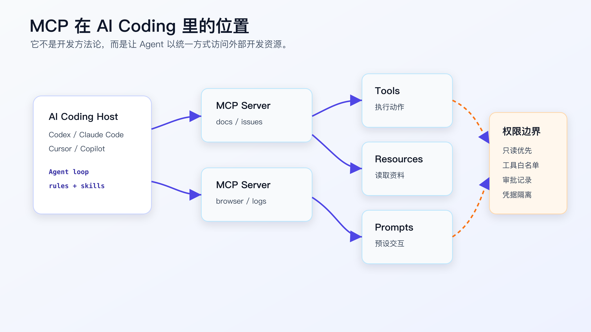
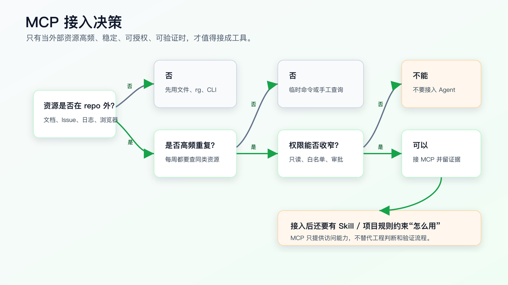

# 外部工具接入：MCP 在 AI Coding 里到底有什么用

MCP 对 AI Coding 有用，但它不是“让 AI 写代码更强”的魔法。

它解决的是另一个问题：

```text
当 Agent 需要访问 repo 之外的开发资源时，怎么用统一方式接入、授权、调用和留证据。
```

很多代码任务只需要读文件、搜索代码、改小 diff、跑测试。

这时不需要 MCP。

但有些任务，repo 里的文件不够。

比如：

```text
修一个接口兼容性问题，需要查当前 OpenAPI 文档。
定位一个前端 bug，需要让 Agent 操作浏览器并看页面状态。
排查一个线上异常，需要查只读日志和关联 Issue。
升级一个 SDK，需要读取当前官方文档和 release note。
理解一个复杂模块，需要查本地代码索引服务。
```

这些资源不在当前上下文里，也不一定适合直接塞进 prompt。

MCP 的价值就在这里。

它让 AI Coding 工具以比较统一的方式连接外部工具和上下文。Agent 可以发现可用工具，读取资源，调用能力，再把结果带回当前任务。



## 先讲边界：MCP 不是开发流程

MCP 很容易被讲成一个新概念。

对程序员更重要的是边界。

Skill 解决“怎么做”。

项目规则解决“在这个 repo 里必须遵守什么”。

SDD / OpenSpec 解决“需求和变更如何形成合同”。

测试和验证解决“结果是否真的成立”。

MCP 解决“Agent 能访问什么外部能力”。

举个例子。

你要修一个支付回调问题。

没有 MCP 时，Agent 只能看当前 repo：

```text
controller
service
repository
tests
README
```

如果真实问题依赖支付平台当前回调文档、历史 Issue、只读日志，Agent 只能靠你把资料贴进来。

接入 MCP 后，Agent 可以通过受控工具访问：

```text
官方文档查询
Issue 读取
日志检索
浏览器页面检查
只读数据库查询
```

但它仍然不知道应该怎么排障。

所以你还需要调试 Skill：

```text
先复现
找第一个失败信号
查调用链
提出单一假设
调用 MCP 工具取证
修根因
跑回归
记录残余风险
```

没有流程约束，MCP 只会给 Agent 更多可犯错的空间。

## MCP 的基本模型

官方文档把 MCP 描述为一种让应用向大语言模型共享上下文的开放标准。

从工程视角看，可以先记住三个角色：

```text
Host：AI 应用，例如 Codex、Claude Code、Cursor、Copilot。
Client：Host 内部连接某个 MCP server 的客户端。
Server：暴露工具、资源或提示的外部服务。
```

Server 通常暴露三类能力：

```text
Tools：可以执行动作，例如查询 Issue、打开浏览器、查日志。
Resources：可以读取资料，例如文档、仓库内容、数据库只读结果。
Prompts：预设交互模板，例如某个工具提供的查询入口。
```

AI Coding 里最常用的是 tools 和 resources。

比如：

```text
list_issues
get_issue
search_docs
fetch_url
query_readonly_logs
browser_snapshot
```

Agent 不是直接“拥有外部系统权限”。

它通过 Host 暴露给它的工具列表发起调用。Host、配置文件、审批策略、MCP server 和凭据共同决定它能做什么。

这也是为什么 MCP 一定要和权限边界一起讨论。

## 什么时候值得接 MCP

不要因为 MCP 热，就把所有东西都接进去。

一个外部资源是否值得接入，可以按四个问题判断：

```text
资源是否在 repo 外？
是否高频重复使用？
权限是否能收窄？
调用结果是否能验证？
```

四个问题都接近“是”，才值得接。



**适合接入的资源：**

```text
官方文档搜索。
Issue / PR 只读查询。
浏览器自动化和页面快照。
只读日志检索。
只读数据库查询。
代码索引服务。
测试报告和 CI 日志读取。
```

这些资源有共同特点：

```text
任务中经常需要。
手工复制成本高。
结果可以被引用。
权限可以控制。
失败后能看到调用证据。
```

**不适合接入的资源：**

```text
生产写权限。
支付、退款、发消息这类强副作用操作。
包含大量敏感数据的内部系统。
一次性临时资料。
你自己都不信任来源的社区内容。
```

这些资源即使能接，也不应该轻易交给 Agent。

个人 AI Coding 的默认策略应该是：

```text
只读优先。
低权限优先。
本地可复现优先。
人工审批优先。
能不用外部工具就不用。
```

## 真实场景一：查当前官方文档

AI Coding 里最常见的 MCP 用法，是查文档。

比如你要升级一个依赖，模型记忆里的 API 可能已经过期。

错误做法是直接问：

```text
帮我把项目升级到最新版本，顺便改 API。
```

Agent 可能凭记忆写旧接口。

先要求它查证：

```text
先查当前官方文档或 release note。
列出破坏性变化。
只改和本任务相关的调用点。
运行现有测试。
报告没有覆盖到的路径。
```

如果你有文档 MCP server，Agent 可以直接查询当前文档。

但注意，MCP 只负责“查到资料”。

你仍然要要求 Agent：

```text
引用具体文档页。
不要把未查到的能力写成事实。
只修改当前变更范围内的代码。
用测试证明改动。
```

如果文档查不到，就应该停下来说明，而不是用模型记忆补。

这类场景里，MCP 的收益很高，因为工具能力和 API 文档变化快。

## 真实场景二：让 Agent 看浏览器状态

前端任务里，代码通过不等于页面正确。

比如：

```text
筛选条件改了。
表格刷新了。
空状态显示了。
按钮 disabled 逻辑变了。
URL query 同步了。
```

这些行为需要浏览器验证。

如果 AI Coding 工具只能读文件，它可能会停在：

```text
npm test passed.
```

但真实问题在页面。

浏览器类 MCP 或工具接入可以让 Agent：

```text
打开本地页面。
点击筛选条件。
查看 DOM 或截图。
检查 network 请求。
确认页面文本和状态。
```

不过这里有一个边界。

浏览器操作结果必须回到验证记录里。

例如：

```text
Opened http://localhost:3000/orders
Clicked status=paid
Observed table request: GET /api/orders?status=paid
Observed first row status: Paid
Screenshot saved: ...
```

如果 Agent 只是说“页面看起来正常”，那还是不可审。

MCP 提供眼睛和手，验证记录提供证据。

## 真实场景三：只读日志和 Issue 查询

后端排障经常需要 repo 外信息。

比如线上 500：

```text
requestId=abc
traceId=xyz
订单状态从 PAID 变成 CANCELLED 后库存没有释放
```

如果你直接把一大段日志贴给 Agent，会有三个问题：

```text
敏感信息难清理。
日志上下文不完整。
Agent 可能只看你贴的片段。
```

可以做一个只读查询工具。

它只允许：

```text
按 requestId 查询脱敏日志。
按 traceId 查询链路片段。
按 issue id 读取问题描述。
限制时间范围。
限制返回字段。
记录查询参数。
```

这类 MCP server 不需要复杂。

甚至可以先是一个非常窄的内部工具。

关键是权限边界：

```text
不能写库。
不能导出大量数据。
不能绕过脱敏。
不能访问非当前任务范围。
```

然后配合调试流程：

```text
先复现。
再查日志。
日志只验证一个假设。
修复后跑本地回归。
报告线上证据和本地证据的关系。
```

这时 MCP 才真正服务 AI Coding。

## 真实场景四：代码索引服务

有些大仓库里，简单 `rg` 不够。

比如跨语言调用、生成代码、路由映射、配置驱动入口。

如果项目已经有代码索引服务，MCP 可以把它暴露给 Agent。

但不要一上来就做复杂代码理解平台。

对个人程序员，最小可用的代码索引可以只回答：

```text
某个 symbol 出现在哪些文件。
某个 API endpoint 映射到哪个 handler。
某个测试覆盖哪些模块。
某个目录的 owner 和验证命令是什么。
```

这类工具的价值不是让 Agent 自动理解整个系统。

价值是减少无效搜索，让它更快拿到候选上下文。

拿到候选上下文后，仍然要读源文件。

不能把索引结果当成事实终点。

## 配置时优先做最小权限

不同 AI Coding 工具的 MCP 配置格式不同。

Codex 文档里支持通过 CLI 添加 MCP server，也支持在配置文件里配置 stdio 或 streamable HTTP server；配置项包含命令、参数、环境变量、工具白名单、禁用工具和默认审批模式等。

GitHub Copilot 在 VS Code 里可以使用 `.vscode/mcp.json` 做仓库级配置，也可以放在个人 VS Code 设置中。GitHub 文档也明确提醒，同一个 server 不建议同时加在多个位置，避免冲突。

这些实现细节会变。

配置原则不要跟着工具细节漂移：

```text
只接当前任务需要的 server。
只开放当前任务需要的 tools。
优先只读。
敏感 token 走环境变量或平台凭据。
默认需要审批。
把仓库共享配置和个人配置分开。
```

一个个人级 Codex 配置可能长这样：

```toml
[mcp_servers.docs]
command = "npx"
args = ["-y", "@some/docs-mcp"]
enabled_tools = ["search_docs", "read_page"]
default_tools_approval_mode = "prompt"
```

一个 VS Code 仓库级配置可能长这样：

```json
{
  "servers": {
    "project-docs": {
      "command": "uvx",
      "args": ["project-docs-mcp"]
    }
  }
}
```

这两个片段只是说明结构，不建议直接复制到生产项目。

正式使用前要回到当前工具官方文档确认字段和版本。

## 工具白名单比“相信 Agent”重要

给 Agent 接工具时，最容易犯的错是：

```text
server 里有十几个工具，全部暴露。
```

这会带来两个问题。

第一，Agent 可能选错工具。

第二，权限边界被扩大。

按任务配置工具白名单，权限边界会清楚很多。

例如文档查询只给：

```text
search_docs
read_doc_page
```

Issue 查询只给：

```text
get_issue
list_issue_comments
search_issues
```

浏览器验证只给：

```text
open_page
click
snapshot
get_network_log
```

日志排查只给：

```text
search_logs
get_trace
```

不要给：

```text
delete_issue
post_comment
update_database
send_message
trigger_deploy
refund_payment
```

不是因为这些工具永远不能自动化，而是它们不应该默认出现在个人 AI Coding 的普通任务里。

涉及外部副作用时，应该先设计单独流程，明确审批、回滚和审计。

## 权限要分级，不要只有开和关

MCP 工具权限不要只分成“能用”和“不能用”。

更实用的是分级。

```text
Level 0：禁用。Agent 看不到这个工具。
Level 1：只读。可以查文档、Issue、日志、页面状态。
Level 2：受限写。只能写草稿、临时文件、非生产评论，且需要审批。
Level 3：强副作用。部署、退款、发消息、改生产配置，默认不进入个人 AI Coding。
```

个人程序员日常使用，默认停在 Level 1。

Level 2 也要谨慎。例如让 Agent 给 Issue 写评论，听起来只是协作动作，但它会对外产生信息。如果评论里包含错误结论、敏感日志或未验证说法，风险就变成公开沟通风险。

Level 3 不适合放进普通 coding 会话。

不是因为技术上不能接，而是它需要另一套流程：

```text
审批人。
变更单。
回滚路径。
审计日志。
执行窗口。
事故处理。
```

这些不是 MCP 能单独解决的。

MCP server 暴露工具前，先把每个 tool 标到权限级别。然后再决定 Agent 当前任务能看到哪些。

## MCP 调用结果也会污染上下文

MCP 能带来更多上下文，也会带来更多噪音。

例如你接了一个文档 server，Agent 查询到了十页资料。

其中只有两页和当前 API 有关。

如果 Agent 把十页都当成背景，它会出现和普通上下文污染一样的问题：

```text
引用无关版本。
混用不同框架的 API。
把搜索结果摘要当成官方结论。
被页面里的示例代码带偏。
```

所以 MCP 调用后还要做筛选：

```text
这条结果和当前任务有什么关系？
它是否来自官方来源？
它是否对应当前版本？
它是否改变实现方案？
是否需要写入验证记录？
```

MCP 不会自动解决上下文工程。

它只扩大可用上下文的来源。

上下文选择仍然是程序员要控制的工程问题。

## MCP 和 Skill 应该怎么组合

一个常见组合是：

```text
Skill 负责流程。
MCP 负责取证。
项目规则负责边界。
测试负责验证。
```

例如“修复前端筛选 bug”：

```text
项目规则：
- 本地启动命令。
- 测试命令。
- 组件目录。

Skill：
- 先复现。
- 小步修改。
- 页面验证必须留证据。

MCP：
- 浏览器操作。
- network 记录。
- 截图或 DOM 快照。

测试：
- 单元测试。
- 组件测试。
- 必要时 Playwright。
```

不要让 MCP 抢主线。

主线应该永远是任务合同和验证。

MCP 只是其中一个取证渠道。

## 一个接入前检查清单

准备给个人 AI Coding 接一个 MCP server 前，先问这些问题：

```text
这个 server 来自可信来源吗？
它会暴露哪些 tools？
哪些 tools 有写操作？
能否只启用只读工具？
凭据放在哪里？
调用是否需要审批？
结果是否会记录到任务输出？
失败时 Agent 会怎么处理？
这个能力是否真的高频？
不用 MCP 是否也能用 CLI 或浏览器完成？
```

如果你答不上来，不要急着接。

先用现有 CLI、浏览器、脚本或 Agent 工具跑几次，把输入、输出、权限、失败处理和验证记录确定下来。人工要复核的是边界和风险，不是把可自动执行的步骤长期手工化。

MCP 应该服务已经跑通的工作流，而不是替你探索工作流。

## 一个 MCP 接入的最小落地例子

假设你经常让 Agent 查内部 API 文档。

不要一开始就接整套知识库。

先做一个只读、只查当前项目文档的 server：

```text
tools:
- search_api_docs(query, version)
- read_api_doc(path)

permissions:
- read only
- no write
- no export
- max 5 results per query
- token from environment
```

然后在项目规则里写：

```markdown
When changing API client code:
- query project API docs through the docs MCP server.
- cite the doc path used.
- do not rely on model memory for API signatures.
- if docs are unavailable, stop and report missing evidence.
```

这才是 MCP 的正确价值：让 Agent 拿到当前资料，并把调用证据写进任务结果。

如果只是把知识库全量开放给 Agent，它可能查到一堆过期页面、跨项目页面或无关示例。接入越大，筛选成本越高。

这个最小 server 的契约也要写清楚。

例如：

```text
search_api_docs(query, version)
- query: required, max 120 chars.
- version: required, must match project configured API version.
- returns: max 5 results, each with title, path, version, updated_at.

read_api_doc(path)
- path: required, must come from search result.
- returns: doc body, version, updated_at.
```

再加失败返回：

```text
not_found：没有匹配文档。
version_mismatch：查到文档但版本不匹配。
unauthorized：凭据不可用。
too_many_results：查询过宽，需要收窄。
```

这类契约越窄，Agent 越容易正确使用。

如果工具只暴露一个 `search(query)`，返回一大段混合内容，Agent 很难判断哪些结果属于当前项目、当前版本和当前任务。

## 配置和凭据不要跟着代码乱走

MCP 配置经常夹在个人环境和项目环境之间。

仓库级配置适合放公共 server 名称、启动方式和只读工具范围。

个人配置适合放本机路径、token、私有账号和审批偏好。

不要把 token、cookie、个人账号路径写进仓库。也不要在文章、PR 或验证记录里贴完整凭据。

如果任务需要说明凭据来源，写成：

```text
token from environment variable.
credential not stored in repository.
```

这类小边界很重要。MCP 的价值是让 Agent 受控访问外部资源，不是把个人凭据变成项目资料。

## MCP 调用也要进入 verification ledger

MCP 调用结果如果影响了实现，就要记录。

例如：

```markdown
External evidence:
- MCP server: project-docs
- tool: `search_api_docs`
- query: `cancel order response status refund_requested`
- doc used: `/orders/cancel.md`
- conclusion: response shape remains `id`, `status`, `message`

Verification:
- API contract test confirms response keys unchanged.
```

这样 reviewer 才知道：Agent 根据哪份外部资料做了判断。

如果 MCP 查询失败，也要写：

```markdown
External evidence:
- project-docs MCP unavailable.
- API behavior inferred only from existing tests and source code.
- current API docs not verified.
```

这比假装查过资料要可靠。

## 接入 MCP 前先做威胁建模

个人使用也要做最小威胁建模。

至少问：

```text
这个 server 能读什么敏感数据？
能不能写外部系统？
token 泄露后影响多大？
调用结果会不会包含隐私或商业信息？
Agent 是否可能把结果写进 PR、文章或日志？
是否有审计记录？
```

如果答案不清楚，先不要接。

对多数个人 AI Coding 场景，最合理的第一版是：

```text
只读。
脱敏。
限范围。
需要审批。
不写外部系统。
不返回大批量数据。
```

MCP 的风险不只在“工具会不会执行坏操作”，也在“工具会不会把不该进入上下文的信息带进来”。

接入外部资源，就是扩大上下文边界。上下文边界扩大，泄露、误用和过期信息的风险都会扩大。

## 什么时候不用 MCP，直接用 CLI 或浏览器

MCP 不是唯一工具接入方式。

如果一个动作是低频、一次性、人工可控，用普通 CLI、浏览器或复制官方链接就够。

适合不接 MCP 的情况：

- 只查一次官方文档。
- 手工下载一份 release note。
- 本地已有 CLI 能完成任务。
- 资源需要人工登录和判断。
- 权限边界还没想清楚。

MCP 适合高频、可收窄、可审计的资源。

先用手工方式跑通流程，再把稳定部分接成 MCP。不要反过来。

## 接入后的失败降级

接了 MCP，也要假设它会失败。

常见失败包括：

```text
server 没启动。
凭据过期。
工具返回超时。
查询结果为空。
返回数据过多。
返回内容和当前版本不匹配。
```

项目规则或 Skill 里要写清楚降级方式。

例如文档查询失败：

```text
Stop if current official API docs cannot be accessed and the task depends on current API signatures.
Do not replace current docs with model memory.
If local source and tests are enough for a smaller change, narrow the task and report the missing external evidence.
```

浏览器工具失败：

```text
Report that browser verification was not performed.
Run available unit or component tests.
Do not claim visual or interaction behavior was verified.
```

日志工具失败：

```text
Do not infer production behavior from missing logs.
Use local reproduction and existing tests only.
Mark production evidence as unavailable.
```

降级策略的重点不是让任务一定继续，而是让 Agent 不伪造外部证据。

## PR 审查里怎么检查 MCP 使用

如果一次改动使用了 MCP，review 时要多看一层。

不是只看代码。

还要看外部证据是否影响了设计。

可以检查：

```text
用了哪个 server。
用了哪些 tools。
查询参数是什么。
结果来自哪个文档、Issue、日志或页面。
结果是否对应当前版本和当前任务。
是否包含敏感信息。
是否有本地测试或代码证据支撑。
```

例如 Agent 根据文档 MCP 修改了 API client。

review 时不要接受这种说法：

```text
根据文档，接口返回字段已更新。
```

要它给出：

```text
doc path。
版本。
字段变化。
影响的调用点。
对应测试。
未覆盖路径。
```

MCP 能扩大 Agent 的视野，也会把错误资料带进实现。审查时必须把外部证据和本地 diff 连起来。

## 不要把 MCP 调用当成验证本身

MCP 调用不是验证终点。

查到文档，只能证明你看过当前文档。

查到日志，只能证明某个请求出现过某种现象。

浏览器快照只能证明某个时刻的页面状态。

真正的验证还要回到任务目标：

```text
代码是否按需求修改。
测试是否覆盖关键路径。
页面行为是否和用户动作一致。
副作用是否符合预期。
失败路径是否处理。
```

例如浏览器 MCP 看到按钮 disabled，不等于功能正确。

还要看：

```text
disabled 的条件是否正确。
API 是否没有被错误调用。
状态恢复是否正常。
相关测试是否覆盖。
```

MCP 是取证渠道，不是结论生成器。

## 常见错误

**错误一：把 MCP 当成 AI Coding 的核心方法。**

它是外部资源接入方式，不是需求、设计、实现、测试和审查流程。

**错误二：把所有内部系统都接进去。**

越多工具，越多权限风险和上下文噪音。先接高频只读资源。

**错误三：没有工具白名单。**

server 支持某个工具，不代表 Agent 当前任务应该看到它。

**错误四：调用结果不留证据。**

Agent 查了什么、看到什么、用它支持了哪个判断，都应该能复查。

**错误五：把 MCP 当成安全边界。**

安全边界来自权限、凭据、审批、沙箱、只读接口、日志和人工判断。MCP 只是协议和接入方式。

**错误六：让 Agent 根据 MCP 结果直接改大范围代码。**

外部信息只能改变判断依据，不能绕过小 diff、测试和 review。

## 改完后重点看什么

接入一个 MCP server 后，不要只看“能不能连上”。

重点看：

- Agent 是否只看到必要 tools。
- 每次调用是否可审。
- 调用结果是否和当前任务相关。
- 权限是否只读或最小化。
- 凭据是否没有写进仓库。
- 失败时是否会停止或降级。
- 最终 diff 是否仍然小而可审。
- 验证记录是否包含 MCP 调用证据。

如果接入后，Agent 只是更会到处查资料，但 diff 更大、结论更散，那这个接入没有提高 AI Coding 稳定性。

## 常见问题

**MCP 是不是必须学？**

不必须。只做 repo 内小改动时，读文件、搜索、测试已经够用。需要稳定访问 repo 外资源时，再学。

**个人程序员最先接什么 MCP？**

优先接文档、浏览器、Issue、只读代码索引。这些收益高，副作用低。

**能不能接数据库？**

可以，但个人默认只读、脱敏、限字段、限时间范围。写库操作不要放进普通 AI Coding 工具链。

**MCP 能替代代码地图吗？**

不能。代码地图是 repo 内结构理解资产。MCP 可以暴露代码索引服务，但索引结果仍然要回到源文件和测试。

**MCP 和 Skill 谁更重要？**

没有谁替代谁。Skill 让 Agent 知道怎么做，MCP 让 Agent 能访问外部资源。复杂任务通常两者都需要。

## 可复查资料

- Model Context Protocol 架构文档：<https://modelcontextprotocol.io/docs/learn/architecture>
- Model Context Protocol 最新规范：<https://modelcontextprotocol.io/specification/latest/>
- OpenAI Codex MCP 文档：<https://developers.openai.com/codex/mcp>
- Anthropic Claude Code MCP 文档：<https://code.claude.com/docs/en/mcp>
- GitHub Copilot MCP 文档：<https://docs.github.com/en/copilot/how-tos/provide-context/use-mcp-in-your-ide/extend-copilot-chat-with-mcp>

---

[课程首页](../../../README.md) · [完整目录](../README.md) · [← 自定义 Skill：把你的经验固化成个人能力](32-%E8%87%AA%E5%AE%9A%E4%B9%89-Skill-%E6%8A%8A%E4%BD%A0%E7%9A%84%E7%BB%8F%E9%AA%8C%E5%9B%BA%E5%8C%96%E6%88%90%E4%B8%AA%E4%BA%BA%E8%83%BD%E5%8A%9B.md) · [多 Agent 与自动化：什么时候拆，什么时候不要拆 →](34-%E5%A4%9A-Agent-%E4%B8%8E%E8%87%AA%E5%8A%A8%E5%8C%96-%E4%BB%80%E4%B9%88%E6%97%B6%E5%80%99%E6%8B%86%E4%BB%80%E4%B9%88%E6%97%B6%E5%80%99%E4%B8%8D%E8%A6%81%E6%8B%86.md)

动手实践：[Superpowers 业务工作流](../../../personal-productivity-app/dev-process/02-superpowers-today-plan-workflow.md)
