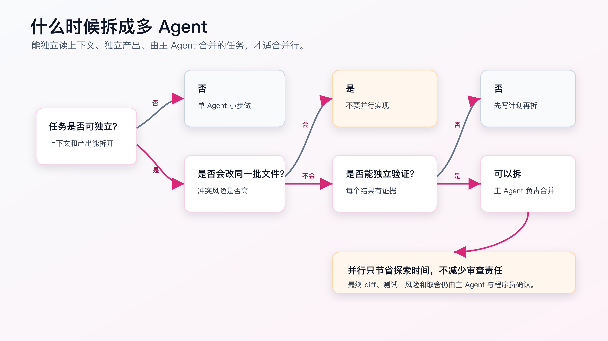
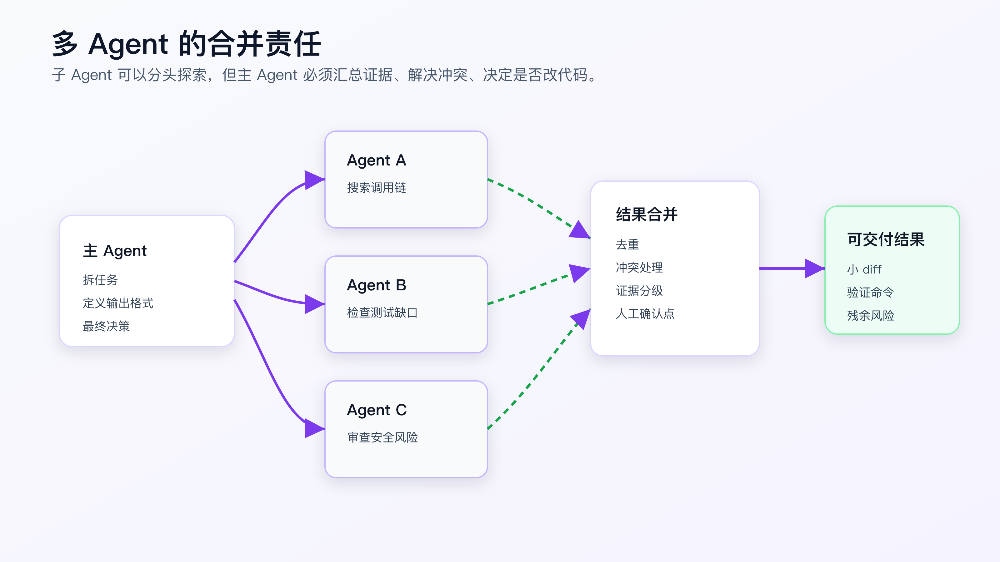

# 多 Agent 与自动化：什么时候拆，什么时候不要拆

多 Agent 很容易让人上头。

一个 Agent 写代码，另一个 Agent 查文档，第三个 Agent 做 review，第四个 Agent 跑测试。听起来像把一个程序员拆成一支小队。

但在真实 AI Coding 里，多 Agent 不是默认选项。

它只在一种情况下有价值：

```text
任务可以拆成互不干扰的独立工作，每个子任务有明确输入、明确产出、明确验证方式，最后由主 Agent 或程序员统一合并。
```

如果任务拆不开，多 Agent 会制造更多上下文漂移、文件冲突和结论冲突。

这篇不讨论“怎么堆更多 Agent”。

这篇只讨论三个问题：个人程序员什么时候应该拆，怎么拆，什么时候应该坚持单 Agent 小步做。



## 多 Agent 解决什么问题

先讲价值。

多 Agent 主要解决三类问题。

第一类是并行探索。

例如你接手陌生项目，要同时搞清楚：

```text
订单取消入口在哪里。
库存回滚在哪里。
支付状态机在哪里。
相关测试在哪里。
最近一次类似 bug 怎么修。
```

这些搜索任务互不改文件，可以并行。

第二类是独立审查。

例如一个 PR 改完后，可以让不同 Agent 从不同角度看：

```text
安全风险。
测试缺口。
兼容性。
性能和并发。
可维护性。
```

它们都只读 diff 和相关文件，不需要互相修改。

第三类是分工验证。

例如一个前后端需求完成后，可以分别检查：

```text
API contract。
前端状态。
数据库副作用。
异常路径。
文档和迁移说明。
```

这些任务可以并行取证，最后合并到一份验证记录里。

这三类都有一个共同点：

```text
并行的是理解、审查和验证，不是随便并行改同一批代码。
```

多 Agent 最适合减少等待时间和降低单一视角盲区。

它不适合把一个本来就不清楚的实现任务拆给多个人同时写。

## 多 Agent 会带来什么风险

多 Agent 的风险也很直接。

第一，成本更高。

Codex 官方文档明确提醒，子 Agent 会各自执行模型和工具工作，因此比单 Agent 消耗更多 token。这个判断不只适用于 Codex。只要你让多个 Agent 并行读上下文、跑工具、写总结，成本都会上升。

第二，上下文不一致。

每个 Agent 看到的上下文可能不同。

Agent A 读了 controller。

Agent B 读了 service。

Agent C 只看了测试。

它们都可能给出局部正确、全局冲突的结论。

第三，文件冲突。

如果多个 Agent 同时改同一批文件，最后不是节省时间，而是制造 merge 和审查成本。

第四，责任被稀释。

多个 Agent 都说了一点，最后没人负责把结论变成可执行决策。

所以多 Agent 必须有主 Agent。

主 Agent 的职责不是转发结果，而是：

```text
定义子任务。
限制子任务权限。
规定输出格式。
等待结果。
去重和冲突处理。
决定哪些结论进入实现。
运行最终验证。
报告残余风险。
```

没有主 Agent 的合并责任，多 Agent 只是并行聊天。



## 适合拆的任务

可以拆的任务通常满足四个条件：

```text
上下文可以独立。
产出可以独立。
文件不会互相覆盖。
结果可以验证或交叉检查。
```

下面是几类适合拆的任务。

**代码库探索。**

例如：

```text
Agent A：找订单取消入口和调用链。
Agent B：找库存回滚逻辑和相关测试。
Agent C：找支付状态变更和幂等逻辑。
```

每个 Agent 的输出应该是：

```text
files read
important symbols
call chain
uncertainties
recommended next files
```

注意，这时不让它们改代码。

**PR 审查。**

例如：

```text
Agent A：只看安全和权限问题。
Agent B：只看测试缺口。
Agent C：只看兼容性和 public API。
```

每个 Agent 输出 finding 时必须有文件和行号。

主 Agent 再把重复问题合并，按严重程度排序。

**文档和工具事实核对。**

例如：

```text
Agent A：核对 OpenAI Codex 文档。
Agent B：核对 Anthropic Claude Code 文档。
Agent C：核对 GitHub Copilot 文档。
```

这种适合写技术文章或工具选型，尤其是工具能力变化快的时候。

每个 Agent 只负责一个来源，降低混用资料的概率。

**验证证据收集。**

例如：

```text
Agent A：跑单元测试。
Agent B：跑前端页面检查。
Agent C：检查文档和迁移说明。
```

前提是这些操作不会互相抢占同一个环境。

如果它们都要改数据库、重启同一个服务，就不适合并行。

## 不适合拆的任务

下面这些任务不适合多 Agent 并行。

**同一批文件的实现。**

例如：

```text
Agent A 改 OrderService。
Agent B 也改 OrderService。
Agent C 改 OrderController，但依赖 OrderService 的新签名。
```

这类任务看似能并行，实际会产生接口漂移。

应该先写 `tasks.md`，按顺序做小 diff。

**需求还不清楚的实现。**

如果需求本身还没澄清，多 Agent 会把不确定性放大。

一个 Agent 以为要兼容旧接口。

另一个 Agent 以为可以破坏兼容。

第三个 Agent 按自己的理解写测试。

最后会得到三套互相矛盾的产物。

这时应该先做设计和计划，不是先并行。

**需要共享状态的调试。**

例如同一个本地数据库、同一个 dev server、同一个消息队列。

多个 Agent 同时操作，会让复现结果变得不可解释。

调试最怕证据被污染。

这类任务更适合单 Agent 按步骤走，必要时让另一个 Agent 做只读 review。

**强副作用操作。**

部署、退款、发消息、修改生产配置，不应该交给多个 Agent 并行。

即使工具支持，也要有单一审批链路。

## 拆任务前要写清楚输出格式

很多多 Agent 失败，不是因为 Agent 不够强，而是主任务没有定义输出格式。

不要这样分派：

```text
Agent A：帮我看看安全问题。
Agent B：帮我看看测试问题。
Agent C：帮我看看架构问题。
```

这会得到三段风格不同、粒度不同、证据不同的文字。

更好的写法：

```text
Spawn three read-only agents.

Shared context:
- task goal: ...
- diff range: current branch vs main
- repository rules: AGENTS.md

Agent A: review security and permissions only.
Agent B: review test coverage and failure risks only.
Agent C: review API compatibility only.

Each agent must return:
- files inspected
- findings with file and line
- evidence
- false positives considered
- open questions
- confidence level

Do not edit files.
Do not run destructive commands.
```

这个 prompt 的重点不是英语，而是合同清楚。

每个 Agent 都知道：

```text
看什么。
不看什么。
能不能改。
怎么输出。
```

主 Agent 后面才有办法合并。

## 子 Agent 最好默认只读

个人 AI Coding 里，子 Agent 默认应该只读。

原因很简单：

```text
读可以并行。
写会冲突。
```

可以先把多 Agent 用在：

```text
探索
审查
事实核对
风险分析
验证证据收集
```

实现仍然由主 Agent 按计划小步执行。

如果确实要让子 Agent 写代码，至少满足这些条件：

```text
每个子任务改不同文件。
接口边界已经固定。
有独立测试。
合并前必须 review diff。
主 Agent 负责最终集成。
```

例如：

```text
Agent A：只添加后端单元测试，不改生产代码。
Agent B：只补文档，不改代码。
Agent C：只检查现有 UI 状态，不写文件。
```

这比让三个 Agent 同时改业务逻辑稳得多。

## 用多 Agent 做代码库探索

真实项目里，多 Agent 最容易出价值的是陌生代码库探索。

假设需求是：

```text
让已支付订单取消时进入退款申请流程，并保持未支付订单原行为不变。
```

不要让一个 Agent 从头读到尾。

可以拆成：

```text
Agent A：找订单取消入口。
Agent B：找订单状态机和状态枚举。
Agent C：找退款请求创建逻辑。
Agent D：找相关测试和 fixture。
```

每个 Agent 只读文件。

输出统一格式：

```markdown
## Scope

What this agent searched.

## Evidence

- file path
- symbol
- relevant behavior

## Risk

What may affect implementation.

## Next Files

Files the main agent should inspect before editing.
```

主 Agent 收到结果后，不直接改。

先合并：

```text
哪些文件被多个 Agent 提到？
哪些结论冲突？
哪些文件必须人工再读？
哪些测试能约束行为？
```

这个过程能节省搜索时间，但不会免掉设计判断。

## 用多 Agent 做审查

多 Agent 审查适合风险较高的 diff，因为不同视角能发现不同问题。

但审查要避免“大家都泛泛看一遍”。

应该按风险拆。

例如一个身份权限相关改动：

```text
Agent A：只看认证和授权绕过。
Agent B：只看数据泄漏和日志。
Agent C：只看测试是否覆盖角色边界。
```

一个数据迁移改动：

```text
Agent A：只看迁移脚本是否可回滚。
Agent B：只看旧数据兼容。
Agent C：只看部署顺序和读写双兼容。
```

每个 Agent 必须有 finding 证据：

```text
文件路径。
行号或函数名。
为什么是问题。
什么输入会触发。
建议修复方向。
是否需要测试。
```

没有证据的“建议优化”，不进入最终审查结果。

主 Agent 要做去重。

同一个问题被三个 Agent 提到，不应该写成三个问题。

相反，如果三个 Agent 对同一段逻辑结论相反，应该标为 open question，不要强行合并。

## 用多 Agent 做验证

验证任务也能拆，但要小心环境冲突。

适合拆的是读多写少的验证：

```text
Agent A：检查单元测试输出。
Agent B：检查浏览器行为。
Agent C：检查文档和配置。
```

不适合拆的是共享环境验证：

```text
三个 Agent 同时跑需要同一个端口的 e2e。
两个 Agent 同时改数据库 fixture。
一个 Agent 重启服务，另一个 Agent 正在测试页面。
```

如果需要共享环境，主 Agent 应该串行调度。

验证结果要合并成一份 ledger：

```markdown
## Verification Commands

- npm test
- npx playwright test tests/orders.spec.ts

## Evidence

- unit tests: pass, 24 tests
- browser: paid order cancel shows refund_requested
- API: POST /orders/:id/cancel returns 202

## Residual Risk

- payment provider callback was not tested locally
```

多 Agent 只是帮你收集证据。

最终证据要落到一份可审查记录里。

## 多 Agent 和 Superpowers 怎么配合

Superpowers 里有两条相关路线：

```text
subagent-driven-development
executing-plans
```

有 subagent 支持时，可以把独立任务交给子 Agent 执行。

没有 subagent 支持时，就在当前会话按计划执行。

并不是所有任务都必须用 subagent。

如果计划里的任务互相独立，可以并行。

如果任务有依赖，就顺序执行。

例如：

```text
Task 1: add failing tests
Task 2: implement state transition
Task 3: create refund request
Task 4: update API response
Task 5: run verification
```

这些任务大多有顺序依赖。

不适合同时写。

但可以并行做：

```text
Agent A：审查 plan 是否覆盖测试。
Agent B：查退款请求现有入口。
Agent C：查状态机历史变更。
```

等探索结果回来，主 Agent 再顺序实现。

## 多 Agent 和 MCP 怎么配合

MCP 提供外部工具。

多 Agent 提供并行执行。

组合起来很强，也更危险。

例如你让多个 Agent 同时使用浏览器、Issue、日志和文档工具。

必须限制：

```text
每个 Agent 能用哪些 MCP tools。
是否只读。
是否需要审批。
每个 Agent 的查询范围。
返回结果如何引用。
```

一个安全的拆法：

```text
Agent A：只用 docs search，核对 API 文档。
Agent B：只用 issue read，查历史问题。
Agent C：只用 browser snapshot，验证页面状态。
```

一个危险的拆法：

```text
所有 Agent 都能用所有 MCP tools。
所有 Agent 都能写外部系统。
没有查询范围。
没有调用记录。
```

多 Agent 会放大 MCP 的权限风险。

所以多 Agent + MCP 的默认策略仍然是只读、白名单、审批和证据。

## 自动化不要越过人工决策

很多人把多 Agent 和自动化放在一起讲，然后直接走向“自动完成需求”。

个人 AI Coding 里要谨慎。

可以自动化：

```text
代码搜索。
文档核对。
测试运行。
格式检查。
重复结构检查。
审查清单。
验证记录生成。
```

不要默认自动化：

```text
需求取舍。
架构方向。
跨模块大改。
生产写操作。
发布决策。
风险接受。
```

这些需要程序员判断。

自动化的目标是减少机械工作，不是移除工程责任。

## 一个可直接使用的多 Agent 分派模板

下面这个模板适合做只读并行探索或审查：

```text
Spawn <N> read-only agents and wait for all results.

Shared task:
<task goal>

Shared boundaries:
- Do not edit files.
- Do not run destructive commands.
- Use repository instructions as constraints.
- Cite files, commands, or official docs for every factual claim.

Agent 1:
<scope>

Agent 2:
<scope>

Agent 3:
<scope>

Each agent must return:
- Scope checked
- Files or sources inspected
- Findings with evidence
- Uncertainties
- Recommended next step

After all agents finish:
- Merge duplicate findings.
- Mark conflicting findings as open questions.
- Do not implement until the merged result is reviewed.
```

如果你要让子 Agent 写文件，把模板改得更严格：

```text
Each agent may edit only the files explicitly assigned to it.
If the change requires editing an unassigned file, stop and report why.
Do not change public interfaces unless the plan already approved it.
Return diff summary and verification command output.
```

写权限越大，任务边界就要越硬。

## 多 Agent 的成本也要算

多 Agent 不是免费并行。

成本至少包括：

- 每个 Agent 都要读上下文。
- 每个 Agent 都可能跑工具。
- 主 Agent 要合并结果。
- 冲突结论要复查。
- 输出要去重。
- 最终验证仍然要跑。

所以不要为了“看起来先进”拆任务。

一个简单判断：

```text
如果并行节省的搜索或审查时间，小于合并和复查成本，就不要拆。
```

比如一个 30 行 CSS 修复，让三个 Agent 分别看 UI、测试、性能，通常不值。

一个跨订单、支付、库存的行为变更，让多个只读 Agent 并行查入口和风险，通常值。

成本判断本身就是程序员的责任。

## 一个可执行的拆分决策路径

开始任务前，可以按这条路径判断要不要拆：

```text
1. 需求是否已经清楚？
   不清楚：先单 Agent 澄清，不拆。

2. 是否需要同时理解多个独立区域？
   是：可以拆只读探索。

3. 子任务是否会改同一批文件？
   是：不并行写，先排顺序。

4. 每个子任务是否有独立输出和证据？
   否：不拆。

5. 最终是否有主 Agent 合并和验证？
   否：不拆。
```

这条路径能挡住大多数错误拆分。

例如“修一个表单校验文案”：

```text
需求清楚。
只涉及一个组件和一个测试。
不需要多区域探索。
```

不拆。

例如“修改订单取消状态，并确认支付回调不受影响”：

```text
需求基本清楚。
涉及订单、支付、退款、测试。
探索阶段可以独立。
实现阶段有依赖。
```

先拆只读探索，再由主 Agent 顺序实现。

拆分不是一次性决定。探索可以并行，写代码可以串行，审查又可以并行。

不要把“用了多 Agent”理解成整个任务都要并行。

## 多 Agent 输出要能被合并，不要像会议纪要

子 Agent 输出不能只有自然语言总结。

最低要包含：

```markdown
## Scope

## Evidence

## Findings

## Uncertainties

## Recommended next step
```

每条 finding 要有证据：

```text
file path
line or symbol
command output
official doc link
```

没有证据的建议，主 Agent 不应该直接采纳。

如果两个子 Agent 冲突，不要让主 Agent凭感觉选一个。要标成 open question：

```markdown
Open question:
- Agent A says API response shape unchanged based on controller.
- Agent B says generated client expects `orderStatus`.
- Need to inspect API contract test before implementation.
```

多 Agent 的价值在于暴露视角差异，不是把差异自动抹平。

## 多 Agent 的合并报告模板

主 Agent 最后应该输出一份合并报告，而不是把子 Agent 原文全贴出来。

可以这样写：

```markdown
## Merged Findings

### Confirmed

- Finding A ...
  - evidence: Agent 1, file ...
  - action: ...

### Duplicates merged

- Agent 1 and Agent 2 both reported ...

### Conflicts

- Agent 2 says response shape unchanged.
- Agent 3 found generated client expects `orderStatus`.
- action: inspect API contract test before implementation.

### Discarded

- Agent 1 suggested refactor, but it is outside current task.

### Next step

- update plan before editing files.
```

这份报告体现主 Agent 的责任：去重、判断、标冲突、决定下一步。

如果没有合并报告，多 Agent 的结果只是几段并排材料，无法进入工程执行。

## 多 Agent 也要有 stop 条件

子 Agent 发现下面情况时应该停：

- 需要写文件，但任务是只读。
- 需要访问未授权 MCP tool。
- 发现任务边界不清。
- 发现和其他子任务可能冲突。
- 发现当前需求和 spec 冲突。

输出应该是：

```text
Stopped:
- reason
- evidence
- required decision
```

不要让子 Agent 自己扩大范围。并行任务一旦各自扩大，主 Agent 很难收回来。

## 最终验证只能对集成结果负责

多 Agent 任务里，子 Agent 可能分别说自己的部分通过了。

这不等于整体通过。

例如：

```text
Agent A：后端测试通过。
Agent B：前端组件测试通过。
Agent C：文档检查通过。
```

这些只能说明各自范围内没有发现问题。

主 Agent 还要在合并后的工作树上跑最终验证：

```text
当前 diff 是否包含所有子任务。
子任务之间是否改了同一接口。
测试是否基于合并后的代码运行。
浏览器或 API 验证是否使用最新构建。
最终报告是否只引用最新命令输出。
```

不要把子 Agent 的局部结果拼成整体结论。

正确说法是：

```markdown
Sub-agent evidence collected.
Integrated diff reviewed by main agent.
Final verification run on merged workspace:
- command: ...
- result: ...
Residual risk: ...
```

多 Agent 可以并行收集证据，但完成声明只能基于最终集成结果。

子 Agent 的原始输出也不要直接放进 PR 或发布文档。

它可能包含未验证推断、重复结论、临时猜测或已经被主 Agent 否掉的建议。

进入交付材料的，应该是主 Agent 合并后的结论：

```text
采纳了什么。
为什么采纳。
丢弃了什么。
为什么丢弃。
还剩哪些风险。
```

这样 review 才看的是真正的工程决策，而不是几段并行对话记录。

## 一个写权限拆分的反例

下面这种拆分很常见，也很危险：

```text
Agent A：改后端接口。
Agent B：改前端调用。
Agent C：改测试。
```

看起来分工清楚，实际风险很高。

后端接口还没定，前端就可能按自己的理解改。

测试 Agent 可能根据前端实现写断言，而不是根据需求写断言。

最后三个 diff 能合并，但不一定表达同一个设计。

更合适的顺序是：

```text
先由主 Agent 固定 API contract。
再补 contract test 或 failing test。
后端实现通过 contract。
前端按 contract 调用。
最后统一跑前后端验证。
```

如果要并行，只并行只读部分：

```text
Agent A：查现有后端接口。
Agent B：查前端调用点。
Agent C：查现有测试覆盖。
```

写代码阶段保持主线顺序。

多 Agent 不是把一个强依赖链拆开同时写。强依赖链要先定合同，再顺序推进。

## 常见错误

**错误一：把并行当成默认提效。**

并行会增加 token、合并和审查成本。只有独立任务才值得拆。

**错误二：多个 Agent 同时改同一批代码。**

这通常会制造接口漂移和冲突。实现任务优先小步串行。

**错误三：没有统一输出格式。**

没有格式，主 Agent 无法合并，只能转述。

**错误四：没有主 Agent 决策。**

子 Agent 给的是局部结论。最终取舍必须统一。

**错误五：让多 Agent 共享可变环境。**

调试、数据库、dev server、端口和消息队列都容易互相污染。

**错误六：把子 Agent 的结论当成事实。**

子 Agent 也会错。结论必须有文件、命令、官方资料或运行结果支撑。

## 改完后重点看什么

一次多 Agent 任务结束后，看这些结果：

- 子任务是否真的独立。
- 每个 Agent 是否只做了自己的范围。
- 是否有统一输出格式。
- 是否有证据。
- 是否存在互相冲突的结论。
- 主 Agent 是否做了去重和取舍。
- 最终 diff 是否仍然小。
- 验证是否由最终集成结果触发，而不是子 Agent 分别声明完成。

如果这些做不到，多 Agent 就没有提高稳定性。

回到单 Agent、小任务、顺序执行。

## 常见问题

**多 Agent 适合个人程序员吗？**

适合，但不要从并行实现开始。先用于探索、审查和验证。

**什么时候一定不要拆？**

需求不清、共享状态、同文件修改、强副作用操作，都不要拆。

**子 Agent 能不能自己提交代码？**

个人工作流里不建议。让它返回 diff 和证据，最终由主 Agent 或程序员决定。

**多 Agent 能减少 review 吗？**

不能。它可以增加审查视角，但最终审查责任还在主 Agent 和程序员。

**多 Agent 和自定义 Skill 谁优先？**

先有清楚流程，再拆 Agent。没有 Skill 或明确规则，多 Agent 只会把不稳定流程并行化。

## 可复查资料

- OpenAI Codex Subagents：<https://developers.openai.com/codex/subagents>
- OpenAI Codex Subagent concepts：<https://developers.openai.com/codex/concepts/subagents>
- Anthropic Claude Code Subagents：<https://code.claude.com/docs/en/sub-agents>
- GitHub Copilot cloud agent best practices：<https://docs.github.com/en/copilot/tutorials/cloud-agent/get-the-best-results>
- Superpowers `subagent-driven-development`：<https://github.com/obra/superpowers/blob/main/skills/subagent-driven-development/SKILL.md>

---

[课程首页](../../../README.md) · [完整目录](../README.md) · [← 外部工具接入：MCP 在 AI Coding 里到底有什么用](33-%E5%A4%96%E9%83%A8%E5%B7%A5%E5%85%B7%E6%8E%A5%E5%85%A5-MCP-%E5%9C%A8-AI-Coding-%E9%87%8C%E5%88%B0%E5%BA%95%E6%9C%89%E4%BB%80%E4%B9%88%E7%94%A8.md) · [模块实战：用 Superpowers 固化一次业务需求的调试和评审 →](35-%E6%A8%A1%E5%9D%97%E5%AE%9E%E6%88%98-%E7%94%A8-Superpowers-%E5%9B%BA%E5%8C%96%E8%B0%83%E8%AF%95%E5%92%8C%E8%AF%84%E5%AE%A1%E6%B5%81%E7%A8%8B.md)

动手实践：[Superpowers 业务工作流](../../../personal-productivity-app/dev-process/02-superpowers-today-plan-workflow.md)
