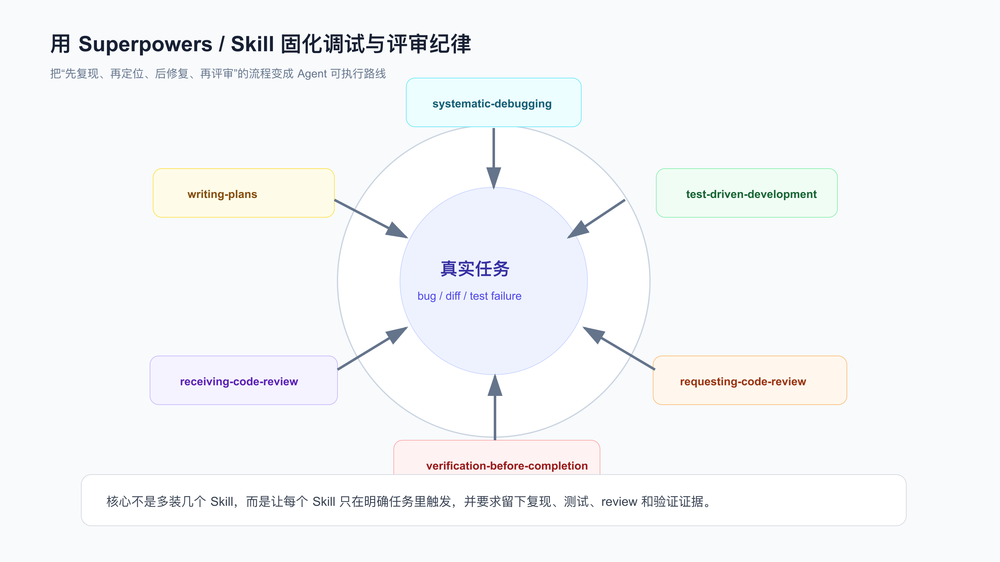

# 模块实战：用 Superpowers 固化一次业务需求的调试和评审

Superpowers 不是“装几个 Skill 就变专业”。

它真正有用的地方，是在真实需求里把几个高风险动作固定下来：先看需求合同，先写失败测试，失败时先找根因，完成前跑新鲜验证，review 时先找行为风险。

Superpowers 的 Skill 链负责约束 Agent 的阶段动作，不负责重新定义业务需求。

所以 Superpowers 实战不能停在“订单退款”这类口头例子上，要回到已经建好需求合同的产品需求里，看它怎么在真实开发过程中约束 TDD、调试、review 和完成前验证。

配套代码仓库 [DavidDingXu/learn-ai-coding](https://github.com/DavidDingXu/learn-ai-coding) 按一个大仓库组织，仓库根目录下有业务 module 和工具 module。这里继续使用业务 module：`personal-productivity-app`，不重新换案例。

这里使用个人效率助手的需求：

```text
今日计划自动纳入逾期未完成任务，并在每日容量限制下返回顺延列表。
```

对应过程记录在：

```text
learn-ai-coding/personal-productivity-app/dev-process/02-superpowers-today-plan-workflow.md
```

前一篇已经用 OpenSpec 建了 change：

```text
learn-ai-coding/personal-productivity-app/openspec/changes/today-plan-overdue-rollover/
```

这次不重新发明需求，只讲 Superpowers 如何约束开发过程。



## 先把入口说准

Superpowers 的入口会随版本和宿主环境变化：可能是 Codex Skill、Claude Skill、插件命令，也可能沉淀进项目规则。

真实使用时，不应该背某个固定命令，而应该确认当前环境里真正生效的约束。

在当前 Superpowers 安装形态里，早期的 `/brainstorm`、`/write-plan`、`/execute-plan` 已提示改用对应 Skill。因此这里不把旧 slash command 当推荐入口。

这次需求实际使用的是这些 Skill 约束：

```text
superpowers:test-driven-development
superpowers:systematic-debugging
superpowers:requesting-code-review
superpowers:receiving-code-review
superpowers:verification-before-completion
```

迁移到自己的项目时，重点不是入口长得像不像这个示例，而是两个检查：

```text
1. 当前工具环境里推荐入口是什么，不沿用旧资料里的过期命令。
2. TDD、调试、review、完成前验证、review 反馈处理这些高风险节点有没有被规则约束。
```

## 分工：OpenSpec 管需求，Superpowers 管纪律

这次需求已经有 OpenSpec 产物：

```text
proposal.md
design.md
specs/today-plan/spec.md
tasks.md
```

Superpowers 不应该再定义一个新需求。

正确分工是：

```text
OpenSpec：需求边界、行为合同、任务列表。
TDD：先写测试并看到红灯。
systematic-debugging：失败时先定位根因。
requesting-code-review：完成后按风险审查 diff。
verification-before-completion：完成前跑新鲜验证。
receiving-code-review：处理反馈时不扩大 scope。
```

如果 Skill 建议和 OpenSpec 边界冲突，以当前 change 为准，并把冲突报告出来。

## TDD：红灯必须是真的

TDD Skill 的核心规则很硬：

```text
NO PRODUCTION CODE WITHOUT A FAILING TEST FIRST
```

本次先有测试：

```text
test/today-plan.test.js
```

第一次运行：

```bash
npm test
```

红灯：

```text
Error [ERR_MODULE_NOT_FOUND]: Cannot find module
'/learn-ai-coding/personal-productivity-app/src/today-plan.js'
```

这不是“测试挂了所以随便修”。

它说明：测试已经表达了 `buildTodayPlan` 的业务行为，但生产文件还不存在。

如果测试第一次就绿，说明你可能只是在验证旧行为。

如果测试因为拼写或 import 错误失败，也不能算有效红灯。

## systematic-debugging：先找根因再修

系统化调试不是只在复杂 bug 里用。

这次红灯看起来简单，但也要按顺序确认：

```text
1. 读完整错误：ERR_MODULE_NOT_FOUND。
2. 复现命令：npm test。
3. 查测试 import：../src/today-plan.js。
4. 查项目文件：src/today-plan.js 不存在。
5. 得出根因：缺少领域函数实现。
```

因此修复范围被限制为：

```text
新增 src/today-plan.js。
不改测试期望。
页面展示不放进这次调试修复。
不接数据库。
不引入第三方依赖。
```

很多 AI Coding 的大 diff，就是因为跳过这一步。

失败一出现，AI 直接开始“顺手重构”，最后测试可能绿了，但需求边界也被改没了。

## 实现：只实现当前任务

OpenSpec tasks 里写的是：

```text
2.1 Add src/today-plan.js and export buildTodayPlan.
2.2 Filter eligible tasks to open overdue and due-today tasks only.
2.3 Sort eligible tasks by overdue status, priority, due date, and stable id fallback.
2.4 Apply daily capacity and return items, deferred, usedMinutes, remainingMinutes.
2.5 Validate date and estimate inputs at the domain boundary.
```

实现文件：

```text
src/today-plan.js
```

核心规则：

```text
status 必须是 open。
dueDate 小于 date -> overdue。
dueDate 等于 date -> due-today。
future 不进入候选。
done / blocked 不进入候选。
逾期优先于当天。
优先级 high -> medium -> low。
放不进容量的进入 deferred。
```

这已经足够满足当前产品需求。

如果此时 AI 提议新增页面、接日历或做复杂优化，要直接挡住：那是新需求。

页面当然可以存在，但它只能复用领域函数展示输出。如果为了页面重写排序、过滤或容量逻辑，就已经越过了当前调试任务的边界。

## Review：看行为风险，不写空泛总结

`requesting-code-review` 的价值不是生成一句“整体实现清晰”。

本次 review 应该围绕需求合同问：

```text
1. 是否误把 done / blocked 任务放进今日计划？
2. 是否误把 future 任务放进今日计划？
3. overdue 是否一定排在 due-today 前？
4. priority 是否优先于 dueDate age？
5. selected items 是否可能超过 capacityMinutes？
6. deferred 是否保留放不下的候选任务？
7. usedMinutes / remainingMinutes 是否和 items 一致？
8. 输入校验是否拒绝非法日期、负容量、负估时？
9. 实现是否偷偷依赖系统时间、I/O 或外部服务？
```

这类 review 才能迁移到真实项目。

比如在订单、工单、审批、账单这些业务里，review 也应该看状态过滤、时间边界、排序规则、容量限制和副作用边界。

## 完成前验证：不能引用旧输出

`verification-before-completion` 的规则也很硬：

```text
NO COMPLETION CLAIMS WITHOUT FRESH VERIFICATION EVIDENCE
```

本次完成前跑三条：

```bash
openspec validate today-plan-overdue-rollover --strict --json --no-interactive
npm test
openspec instructions apply --change today-plan-overdue-rollover --json
```

结果：

```text
OpenSpec strict validate：passed 1, failed 0
npm test：pass 7, fail 0
OpenSpec apply：total 8, complete 8, remaining 0
```

完成报告应该写这些证据，而不是写：

```text
已完成，测试通过。
```

后者对 reviewer 没有价值。

## receiving-code-review：别把反馈变成新需求

收到 review 后也要有边界。

对这次需求，反馈可以分三类：

必须修：

```text
容量可能超限。
排序和 spec 不一致。
done / blocked 被误收。
deferred 丢失任务。
测试缺少关键场景。
```

可选修：

```text
错误文案更清楚。
局部函数命名更准确。
测试 helper 可读性提升。
```

不在当前需求修：

```text
新增 UI。
接数据库。
接日历。
做提醒系统。
做全局最优排程。
```

这一步能防止 review 变成新的大需求。

## Skill 不替代工程判断

Superpowers 解决的是流程纪律，不替代你判断业务边界。

它不能替你决定：

```text
blocked 任务是否应该单独提醒。
低优先级旧任务是否永远排在高优先级新任务之后。
容量应该按分钟、番茄钟还是工作块计算。
是否要区分工作、生活、学习不同桶。
```

这些仍然要写进产品需求或 OpenSpec change。

Skill 负责的是：当你开始做时，不要跳过红灯、根因、review 和验证。

## 迁移到自己的项目

你可以不用 Superpowers 插件，但建议保留这条工作流：

```text
需求合同：OpenSpec / spec / issue
红灯测试：先让行为失败
根因调试：先复现、读错误、定位
小步实现：只做当前任务
风险评审：按行为合同找问题
新鲜验证：完成前重新跑命令
反馈处理：分类，不扩大 scope
```

给 AI 的指令可以这样写：

```text
以 openspec/changes/today-plan-overdue-rollover/tasks.md 为任务来源。
实现前使用 superpowers:test-driven-development，先确认失败测试。
如果测试失败，使用 superpowers:systematic-debugging，先记录第一个失败信号和根因假设。
实现完成后按 requesting-code-review 的方式审查状态过滤、容量、排序和 deferred 行为。
完成前使用 verification-before-completion，重新运行 openspec validate、npm test 和 openspec instructions apply。
收到 review 后使用 receiving-code-review 分类处理，超出当前 change 的建议不混进本次 diff。
```

## 配套资料

- Superpowers 过程记录：`learn-ai-coding/personal-productivity-app/dev-process/02-superpowers-today-plan-workflow.md`
- OpenSpec 过程记录：`learn-ai-coding/personal-productivity-app/dev-process/01-openspec-today-plan-rollover.md`
- OpenSpec 变更包：`learn-ai-coding/personal-productivity-app/openspec/changes/today-plan-overdue-rollover/`
- 领域实现：`learn-ai-coding/personal-productivity-app/src/today-plan.js`
- 业务测试：`learn-ai-coding/personal-productivity-app/test/today-plan.test.js`
- 结果页：`learn-ai-coding/personal-productivity-app/index.html`
- 页面演示测试：`learn-ai-coding/personal-productivity-app/test/today-plan-demo.test.js`
- Superpowers 上游仓库：<https://github.com/obra/superpowers>

---

[课程首页](../../../README.md) · [完整目录](../README.md) · [← 多 Agent 与自动化：什么时候拆，什么时候不要拆](34-%E5%A4%9A-Agent-%E4%B8%8E%E8%87%AA%E5%8A%A8%E5%8C%96-%E4%BB%80%E4%B9%88%E6%97%B6%E5%80%99%E6%8B%86%E4%BB%80%E4%B9%88%E6%97%B6%E5%80%99%E4%B8%8D%E8%A6%81%E6%8B%86.md) · [模块实战：给 AI 接一个只读项目工具 →](36-%E6%A8%A1%E5%9D%97%E5%AE%9E%E6%88%98-%E7%BB%99-AI-%E6%8E%A5%E4%B8%80%E4%B8%AA%E5%8F%AA%E8%AF%BB%E9%A1%B9%E7%9B%AE%E5%B7%A5%E5%85%B7.md)

动手实践：[Superpowers 业务工作流](../../../personal-productivity-app/dev-process/02-superpowers-today-plan-workflow.md)
