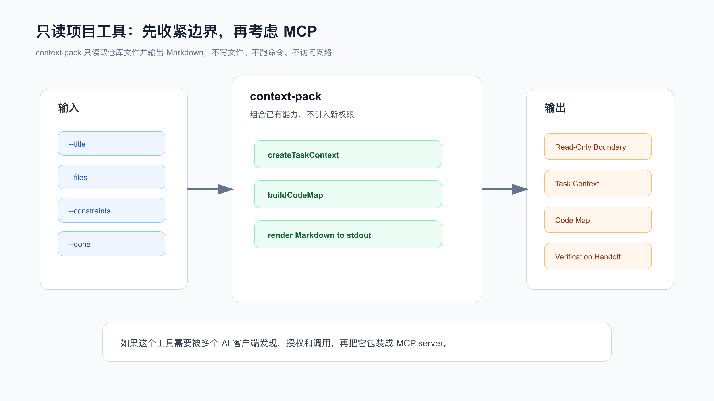
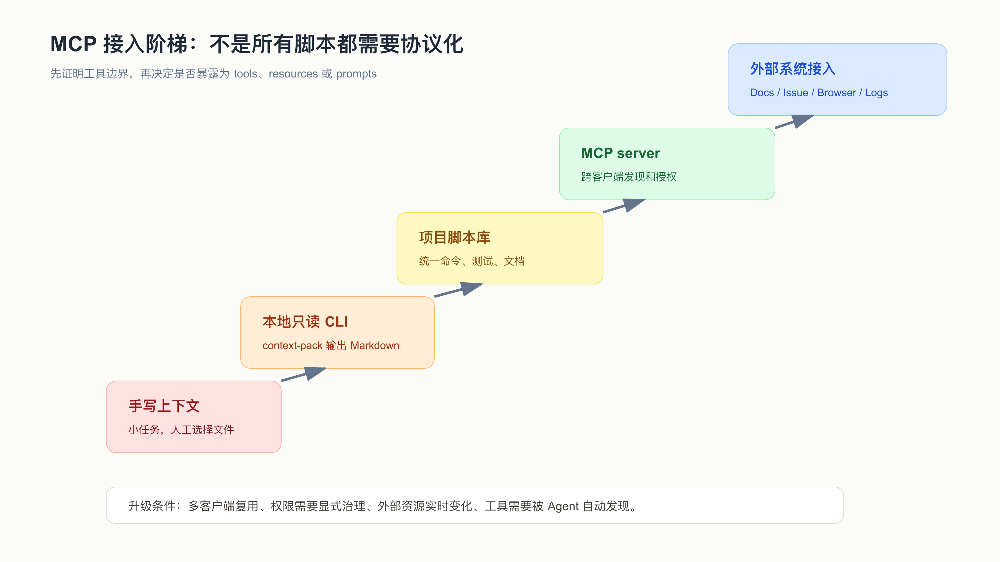

# 模块实战：给 AI 接一个只读项目工具

给 AI 接工具，最容易走偏的地方不是 MCP 配置。

真正危险的是：工具还没定义清楚读写权限、失败行为和验证方式，就开始让 Agent 调用。

配套代码仓库 [DavidDingXu/learn-ai-coding](https://github.com/DavidDingXu/learn-ai-coding) 按一个大仓库组织，仓库根目录下有业务 module 和工具 module。这里用工具 module：`ai-coding-workflow-kit`。它适合验证工具权限边界，不替代业务 module 的综合实战。

这一篇用 `ai-coding-workflow-kit` 的 `context-pack` 需求做案例。过程记录在：

```text
learn-ai-coding/ai-coding-workflow-kit/dev-process/05-readonly-tool-boundary.md
```

对应真实需求是：

```text
在接外部工具前，先做一个只读项目工具 context-pack，再判断是否值得包装成 MCP。
```

重点不是执行 `context-pack` 看输出，而是记录一个工具从需求、权限边界、失败行为、验证方式，到 MCP 判断的完整过程。



## 先问工具要解决什么问题

`context-pack` 要解决的问题很具体：

```text
AI 接手任务时，需要一份紧凑交接材料。
这份材料应该包含任务目标、相关文件、代码地图和验证提示。
已有 codemap 和 task-context，但需要人工拼接。
```

所以这次需求不是：

```text
做一个万能项目助手。
做一个 MCP server。
自动读取 Issue。
自动执行 npm test。
自动生成并写入 context-pack.md。
```

它只做一件事：

```text
把任务上下文、代码地图和验证提醒组合成 Markdown，输出到 stdout。
```

真实项目里，工具需求越小，越要把边界写清楚。因为工具一旦接给 Agent，Agent 会倾向于把它当作“可以继续做更多事”的能力。

## 权限边界先于实现

过程记录里的 Boundary Checklist 很直接：

```text
能读什么？
- root 下的文件树和指定文件路径。

能写什么？
- 什么都不写，只输出 stdout。

能执行什么？
- 不执行项目命令，只把验证命令写成提醒。

能联网吗？
- 不能。

失败时怎么表现？
- 参数缺失走 CLI 错误路径。

输出怎么验证？
- 测试检查只读边界文本、task context、code map 和 done 提示。
```

这段清单就是工具需求的一部分。

如果它缺失，AI 很可能顺手做这些事：

```text
把输出写成 context-pack.md。
自动运行 npm test 并收集结果。
读取浏览器、Issue 或网络文档。
把项目扫描扩大到不相关目录。
```

这些能力不一定永远不能做，但都不属于这次需求。

## 实现先做本地安全内核

本次工具先做 CLI 安全内核，而不是直接接 MCP。

涉及文件是：

```text
src/lib/context-pack.js
src/cli.js
test/context-pack.test.js
README.md
openspec/changes/context-pack-readonly/*
```

核心实现复用已有能力：

```text
createTaskContext
buildCodeMap
renderCodeMapMarkdown
```

`src/lib/context-pack.js` 输出包括：

```text
Read-Only Boundary
Task Context
Repository Code Map
Verification Handoff
```

这几个 section 都是有意设计的。

`Read-Only Boundary` 告诉人和 Agent：这个工具不能写文件、不能执行命令、不能联网。

`Verification Handoff` 则说明：验证命令只是提醒，真正执行和记录结果要在任务验证阶段完成。

## 给 AI 的实现指令

这类需求不要写成：

```text
给项目加一个 context-pack 工具。
```

应该写成：

```text
请读取：
- learn-ai-coding/ai-coding-workflow-kit/dev-process/05-readonly-tool-boundary.md
- learn-ai-coding/ai-coding-workflow-kit/openspec/changes/context-pack-readonly/design.md
- learn-ai-coding/ai-coding-workflow-kit/src/lib/codemap.js
- learn-ai-coding/ai-coding-workflow-kit/src/lib/task-context.js
- learn-ai-coding/ai-coding-workflow-kit/src/cli.js
- learn-ai-coding/ai-coding-workflow-kit/test/context-pack.test.js

只实现只读 context-pack：
1. 组合 task context 和 code map。
2. 输出 read-only boundary。
3. 输出 verification handoff。
4. 不写文件。
5. 不执行项目命令。
6. 不访问网络。

如果你认为需要 MCP、写文件或执行命令，先报告理由，不要直接实现。
```

这段指令先保护权限边界，再谈实现。

## 验证工具边界

自动测试：

```bash
cd learn-ai-coding/ai-coding-workflow-kit
npm test
```

目标命令：

```bash
node src/cli.js context-pack \
  --title "Inspect CLI contract" \
  --files "src/cli.js,test/cli.test.js" \
  --done "npm test"
```

要检查的不是“输出很多 Markdown”，而是：

```text
是否包含 Read-Only Boundary。
是否说明 Does not edit files。
是否说明 Does not execute project commands。
是否说明 Does not access network resources。
是否包含 Task Context。
是否包含 Code Map。
是否把 npm test 放在 Verification Handoff，而不是自动执行。
```

如果工具自动写文件或执行命令，即使看起来更方便，也违反了这次需求。

## 什么时候才需要 MCP

过程记录里的 MCP 判断很克制：

```text
暂时不包装成 MCP。
先保留 CLI。
后续如果多个 Agent 或编辑器都需要稳定调用，再考虑 MCP。
```

理由是：

```text
还没有多个客户端复用这个能力的需求。
还没有外部资源接入需求。
只读本地仓库和 stdout 已经满足当前任务。
```

很多 MCP 接入失败，不是协议难，而是安全内核还没定义清楚。

如果以后要包装 MCP，也应该保留同一份契约：

```text
输入是什么。
读取范围是什么。
是否写文件。
是否执行命令。
是否联网。
输出结构是什么。
失败怎么返回。
本地 CLI 如何验证。
```

MCP 是接入层，不应该改变工具内核的权限边界。



## Review 要盯权限扩张

这类工具的代码审查重点不是语法，而是权限有没有扩大。

重点看：

```text
有没有 fs.writeFile。
有没有 child_process。
有没有 fetch/http/network。
有没有读取 root 之外的路径。
有没有把验证命令执行掉。
有没有新增依赖。
有没有把错误吞掉。
```

在当前实现里，`context-pack` 只组合 `codemap` 和 `task-context`，输出 Markdown。

如果 diff 里出现写文件、执行 shell、请求网络，就要退回到需求层重新讨论。

## 迁移到你的项目

给 AI 接任何项目工具前，先写一张边界卡。

```text
工具名：
解决的问题：
输入：
读取范围：
写入范围：
是否执行命令：
是否联网：
输出格式：
失败行为：
验证方式：
不做什么：
```

然后再让 AI 实现。

对于多数个人项目，推荐顺序是：

```text
先做只读 CLI。
用测试保护输入输出。
用 README 写清命令和边界。
真实使用几次后，再决定是否需要 MCP。
```

不要一上来就把工具做成 Agent 可以写文件、执行命令、访问外部系统的全能助手。

## 常见错误

**错误一：把 MCP 当第一步。**

如果工具本身的权限、输出和失败行为没定义清楚，包装成 MCP 只会把风险扩散。

**错误二：为了方便让工具自动执行命令。**

验证命令应该由任务验证阶段执行并记录。上下文工具只负责提醒。

**错误三：只测输出，不测边界文本。**

只读工具的输出必须明确告诉使用者它不会写文件、执行命令或联网。

**错误四：把工具输出当正确性证明。**

`context-pack` 是导航材料，不证明代码正确。

**错误五：没有保留本地验证路径。**

即使以后包装 MCP，也应该保留 CLI 或单元测试，方便在没有 Agent 的情况下验证内核。

## 可复查资料

- 只读工具边界过程记录：`learn-ai-coding/ai-coding-workflow-kit/dev-process/05-readonly-tool-boundary.md`
- `context-pack` 需求记录：`learn-ai-coding/ai-coding-workflow-kit/dev-process/03-openspec-context-pack.md`
- `context-pack` 实现：`learn-ai-coding/ai-coding-workflow-kit/src/lib/context-pack.js`
- CLI 入口：`learn-ai-coding/ai-coding-workflow-kit/src/cli.js`
- 测试文件：`learn-ai-coding/ai-coding-workflow-kit/test/context-pack.test.js`
- OpenSpec 变更包：`learn-ai-coding/ai-coding-workflow-kit/openspec/changes/context-pack-readonly/`

---

[课程首页](../../../README.md) · [完整目录](../README.md) · [← 模块实战：用 Superpowers 固化一次业务需求的调试和评审](35-%E6%A8%A1%E5%9D%97%E5%AE%9E%E6%88%98-%E7%94%A8-Superpowers-%E5%9B%BA%E5%8C%96%E8%B0%83%E8%AF%95%E5%92%8C%E8%AF%84%E5%AE%A1%E6%B5%81%E7%A8%8B.md) · [综合实战：一个真实需求的 AI Coding 最佳实践 →](../07-%E7%BB%BC%E5%90%88%E5%AE%9E%E6%88%98%E4%B8%8E%E8%B5%84%E4%BA%A7%E6%B2%89%E6%B7%80/37-%E7%BB%BC%E5%90%88%E5%AE%9E%E6%88%98-%E4%B8%80%E4%B8%AA%E7%9C%9F%E5%AE%9E%E9%9C%80%E6%B1%82%E7%9A%84-AI-Coding-%E6%9C%80%E4%BD%B3%E5%AE%9E%E8%B7%B5.md)

动手实践：[只读工具边界实战](../../../ai-coding-workflow-kit/dev-process/05-readonly-tool-boundary.md)
