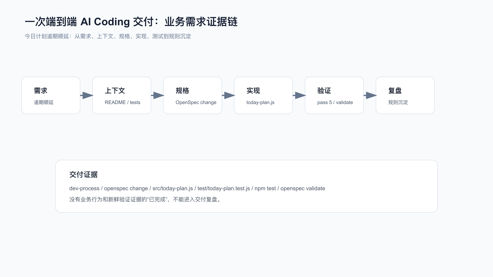
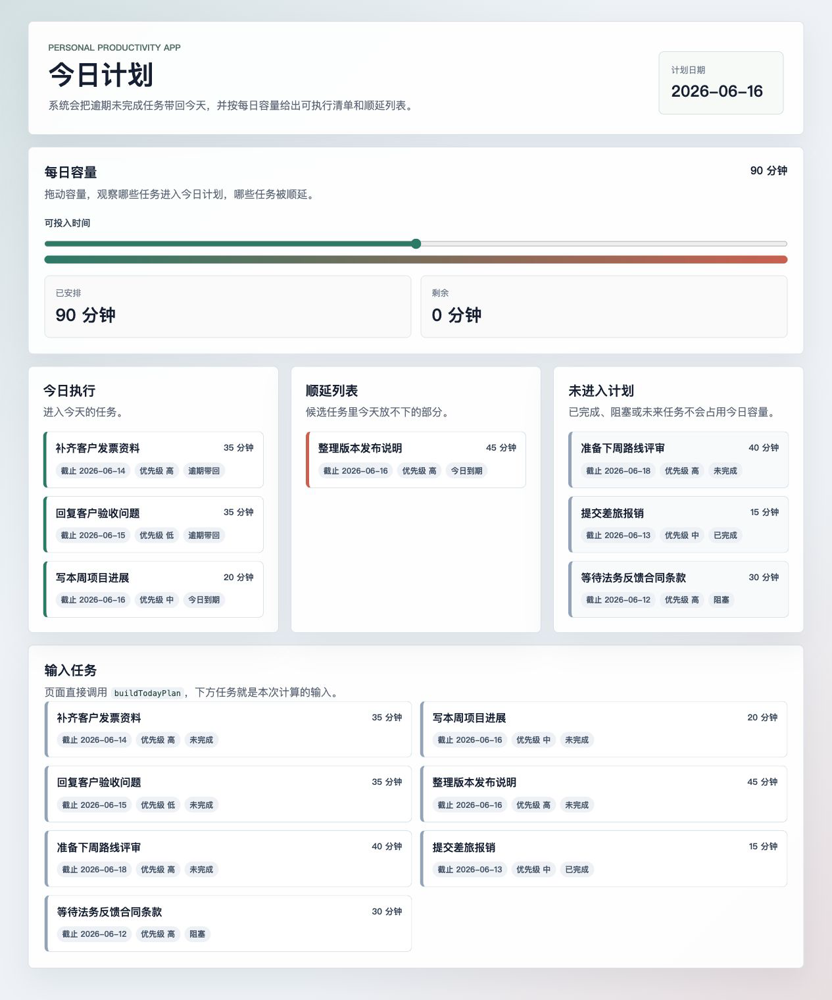

# 综合实战：一个真实需求的 AI Coding 最佳实践

真实需求不会按工具章节出现。它通常同时牵涉上下文、spec、TDD、debug、Skill、OpenSpec 和验证。

如果这些能力只停留在单点命令，真实需求进来时仍然很容易断链。

下面用同一个产品需求把整条链路走完：

```text
个人效率助手每天生成今日计划时，自动纳入逾期未完成任务，并在每日容量限制下返回顺延列表。
```

配套代码仓库 [DavidDingXu/learn-ai-coding](https://github.com/DavidDingXu/learn-ai-coding) 按一个大仓库组织，仓库根目录下有业务 module 和工具 module。这里使用业务 module：`personal-productivity-app`。工具 module 里的 CLI、context-pack、verification ledger 可以提供方法样例，但不能替代这一条业务链路。

端到端过程记录在：

```text
learn-ai-coding/personal-productivity-app/dev-process/03-end-to-end-today-plan-delivery.md
```

这不是工具项目里的命令演示，而是一个可迁移的业务规则需求：有状态、有日期、有优先级、有容量、有测试、有 review 边界。



## 第一步：把需求翻译成业务边界

原始需求可以很口语：

```text
今日计划别漏掉昨天没做完的任务，但也别把今天排爆。
```

AI 如果直接改代码，容易把需求扩大成：

```text
做一个任务系统。
做一个日历同步。
做一个提醒服务。
做一个复杂排程算法。
```

真实开发里，第一步不是写代码，而是限定边界。

本次做：

```text
buildTodayPlan 领域函数。
逾期任务和当天任务候选选择。
done / blocked / future 过滤。
priority / dueDate 排序。
capacityMinutes 容量约束。
items / deferred 输出。
今日计划结果页。
容量调节后即时重算。
```

本次不做：

```text
完整任务系统页面。
API。
数据库。
账号系统。
提醒系统。
日历同步。
复杂排程优化。
```

这一步是后续所有工具能发挥作用的前提。

## 第二步：把上下文交给 AI

给 AI 的上下文不是“你帮我做一下”。

最少应该包含：

```text
README.md
package.json
test/today-plan.test.js
openspec/changes/today-plan-overdue-rollover/proposal.md
openspec/changes/today-plan-overdue-rollover/specs/today-plan/spec.md
openspec/changes/today-plan-overdue-rollover/design.md
openspec/changes/today-plan-overdue-rollover/tasks.md
```

这些文件分别回答：

```text
项目是什么。
怎么跑测试。
需求为什么做。
行为合同是什么。
实现边界是什么。
任务怎么拆。
```

如果 AI 只读测试文件，可能知道要实现什么。

但它不知道为什么 UI 只能展示已有领域规则、为什么 blocked 不进入计划、为什么 priority 要优先于 dueDate age。

上下文不是越多越好，而是要覆盖决策所需事实。

## 第三步：用 OpenSpec 固定需求合同

OpenSpec 本次真实命令链是：

```bash
openspec init --tools codex .

openspec new change today-plan-overdue-rollover \
  --description "今日计划自动纳入逾期未完成任务，并在每日容量限制下给出顺延列表。" \
  --goal "让个人效率助手每天生成可执行的今日计划，避免逾期任务丢失或一天被排爆。" \
  --json

openspec instructions proposal --change today-plan-overdue-rollover --json
openspec instructions specs --change today-plan-overdue-rollover --json
openspec instructions design --change today-plan-overdue-rollover --json
openspec instructions tasks --change today-plan-overdue-rollover --json
openspec validate today-plan-overdue-rollover --strict --json --no-interactive
```

生成的核心文件：

```text
proposal.md
design.md
specs/today-plan/spec.md
tasks.md
```

最关键的不是文件名，而是它们让需求变成可审合同。

proposal 写为什么做。

spec 写 SHALL / MUST 和 scenario。

design 写技术取舍和不做什么。

tasks 写每一步怎么完成。

## 第四步：先红灯再实现

测试先表达业务行为：

```text
逾期任务进入今日计划，且排在当天任务前。
done / blocked 不进入今日计划。
容量不足时放不下的任务进入 deferred。
逾期任务按 priority 优先于 dueDate age。
非法日期、负容量、负估时被拒绝。
```

第一次运行：

```bash
npm test
```

红灯：

```text
ERR_MODULE_NOT_FOUND: Cannot find module 'src/today-plan.js'
```

这个红灯把实现范围钉住了：

```text
要新增 src/today-plan.js。
测试期望不用改。
没有理由新增数据库或外部服务。页面展示必须复用 `buildTodayPlan`，不能另写一套规则。
```

## 第五步：小 diff 实现领域规则

实现文件：

```text
src/today-plan.js
```

核心函数：

```js
export function buildTodayPlan({ date, capacityMinutes = 0, tasks = [] } = {}) {
  // 过滤、排序、容量选择、输出 items/deferred
}
```

核心实现边界：

```text
不读取系统时间。
不访问网络。
不写文件。
不引入依赖。
不做持久化。
页面只展示 `buildTodayPlan` 的结果，不接后端。
```

这就是小 diff 的意义：只改当前需求需要的地方。

## 第六步：用 Superpowers 约束过程

本次 Superpowers 没有替代 OpenSpec。

它约束的是执行纪律：

```text
test-driven-development：实现前先红灯。
systematic-debugging：测试失败时先找根因。
requesting-code-review：完成后按行为风险审查。
verification-before-completion：完成前跑新鲜验证。
receiving-code-review：处理反馈时不扩大 scope。
```

这里也核对了当前入口：本机 `brainstorm`、`write-plan`、`execute-plan` 命令文件都标了 deprecated，当前写法以 Skill 触发为准。

所以不能把旧命令当成当前推荐路径。

## 第七步：验证不是一句话

本次验证有四层。

OpenSpec strict validate：

```bash
openspec validate today-plan-overdue-rollover --strict --json --no-interactive
```

结果：

```text
passed: 1
failed: 0
```

业务测试：

```bash
npm test
```

结果：

```text
tests 7
pass 7
fail 0
```

OpenSpec apply 进度：

```bash
openspec instructions apply --change today-plan-overdue-rollover --json
```

结果：

```text
total: 8
complete: 8
remaining: 0
state: all_done
```

这才叫完成证据。

只写“已完成，测试通过”，reviewer 不知道通过了什么，也不知道需求合同是否仍然有效。

最终页面也要验证。启动本地页面：

```bash
npm run dev
```

打开：

```text
http://127.0.0.1:4173
```

默认 90 分钟容量下，页面应该展示：

```text
今日执行：补齐客户发票资料、回复客户验收问题、写本周项目进展
顺延列表：整理版本发布说明
未进入计划：准备下周路线评审、提交差旅报销、等待法务反馈合同条款
```

把容量调到 60 分钟后，页面应该重新计算：

```text
今日执行：补齐客户发票资料、写本周项目进展
顺延列表：回复客户验收问题、整理版本发布说明
已安排：55 分钟
剩余：5 分钟
```

这一步不是把样例扩成完整产品，而是确认业务规则确实落到了用户可见结果里。



## 第八步：Review 看业务风险

这次 review 应该盯这些问题：

```text
done / blocked 是否被误收？
future 是否被误收？
overdue 是否排在 due-today 前？
priority 是否先于 dueDate age？
capacity 是否可能超限？
deferred 是否保留放不下的任务？
remainingMinutes 是否计算正确？
实现是否依赖系统时间或外部副作用？
```

这些问题比“代码是否优雅”更重要。

因为真实用户只关心：今天看到的计划是否可信。

## 第九步：复盘沉淀可迁移规则

这次需求之后，值得沉淀的不是 `today-plan` 这个函数名。

真正可迁移的是：

```text
有状态、日期、优先级、容量边界的需求，先写 spec 再实现。
业务实战必须先写用户可见行为，不要用工具命令冒充业务需求。
OpenSpec 实战必须有真实 CLI 命令和 validate 输出。
Superpowers 实战必须写当前 Skill 入口和触发条件。
完成前必须重新跑验证命令，不能引用旧输出。
```

这些规则可以迁移到：

```text
订单超时关闭。
工单 SLA 升级。
审批任务催办。
会员权益到期提醒。
账单分期滚动。
```

## 给 AI 的完整执行指令

真实项目里可以这样交给 AI：

```text
需求：今日计划自动纳入逾期未完成任务，并在每日容量限制下返回顺延列表。

请先读取：
- README.md
- package.json
- openspec/changes/today-plan-overdue-rollover/proposal.md
- openspec/changes/today-plan-overdue-rollover/specs/today-plan/spec.md
- openspec/changes/today-plan-overdue-rollover/design.md
- openspec/changes/today-plan-overdue-rollover/tasks.md
- test/today-plan.test.js

执行要求：
1. 以 tasks.md 为 source of truth。
2. 实现前运行 npm test，记录红灯。
3. 先实现 src/today-plan.js；页面展示必须复用该函数，不接数据库、API 或外部依赖。
4. 如果测试失败，按 systematic-debugging 先定位第一个失败信号。
5. 完成后运行 npm test。
6. 运行 openspec validate today-plan-overdue-rollover --strict --json --no-interactive。
7. 运行 openspec instructions apply --change today-plan-overdue-rollover --json。
8. 如果改动影响页面展示，运行 npm run dev 并检查 http://127.0.0.1:4173。
9. 汇报修改文件、验证结果和残余风险。
```

这比“帮我实现一下”稳定得多。

## 配套资料

- 端到端过程记录：`learn-ai-coding/personal-productivity-app/dev-process/03-end-to-end-today-plan-delivery.md`
- OpenSpec 过程记录：`learn-ai-coding/personal-productivity-app/dev-process/01-openspec-today-plan-rollover.md`
- Superpowers 过程记录：`learn-ai-coding/personal-productivity-app/dev-process/02-superpowers-today-plan-workflow.md`
- OpenSpec 变更包：`learn-ai-coding/personal-productivity-app/openspec/changes/today-plan-overdue-rollover/`
- 领域实现：`learn-ai-coding/personal-productivity-app/src/today-plan.js`
- 结果页：`learn-ai-coding/personal-productivity-app/index.html`
- 页面渲染：`learn-ai-coding/personal-productivity-app/src/ui.js`
- 页面演示数据：`learn-ai-coding/personal-productivity-app/src/today-plan-demo.js`
- 业务测试：`learn-ai-coding/personal-productivity-app/test/today-plan.test.js`
- 页面演示测试：`learn-ai-coding/personal-productivity-app/test/today-plan-demo.test.js`

---

[课程首页](../../../README.md) · [完整目录](../README.md) · [← 模块实战：给 AI 接一个只读项目工具](../06-Skill-Superpowers-%E4%B8%8E%E5%B7%A5%E4%BD%9C%E6%B5%81%E5%9B%BA%E5%8C%96/36-%E6%A8%A1%E5%9D%97%E5%AE%9E%E6%88%98-%E7%BB%99-AI-%E6%8E%A5%E4%B8%80%E4%B8%AA%E5%8F%AA%E8%AF%BB%E9%A1%B9%E7%9B%AE%E5%B7%A5%E5%85%B7.md) · [综合实战：从一次交付沉淀个人规则库 →](38-%E7%BB%BC%E5%90%88%E5%AE%9E%E6%88%98-%E4%BB%8E%E4%B8%80%E6%AC%A1%E4%BA%A4%E4%BB%98%E6%B2%89%E6%B7%80%E4%B8%AA%E4%BA%BA%E8%A7%84%E5%88%99%E5%BA%93.md)

动手实践：[完整业务需求交付](../../../personal-productivity-app/dev-process/03-end-to-end-today-plan-delivery.md)
