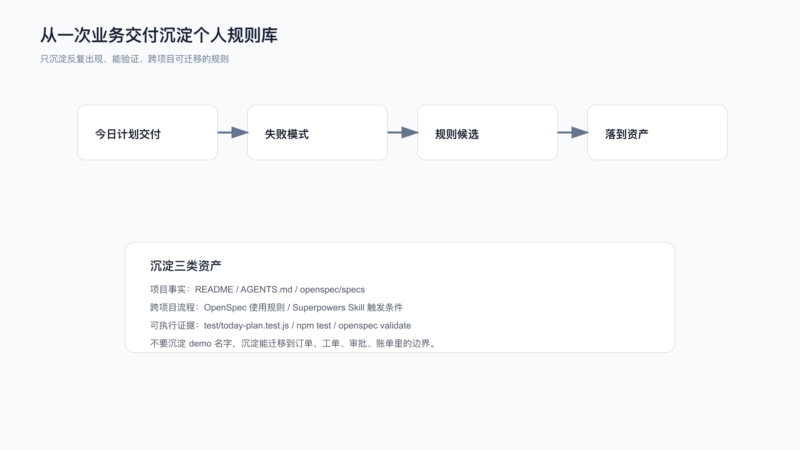

# 综合实战：从一次交付沉淀个人规则库

一次需求交付完，不应该只剩一段总结。

真正能提高下一次 AI Coding 稳定性的，是把这次暴露出来的失败模式、判断边界和验证方式沉淀成可复用规则。

这里继续用个人效率助手的需求：

```text
今日计划自动纳入逾期未完成任务，并在每日容量限制下返回顺延列表。
```

配套代码仓库 [DavidDingXu/learn-ai-coding](https://github.com/DavidDingXu/learn-ai-coding) 按一个大仓库组织。规则沉淀不能只写工具 module 的命令经验，还要回到业务 module 的需求边界、验证证据和 review 风险。这里使用 `personal-productivity-app`。

规则沉淀记录在：

```text
learn-ai-coding/personal-productivity-app/dev-process/04-rule-asset-sedimentation.md
```



## 先看这次交付暴露了什么

这次需求并不大，但它暴露出几个常见问题：

```text
业务实战容易被写成工具实战。
OpenSpec 容易被写成“风格”，而不是实际 CLI 和仓库产物。
Superpowers 容易只写 Skill 名字，不写当前入口和触发条件。
测试容易只看最终绿灯，不记录红灯。
完成汇报容易只写“测试通过”，不写验证证据。
review 容易看代码风格，漏掉业务边界。
```

这些问题在别的项目里也会反复出现。

所以它们值得沉淀。

## 规则 1：实战需求必须先写用户可见行为

不能把“执行一个命令”“新增一个工具”“整理一份上下文”直接当综合实战主线。

这些动作可以作为工具能力验证，但很难撑起一条完整交付链路；完整交付更适合从业务或产品需求开始。

判断方式很简单：

```text
这个需求解决了哪个用户问题？
这个需求有没有状态、边界、异常、验证？
读者能不能迁移到自己的业务项目？
```

这次选择的是：

```text
今日计划别漏掉逾期任务，也别把当天排爆。
```

读者可以迁移到：

```text
订单超时关闭。
工单 SLA 升级。
审批任务催办。
会员权益到期提醒。
账单分期滚动。
```

这比“给 AI 工具加一个命令”更容易复用。

## 规则 2：OpenSpec 实战必须有真实命令

如果 OpenSpec 只剩这些文件名：

```text
proposal.md
design.md
tasks.md
```

还不够。

一次可复查的 OpenSpec 变更至少要能追到这些证据：

```bash
openspec --version
openspec init --tools codex .
openspec new change today-plan-overdue-rollover ...
openspec instructions proposal --change today-plan-overdue-rollover --json
openspec instructions specs --change today-plan-overdue-rollover --json
openspec instructions design --change today-plan-overdue-rollover --json
openspec instructions tasks --change today-plan-overdue-rollover --json
openspec validate today-plan-overdue-rollover --strict --json --no-interactive
openspec instructions apply --change today-plan-overdue-rollover --json
```

以及真实目录：

```text
openspec/changes/today-plan-overdue-rollover/
```

以后遇到 OpenSpec 相关交付，这条规则要优先生效：

```text
没有真实 CLI 和 validate 输出，就不要写成 OpenSpec 实战。
```

## 规则 3：Superpowers 要写当前入口

Superpowers 的入口不是固定在某个 slash command 上。不同宿主环境可能通过 Skill、插件命令或项目规则触发同一套流程。

所以不能把旧 slash command 当作默认最佳实践，而要先核对当前环境推荐的触发方式。

沉淀规则：

```text
使用 Superpowers 时，先核对当前平台推荐入口和 Skill/command 状态。
如果旧命令已经 deprecated，就不要把它写成当前推荐入口。
每个 Skill 都必须说明触发条件、输入、输出和验证证据。
```

本次真实使用的 Skill 是：

```text
test-driven-development
systematic-debugging
requesting-code-review
receiving-code-review
verification-before-completion
```

## 规则 4：完成前必须重新跑验证

完成汇报不能引用旧输出。

本次完成前验证是：

```bash
openspec validate today-plan-overdue-rollover --strict --json --no-interactive
npm test
npm run dev
openspec instructions apply --change today-plan-overdue-rollover --json
```

证据是：

```text
OpenSpec strict validate：passed 1, failed 0
npm test：pass 7, fail 0
页面验证：90 分钟下 3 个今日执行、1 个顺延；60 分钟下 2 个今日执行、2 个顺延
OpenSpec apply：total 8, complete 8, remaining 0
```

沉淀规则：

```text
任何“已完成”“已修复”“测试通过”之前，都必须有当前轮新鲜命令输出。
```

这条规则应该放进个人工作流，成为每次完成前的固定动作。

## 规则 5：规则只沉淀可迁移部分

不是所有东西都值得进规则库。

不沉淀：

```text
today-plan 这个函数名。
某次临时标题。
某个临时目录路径。
某个截图摆放方式。
某次临时判断口径。
```

要沉淀：

```text
什么需求需要 spec。
什么失败需要 systematic-debugging。
什么完成声明需要 verification-before-completion。
什么 review 意见属于当前 scope。
什么交付练习必须有真实业务需求。
什么交付结果需要用户可见展示。
```

规则库要服务下一次开发，不是记录一次临时复盘怎么组织。

## 放到哪里

项目事实放仓库：

```text
README.md
AGENTS.md
openspec/specs/
```

需求过程放仓库：

```text
openspec/changes/
dev-process/
```

跨项目流程放个人资产：

```text
Skill
Superpowers 使用约定
个人 AI Coding 检查清单
```

可执行证据放测试或脚本：

```text
test/
scripts/
verification ledger
```

规则不能只留在聊天记录里。

聊天记录太容易丢，也太难被下一次任务自动读取。

## 一次交付后的复盘模板

你可以用这 6 个问题复盘：

```text
1. 这次真实需求是什么，用户可见行为是什么？
2. 哪些边界一开始不清楚？
3. 哪个测试先红灯，最后哪个命令绿灯？
4. 哪些 review 风险和业务行为直接相关？
5. 哪条规则下次还能复用？
6. 这条规则应该放进项目事实、跨项目流程，还是可执行验证？
```

不要写成空泛总结。

比如这次可沉淀为：

```text
有状态、日期、优先级和容量边界的需求，先落 OpenSpec spec，再写测试。
```

这句话能指导下一次任务。

## 迁移到自己的项目

假设你做的是工单系统，需求是：

```text
SLA 快超时的工单要自动升级，但不能把所有低优工单都推给同一个值班人。
```

你可以直接复用这次规则：

```text
先写用户可见行为。
用 OpenSpec 写状态、时间、优先级和容量边界。
用 TDD 先写失败测试。
用 systematic-debugging 处理测试失败。
review 时检查状态过滤、时间边界、容量分配和 deferred/overflow。
完成前跑新鲜验证。
交付后沉淀“有 SLA/容量边界的需求必须先 spec”。
```

这就是规则沉淀的价值。

## 配套资料

- 规则沉淀记录：`learn-ai-coding/personal-productivity-app/dev-process/04-rule-asset-sedimentation.md`
- 端到端过程记录：`learn-ai-coding/personal-productivity-app/dev-process/03-end-to-end-today-plan-delivery.md`
- OpenSpec 过程记录：`learn-ai-coding/personal-productivity-app/dev-process/01-openspec-today-plan-rollover.md`
- Superpowers 过程记录：`learn-ai-coding/personal-productivity-app/dev-process/02-superpowers-today-plan-workflow.md`
- OpenSpec 变更包：`learn-ai-coding/personal-productivity-app/openspec/changes/today-plan-overdue-rollover/`
- 结果页：`learn-ai-coding/personal-productivity-app/index.html`

---

[课程首页](../../../README.md) · [完整目录](../README.md) · [← 综合实战：一个真实需求的 AI Coding 最佳实践](37-%E7%BB%BC%E5%90%88%E5%AE%9E%E6%88%98-%E4%B8%80%E4%B8%AA%E7%9C%9F%E5%AE%9E%E9%9C%80%E6%B1%82%E7%9A%84-AI-Coding-%E6%9C%80%E4%BD%B3%E5%AE%9E%E8%B7%B5.md) · [从个人提效到个人工程系统 →](../08-%E4%B8%AA%E4%BA%BA%E5%B7%A5%E7%A8%8B%E8%B5%84%E4%BA%A7/39-%E4%BB%8E%E4%B8%AA%E4%BA%BA%E6%8F%90%E6%95%88%E5%88%B0%E4%B8%AA%E4%BA%BA%E5%B7%A5%E7%A8%8B%E7%B3%BB%E7%BB%9F.md)

动手实践：[个人规则沉淀实战](../../../personal-productivity-app/dev-process/04-rule-asset-sedimentation.md)
