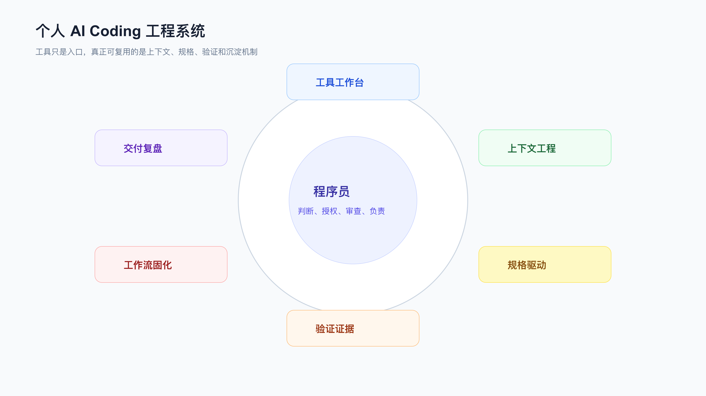
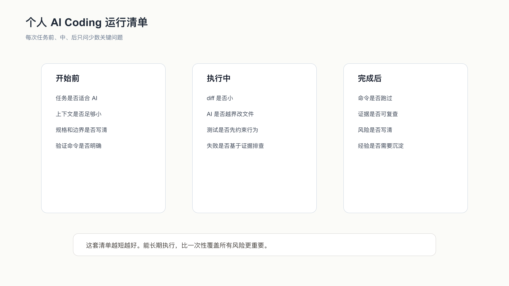

# 从个人提效到个人工程系统

AI Coding 用到最后，拼的不是谁会更多工具。

也不是谁收藏了更多 prompt。

拉开差距的是：你能不能把 AI 放进自己的工程系统里。

这个系统不复杂。

它由几件很朴素的东西组成：

```text
知道什么任务适合 AI。
知道什么时候必须自己主导。
知道怎么给上下文。
知道怎么写规格和边界。
知道怎么限制 diff。
知道怎么用测试和手动验证定义完成。
知道怎么把成功经验沉淀下来。
```

如果这些能力没有建立，再强的模型也会让你在真实项目里反复返工。

如果这些能力建立起来，工具可以替换，工作流仍然保留。



## 工具只是入口

Codex、Claude Code、Cursor、Copilot、MCP、Skill、OpenSpec、Superpowers，这些都重要。

但它们不是终点。

程序员最容易掉进一个坑：以为换一个工具，就能解决 AI Coding 不稳定的问题。

工具确实会影响效率，但不要把 App、CLI、IDE 当成互不重叠的能力盒子。

同一个 Agent，如果拿到了仓库、终端和编辑权限，在 CLI 里也能计划、解释、搜索、修改、测试和总结。App 的价值更多在结果预览、长任务管理、异步审查、文件查看、材料整理和协作反馈。

CLI 适合贴近终端和 repo 操作，也适合把一次改动从搜索、计划、实现到验证串起来。

IDE 适合局部补全和代码导航。

浏览器适合验证 UI 和查资料。

MCP 适合把必要外部资源以受控方式接进来。

Skill 适合固化重复工作流。

但如果任务边界不清、上下文混乱、验证缺失、diff 过大，换工具只能让错误发生得更快。

所以工具工作台只是第一层。

要建立的是任务到交付的整套路径。

这套路径有三条底线。

第一，AI 不能替你定义业务正确性。它可以读代码、找相似实现、补测试、提出候选方案，但订单能不能回退、权限能不能放宽、金额怎么取整、历史数据怎么兼容，必须由人确认。代码里已有的行为也不一定都是正确需求，可能只是历史遗留。

第二，AI 不能替你承担变更责任。它生成的 diff 进了仓库，责任在提交者，不在模型。你可以让 Agent 写完成报告，但不能把完成报告当成审查结论。真正的结论来自 diff、测试、日志、截图、接口响应和 reviewer 判断。

第三，AI 不能替你决定权限边界。让它读仓库、跑测试、打开浏览器、访问 Issue、查数据库、调用 MCP server，都是不同授权级别。能力越强，越要明确只读、可写、可执行、可联网和需要确认的动作。

个人工程系统存在的意义，就是把这三条底线落到日常动作里。

## 一次任务开始前

不要急着问 AI 怎么写。

先问四个问题：

```text
这个任务适合交给 AI 到什么程度？
AI 需要读哪些文件才不会误判？
哪些行为不能被改？
完成后用什么证明？
```

小任务可以很轻：

```text
目标：修 README 命令。
文件：README.md。
约束：不改 CLI 实现。
完成：命令能跑。
```

复杂任务要更正式：

```text
requirements.md
design.md
tasks.md
openspec/changes/<change>/
verification ledger
```

这不是流程表演。

它是在给 AI 行动边界。

边界越清楚，diff 越容易审。

## 执行中要看 diff，不要看情绪

AI 很会总结。

它可以把一次不可靠的改动说得很完整。

所以执行中不要被总结带走。

你要看：

```text
改了哪些文件。
有没有越过任务边界。
是否引入新依赖。
是否改变外部行为。
测试是否先表达新行为。
失败是否基于证据排查。
README、规格、规则是否同步。
```

如果 diff 失控，不要继续让 AI “优化”。

先收住范围。

必要时回到任务上下文，重新授权一个更小的步骤。

程序员在 AI Coding 里的核心角色，不是给 AI 当审核员那么简单。

你要负责判断：

```text
哪一步可以让 AI 做。
哪一步必须先停。
哪一步要补证据。
哪一步要人工决策。
```

## 完成后必须有证据

“完成”至少要有一类证据。

代码任务通常不止一类。

```text
测试命令。
目标命令。
浏览器验证。
日志或数据库检查。
diff 审查。
README 命令复跑。
verification ledger。
```

比如 `context-pack` 任务，完成证据是：

```text
npm test：12 pass，0 fail。
context-pack 输出 Read-Only Boundary、Task Context、Code Map、Verification Handoff。
unknown command stderr 包含 context-pack，exit code 非 0。
README 写了可运行命令。
OpenSpec 式变更包记录了只读边界。
```

这比“已实现 context-pack”可靠得多。

没有证据的完成，只是模型输出。

证据能被复查，交付才可持续。

证据也要和任务风险匹配。

文档改动，看 diff 和链接即可。CLI 行为改动，要跑目标命令、错误命令和测试。前端交互改动，要有测试或浏览器操作记录。接口合同改动，要看 status、response shape、兼容路径和调用方影响。状态机、权限、金额、数据迁移这类任务，要有反向用例和残余风险说明。

证据不足时，不要把话说满。可以写“已通过本地 focused test，未覆盖真实第三方回调”；可以写“已验证页面主路径，未跑浏览器兼容性”；可以写“当前失败是 baseline，但需要独立任务处理”。这种表达比“全部完成”更专业，也更适合进入 review。

AI Coding 的完成感经常来得太早。程序员要做的，是把完成感推迟到证据之后。



## 哪些东西要沉淀

每次交付后，不要把所有东西都写进规则库。

只沉淀会复用的。

项目事实放项目：

```text
AGENTS.md
CLAUDE.md
README.md
openspec/specs/
```

任务边界放任务：

```text
task-context
openspec/changes/
verification ledger
```

跨项目流程放 Skill：

```text
systematic debugging
focused code review
CLI contract review
verification before completion
```

确定性检查放脚本或测试：

```text
npm test
node --test
lint
check-ledger
browser verification
```

不要把它们混在一个超长 prompt 里。

超长 prompt 会过期，会互相冲突，也会让 AI 忽略真正重要的上下文。

## 这套系统的最小版本

如果你只想从明天开始改一个习惯，不需要一次建完所有资产。

最小版本是：

```text
一个项目规则文件。
一个任务上下文模板。
一个 verification ledger 模板。
一个调试 Skill。
一个 review Skill。
一个固定的测试命令习惯。
```

在每次任务里执行：

```text
先写任务上下文。
让 AI 先解释计划。
限制一次 diff。
先看 diff 再看总结。
跑验证命令。
写剩余风险。
把重复问题沉淀。
```

做到这些，已经能过滤掉大量不可靠的 AI Coding 输出。

后续再引入 OpenSpec、MCP、多 Agent、自动化脚本。

顺序不能反。

如果没有任务边界和验证习惯，多 Agent 只会并行制造更多不确定性。

如果没有只读工具边界，MCP 只会扩大权限风险。

如果没有可迁移流程，Skill 只是长 prompt。

## 常见误区

**误区一：把 AI Coding 当更快的编码。**

它不只是写代码。它会影响需求、设计、测试、文档和交付证据。

**误区二：把 prompt 当核心资产。**

prompt 容易丢、容易过期。更耐用的资产是规则、规格、测试、Skill 和复盘记录。

**误区三：复杂任务不写规格。**

复杂需求只靠聊天窗口，很容易把当前事实和目标行为混在一起。

**误区四：测试绿了就交付。**

测试是必要证据，不是唯一证据。CLI、UI、文档、数据副作用也要看。

**误区五：为了高级工具增加复杂度。**

OpenSpec、MCP、多 Agent 都有使用成本。任务不需要时，不要硬上。

## 从一个真实任务开始

可以从一个真实项目开始，不要从空项目开始。

选一个中等难度任务：

```text
改一个 CLI 行为。
修一个接口边界 bug。
补一个表单校验。
改一个状态机分支。
给老模块补测试。
```

按这个顺序做：

```text
写任务上下文。
生成代码地图。
让 AI 先读入口、测试、规则。
必要时写 spec/design/tasks。
让 AI 小步改。
看 diff。
跑测试。
手动验证目标行为。
写 verification ledger。
复盘沉淀规则。
```

你不需要每次都把流程跑满。

但你要知道哪些步骤可以省，哪些不能省。

程序员和随手聊天式开发的区别，就在这些可复查的步骤里。

AI 可以参与越来越多的开发工作。

但最终负责的人仍然是程序员。

你负责判断、授权、审查和交付。

工具会变。

这套工程系统应该留下。

## 自测：你的系统到了哪一层

可以用下面这组问题检查自己的状态。

第一层，只会用工具：

```text
我能让 AI 写代码。
我会在 IDE 或 CLI 里调用 AI。
我会让 AI 解释报错。
```

这一层能提高速度，但结果不稳定。

第二层，能控制上下文：

```text
我知道让 AI 先读哪些入口文件。
我会写任务上下文。
我会把项目规则放进 AGENTS.md 或对应规则文件。
我知道什么时候要清理旧结论。
```

到这一层，AI 开始不那么乱改。

第三层，能控制需求和 diff：

```text
我会把复杂需求拆成 requirements、design、tasks。
我知道什么时候用 OpenSpec 或轻量 SDD。
我会限制一次改动范围。
我会先看 diff，而不是先看总结。
```

到这一层，复杂任务才开始可审。

第四层，能定义完成：

```text
我会让测试约束行为。
我会手动验证 CLI、页面或接口。
我会记录 baseline、命令和残余风险。
我不会接受没有证据的完成声明。
```

到这一层，AI Coding 才能进入真实交付。

第五层，能沉淀系统：

```text
我会把反复出现的问题写成规则、Skill、脚本或测试。
我知道哪些经验只属于当前项目。
我会删除过期规则。
我能判断是否需要 MCP 或多 Agent。
```

到这一层，个人经验开始复利。

不要急着跳到第五层。

如果第二层还没建立，直接玩 MCP 和多 Agent，大概率只会增加不确定性。

## 30 天落地路线

可以用一个月建立最小系统。

第一周，只做上下文。

```text
给一个真实项目写 AGENTS.md。
整理 README、测试命令、入口文件。
为一个任务写 task context。
让 AI 每次改前先复述目标、文件和约束。
```

不要急着写复杂工具。

先让 AI 读对项目。

第二周，做规格和小 diff。

```text
挑一个中等复杂需求。
写 requirements.md、design.md、tasks.md。
每次只授权一个小任务。
每步看 diff。
越界就停。
```

如果需求会长期迭代，再考虑 OpenSpec。

第三周，做验证。

```text
给一个行为变化补测试。
补一次失败路径验证。
写一份 verification ledger。
手动跑一次 README 命令或页面流程。
```

这一周的目标是改变“AI 说完成就算完成”的习惯。

第四周，做沉淀。

```text
整理三条重复提醒。
把一条写进项目规则。
把一条写成 Skill 草稿。
把一条写成测试或脚本。
删掉一条不再适用的规则。
```

一个月后，你不一定有很多工具。

但你会有一套能继续长的工作流。

## 工具升级顺序

不要反过来。

更合适的顺序是：

```text
任务上下文 -> 项目规则 -> 测试和 ledger -> SDD/OpenSpec -> Skill -> 只读工具 -> MCP -> 多 Agent
```

前面的东西没有做好，后面的东西会变重。

没有任务上下文，项目规则会被误用。

没有测试和 ledger，SDD 只会变成文档。

没有稳定流程，Skill 只是换了位置的 prompt。

没有只读工具边界，MCP 会扩大权限风险。

没有独立审查面，多 Agent 会制造冲突。

这不是说后面的工具不重要。

而是它们需要前面的工程纪律支撑。

## 常见问题

**是不是每个需求都要写 spec？**

不是。小改动可以只写任务上下文。影响外部行为、跨模块、状态机、权限、支付、库存、CLI/API 合同这类需求，才值得写完整规格。

**是不是所有项目都要接 MCP？**

不是。单 repo、本地命令、手动上下文足够时，CLI 或脚本更简单。MCP 适合多客户端复用、外部资源实时变化、权限需要集中治理的场景。

**Skill 会不会让流程变重？**

写坏会。Skill 应该只固化高频、高风险、跨项目的流程。改 typo、整理一段 Markdown，不需要完整 Skill 链。

**多 Agent 能不能提高速度？**

能，但只适合边界清楚的独立任务或独立审查视角。强依赖实现不要硬拆，否则合并成本会吃掉并行收益。

**个人规则库维护成本高吗？**

如果规则很多，会高。正确做法是少写、常删、尽量用测试和脚本替代自然语言规则。

## 回到工程事实

每次让 AI 参与开发，都把它放回工程事实里。

事实包括：

```text
源码。
测试。
日志。
命令。
截图。
规格。
diff。
review。
ledger。
```

不要让 AI 只在自然语言里自洽。

自然语言很容易说通。

工程事实不容易骗人。

整套工作流都建立在这个判断上：AI 可以扩大你的执行能力，但不能替你承担工程责任。

责任还在你这里。

## 每个月做一次维护

个人工程系统不是写完就不动。

建议每个月做一次小维护，时间不用长，半小时够用。

先看规则文件：

```text
AGENTS.md 里有没有过期路径？
测试命令是否变了？
项目结构是否变了？
有没有已经不再适用的限制？
有没有最近重复提醒 AI 的规则还没写进去？
```

再看 Skill：

```text
哪个 Skill 最近真实触发过？
哪个 Skill 经常误触发？
哪个 Skill 太长，导致 Agent 读到一堆无关内容？
哪个 Skill 缺少明确输出证据？
```

然后看脚本和模板：

```text
verification ledger 是否还适合当前项目？
task context 模板是否太重？
code map 是否漏掉新目录？
README 命令是否还能跑？
```

最后看一次交付记录：

```text
最近一次返工是为什么？
是上下文错了，规格缺了，测试漏了，还是验证没跑？
有没有一个小规则或测试能防止它再发生？
```

维护的目标不是让资产越来越多。

恰好相反。

每次维护最好删掉一点东西。

删掉过期规则，删掉从未触发的流程，删掉只服务某次任务的上下文。

规则越少，AI 越容易遵守。

## 系统有没有变好，看这些信号

个人工程系统不是靠文件数量判断。

看这些信号更直接：

```text
同类任务是否少解释了。
AI 是否少改计划外文件了。
大 diff 是否减少了。
测试失败是否能先分类了。
完成报告里是否有命令和残余风险了。
reviewer 是否能从 PR 描述里看懂验证范围了。
返工时是否能找到当时的规格、diff 和 ledger。
```

如果这些信号没有变化，说明你只是多写了一些文档。

反过来，如果文档很少，但这些信号变好了，系统已经在工作。

可以给自己设一个很朴素的月度指标：

```text
本月有几次 AI 改动越界？
有几次测试失败被误判？
有几次因为上下文不清返工？
有几次完成报告缺验证证据？
有几条规则被证明有用？
有几条规则应该删除？
```

这些指标不需要做成复杂看板。每月复盘 10 分钟就够。

AI Coding 的个人系统，最终要减少两类成本：重复解释成本和返工成本。

如果系统增加了大量维护成本，却没有减少这两类成本，就该删减。

## 什么时候应该降级

不是所有任务都要动用完整系统。

下面这些情况应该降级：

```text
任务只是文案、注释、README 小改。
改动只在一个明确文件内。
验证命令非常直接。
没有业务状态、权限、金额、数据和兼容性风险。
不需要长期沉淀。
```

这时可以只做：

```text
说明目标。
限制文件。
改完看 diff。
跑一个命令。
```

不需要写 spec，不需要 OpenSpec，不需要 MCP，不需要多 Agent。

降级不是偷懒。

降级是让流程重量和任务风险匹配。

程序员用 AI Coding，不能只会加流程，也要会删流程。

## 换一个项目时怎么迁移

个人工程系统最怕写死在一个项目里。

换到新项目时，不要直接复制旧项目的 `AGENTS.md`、OpenSpec 目录和所有 Skill。先迁移方法，再迁移资产。

第一步，只迁移问题。

你需要重新问：

```text
这个项目怎么安装和测试？
主要入口在哪里？
哪些目录不能直接改？
哪些命令能证明改动结果？
哪些业务路径风险最高？
```

这些问题通用，但答案必须来自新项目。

第二步，迁移最小规则。

先放五条：

```text
不要覆盖用户改动。
不要改 generated 和 build output。
不要新增依赖，除非任务明确要求。
行为改动要跑 focused verification。
完成报告要写命令、结果和残余风险。
```

等真实任务跑过以后，再补项目特有规则。

第三步，迁移流程，不迁移结论。

调试 Skill、review Skill、verification ledger 可以迁移，因为它们是流程。旧项目的状态机规则、目录结构、测试命令不能直接迁移，因为它们是结论。

第四步，用一个中等风险任务试跑。

不要一上来处理最大需求。选一个能本地验证、涉及两三个文件、有明确测试或手动验证路径的任务。它能暴露规则是否加载、上下文是否准确、验证命令是否可用。

迁移成功的标志不是“所有文件都复制过去”，而是新项目里第一次 AI 改动能收住范围、跑出证据、留下可复查记录。

## 系统失效时怎么处理

个人工程系统也会失效。

常见失效原因有四类。

第一，规则过期。

测试命令、目录结构、生成路径、依赖管理方式变了，但规则文件没变。Agent 读到旧规则，就会稳定地做错事。

第二，流程过重。

简单任务也要求完整 spec、完整 ledger、多个 Skill，最后人和 Agent 都在维护流程，而不是解决问题。

第三，权限扩大。

一开始只是读文档，后来接了浏览器、Issue、数据库、内部服务，却没有重新定义只读边界、确认动作和日志记录。

第四，沉淀失控。

每次任务都往规则库里加东西，从不删除。规则越来越长，真正关键的限制被埋掉。

处理方式很直接：

```text
先冻结新增资产。
找最近三次返工。
判断返工原因属于上下文、规格、测试、权限还是规则。
只修最常出现的一类。
删除明显过期和从未触发的规则。
用一次真实任务验证修复是否有效。
```

不要在系统失效时再加一套系统。

先删，再修，再验证。

## 个人系统和团队系统的边界

个人工程系统不是团队研发平台。

个人系统解决的是：你如何在自己的机器、自己的仓库、自己的任务里稳定使用 AI Coding。

它关注：

```text
任务怎么判断。
上下文怎么给。
Agent 能改到什么程度。
diff 怎么收住。
验证证据怎么留下。
哪些经验值得沉淀。
```

团队系统要解决的是另一类问题：

```text
统一权限。
统一审计。
统一 CI 和发布。
成本统计。
代码资产治理。
跨团队协同。
安全和合规。
```

这两者有关，但不能混在一起。

个人程序员应该先把自己的流程跑顺。否则一上来讨论团队平台、指标看板、权限中心，很容易把真正的开发问题藏起来。

反过来，个人系统也不能假装解决团队问题。你自己的 `AGENTS.md`、Skill、ledger，不能替代团队的安全审计、生产权限、CI 策略和发布流程。

一个健康的边界是：个人系统负责把每次 AI 参与开发的证据留清楚；团队系统负责让这些证据进入统一的审查、测试、合并和发布链路。

## 最后一次复盘应该看什么

如果你跟着这套方法做完一个真实需求，最后不要只看“有没有省时间”。

省时间当然重要，但它不是唯一结果。

更应该看：

```text
AI 是否读到了正确入口？
计划是否提前暴露了风险？
diff 是否比以前小？
测试是否先锁住行为？
失败是否被分类，而不是被解释掉？
完成报告是否能支撑 review？
有没有一条经验值得沉淀？
有没有一条旧规则应该删除？
```

这些问题能告诉你系统有没有变强。

如果一次任务没有省时间，但让你发现了测试缺口、上下文缺口、规则冲突，也值得。个人工程系统不是靠一次任务回本，而是靠持续减少返工。

AI Coding 的长期收益，来自每次任务结束后多留下了一点可复用的工程资产。

## 最终应该留下什么

把前面的内容收成一个个人工作台，最后应该留下这些资产：

```text
1. 项目规则文件：告诉 AI 当前 repo 的事实和约束。
2. 任务上下文模板：每次需求开始前写目标、文件、边界和完成定义。
3. 规格模板：复杂需求用 requirements、design、tasks 或 OpenSpec 管理。
4. 代码地图工具：帮助 AI 接手陌生模块。
5. 验证记录模板：记录命令、结果、证据和残余风险。
6. 调试 Skill：防止没复现就改。
7. Review Skill：防止评审变成总结。
8. 只读上下文工具：在需要时给 AI 稳定导航材料。
9. 复盘记录：把失败模式变成下一次任务输入。
```

这些东西不需要一次完成。

你可以从前三个开始：

```text
项目规则。
任务上下文。
验证记录。
```

再补两个：

```text
调试 Skill。
Review Skill。
```

最后再考虑：

```text
OpenSpec。
MCP。
多 Agent。
自动化脚本。
```

工具链可以慢慢长。

底层习惯要先建立：

```text
先写边界。
先选上下文。
先让测试约束行为。
先看 diff。
先跑验证。
最后再沉淀。
```

这一套动作比任何单个工具都更抗变化。

最后留下来的东西，一定要能被下一次任务直接使用。不能执行、不能验证、不能减少返工的材料，不要留给 Agent 读取。个人工程系统的价值不在收藏，而在下一次真实改动开始时，少一点猜测，多一点证据。

## 可复查资料

- 项目规则：`AGENTS.md`
- 配套工具：[DavidDingXu/learn-ai-coding](https://github.com/DavidDingXu/learn-ai-coding) 中的 `learn-ai-coding/ai-coding-workflow-kit/`
- OpenAI Codex Skills：<https://developers.openai.com/codex/skills>
- OpenAI Codex MCP：<https://developers.openai.com/codex/mcp>
- OpenAI Codex Subagents：<https://developers.openai.com/codex/subagents>
- MCP 架构：<https://modelcontextprotocol.io/docs/learn/architecture>

---

[课程首页](../../../README.md) · [完整目录](../README.md) · [← 综合实战：从一次交付沉淀个人规则库](../07-%E7%BB%BC%E5%90%88%E5%AE%9E%E6%88%98%E4%B8%8E%E8%B5%84%E4%BA%A7%E6%B2%89%E6%B7%80/38-%E7%BB%BC%E5%90%88%E5%AE%9E%E6%88%98-%E4%BB%8E%E4%B8%80%E6%AC%A1%E4%BA%A4%E4%BB%98%E6%B2%89%E6%B7%80%E4%B8%AA%E4%BA%BA%E8%A7%84%E5%88%99%E5%BA%93.md) · [写在专栏结束时：把 AI Coding 留在日常工程里 →](END-%E5%86%99%E5%9C%A8%E4%B8%93%E6%A0%8F%E7%BB%93%E6%9D%9F%E6%97%B6-%E6%8A%8A-AI-Coding-%E7%95%99%E5%9C%A8%E6%97%A5%E5%B8%B8%E5%B7%A5%E7%A8%8B%E9%87%8C.md)

动手实践：[个人规则沉淀实战](../../../personal-productivity-app/dev-process/04-rule-asset-sedimentation.md)
