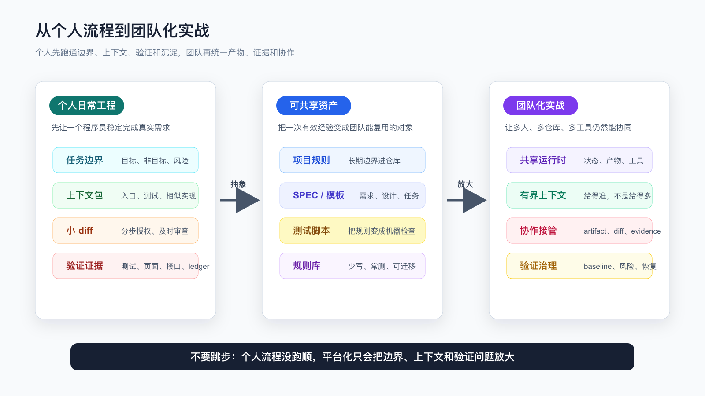

# 写在专栏结束时：把 AI Coding 留在日常工程里

如果一路读到这里，最重要的结论其实很简单：

AI Coding 不应该停在“我会用某个工具写代码”。

它应该变成你日常开发里的一套工程习惯。

这套习惯不依赖某个固定工具，也不靠一段神奇 prompt。它依赖的是更基础的东西：

```text
任务开始前，先定义边界。
动手之前，先让 Agent 读对上下文。
复杂需求，先把规格写清楚。
执行过程中，用小 diff 控制风险。
完成之前，用测试、页面、接口、日志和 diff 留证据。
任务结束后，把可复用经验沉淀下来。
```

工具会变，模型会变，入口也会变。

但只要你还在真实代码库里交付需求，这几件事不会过时。

这也是整套内容真正想留下来的东西。

不是某个工具菜单。

不是一串命令。

不是一份可以复制粘贴的 prompt。

而是一套程序员能长期复用的 AI Coding 操作方式。



## 不要把结束理解成学完

AI Coding 这件事，很容易让人产生一种错觉：

```text
我把工具都试过了。
我看懂了 Agent、Skill、MCP、OpenSpec。
我知道怎么让 AI 改代码。
所以我学完了。
```

这还不够。

真正的变化发生在下一次真实需求里。

比如你接到一个很普通的任务：

```text
列表页新增一个筛选条件。
接口多返回一个状态字段。
CLI 多支持一个参数。
审批流加一个异常分支。
老模块补一条失败路径测试。
```

以前你可能会直接问 AI：

```text
帮我实现这个需求。
```

看起来很快。

但在真实项目里，这句话通常缺了太多东西：

```text
它不知道现有入口在哪里。
它不知道哪些行为不能改。
它不知道测试命令是什么。
它不知道这次改动的风险边界。
它不知道完成后要拿什么证明。
```

所以读完整套内容之后，不是要把提示词写得更长，而是要把这句话换成一套更稳的动作：

```text
先找入口。
先看相似实现。
先确认任务边界。
先列验证动作。
先让 AI 解释准备怎么改。
再授权一个小 diff。
```

这才是从“会用 AI”切到“能用 AI 交付”的分界线。

## 你要留下四类资产

读完以后，不建议马上去搭一个很重的平台。

也不建议把每篇文章都整理成复杂模板。

先留下四类最小资产。

第一类，是项目入口卡。

它不需要长，能帮 Agent 和你自己快速进入项目就够了：

```text
项目做什么。
主要入口在哪。
核心测试命令是什么。
本地怎么启动。
哪些目录不能随便改。
哪些接口、状态、权限、金额、数据迁移属于高风险。
```

这些内容适合放在项目规则文件、README 或团队已有开发文档里。

不要每次都在聊天窗口重新解释。

第二类，是任务上下文包。

它服务单次需求，不必长期保存所有细节。

最小结构可以是：

```text
目标：这次要改变什么用户可见行为。
非目标：这次明确不改什么。
相关文件：入口、调用方、测试、文档。
约束：兼容性、权限、数据、副作用。
验证：完成后要跑什么、看什么。
未知：哪些信息需要先确认，不能让 AI 猜。
```

这份上下文包的价值，不是写得漂亮。

它的价值是防止 AI 一边改一边补脑。

第三类，是验证记录。

这类记录可以很短，但必须具体：

```text
命令是什么。
结果是什么。
失败是否是改前已有。
页面或接口看到了什么。
哪些路径还没覆盖。
剩余风险是什么。
```

真实交付里，最危险的不是 AI 写错代码。

最危险的是你不知道它错在哪里，还被一段完成总结说服了。

验证记录就是反制这个问题的。

第四类，是个人规则库。

不要把所有经验都写进去。

只写会反复发生、反复提醒、反复影响结果的东西。

例如：

```text
接口合同改动必须看调用方。
CLI 行为改动必须覆盖 stdout、stderr、exit code。
前端交互改动必须有浏览器验证。
测试失败不能直接听 AI 说无关，要先看 baseline。
多 Agent 只拆独立任务，不拆强依赖实现。
```

这些规则以后可以继续升级成 Skill、脚本、测试或检查项。

但一开始，不要追求完整。

能在下一次任务里生效，比写成一套宏大的文档更重要。

## 把一套文章压成一条日常流程

这套内容看起来覆盖了很多主题：

```text
工具工作台。
上下文工程。
代码地图。
项目规则。
任务上下文包。
SDD 和 OpenSpec。
计划先行。
小步开发。
TDD。
系统化调试。
验证闭环。
Skill。
MCP。
多 Agent。
个人规则库。
```

但落到每天的开发，不需要每次都跑满。

你可以把它压缩成一条普通流程：

```text
判断任务风险。
准备上下文。
让 AI 侦察代码。
要求 AI 给计划。
按小步授权修改。
看 diff。
跑验证。
记录证据和剩余风险。
沉淀一条可复用经验。
```

低风险任务可以轻一点。

例如改一段 README、修一个 typo、补一条简单文案，只需要明确目标、看 diff、检查链接或命令。

中风险任务要多做几步。

例如改 CLI 行为、补接口字段、调整表单校验，就要看调用方、补测试、跑目标命令、同步文档。

高风险任务必须拉满。

例如权限、金额、库存、状态机、数据迁移、兼容接口、批量任务、生产副作用，就不能只靠聊天窗口推进。至少要有规格、设计边界、任务拆分、失败用例、回滚考虑和完成证据。

很多人用 AI Coding 不稳定，不是因为少了某个工具。

而是低风险任务和高风险任务用了同一套粗糙流程。

轻任务被搞复杂，重任务被处理得太轻。

程序员要做的判断，就在这里。

## 最容易带走的不是 prompt，而是停止条件

很多人会问：

有没有一段最终版 prompt？

没有。

至少不应该把它当成核心资产。

不同项目、不同任务、不同风险级别，prompt 一定要变。

真正更值得带走的是停止条件。

比如任务开始前的停止条件：

```text
AI 没说清相关文件，不实现。
AI 没说清验证方式，不实现。
AI 把非目标也纳入计划，不实现。
任务里有业务歧义，先确认，不让 AI 猜。
```

执行中的停止条件：

```text
diff 变大，先停。
新增依赖，先问为什么。
越过授权目录，先停。
测试失败原因不清楚，先复现和分类。
实现开始改公共抽象，先回到设计。
```

完成前的停止条件：

```text
没有新鲜验证输出，不说完成。
只跑了单测但改了 UI，不说完成。
只看页面但改了接口合同，不说完成。
没有说明剩余风险，不说全部完成。
AI 只给总结，没有证据，不接受。
```

这些停止条件比 prompt 更硬。

prompt 是给 AI 的。

停止条件是给人的。

AI Coding 能不能稳定，很大程度取决于程序员能不能在这些节点停下来。

## 以后工具升级，按这个顺序

工具会继续变多。

你还会看到新的 Agent、新的 IDE 插件、新的模型、新的 MCP server、新的 Skill 形态、新的自动化平台。

不要一看到新东西就搬进工作流。

更稳的顺序是：

```text
先把任务上下文写清楚。
再把项目规则放到仓库里。
再把测试和验证记录做起来。
再用 SDD / OpenSpec 管复杂需求。
再用 Skill 固化高频流程。
再用只读工具降低上下文成本。
再考虑 MCP 接入外部资源。
最后才考虑多 Agent 和自动化。
```

这个顺序不是为了保守。

它是为了让每一步升级都能解决真实问题。

如果任务上下文还不清楚，MCP 接更多资料只会把噪音变多。

如果验证习惯还没有建立，多 Agent 只会并行产生更多难审的输出。

如果项目规则还在聊天窗口里来回复制，Skill 也只是换个地方存 prompt。

如果测试和手动验证不稳定，OpenSpec 也只能停留在文档层面。

工具升级应该服务已有流程，而不是替代工程判断。

## 适合从哪里开始

不要从空项目开始。

空项目太干净，反而看不出 AI Coding 的真实问题。

选一个你熟悉但不完美的项目。

最好有这些特征：

```text
有真实业务逻辑。
有一些测试，但覆盖不完整。
有 README，但命令可能过期。
有旧模块，也有近期改动。
有一两个你一直想修的小问题。
```

然后选一个中等大小的任务。

不要太小，小到看不出流程价值。

也不要太大，大到一开始就要跨很多模块。

合适的任务像这样：

```text
给一个 CLI 命令补错误提示。
给列表页新增一个状态筛选。
给接口补一个向后兼容字段。
把一段重复校验抽成内部函数。
给老模块补一条失败路径测试。
修一个能稳定复现的小 bug。
```

用下面这份最小任务卡开始：

```text
目标：
这次要改变的用户可见行为是什么？

非目标：
哪些文件、行为、抽象这次不碰？

上下文：
让 AI 先读哪些入口、测试、文档和相似实现？

计划：
AI 准备改哪些文件，为什么？

授权：
第一步只允许改什么？

验证：
改完必须跑什么命令、看什么页面或接口？

沉淀：
这次如果踩坑，哪一条经验值得写回规则？
```

这张卡足够短。

短到你愿意在真实任务里用。

也足够硬。

硬到 AI 很难完全脱离工程事实乱改。

## 团队里也可以这么用

这套方法不是只能个人使用。

团队里更适合从轻量约定开始，而不是直接搭平台。

比如先约定三件事：

```text
涉及外部行为变化的 AI 代码，PR 里必须写验证证据。
AI 参与的复杂需求，必须先有任务上下文或规格。
项目规则只能写长期有效内容，临时结论不能塞进规则文件。
```

再约定三类文件：

```text
项目规则文件：长期有效的工程约束。
任务上下文：单次需求的目标、范围和验证。
验证记录：本次改动跑过什么、没覆盖什么。
```

这样做不会强迫所有人使用同一个 AI 工具。

有人用 Codex，有人用 Claude Code，有人用 Cursor，有人用 Copilot，都可以。

团队真正需要统一的，不是工具界面。

而是证据和边界：

```text
为什么这么改。
改了哪些范围。
怎么证明没破坏关键行为。
还有哪些风险没覆盖。
```

这几件事统一了，工具可以各用各的。

## 如果你要把这套方法带进团队

个人 AI Coding 稳定以后，下一步自然会遇到团队问题。

个人可以靠经验记住很多边界。

团队不行。

一旦多人、多仓库、多应用、多工具一起使用 AI Coding，问题会变成另一组：

```text
不同项目是不是在重复建设 Agent、Prompt、Skill 和规则？
需求、上下文、验证记录有没有统一承接方式？
AI 生成的产物怎么被团队 review、接管和恢复？
测试失败、baseline、剩余风险有没有团队共识？
个人沉淀的规则怎样变成团队可复用资产？
```

这些问题已经超出了个人工作流。

它们需要团队层面的共享运行时、SPEC 系统、需求拆分、有界上下文、交付协作、验证治理和资产沉淀。

如果你正在把 AI Coding 从个人实践带到团队，可以继续看《AI Coding 团队化实战》。

那套内容讨论的不是“团队成员怎么写更好的 prompt”，而是：

```text
怎样把个人 AI Coding 经验，
变成团队可复制、可审查、可恢复、可沉淀的工程能力。
```

个人专栏解决的是：

```text
一个程序员怎样稳定用 AI 完成真实代码库里的需求。
```

团队化实战继续解决的是：

```text
一支团队怎样让这些经验不只停留在少数高手身上。
```

这两个问题前后衔接，但不要跳步。

如果个人任务边界、上下文、验证和规则沉淀还没跑顺，直接做团队平台，很容易把个人阶段的问题放大。

更合适的顺序是：

```text
先让个人流程稳定。
再把高频规则抽出来。
再统一团队产物和证据。
再建设共享运行时和工具适配。
最后再考虑多 Agent、自动化和平台化治理。
```

这样团队化不是新起一套口号，而是把已经有效的工程习惯放大。

## 几个不要做的事

第一，不要把所有规则塞进一个超长 prompt。

规则一长，冲突、过期和被忽略都会变多。

长期规则放项目。

单次规则放任务。

流程规则放 Skill。

可执行规则放测试和脚本。

第二，不要为了显得专业而每次都上 OpenSpec。

小改动不需要完整规格。

但一旦涉及状态、权限、金额、兼容性、跨模块调用，就不要只靠一句话让 AI 猜。

第三，不要把 AI 的完成总结当成交付证据。

总结可以读，但不能替代命令输出、diff、截图、接口响应、测试结果和 review。

第四，不要把个人规则库写成垃圾桶。

规则越多，越没人看。

只留下能改变下一次行为的规则。

第五，不要把多 Agent 当成默认答案。

多 Agent 适合并行侦察、独立 review、独立实现小任务。

它不适合边界不清、强依赖、需要大量共享状态的任务。

## 常见问题

**我是不是要把前面的文章都重新整理成模板？**

不需要。

先抽一套能跑起来的最小流程。真实用三次以后，再决定哪些东西值得模板化。没被真实任务验证过的模板，很容易变成摆设。

**我所在团队暂时不能使用外部 AI 工具怎么办？**

仍然可以迁移工程方法。任务上下文、规格、测试、验证记录、规则沉淀，本来就是程序员应该做的事。AI 只是放大这些方法的收益，不是这些方法存在的前提。

**每次都写验证记录会不会太重？**

取决于任务风险。文案改动可以只记录 diff 和链接；接口、CLI、状态机、权限、数据类改动就应该记录命令和结果。验证记录不要求长，只要求可复查。

**规则库越来越多怎么办？**

删。

删掉过期规则、临时规则、重复规则、无法改变行为的规则。能用测试表达的，就不要长期写自然语言提醒。能用脚本检查的，就不要靠人记。

**工具一直变，前面学的会不会失效？**

具体入口会变，工程控制点不会变。读文件、选上下文、限制 diff、写测试、跑验证、审查风险、沉淀规则，这些动作仍然存在。工具升级以后，先看它能不能更好地服务这些控制点。

## 最后回到一句话

AI Coding 的长期价值，不是让你少写几行代码。

而是让你把开发过程里那些原本靠经验、靠记忆、靠临场判断的东西，逐步变成可复查、可复用、可迁移的工程资产。

一次任务开始前，多一份上下文。

一次改动执行中，多一次 diff 边界。

一次完成之前，多一条验证证据。

一次交付之后，多一条可复用规则。

这些东西看起来都不大。

但它们会累积。

累积到某一天，你会发现自己使用 AI 的方式已经变了：

```text
不再急着让 AI 写代码。
先让它理解项目。
不再接受漂亮总结。
先看证据。
不再把错误归因给模型不稳定。
先检查边界、上下文和验证。
不再追一个万能工具。
开始维护自己的工程系统。
```

这时，AI Coding 才真正进入日常工程。

它不再是一段演示。

也不再是一种新鲜感。

它变成你处理真实需求、真实代码、真实风险的一部分。

这比学会任何一个工具都重要。

---

[课程首页](../../../README.md) · [完整目录](../README.md) · [← 从个人提效到个人工程系统](39-%E4%BB%8E%E4%B8%AA%E4%BA%BA%E6%8F%90%E6%95%88%E5%88%B0%E4%B8%AA%E4%BA%BA%E5%B7%A5%E7%A8%8B%E7%B3%BB%E7%BB%9F.md)

动手实践：[业务实践入口](../../../personal-productivity-app/README.md)
